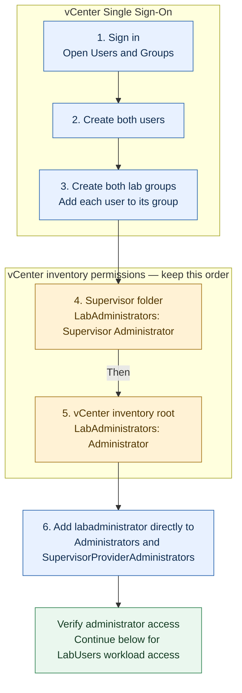
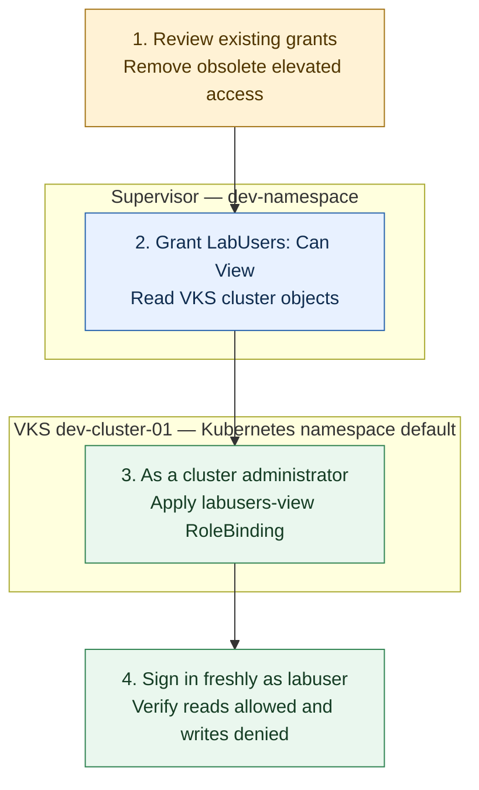
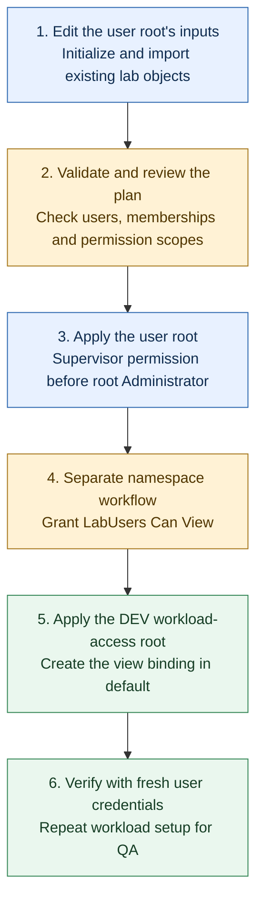

<!--
authors: "Julius M. Nicolescu, Qwen3-Coder-30B-A3B-Instruct-4bit, Qwen3.8-27B-8bit"
date: 2026-11-18
description: Create vCenter SSO users and groups, explain each Terraform configuration, and configure administrator and read-only VKS access.
keywords: VCF 9.1.1, vCenter, Supervisor, VKS, SSO, users, groups, permissions, Terraform, Kubernetes RBAC
lang: en
-->

# Create vCenter users and assign Supervisor roles

Create two local vCenter Single Sign-On (SSO) accounts for VMware Cloud Foundation **9.1.1**: a lab administrator and a regular user. Use the manual vSphere Client procedure, the Bash examples, or Terraform to configure the identities and administrator permissions.

| User | Purpose | Access configured here |
| --- | --- | --- |
| `labadministrator@vsphere.local` | Administer the lab's vCenter and Supervisor. | Membership in three administrator groups; `LabAdministrators` receives Administrator at the inventory root and Supervisor Administrator on the Supervisor folder. |
| `labuser@vsphere.local` | Inspect applications without changing them. | Membership in `LabUsers`. The separate DEV/QA Terraform roots grant Kubernetes `view` in `default`; Can View on the hosting vSphere namespaces must also be configured. |

The Terraform workflow has **three independent root configurations**: user creation, DEV workload access, and QA workload access. Each has its own inputs and state. The [Terraform deployment](#terraform-deployment) tables explain their files, resources and effects.

**Worked example:** DEV is used for workload-access commands. Repeat the procedure for QA with its own namespace, cluster context and Terraform state.

Choose **one management method for each resource**. Import existing objects before managing them with Terraform. These examples configure access to existing infrastructure; they do not create Supervisor, vSphere namespaces or VKS clusters.

## Contents

- [Reference Environment](#reference-environment)
- [Automated alternatives](#automated-alternatives)
- [Prerequisites](#prerequisites)
- [Understand users, groups, roles and permissions](#understand-users-groups-roles-and-permissions)
- [Prepare the configuration](#prepare-the-configuration)
- [Create users and permissions manually](#create-users-and-permissions-manually)
- [Configure read-only VKS access](#configure-read-only-vks-access)
- [Create users with Bash](#create-users-with-bash)
- [Terraform deployment](#terraform-deployment)
- [Verify the deployment](#verify-the-deployment)
- [Project files](#project-files)
- [Optional cleanup](#optional-cleanup)
- [Troubleshooting](#troubleshooting)
- [Output](#output)
- [References](#references)

## Reference Environment

These are the names in the supplied configuration. Replace them with your own values before following the procedures. The target platform is **VCF 9.1.1**; the names below describe the lab configuration.

| Setting | DEV / shared platform | QA |
| --- | --- | --- |
| vCenter Server | `mgmt-vcsa.platformlab.vcf` | Same vCenter |
| SSO domain | `vsphere.local` | Same domain |
| Supervisor inventory folder | `/platformlab-dc01/vm/Namespaces/lab-supervisor` | Same Supervisor |
| Hosting vSphere namespace | `dev-namespace` | `qa-namespace` |
| VKS workload cluster | `dev-cluster-01` | `qa-cluster-02` |
| Administrator workload context | `dev-cluster-01:dev-cluster-01` | `qa-cluster-02:qa-cluster-02` |
| Kubernetes access target | `default/labusers-view` | `default/labusers-view` in QA |

The users and SSO groups are created **once per vCenter SSO domain**. Namespace permissions and workload RoleBindings are configured separately for each environment. A context name identifies a connection; verify which user's credentials it uses.

## Automated alternatives

The supplied scripts and Terraform configuration are examples. Bash and the user-creation Terraform root are alternative identity-management methods. The DEV/QA access roots are additional workload configuration; deletion is optional cleanup.

Paths are relative to this README. `.` means the directory containing this README.

| Script / configuration | Scope | What it does | Run from this directory |
| --- | --- | --- | --- |
| [01-create-vcenter-users.sh](01-create-vcenter-users.sh) | `.` | Create missing users/groups, add memberships and assign the two inventory permissions. | `bash ./01-create-vcenter-users.sh` |
| [02-delete-vcenter-users.sh](02-delete-vcenter-users.sh) | `.` | Remove lab permissions, the legacy custom role, both users and both lab groups. | `bash ./02-delete-vcenter-users.sh` |
| [User-creation Terraform](terraform-create-vcenter-users/main.tf) | `terraform-create-vcenter-users` | Manage two SSO users, two lab groups, shared-group memberships and two inventory permissions. | Follow [Run the user-creation root](#run-the-user-creation-root). |
| [DEV access Terraform](terraform-configure-vks-access/dev-cluster-01/main.tf) | `terraform-configure-vks-access/dev-cluster-01` | Grant `LabUsers` Kubernetes `view` in DEV's existing `default` namespace. | Follow [Configure read-only VKS access with Terraform](#configure-read-only-vks-access-with-terraform). |
| [QA access Terraform](terraform-configure-vks-access/qa-cluster-02/main.tf) | `terraform-configure-vks-access/qa-cluster-02` | Grant the same namespace-scoped read access inside QA. | Follow [Configure read-only VKS access with Terraform](#configure-read-only-vks-access-with-terraform). |

## Prerequisites

| Requirement | Details |
| --- | --- |
| Platform | VCF 9.1.1 vCenter and an enabled Supervisor with its inventory folder. |
| Authentication | An SSO administrator account authorized to manage users/groups and inventory permissions, including Supervisor-folder permissions. Root Administrator alone does not establish that all Supervisor permission changes are allowed. |
| Existing roles/groups | Administrator, Supervisor Administrator, and the existing `Administrators` and `SupervisorProviderAdministrators` groups. Verify the Provider group's existing permission. |
| Connectivity | HTTPS connectivity and name resolution to vCenter. Workload-access Terraform also needs connectivity to the selected VKS Kubernetes API. |
| Manual method | Access to vSphere Client. No workstation CLI is required. |
| Bash method | Bash 3.2+, govc and awk on macOS/Linux; writable govc session cache. VCF CLI and govc are different utilities. |
| Terraform method | Terraform >= 1.10.0, with `vmware/vsphere = 2.17.1` and `magodo/restful = 0.25.2`; registry access during initialization or a configured provider mirror. No govc, local-exec, Python or shell helper is used. |
| Manual workload access | kubectl and valid administrator workload contexts; existing vSphere namespaces, VKS clusters and Kubernetes namespaces. See the [CLI installation guide](../41-install-vcf-cli-kubectl/Readme.md) and [context guide](../42-create-vks-context/Readme.md). |
| Workload-access Terraform | Terraform >= 1.10.0, Kubernetes provider `2.38.0`, existing VKS clusters and target Kubernetes namespaces, and valid administrator kubeconfig contexts. Configure Can View for `LabUsers` on the hosting vSphere namespaces. |
| Local files | Edit access to the selected configuration and write access for Terraform's working data and state. Protect files containing credentials and state. |
| Existing objects | Before Terraform apply, import any existing lab users, lab groups and matching permission records. Shared administrator groups are imported by the configuration itself. |

## Understand users, groups, roles and permissions

### Identity, membership and access

A **user** authenticates, a **group** contains identities, a **role** defines privileges, and a **permission** assigns a role to a user or group on a particular object. Group membership and permission assignment are separate operations. Broadcom describes this model in [How Permissions Work in Supervisor][supervisor-permissions].

| Term | Meaning | Example in this project |
| --- | --- | --- |
| SSO domain | Identity source containing the local users and groups. | `vsphere.local` |
| User | An identity that can authenticate. | `labadministrator@vsphere.local` |
| Group | A collection of users or other groups. | `LabAdministrators` contains `labadministrator`. |
| Privilege | Authorization to perform a particular operation. | `Authorization.ModifyPermissions` allows permission changes at the permitted scope. |
| Role | A named collection of privileges. | Supervisor Administrator |
| Permission | Principal + role + target object + propagation setting. | `LabAdministrators` + Supervisor Administrator + `lab-supervisor` folder + propagation enabled |

**`Administrators` is an SSO group; `Administrator` is an inventory role.** They are different objects. Likewise, `SupervisorProviderAdministrators` is the plural group name, while `SupervisorProviderAdministrator` is the singular internal role name. Adding someone to a group does not create a missing permission for that group.

### Users and their purpose

| SSO user | Direct group memberships | What the account is for | What still needs separate configuration |
| --- | --- | --- | --- |
| `labuser` | `LabUsers` | Read ordinary application resources, such as pods, Deployments and Services, in the selected VKS Kubernetes namespace. | Assign `LabUsers` Can View on the hosting vSphere namespace and apply the workload `view` RoleBinding. Creating the account alone grants neither. |
| `labadministrator` | `LabAdministrators`, `Administrators`, `SupervisorProviderAdministrators` | Manage vCenter inventory, Supervisor administration and SSO identities through the assigned group permissions. | Verify the Provider group's existing permission. Configure namespace and workload access for the operations the account will perform. |

Usernames above belong to `vsphere.local` in the supplied lab. Use the full `user@domain` name when signing in. These are SSO identities, not appliance operating-system accounts.

### Groups and direct memberships

| SSO group | Member added here | What the group does | How Terraform manages it |
| --- | --- | --- | --- |
| `LabUsers` | `labuser` | Collect regular users for separate Can View namespace grants and Kubernetes `view` bindings. The user-creation root assigns this group no inventory or namespace role. | Creates the group, or manages it after import. Declared membership is authoritative; extra members can be removed. |
| `LabAdministrators` | `labadministrator` | Receive the two explicit inventory permissions: Administrator at `/` and Supervisor Administrator on the Supervisor folder. | Creates the group, or manages it after import. Declared membership is authoritative. |
| `Administrators` | `labadministrator` | Provide membership in the existing SSO administration group. This is separate from the inventory role named Administrator. | Imports the existing group, retains discovered users, nested groups and description, then adds the lab administrator. Destruction is blocked. |
| `SupervisorProviderAdministrators` | `labadministrator` | Provide Provider access through a permission that must already exist on the intended Supervisor. | Imports and updates the existing group as above. It does not create the group's Provider permission. |

The lab administrator is added **directly** to all three administrator groups. `LabAdministrators` is not nested inside the shared groups.

### Intended access for each user

The intended result is **read-only application access for `labuser`** and **broad lab administration for `labadministrator`**. The table assumes that Can View and the workload `view` binding have been applied and no other grants elevate `labuser`.

| Operation | `labuser` / `LabUsers` | `labadministrator` |
| --- | --- | --- |
| Authenticate through Supervisor | Can View on DEV/QA provides the namespace access used by the SSO workflow. | Uses the existing administrator permissions; verify effective namespace access. |
| Read VKS cluster objects on Supervisor | Yes, within the assigned DEV/QA namespaces. | Through its effective administrative/namespace access. |
| Create, resize, upgrade or delete VKS clusters | No. Can View does not grant these lifecycle operations. | Intended provisioning account; requires effective namespace write access. An inherited Supervisor role alone is not proof of workload authorization. |
| Read application pods, deployments and services | Yes, in Kubernetes `default` after the supplied `view` binding is applied to that VKS cluster. | Workload operations depend on its effective Kubernetes permissions; verify in each cluster. |
| Create, modify or delete applications | No with the supplied read-only binding. | Allowed where its workload-cluster permissions grant the operation. |
| Read Secrets, manage RBAC, or list cluster-scoped nodes | Not granted by the supplied namespace-scoped `view` binding. | Depends on workload-cluster RBAC; do not infer it solely from vCenter Administrator. |
| Create a self-service vSphere namespace | No; `LabUsers` is excluded from template permissions. | Through its `LabAdministrators` template grant when Namespace Service is configured. |
| Manage vCenter inventory, Supervisor configuration and SSO users/groups | No. | Broad access through root Administrator, Supervisor Administrator and direct SSO `Administrators` membership. Provider duties additionally rely on the existing Provider-group permission. |

This table describes the intended configuration, assuming no additional direct, inherited or group grants. The supplied workload binding covers `default` only; change its namespace or add separate bindings for other application namespaces. It does not grant cluster-wide read access.

### Roles and their scope

vSphere Client and Terraform role lookups use display labels. The Bash scripts use the internal govc names shown below.

| Display label / role | Internal govc name | Scope and purpose | Used here? |
| --- | --- | --- | --- |
| Administrator | `Admin` | Manage vCenter inventory at the assigned scope; this project assigns it at the root with propagation. | Explicit permission for `LabAdministrators`. |
| Supervisor Administrator | `SupervisorAdministrator` | Manage the Supervisor, its configuration, services and permissions. Assign on the Supervisor folder. | Explicit permission for `LabAdministrators`. |
| Supervisor Provider Administrator | `SupervisorProviderAdministrator` | Provider administration of Supervisor resources; inspect the installed role for its exact privileges. | Through existing `SupervisorProviderAdministrators` membership and permission. |
| Supervisor Operations Administrator | `SupervisorOperationsAdministrator` | Supervisor operations and observability; inspect the installed role for its exact privileges. | No assignment in this project. |
| Namespaces Owner | `NamespacesOwner` | VKS lifecycle access and automatic workload-cluster `cluster-admin`, plus namespace ownership capabilities. | Configured separately. |
| Namespaces Edit | `NamespacesEdit` | Create, update and delete VKS clusters in the vSphere namespace; automatic `cluster-admin` inside those clusters. | Configured separately. |
| Namespaces View | `NamespacesView` | Read cluster objects on Supervisor; no automatic RBAC access inside VKS clusters. | Configured separately. |

The VCF 9.1 [permission guide][supervisor-permissions] documents Supervisor Administrator and namespace roles. Review installed roles under **Administration → Access Control → Roles**. The Provider and Operations privilege sets have not been inspected on a live vCenter for this update.

### Permissions configured by this project

| Principal | Role | Target object | Propagate to children | Ownership |
| --- | --- | --- | --- | --- |
| `LabAdministrators@vsphere.local` | Supervisor Administrator | `/platformlab-dc01/vm/Namespaces/lab-supervisor` | Yes | Created first by Bash or Terraform; configure first in the manual procedure. |
| `LabAdministrators@vsphere.local` | Administrator | vCenter inventory root `/` | Yes | Created after the Supervisor permission. |
| Existing `SupervisorProviderAdministrators` group | Supervisor Provider Administrator | Intended Supervisor folder | Verify the existing setting. | Prerequisite; only group membership is changed here. |
| `LabUsers@vsphere.local` | Namespaces View, configured by the namespace project | `dev-namespace` and `qa-namespace` | Namespace-scoped | Separate namespace configuration; users-creation code does not make this assignment. |

The root entry is an **inventory permission on the vCenter object**, not an entry under **Administration → Global Permissions**. No custom role is created, and neither account receives a new direct user permission from the automation.

Propagation lets child objects inherit a permission. An explicit permission on a child can change the effective access for that principal. A second role assignment for the same principal on the same object updates its permission; it does not create a second independent role entry. This project uses different objects for the two `LabAdministrators` assignments and a different group for Provider access.

### Supervisor administration versus namespace workload access

There are two Kubernetes access scopes:

| Scope | What the user manages | Example |
| --- | --- | --- |
| **Supervisor / vSphere namespace** | The VKS cluster object and its lifecycle: create, resize, update and delete a cluster. | `dev-cluster-01` is a Cluster API object in `dev-namespace`. |
| **Inside a VKS workload cluster** | Applications and Kubernetes resources in an already provisioned cluster. | Read pods or deploy an application in the workload cluster's `default` namespace. |

A vSphere namespace on Supervisor and a Kubernetes namespace inside a VKS cluster are different objects. A role binding inside the workload cluster does not itself grant permission to create or delete that cluster's object on Supervisor.

Supervisor Administrator is for Supervisor management. It is not the role to give a regular application user just to connect to an existing VKS cluster. Broadcom explains the distinction in [KB 436055][kb-supervisor] and [KB 445832][kb-inventory-rbac]. For delegated inventory visibility, the [Supervisor permission guide][supervisor-permissions] also describes Read-only access on the backing vSphere cluster; that is separate from Kubernetes workload access.

### Choose the namespace permission

Broadcom's [VKS namespace permissions guide][vks-namespace-permissions] and [KB 424897 — vSphere Namespace Permissions for VKS][kb-vks-permissions] describe these mappings for vCenter SSO users and groups:

| Permission on the vSphere namespace | Read VKS cluster objects on Supervisor | Create, update or delete VKS clusters | Access inside the existing VKS clusters |
| --- | --- | --- | --- |
| **Can View / Namespaces View** | Yes | No | No workload permissions are granted automatically. Add a Kubernetes role binding separately. |
| **Can Edit / Namespaces Edit** | Yes | Yes | Automatically grants Kubernetes `cluster-admin` in the VKS clusters hosted in that vSphere namespace. |
| **Owner / Namespaces Owner** | Yes | Yes | Same VKS access as Can Edit, plus namespace ownership capabilities. Namespace creation through self-service also requires the configured service/template. |

**To create a VKS cluster, Can Edit on its target vSphere namespace is sufficient for the namespace authorization requirement.** Owner also permits it, but is not required solely to create a cluster. The namespace still needs its compute, storage, VM classes, release availability and other provisioning prerequisites configured.

Can Edit also allows cluster deletion. Choosing Can Edit instead of Owner does **not** produce a user who can use a cluster but cannot delete it. Owner's additional namespace capabilities are distinct from deleting a VKS cluster within that namespace.

Assign namespace permissions in **Supervisor Management → Namespaces → select the namespace → Permissions → Add Permissions**. Select the SSO user or group and the required role. These are namespace permissions; do not substitute a root vCenter permission or membership in the SSO Administrators group.

## Prepare the configuration

The values below describe the supplied lab. Replace the connection, domain and target values with your environment. Keep the exact spelling and case of group names.

Each Bash script has independent settings. Terraform reads [terraform.tfvars](terraform-create-vcenter-users/terraform.tfvars); it does not read the Bash scripts.

| Bash setting | Terraform input | Supplied value / purpose |
| --- | --- | --- |
| `VCENTER` | `vcenter` | `mgmt-vcsa.platformlab.vcf` |
| `VC_USER` | `vcenter_user` | `administrator@vsphere.local` |
| `VC_PASS` | `vcenter_password` | Credential of the provisioning account. |
| `GOVC_INSECURE=true` | `insecure_tls = true` | Skip certificate verification for the lab. Use certificate verification when the workstation trusts the server certificate. |
| `SSO_DOMAIN` | `sso_domain` | `vsphere.local` |
| `LAB_USER` | `lab_user` | `labuser` |
| `LAB_USER_PASSWORD` | See password behavior below. | Initial regular-user password for Bash. |
| `LAB_USER_GROUP` | `lab_user_group` | `LabUsers` |
| `LAB_ADMIN` | `lab_admin` | `labadministrator` |
| `LAB_ADMIN_PASSWORD` | See password behavior below. | Initial administrator password for Bash. |
| `LAB_ADMIN_GROUP` | `lab_admin_group` | `LabAdministrators` |
| `LAB_ADMIN_ROLE` | `lab_admin_role` | Bash uses `Admin`; Terraform uses display label `Administrator`. |
| `LAB_ADMIN_SUPERVISOR_ROLES[0]` | `supervisor_role` | Bash uses `SupervisorAdministrator`; Terraform uses display label `Supervisor Administrator`. |
| `SSO_ADMIN_GROUP` | `sso_admin_group` | Existing `Administrators` group. |
| `SSO_PROVIDER_GROUP` | `sso_provider_group` | Existing `SupervisorProviderAdministrators` group. |
| `SUPERVISOR_FOLDER` | `supervisor_folder` | `/platformlab-dc01/vm/Namespaces/lab-supervisor` |

Script 01's `LAB_ADMIN_SUPERVISOR_ROLES[1]` identifies `SupervisorProviderAdministrator` in its messages. It does not assign that role; membership in `SSO_PROVIDER_GROUP` supplies access through the group's existing permission. Script 02 additionally defines `LAB_ADMIN_COMBINED_ROLE=LabSupervisorAdministrator` for cleanup of a legacy custom role. Current creation code does not create it.

**Terraform password behavior:** the current `main.tf` sets both new-user passwords from `var.vcenter_password`. The declared `lab_user_password` and `lab_admin_password` inputs are unused, and the supplied tfvars omits them, so interactive Terraform commands can still prompt for those required inputs. Supplying them does not change the resource passwords. Both resources ignore password changes after creation/import. Bash uses its separate password settings and preserves existing passwords.

## Create users and permissions manually

Use **vSphere Client** for the six steps below. Complete [Prerequisites](#prerequisites) and review the lab values in [Reference Environment](#reference-environment) first. Keep the provisioning administrator session open while assigning permissions.



The numbers match the procedure. Group membership establishes identity relationships; the two inventory permissions establish administrator access at their respective scopes.

### 1. Sign in and open Users and Groups

1. Open `https://<vcenter-fqdn>/ui` in a browser. The lab address is `https://mgmt-vcsa.platformlab.vcf/ui`.
2. Sign in as `administrator@vsphere.local`, or an account authorized for SSO management and Supervisor permission changes.
3. Go to **Menu → Administration → Single Sign On → Users and Groups**.
4. Open **Users** and select **vsphere.local** from the domain list. Use your actual local SSO domain if different.

**Check:** the local domain is selected and **Add** is available. Local SSO users are created in this domain. See [Add vCenter Single Sign-On Users][add-users] and [KB 422297][kb-ui-users].

### 2. Create the two users

Click **Add**, complete the fields below, then click **Add** to save. Repeat for the second user.

| Field | Regular user | Lab administrator |
| --- | --- | --- |
| User name | `labuser` | `labadministrator` |
| Password / Confirm password | Set the regular user's initial password. | Set the administrator's initial password. |
| First name / Last name | Enter the user's identity details. | Enter the administrator's identity details. |
| Email / Description | Complete as appropriate for your organization. | Complete as appropriate for your organization. |

Enter the user name without `@vsphere.local`. Passwords must satisfy the SSO password policy. If an account already exists, inspect it and reuse the intended identity.

**Check:** both accounts appear in **Users**. Their sign-in names are `labuser@vsphere.local` and `labadministrator@vsphere.local`. They are SSO identities; creating them alone grants no management privileges.

### 3. Create the lab groups and add their members

1. Open **Users and Groups → Groups → Create Group**; some builds label the action **Add**.
2. Enter the group name and a description.
3. Under **Add Members**, select **vsphere.local**, search for the user, and select the matching account.
4. Click **Done**, then repeat for the other group.

| Group to create | Direct member to add | Purpose |
| --- | --- | --- |
| `LabUsers` | `labuser@vsphere.local` | Regular users receiving the separate read-only grants below. |
| `LabAdministrators` | `labadministrator@vsphere.local` | Lab administrators receiving the next two inventory permissions. |

For an existing group, select it and click **Edit** to add a missing member while retaining unrelated members. See [Add a vCenter Single Sign-On Group][add-group] and [Add Members][add-members].

**Check:** reopen each group and confirm its direct member. Keep `labuser` out of the administrator groups for the read-only profile.

### 4. Assign Supervisor Administrator on the Supervisor folder

1. Go to **Menu → VMs and Templates**.
2. Expand **platformlab-dc01 → Namespaces → lab-supervisor**, substituting your datacenter and Supervisor names.
3. Select the **Supervisor folder**, open **Permissions**, and click **Add Permission**. The folder's right-click menu also provides **Add Permissions**.
4. Complete the assignment:

| Permission field | Value |
| --- | --- |
| Domain / identity source | `vsphere.local` |
| User / group | Group `LabAdministrators` |
| Role | **Supervisor Administrator** |
| Propagate to children | **Enabled** |

Save the permission. **Check:** the selected folder shows an explicit `LabAdministrators` entry with the correct role and propagation.

Assign this permission **before root Administrator**. The project's historical fresh-group test recorded a failure with root-first ordering, and both automated methods preserve Supervisor-first ordering. [KB 415200][kb-supervisor-admin] explains the operator's explicit Supervisor permissions and conflict checks.

### 5. Assign Administrator at the vCenter inventory root

1. In the inventory, select the top-level **vCenter Server object**.
2. Open **Permissions → Add Permission**.
3. Select domain **vsphere.local**, group **LabAdministrators**, role **Administrator**, and enable **Propagate to children**.
4. Save, then return to the Supervisor folder and confirm its explicit **Supervisor Administrator** entry remains.

**Check:** the group has Administrator at the inventory root and Supervisor Administrator on the Supervisor folder. These are permissions on two different objects. Use the vCenter object's Permissions tab for the root assignment.

### 6. Add the administrator to the existing shared groups

Return to **Administration → Single Sign On → Users and Groups → Groups**. For each group below, select **Edit**, choose **vsphere.local**, search for **labadministrator**, select the account, and click **Save**. Preserve existing users and nested groups.

| Existing group | Direct member to add | Check after saving |
| --- | --- | --- |
| `SupervisorProviderAdministrators` | `labadministrator@vsphere.local` | The existing group has Supervisor Provider Administrator on the intended Supervisor. |
| `Administrators` | `labadministrator@vsphere.local` | The account is a direct member of the SSO administration group. |

These groups must already exist. Adding membership relies on their existing permissions; it does not create a missing Provider permission. See [Add Members][add-members].

**Administrator setup is complete when** the membership and inventory checks in [Verify the deployment](#verify-the-deployment) pass in a fresh administrator session. For the regular user's read-only VKS access, continue with the following procedure after the hosting namespace and VKS cluster exist.

## Configure read-only VKS access

Run this procedure after creating `LabUsers` and the target VKS cluster. DEV is the worked example; use QA's namespace and workload context from [Reference Environment](#reference-environment) when repeating it.

For SSO access through Supervisor, the regular user needs **both** grants below. Can View permits reading the VKS cluster object on Supervisor; Kubernetes `view` permits reading ordinary application resources inside the chosen workload namespace. See [namespace permissions][vks-namespace-permissions], [Supervisor authentication][kb-supervisor-login] and [developer access][vks-developer-access].



Arrows show configuration order across two authorization scopes. The workload binding grants access in `default` only.

### 1. Review existing grants

For a fresh setup, confirm `labuser` belongs to `LabUsers` only among the groups described here. For an earlier deployment, inspect both environments before testing read-only access:

| Existing grant | Required action for the read-only profile |
| --- | --- |
| `LabUsers` has Owner or Can Edit on a vSphere namespace | Change it to **Can View** through the owning UI or Terraform configuration. |
| `LabUsers` is permitted by an active Namespace Service template | Remove its template grant; the lab template is intended for `LabAdministrators`. |
| Direct permissions, other group memberships or Kubernetes bindings grant administrator access | Review the grant and its owner, then revoke the obsolete elevated access. Verify synchronized administrator bindings after changing Owner/Edit. |

Permissions are additive: a `view` binding cannot cancel another grant. The current [namespace guide](../43-create-vsphere-namespace/Readme.md#update-existing-namespace-permissions) describes updating existing grants. For Terraform-owned namespaces, update and apply their existing root/state. Creation scripts do not reconcile an existing namespace.

### 2. Grant Can View on the hosting vSphere namespace

1. As the provisioning administrator, go to **Menu → Supervisor Management → Namespaces → dev-namespace**.
2. Open **Permissions → Add Permissions**. Some Client versions expose this through the **Summary → Permissions** card under **Workload Management**.
3. Select identity source **vsphere.local** and group **LabUsers**.
4. Choose **Can View** and save. If the group already has Owner or Can Edit, edit that existing grant.

**Check:** the namespace shows `LabUsers` with Can View / Namespaces View. Repeat on `qa-namespace` for QA access. This namespace operation is separate from the user-creation scripts and user-creation Terraform root.

### 3. Grant Kubernetes view inside the workload cluster

Use a terminal with **administrator credentials for the existing DEV workload cluster**, starting in the directory containing this README. Review [labusers-view.yaml](labusers-view.yaml) before applying it:

| Manifest field | Supplied value | Meaning |
| --- | --- | --- |
| `metadata.name` | `labusers-view` | RoleBinding name. |
| `metadata.namespace` | `default` | Kubernetes namespace receiving read access. Change it for a different existing application namespace. |
| `subjects[].kind` / `name` | `Group` / `sso:LabUsers@vsphere.local` | Exact SSO group subject, including the `sso:` prefix. |
| `roleRef.kind` / `name` | `ClusterRole` / `view` | Bind the built-in role within the RoleBinding's namespace. |

```bash
# Select the DEV workload context authenticated as an administrator.
kubectl config use-context dev-cluster-01:dev-cluster-01

# Apply the reviewed read-only binding in its declared namespace.
kubectl apply -f labusers-view.yaml

# Inspect the saved binding, role reference and SSO group subject.
kubectl get rolebinding labusers-view -n default -o yaml
```

**Check:** the binding references ClusterRole `view` and group `sso:LabUsers@vsphere.local` in `default`. It permits ordinary workload reads and excludes Secrets and RBAC objects. It grants no cluster-wide access. See [Kubernetes RBAC][kubernetes-rbac].

Use the [workload-access Terraform root](#configure-read-only-vks-access-with-terraform) as an alternative to applying this manifest. Choose one owner for the binding; import it before switching to Terraform. For QA, repeat these same commands with the QA administrator context.

### 4. Test with the regular user's credentials

Create or refresh connections using **labuser@vsphere.local**, following the [context guide](../42-create-vks-context/Readme.md). Use a separate terminal and kubeconfig from the provisioning administrator so the checks use the restricted user's credentials. A context name alone does not establish which user is authenticated.

Run the [restricted-user authorization checks](#restricted-user-authorization-checks) below. Authentication must succeed, workload reads must be allowed, and cluster lifecycle and workload write checks must be denied. Reauthenticate after permission changes before testing.

## Create users with Bash

Use this as an alternative to the manual identity and administrator-permission procedure. Start beside this README on macOS or Linux. Edit [01-create-vcenter-users.sh](01-create-vcenter-users.sh) with your connection, credentials, SSO names and Supervisor folder, then run:

```bash
# Create missing lab identities and assign the administrator permissions.
bash ./01-create-vcenter-users.sh
```

Follow [Verify the deployment](#verify-the-deployment), then [Configure read-only VKS access](#configure-read-only-vks-access) if the regular user needs application access. The Bash script handles identities and administrator permissions; the namespace and workload grants are separate.

On Windows, use the browser-based manual procedure or the native Terraform workflow below. The project supplies no PowerShell or CMD identity-management script. Bash requires a suitably configured Linux environment with govc.

## Terraform deployment

### Configurations at a glance

A **Terraform root** is a directory run independently with `terraform init`, `plan` and `apply`. Terraform loads the `.tf` files together; do not run `main.tf`, `auth.tf` or `providers.tf` individually.

| Root configuration | Connects to | What it creates or changes | What it leaves to another workflow |
| --- | --- | --- | --- |
| [terraform-create-vcenter-users](terraform-create-vcenter-users/main.tf) | vCenter, using an SSO administrator | Creates `labuser`, `labadministrator`, `LabUsers` and `LabAdministrators`; assigns the two administrator inventory permissions; imports the two shared groups and adds `labadministrator`. | vSphere namespace grants, the Provider group's existing permission, VKS cluster creation and workload RBAC. |
| [DEV workload access](terraform-configure-vks-access/dev-cluster-01/main.tf) | `dev-cluster-01`, using its configured administrator kubeconfig context | Creates one RoleBinding, `default/labusers-view`, granting `sso:LabUsers@vsphere.local` the built-in Kubernetes `view` role in `default`. | SSO identities, Can View on `dev-namespace`, and all cluster/namespace provisioning. |
| [QA workload access](terraform-configure-vks-access/qa-cluster-02/main.tf) | `qa-cluster-02`, using its configured administrator kubeconfig context | Creates the same RoleBinding in QA's own `default` namespace. | SSO identities, Can View on `qa-namespace`, and all cluster/namespace provisioning. |

**Applying only the user-creation root does not complete `labuser` access.** Assign Can View on each hosting vSphere namespace, then apply the matching workload-access root after that VKS cluster exists.



Arrows show the operator's setup sequence. The roots have independent state and do not invoke one another. Existing Supervisor namespaces and VKS clusters are prerequisites for the workload-access steps.

### Providers and differences

The root [terraform-create-vcenter-users](terraform-create-vcenter-users/main.tf) uses native vSphere resources for SSO identities and groups, and `magodo/restful` for individual vCenter inventory permissions. It does not call govc and is not an all-REST implementation of SSO user management.

| Behavior | Bash creation script | Terraform configuration |
| --- | --- | --- |
| Existing lab users/groups | Reuse by name. | Import before apply; matching names alone do not establish state ownership. |
| Lab group membership | Add the configured user while retaining other members. | Authoritatively manage each lab group's declared membership. Review removal of additional members. |
| Shared administrator groups | Add the missing user membership. | Discover existing members/description, import the groups, and manage the union of existing users plus `labadministrator`; retain discovered nested groups. |
| User passwords | Set on creation only. | `ignore_changes = [password]` prevents later password reconciliation. |
| Permission ownership | Set the two configured permissions. | Track each permission as a separate REST resource, including its returned ID. Import existing matching permissions. |
| Shared group deletion | Built-in groups are not deleted. | `prevent_destroy = true` blocks their destruction and a normal full destroy. |

The configuration pins vSphere **2.17.1** and RESTful **0.25.2**. Run initialization with these constraints; a newer documentation page does not change the pinned versions.

### What the Terraform code does

The following blocks are in the **user-creation root**. Data sources read existing objects; resources manage objects; import blocks bring existing objects into state.

| Terraform block | What it does | Result / scope |
| --- | --- | --- |
| `ephemeral.restful_resource.vcenter_session` in `auth.tf` | Opens a REST session with `POST /api/session`, supplies the sensitive session token to the REST provider, and configures `DELETE /api/session` for closure. | Temporary authentication for permission management; no token needs to be copied manually. |
| `vsphere_sso_user.lab_user` | Creates or manages the regular SSO account. | `labuser@vsphere.local`; initial password comes from `vcenter_password`; later password changes are ignored. |
| `vsphere_sso_user.lab_admin` | Creates or manages the administrator SSO account. | `labadministrator@vsphere.local`; same password lifecycle rule. |
| `vsphere_sso_group.lab_users` | Creates or manages the regular-user group and its declared member. | `LabUsers` contains `labuser`; this block assigns no role. |
| `vsphere_sso_group.lab_administrators` | Creates or manages the lab administrator group and its declared member. | `LabAdministrators` contains `labadministrator`; permission resources grant its roles below. |
| `data.vsphere_sso_group.shared` | Reads the existing `Administrators` and `SupervisorProviderAdministrators` groups. | Discovers their users, nested groups and descriptions for preservation. Both groups must already exist. |
| `import` blocks and `vsphere_sso_group.shared` | Adopt the two existing shared groups and add `labadministrator` to the discovered users. | Retains discovered users, nested groups and descriptions. `prevent_destroy = true` protects these shared groups. |
| `data.vsphere_folder.supervisor` and `data.vsphere_folder.root` | Resolve the configured Supervisor folder and inventory root. | Supplies their existing object IDs; creates no folders. |
| `data.vsphere_role.supervisor` and `data.vsphere_role.administrator` | Look up the installed roles by display label. | Supplies existing role IDs; creates no custom roles. |
| `restful_resource.supervisor_permission` | Assigns Supervisor Administrator to `LabAdministrators` on the resolved Supervisor folder. | Propagates to children; established before the root permission. |
| `restful_resource.root_permission` | Assigns Administrator to `LabAdministrators` at the inventory root. | Propagates to children; explicitly depends on the Supervisor permission. |

Each **DEV/QA workload-access root** contains this resource:

| Terraform block | What it does | Result / scope |
| --- | --- | --- |
| `kubernetes_role_binding_v1.lab_users_view` | Binds group `sso:LabUsers@vsphere.local` to the existing Kubernetes ClusterRole `view`. | RoleBinding `labusers-view` in `default` of the selected cluster. It grants namespace-scoped reading of ordinary workloads, not cluster-wide access. |

The REST permission resources use POST to create, GET to read, PATCH to update and DELETE to remove a permission. The creation body uses `propagating`; updates use `is_propagating`. A change to the principal or target object replaces that permission. Each resource owns one inventory permission and leaves unrelated permissions alone.

Shared-group preservation uses the membership discovered during planning. Avoid concurrent membership edits between plan and apply. Changing `lab_admin` can leave a previous administrator in those groups because discovered members are retained; review and revoke obsolete memberships explicitly.

### Terraform configuration

Each root has its own `terraform.tfvars`. Editing the user-creation inputs does not update the DEV/QA inputs.

| File | User-creation root | DEV and QA access roots |
| --- | --- | --- |
| `providers.tf` | [Provider configuration](terraform-create-vcenter-users/providers.tf): Terraform >= 1.10.0, vSphere `2.17.1`, RESTful `0.25.2`, and vCenter authentication. | [DEV](terraform-configure-vks-access/dev-cluster-01/providers.tf) / [QA](terraform-configure-vks-access/qa-cluster-02/providers.tf): Terraform >= 1.10.0, Kubernetes `2.38.0`, and the explicit kubeconfig path/context. |
| `variables.tf` | [Input declarations](terraform-create-vcenter-users/variables.tf): connection, credentials, users, groups, role labels and Supervisor folder. | [DEV](terraform-configure-vks-access/dev-cluster-01/variables.tf) / [QA](terraform-configure-vks-access/qa-cluster-02/variables.tf): kubeconfig, target Kubernetes namespace, SSO group and domain. |
| `terraform.tfvars` | [User settings](terraform-create-vcenter-users/terraform.tfvars): actual deployment values; edit credentials locally. | [DEV settings](terraform-configure-vks-access/dev-cluster-01/terraform.tfvars) / [QA settings](terraform-configure-vks-access/qa-cluster-02/terraform.tfvars): actual cluster context and access target. |
| `auth.tf` | [REST session](terraform-create-vcenter-users/auth.tf): open and close the ephemeral session for permission management. | Authentication comes from kubeconfig; no `auth.tf` is used. |
| `main.tf` | [SSO and permission resources](terraform-create-vcenter-users/main.tf): users, lab groups, shared-group adoption, lookups and permissions. | [DEV](terraform-configure-vks-access/dev-cluster-01/main.tf) / [QA](terraform-configure-vks-access/qa-cluster-02/main.tf): one `labusers-view` RoleBinding per root. |

Password variables are sensitive but not ephemeral. Protect the input files, plans and state. The REST session is ephemeral; that does not make all Terraform credentials or state ephemeral.

### Run the user-creation root

Use the same commands on macOS, Linux or Windows PowerShell. Start in the directory containing this README and edit [terraform.tfvars](terraform-create-vcenter-users/terraform.tfvars) with your connection details, passwords and target names.

```bash
# Enter the user-creation root from the README directory.
cd terraform-create-vcenter-users

# Install the providers required by this root.
terraform init

# Validate the configuration with its installed providers.
terraform validate
```

Import existing lab users, groups and matching permission records **before planning**. The shared administrator groups have configuration-driven import blocks. For lab resources, use the import examples in [main.tf](terraform-create-vcenter-users/main.tf) and the correct existing IDs.

```bash
# Preview imports, membership changes and inventory permissions.
terraform plan

# Review the newly calculated apply plan, then confirm to apply it.
terraform apply
```

| Command | What it does |
| --- | --- |
| `terraform init` | Initializes the current root and installs its pinned providers. |
| `terraform validate` | Checks the configuration against installed provider schemas. |
| `terraform plan` | Reads current objects and shows proposed creations, imports, updates and removals. Review membership changes and permission scopes. |
| `terraform apply` | Calculates a plan again, asks for confirmation, then applies the approved changes. The preceding unsaved plan is a preview. |

Enter `yes` only after reviewing the apply plan, then follow [Verify the deployment](#verify-the-deployment).

If the lab users, groups or permissions already exist, import them before applying. The configuration already handles importing the two existing shared administrator groups. Import examples are included in [main.tf](terraform-create-vcenter-users/main.tf).

### Configure read-only VKS access with Terraform

The permission model uses three separate configurations, in this order:

| Configuration | Permission it manages |
| --- | --- |
| `terraform-create-vcenter-users` | Create `labuser` in `LabUsers`; grant the documented administrator memberships and inventory permissions to `labadministrator` and `LabAdministrators`. It grants no administrator permission to `LabUsers`. |
| [Namespace Terraform](../43-create-vsphere-namespace/Readme.md) | Grant `LabUsers` `VIEW` on the DEV and QA vSphere namespaces. Both native and REST alternatives contain this setting. |
| [DEV workload access](terraform-configure-vks-access/dev-cluster-01/main.tf) and [QA workload access](terraform-configure-vks-access/qa-cluster-02/main.tf) | Create `labusers-view`, a Kubernetes RoleBinding from `sso:LabUsers@vsphere.local` to ClusterRole `view`, scoped to `default` inside each existing VKS cluster. |

Run these configurations after the clusters exist, using an administrator kubeconfig context. Edit the selected root's `terraform.tfvars`:

| Input | DEV value | QA value | Purpose |
| --- | --- | --- | --- |
| `kubeconfig_path` | `~/.kube/config` | `~/.kube/config` | Kubeconfig containing valid administrator credentials. |
| `kubeconfig_context` | `dev-cluster-01:dev-cluster-01` | `qa-cluster-02:qa-cluster-02` | Select the existing workload cluster explicitly. Context names alone do not prove administrator authentication. |
| `kubernetes_namespace` | `default` | `default` | Existing namespace in which the RoleBinding grants access. |
| `lab_user_group` | `LabUsers` | `LabUsers` | SSO group named in the binding subject. |
| `sso_domain` | `vsphere.local` | `vsphere.local` | Produces subject `sso:LabUsers@vsphere.local` with the group input. |

These lab values match the supplied files. Substitute your actual administrator contexts and namespace names. The Kubernetes provider uses the configured context even if another kubectl context is currently selected.

For DEV, start in the directory containing this README:

```bash
# Enter the DEV access root from the README directory.
cd terraform-configure-vks-access/dev-cluster-01

# Install this root's Kubernetes provider.
terraform init

# Validate the RoleBinding configuration.
terraform validate
```

If the binding already exists, import it before planning:

```bash
# Adopt the existing binding in this root's configured cluster.
terraform import kubernetes_role_binding_v1.lab_users_view default/labusers-view
```

Then review and apply:

```bash
# Review the target namespace, role and SSO group subject.
terraform plan

# Apply the reviewed workload-access configuration.
terraform apply
```

For QA, return to the README directory and repeat the same procedure in `terraform-configure-vks-access/qa-cluster-02`, using its own administrator context and state. These roots are alternatives to applying [labusers-view.yaml](labusers-view.yaml).

Then manage the binding with Terraform. With namespace `VIEW` and this binding, `labuser` can use the SSO connection flow and read ordinary workloads in `default`. It cannot create, update or delete VKS clusters, change workloads, read Secrets or manage RBAC through these grants. The RoleBinding does not grant cluster-wide access or access to other Kubernetes namespaces. `labadministrator` retains the administrator permissions described above.

Permissions are additive. These roots do not remove old Owner/Edit grants, template access, administrator memberships or other Kubernetes bindings. Apply the namespace permission changes and remove obsolete elevated grants as described in [Review existing grants](#1-review-existing-grants) before testing a fresh `labuser` session. A successful Terraform apply alone does not prove that the user has no other permissions.

Destroying a workload-access root removes only its managed RoleBinding; it does not delete the VKS cluster, vSphere namespace or SSO users. The shared-group restrictions below apply to the user-creation root.

### Terraform outputs and cleanup

There are no declared outputs; `terraform output` is not a user-access report. Use state inspection and the vSphere Client checks below.

A normal `terraform destroy` is intentionally blocked by `prevent_destroy` on the two shared groups. Do not disable that protection to make full destruction succeed. The supplied root has no turnkey teardown that detaches the shared groups while removing only the lab resources. A Terraform retirement must first separate shared-group ownership from lab-resource removal and explicitly review the added memberships. See [Optional cleanup](#optional-cleanup) and HashiCorp's [lifecycle documentation][terraform-lifecycle].

## Verify the deployment

Use vSphere Client for the same checks after manual, Bash or Terraform deployment.

| Where to check | Expected configuration |
| --- | --- |
| **Administration → Single Sign On → Users and Groups → Users** | Both lab users exist in the intended SSO domain. |
| **Groups → LabUsers → Edit** | Contains `labuser`. |
| **Groups → LabAdministrators → Edit** | Contains `labadministrator`. |
| **Groups → Administrators → Edit** | Contains `labadministrator`; unrelated members remain. |
| **Groups → SupervisorProviderAdministrators → Edit** | Contains `labadministrator`; unrelated members remain. |
| **VMs and Templates → Namespaces → lab-supervisor → Permissions** | Explicit `LabAdministrators` permission uses Supervisor Administrator with propagation. Verify the existing Provider-group permission separately. |
| **vCenter inventory root → Permissions** | `LabAdministrators` has Administrator with propagation. |
| **DEV/QA namespace → Permissions** | `LabUsers` has Can View, not Owner or Can Edit. |
| **Namespace Service template → Permissions** | Only `LabAdministrators` has the configured template grant; `LabUsers` is absent. |
| **Each VKS cluster → Kubernetes RBAC** | `LabUsers` has `view` in `default`; no remaining direct or group grant supplies administrator access. |

Use a fresh session as the target user to test effective access after changes. Check authentication, inventory visibility, Supervisor administration and namespace workload access independently. Follow the [context guide](../42-create-vks-context/Readme.md) for Kubernetes connections. A permission listing or successful Terraform apply alone does not prove all of these outcomes.

### Restricted-user authorization checks

Use contexts authenticated as **labuser**, as prepared in [Test with the regular user's credentials](#4-test-with-the-regular-users-credentials). The following context names match the lab; substitute the restricted user's actual context names.

On **Supervisor**, both checks should return `no` for DEV:

```bash
# Select the Supervisor context authenticated as labuser.
kubectl config use-context supervisor

# Check that the regular user cannot create VKS clusters.
kubectl auth can-i create clusters.cluster.x-k8s.io -n dev-namespace

# Check that the regular user cannot delete VKS clusters.
kubectl auth can-i delete clusters.cluster.x-k8s.io -n dev-namespace
```

Inside the **DEV workload cluster**, pod reads should return `yes`; pod deletion and Secret reads should return `no`:

```bash
# Select the DEV workload context authenticated as labuser.
kubectl config use-context dev-cluster-01:dev-cluster-01

# Confirm permission to read application pods.
kubectl auth can-i get pods -n default

# Confirm pod deletion is denied.
kubectl auth can-i delete pods -n default

# Confirm Secret reads are denied.
kubectl auth can-i get secrets -n default

# Query the application namespace to confirm a real read succeeds.
kubectl get pods -n default
```

An empty pod list is valid if `default` contains no pods. The authorization queries do not create or delete resources. A lifecycle check must target Supervisor; a workload check must target the workload cluster. Repeat with QA's namespace and context.

**Success conditions:** both identities exist; the administrator has the intended memberships and scoped inventory permissions; `labuser` can authenticate and read the intended workloads while the tested lifecycle/write operations are denied. These checks cover the named operations, not every possible grant.

## Project files

### Repository layout

```text
40-create-vcenter-users/
├── Readme.md
├── 01-create-vcenter-users.sh
├── 02-delete-vcenter-users.sh
├── labusers-view.yaml
├── terraform-create-vcenter-users/
│   ├── providers.tf
│   ├── variables.tf
│   ├── terraform.tfvars
│   ├── auth.tf
│   └── main.tf
└── terraform-configure-vks-access/
    ├── dev-cluster-01/
    │   ├── providers.tf
    │   ├── variables.tf
    │   ├── terraform.tfvars
    │   └── main.tf
    └── qa-cluster-02/
        ├── providers.tf
        ├── variables.tf
        ├── terraform.tfvars
        └── main.tf
```

Terraform working files and state are described in [Local files created or updated](#local-files-created-or-updated). Each root is initialized and applied separately.

### What the Bash scripts do

| Stage | Creation script behavior |
| --- | --- |
| Authenticate | Configure govc, issue an SSO token, log out of the cached session, then log in using the token. Clear the token variable after login. |
| Create identities | List existing users/groups, compare names case-insensitively, and create missing lab entries. Existing user passwords are preserved. |
| Add lab membership | Add each user to its corresponding lab group if membership is missing. Retain other members. |
| Assign permissions | Set propagated Supervisor Administrator on the Supervisor folder first, then propagated Administrator at the inventory root. |
| Add shared membership | Add `labadministrator` to the existing Provider and SSO administrator groups when absent. |
| Finish | Log out and print completion text. |

Script 01 uses `set -e`: a failing command normally stops execution. Completed changes remain, and a later rerun can reuse existing identities and memberships. An error does not trigger rollback or guaranteed logout.

Script 02 removes the configured lab permissions and legacy custom role before attempting user/group deletion. **Its `set -e` line is currently commented out.** Apart from the explicit missing-govc check, a command error can be followed by later commands and the final success message. Inspect errors and verify the resulting state; the message alone is not a reliable cleanup result.

### Local files created or updated

The Bash scripts print progress to the terminal and use govc's session cache. They do not save manifests, payloads or reports in an output directory. They log out on normal completion.

The user-creation Terraform root uses one state for both accounts. DEV and QA workload-access roots each keep their own state. The configurations generate no deployment YAML. With the supplied local-backend configuration, Terraform creates:

| File / directory | Purpose |
| --- | --- |
| `.terraform/` | Initialized provider and working data. |
| `.terraform.lock.hcl` | Provider selections and checksums created by `terraform init`. |
| `terraform.tfstate` | Managed resource state created by import/apply; a backup state may also be written. |

The supplied [labusers-view.yaml](labusers-view.yaml) is a hand-authored Kubernetes RoleBinding manifest, applied separately to existing VKS clusters; it is not generated by Terraform.

Terraform artifacts stay inside the root directory where you run the commands. Credentials remain in local inputs, and sensitive resource values can be stored in plan/state files. Sensitive variable flags redact normal display; they do not encrypt these files. There are no Terraform output blocks or generated Kubernetes YAML files in this configuration.

## Optional cleanup

### Remove resources created manually or with Bash

Configure script 02 with the same connection, SSO domain, users, lab groups and Supervisor folder. Run from the README directory only when those lab identities should be deleted:

```bash
# Remove the configured lab identities and their lab inventory permissions.
bash ./02-delete-vcenter-users.sh
```

The script attempts to remove direct `LabUsers` and `LabAdministrators` permissions on the Supervisor folder, a direct `labadministrator` permission there, and the `LabAdministrators` root permission. It also attempts to delete the legacy `LabSupervisorAdministrator` role if present, then both lab accounts and lab groups.

Missing permissions are tolerated through `-f=true`. Custom-role deletion is not forced if it is still assigned elsewhere. Other errors can occur, including missing accounts/groups; because `set -e` is commented out, the current script can continue after these failures. Verify each removal in vSphere Client and inspect the terminal errors.

Built-in roles, `Administrators`, `SupervisorProviderAdministrators`, Supervisor, namespaces and workloads are not deleted by the script. Removing the lab identities removes their associated group memberships; separately review any namespace assignments referencing the deleted groups.

### Terraform-managed resources

Do not use script 02 as routine cleanup while Terraform still owns these objects. It would leave state out of sync, and a later apply could recreate resources. The shared-group protections and absence of a complete teardown workflow are described in [Terraform outputs and cleanup](#terraform-outputs-and-cleanup).

## Troubleshooting

| Symptom | Check or action |
| --- | --- |
| Add user is unavailable | Select the local SSO domain and use an account allowed to manage SSO identities. External directory identities must be managed in their own directory. |
| User can authenticate but has no workload access | Check namespace Owner/Edit/View permissions. This project assigns no namespace role to `LabUsers`. |
| Permission denied while assigning Supervisor access | Check the operator's explicit Supervisor permission and conflicting assignments. Apply the lab group's Supervisor-folder permission before root Administrator. See [KB 415200][kb-supervisor-admin]. |
| Provider group membership gives no Provider access | Verify that the existing group actually has the required role on the intended Supervisor. The automation does not establish that permission. |
| Role lookup fails | Bash uses `Admin` / `SupervisorAdministrator`; Terraform uses display labels `Administrator` / `Supervisor Administrator`. Check installed roles and exact labels. |
| Delegated administrator cannot see namespace inventory | Review Read-only access on the backing vSphere cluster, as described in the [Supervisor permission guide][supervisor-permissions]. |
| govc is missing | Install govc in the shell's PATH before running Bash. Terraform does not require it. |
| Script 01 stops partway through | Correct the error and rerun; completed changes remain. Normal-completion logout may not have occurred. |
| Script 02 prints success after errors | Its `set -e` is commented out. Inspect all errors and verify actual removals. |
| Terraform reports an existing object / `AlreadyExists` | Import the existing lab users, groups or permission records into the correct resource addresses before applying. |
| Terraform proposes removing group members | Lab group membership is authoritative. Inspect the plan; shared groups should retain discovered users and nested groups. Avoid concurrent membership edits. |
| A former lab administrator still has shared-group access | Shared-group membership preserves discovered members. Review and explicitly revoke obsolete access; changing the input name is not a complete revocation workflow. |
| Terraform reports missing providers | Run `terraform init` in the documented root, then validate again. |
| Terraform destroy is blocked | This is the shared groups' `prevent_destroy` protection. Do not remove it merely to permit deletion. |
| kubectl reports `Forbidden` | Check the authenticated user, selected context, Can View namespace grant and workload RoleBinding. See [KB 436055][kb-supervisor]. |
| `labuser` can still delete clusters or workloads | Inspect remaining Owner/Edit, direct permissions, group memberships and Kubernetes administrator bindings. Read-only grants do not override elevated grants. |
| Terraform prompts for the two new-user password variables | They are required declarations but unused by the current resources; see [Terraform password behavior](#prepare-the-configuration). |

## Output

The existing lab notes recorded the following Bash observations from **2026-11-06**. They are retained as historical notes; no linked terminal transcript is supplied in this directory, and this update did not revalidate live state. They do not establish Terraform deployment success or Kubernetes workload access.

| Check | Previously recorded result |
| --- | --- |
| Lab group memberships | `LabUsers` contained `labuser`; `LabAdministrators` contained `labadministrator`. |
| Shared memberships | `labadministrator` belonged to `Administrators` and `SupervisorProviderAdministrators`. |
| Root permission | `LabAdministrators` had `Admin`, with propagation. |
| Supervisor-folder permission | `LabAdministrators` had `SupervisorAdministrator`, with propagation. |
| Fresh-group ordering test | Root first failed; Supervisor first then root succeeded. The previous record states that temporary diagnostic groups and permissions were removed. |

## References

The three SSO UI guides below are the **vSphere 8.0** documentation; use them for the basic user/group actions. The Supervisor and developer-access guides are **VCF 9.1**. The namespace-permissions guide is published under **VCF Service Administration and Development 9.0**. The RESTful `0.25.2` links redirected to **latest** documentation when checked; the project remains pinned to `0.25.2`. The Kubernetes provider link retained version `2.38.0`.

| Reference | What it covers |
| --- | --- |
| [Add vCenter Single Sign-On Users][add-users] | Create a local SSO account and enter its identity details. |
| [Add a vCenter Single Sign-On Group][add-group] | Create a local group and select its initial members. |
| [Add Members to a vCenter Single Sign-On Group][add-members] | Edit an existing group's membership. |
| [Broadcom KB 422297 — Allowing specific user accounts to manage specific virtual machines][kb-ui-users] | includes the SSO user-creation path; its example VM role is not used by this project. |
| [VCF 9.1 — How Permissions Work in Supervisor][supervisor-permissions] | object permissions, Supervisor administration and namespace access. |
| [Broadcom KB 415200 — Administrator account does not have permission to change roles on Supervisor namespaces][kb-supervisor-admin] | explicit Supervisor-folder permissions and conflict checks. |
| [Broadcom KB 436055 — Unable to list pods or namespaces with Supervisor Administrator on the Supervisor folder][kb-supervisor] | separate namespace access and permission-scope troubleshooting. |
| [Configure vSphere Namespace Permissions for vCenter SSO Users and Groups][vks-namespace-permissions] | Can View, Can Edit and Owner mappings to VKS lifecycle and Kubernetes access. |
| [Broadcom KB 424897 — vSphere Namespace Permissions for VKS][kb-vks-permissions] | examples distinguishing Supervisor lifecycle access from access inside a VKS cluster. |
| [VCF 9.1 — Grant Developer Access to VKS Clusters][vks-developer-access] | grant existing-cluster access through Kubernetes roles and bindings for SSO users/groups. |
| [Broadcom KB 445832 — Distinguishing vCenter Inventory Roles from Kubernetes RBAC][kb-inventory-rbac] | permission scopes and authorization checks. |
| [Broadcom KB 419236 — Setting up RBAC policies for user access in a VKS Supervisor environment][kb-supervisor-login] | namespace permission requirements for Supervisor authentication. |
| [Kubernetes — Using RBAC Authorization][kubernetes-rbac] | RoleBinding scope, additive grants, and the built-in `view` and `edit` roles. |
| [Kubernetes RoleBinding resource documentation, version 2.38.0](https://registry.terraform.io/providers/hashicorp/kubernetes/2.38.0/docs/resources/role_binding_v1) | namespace-scoped binding schema and import format. |
| [RESTful resource documentation][restful-resource] | request configuration and permission-resource import format. |
| [RESTful ephemeral resource documentation][restful-session] | opening and closing temporary resources such as the vCenter API session. |
| [Terraform lifecycle reference][terraform-lifecycle] | `ignore_changes` and `prevent_destroy` behavior. |

[add-users]: https://techdocs.broadcom.com/us/en/vmware-cis/vsphere/vsphere/8-0/vsphere-authentication/vsphere-authentication-with-vcenter-single-sign-on/managing-users-and-groups-with-sso/add-vcenter-single-sign-on-users.html
[add-group]: https://techdocs.broadcom.com/us/en/vmware-cis/vsphere/vsphere/8-0/vsphere-authentication/vsphere-authentication-with-vcenter-single-sign-on/managing-users-and-groups-with-sso/add-a-vcenter-single-sign-on-group.html
[add-members]: https://techdocs.broadcom.com/us/en/vmware-cis/vsphere/vsphere/8-0/vsphere-authentication/vsphere-authentication-with-vcenter-single-sign-on/managing-users-and-groups-with-sso/add-members-to-a-vcenter-single-sign-on-group.html
[kb-ui-users]: https://knowledge.broadcom.com/external/article/422297/allowing-specific-user-accounts-to-manag.html
[supervisor-permissions]: https://techdocs.broadcom.com/us/en/vmware-cis/vcf/vcf-9-0-and-later/9-1/vsphere-supervisor-installation-and-configuration/vsphere-supervisor-concepts/vsphere-iaas-control-plane-concepts/understanding-authorization-in-supervisor/how-permissions-work-in-supervisor.html
[kb-supervisor-admin]: https://knowledge.broadcom.com/external/article/415200/administrator-account-does-not-have-perm.html
[kb-supervisor]: https://knowledge.broadcom.com/external/article/436055/forbidden-cannot-get-resource-pods-in-ap.html
[restful-resource]: https://registry.terraform.io/providers/magodo/restful/0.25.2/docs/resources/resource
[restful-session]: https://registry.terraform.io/providers/magodo/restful/0.25.2/docs/ephemeral-resources/resource
[terraform-lifecycle]: https://developer.hashicorp.com/terraform/language/meta-arguments/lifecycle

[vks-namespace-permissions]: https://techdocs.broadcom.com/us/en/vmware-cis/vcf/vcf-service-administration-and-development/9-0/managing-vsphere-kubernetes-service/configuring-vsphere-namespaces-for-hosting-tkg-service-clusters/configure-vsphere-namespace-persmissions-for-vcenter-sso-users-and-groups.html
[kb-vks-permissions]: https://knowledge.broadcom.com/external/article/424897/vsphere-namespace-permissions-for-vks.html
[vks-developer-access]: https://techdocs.broadcom.com/us/en/vmware-cis/vcf/vcf-9-0-and-later/9-1/vsphere-supervisor-installation-and-configuration/connecting-to-vsphere-with-tanzu-clusters/grant-developer-access-to-tanzu-kubernetes-clusters.html
[kb-inventory-rbac]: https://knowledge.broadcom.com/external/article/445832/clarifying-vsphere-supervisor-permissio.html
[kubernetes-rbac]: https://kubernetes.io/docs/reference/access-authn-authz/rbac/

[kb-supervisor-login]: https://knowledge.broadcom.com/external/article/419236/setting-up-rolebased-access-control-rbac.html
