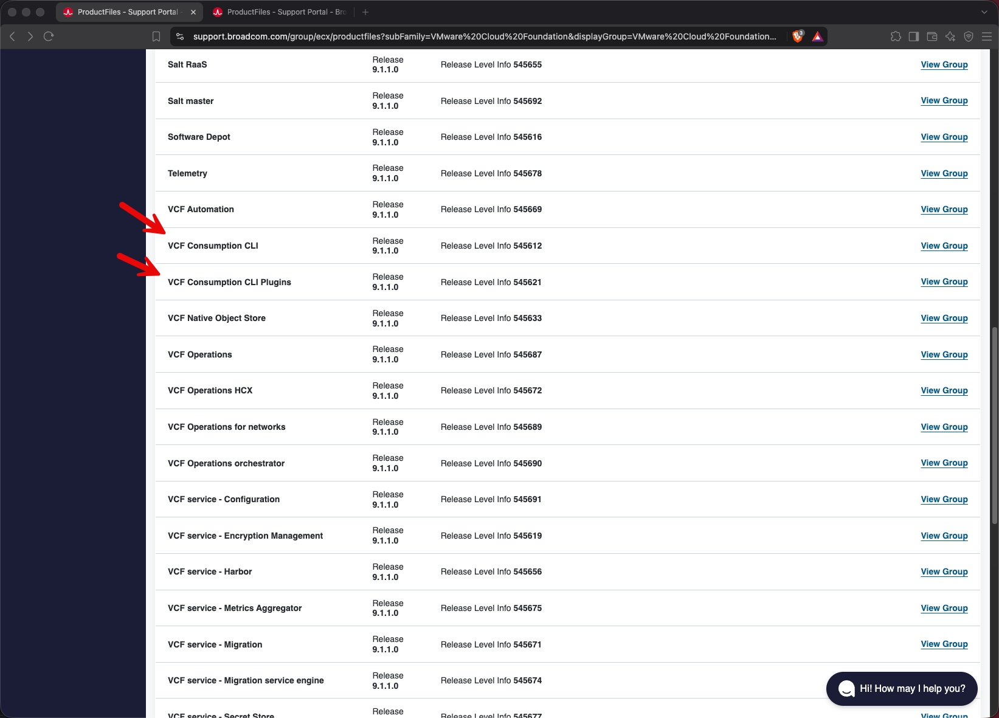
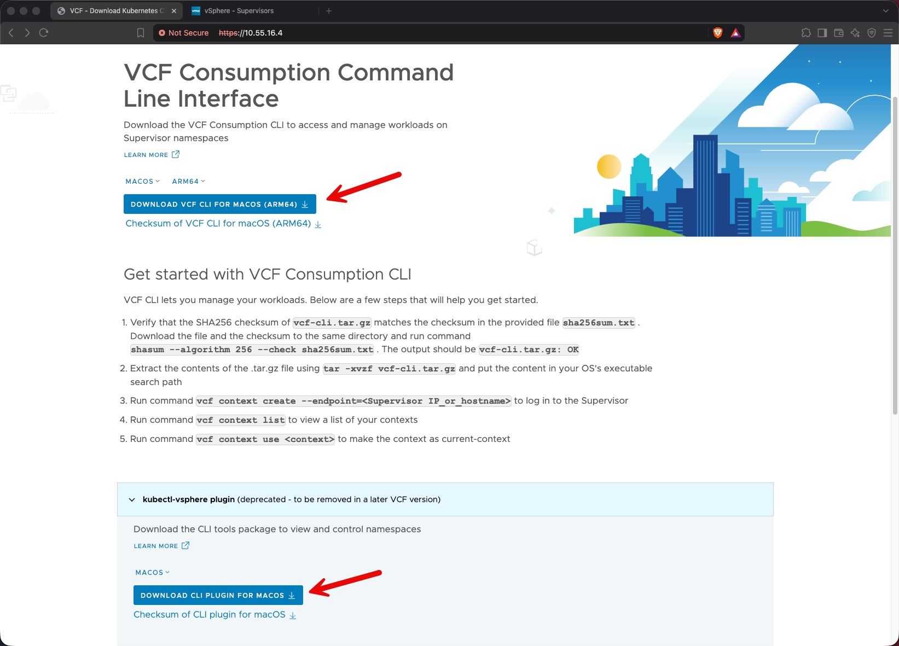

<!--
authors: "Julius M. Nicolescu, Qwen3-Coder-30B-A3B-Instruct-4bit, Qwen3.8-27B-8bit"
date: 2026-11-18
description: Install VCF Consumption CLI, kubectl and local CLI plugins using Broadcom Support downloads or Supervisor packages on macOS, Linux and Windows.
keywords: VCF 9.1.1, Consumption CLI, kubectl, Supervisor, PluginBundle, macOS ARM64, Linux AMD64, Windows AMD64
lang: en
-->

# Install VCF CLI, kubectl and VCF CLI plugins

This project installs the VCF Consumption CLI (`vcf`), the Kubernetes client (`kubectl`) and VCF CLI plugins on an administration workstation for VMware Cloud Foundation 9.1.1. Choose one download option, then install manually or run the matching example script.

| Installation option | VCF CLI source | kubectl source | VCF CLI plugins source |
| --- | --- | --- | --- |
| **1 — Broadcom Support downloads** | Broadcom Support | Kubernetes download service | Broadcom Support |
| **2 — Supervisor downloads** | Supervisor | Supervisor `vsphere-plugin.zip` | Broadcom Support |

| Component | Installed command | Purpose |
| --- | --- | --- |
| VCF Consumption CLI | `vcf` | Configure contexts and use VCF services. |
| Kubernetes client | `kubectl` | Manage Kubernetes resources after configuring access. |
| VCF Consumption CLI plugins | Commands listed by `vcf plugin list` | Extend the CLI with service commands, including cluster and namespace operations. |
| vSphere login plugin, optional and deprecated | `kubectl vsphere` | Legacy login workflows; supplied inside `vsphere-plugin.zip`, separately from the VCF CLI PluginBundle. |

The workstation examples cover **macOS ARM64**, **Linux AMD64** and **Windows AMD64**. After installation, use the [Supervisor and VKS context guide](../42-create-vks-context/Readme.md) to configure authentication. These installers prepare local tools; cluster creation and workload deployment are separate procedures.

**Copy and paste:** Run only the commands for your platform, in order, from the stated directory. Keep the same terminal session for each manual procedure and inspect each result before continuing.

## Contents

- [Reference Environment](#reference-environment)
- [Prerequisites](#prerequisites)
- [Prepare the configuration](#prepare-the-configuration)
- [Download files](#download-files)
- [Verify downloaded files](#verify-downloaded-files)
- [Install on macOS](#install-on-macos)
- [Install on Linux](#install-on-linux)
- [Install on Windows](#install-on-windows)
- [Automated alternatives](#automated-alternatives)
- [Verify the installation](#verify-the-installation)
- [Project files](#project-files)
- [Optional cleanup](#optional-cleanup)
- [Troubleshooting](#troubleshooting)
- [Output](#output)
- [References](#references)

## Reference Environment

This guide targets **VMware Cloud Foundation 9.1.1**. The following package selections come from the current installer scripts; confirm the files available for your target before installing.

| Component | Configured version or build | Scope |
| --- | --- | --- |
| VCF platform | `9.1.1.0-545627-2026-09` | Target release recorded in the script headers. |
| Broadcom VCF CLI | `9.1.1.0100.25746586` | macOS ARM64, Linux AMD64 and Windows AMD64 archives. |
| Broadcom CLI plugins — macOS/Linux | `9.1.1.0100.25793136` | Binary PluginBundle for the workstation OS/architecture. |
| Broadcom CLI plugins — Windows | `9.1.1.0300.25882127` | Separate Windows AMD64 PluginBundle. |
| Supervisor VCF CLI | `v9.1.1.0/25662425` | Build-specific download path configured in the examples. |
| Native kubectl | `v1.33.6` | Option 1 downloads; select a compatible client for each target API server. |
| Supervisor kubectl | Read the installed client version | Supplied by `vsphere-plugin.zip`; its version is independent of the CLI archive. |

The [screenshots](#output) record the two download pages on **2026-11-18**. They show package selection, without establishing installation or cluster-access success.

## Prerequisites

| Requirement | Details |
| --- | --- |
| Workstation | Apple Silicon macOS ARM64, Linux x86-64/AMD64, or Windows 10/11 AMD64, matching the selected packages. |
| Broadcom access | Support Portal account with access to the VCF 9.1.1.0 CLI and plugin deliverables. |
| Network | Internet for downloading option 1 inputs; Supervisor HTTPS connectivity for option 2. Local files can be transferred to an internet-restricted workstation. |
| macOS/Linux tools | Bash, `tar`, `install`, `mkdir`, `sudo`; `unzip` for Supervisor tools; `curl` for Supervisor installers; `jq` for helper 01. Checksum checks use `shasum` on macOS or `sha256sum` on Linux. |
| Windows manual procedure | PowerShell 5.1 or 7 and native ZIP extraction with `Expand-Archive`. |
| Windows local-file CMD installer | Built-in Windows `tar.exe` with ZIP support; all three inputs already in Downloads. |
| Windows Supervisor CMD installer | `curl.exe`, ZIP-capable `bsdtar` or 7-Zip, and registry tools. It can install missing curl or 7-Zip with WinGet; the machine-level 7-Zip fallback needs administrator approval. |
| Endpoint helpers | vCenter connectivity, credentials and permission to read the selected cluster and Supervisor configuration. CMD helper 04 requires curl and jq and can install them with WinGet when missing. |
| Local permissions | sudo access for `/usr/local/bin` on macOS/Linux; write access to the user profile, user programs directory and user PATH on Windows. |
| macOS Supervisor kubectl | Rosetta 2 for the configured AMD64 binary, or use the native ARM64 client from option 1. |
| Certificate trust | Trust the download server's certificate for normal browser downloads. Existing lab scripts bypass certificate validation for vCenter/Supervisor requests. |
| Existing VCF settings | Preserve settings needed after the automated installers' reset. |

**Client compatibility:** kubectl must be within one minor version of the API server. For example, the pinned `v1.33.6` client fits API-server minors `1.32`–`1.34`; select another compatible client when accessing `1.35` or later. Check Supervisor and VKS targets separately against the [version-skew policy](https://kubernetes.io/releases/version-skew-policy/).

## Prepare the configuration

### Script configuration

Edit the literal assignments near the top of the chosen script. The values in the repository are lab-specific. Manual browser downloads do not require editing or running an endpoint helper.

| Setting | Used by | What to configure |
| --- | --- | --- |
| `VCENTER`, `VC_USER`, `VC_PASS` | Helpers 01–04 | vCenter address and credentials with Supervisor read access. |
| `CLUSTER_NAME` | Helpers 01–04 | Exact vSphere cluster name hosting the intended Supervisor. |
| `DOWNLOAD_DIR` | Broadcom Support installers | Local input directory; defaults to the current user's Downloads. |
| `VCF_CLI_DOWNLOAD_FILE`, `KUBECTL_DOWNLOAD_FILE` | Broadcom Support installers | Exact local CLI archive and kubectl binary paths. |
| `SUPERVISOR_API_ENDPOINT` | Supervisor installers | Supervisor hostname/IP without `https://`. |
| `VCF_CLI_DOWNLOAD_URL` | Supervisor installers | Build-specific CLI path relative to `/wcp/`. |
| `KUBECTL_DOWNLOAD_URL` | Supervisor installers | Tools package path relative to `/wcp/`. |
| `VCF_CLI_PLUGIN_DOWNLOAD_FILE` | All installers | Local OS/architecture-specific binary PluginBundle. |
| `WORK_DIR` | All installers | Staging directory, currently `~/vcf-cli-install` or `%USERPROFILE%\vcf-cli-install`; existing contents are removed. |
| `INSTALL_DIR` | Windows installers | Current-user binary directory, normally `%LOCALAPPDATA%\Programs\vcf`. |

**Supervisor installers assign `SUPERVISOR_API_ENDPOINT` directly.** A value saved by a helper does not override that assignment. Read the helper's output and copy the verified endpoint into the chosen installer.

### Supervisor package paths

These are the current script paths, relative to `https://<SUPERVISOR_API_ENDPOINT>/wcp/`. Confirm them on your Supervisor download page after an update.

| Platform | VCF CLI path | kubectl tools package path |
| --- | --- | --- |
| macOS | `vcf-cli/v9.1.1.0/25662425/darwin/arm64/vcf-cli.tar.gz` | `plugin/darwin-amd64/vsphere-plugin.zip` |
| Linux | `vcf-cli/v9.1.1.0/25662425/linux/amd64/vcf-cli.tar.gz` | `plugin/linux-amd64/vsphere-plugin.zip` |
| Windows | `vcf-cli/v9.1.1.0/25662425/windows/amd64/vcf-cli.zip` | `plugin/windows-amd64/vsphere-plugin.zip` |

### Plugin bundle location

| Installation method | Default local input location |
| --- | --- |
| Manual procedure, either download option | All packages in the current user's Downloads. |
| Broadcom Support installers, all platforms | CLI archive, kubectl binary and PluginBundle in the current user's Downloads. |
| Supervisor Bash installers | PluginBundle in `/tmp`; change `VCF_CLI_PLUGIN_DOWNLOAD_FILE` if keeping it in Downloads. CLI/tools packages are downloaded automatically. |
| Supervisor Windows installers | PluginBundle in `%USERPROFILE%\Downloads`; CLI/tools packages are downloaded automatically. |

The filename alone is insufficient: the archive must exist at the configured path. Keep the CLI archive and PluginBundle as separate files.

### Discover the Supervisor endpoint

For option 2, use the namespace's **Link to CLI Tools** in vSphere Client, or configure and run one [endpoint helper](#endpoint-discovery-helpers). Helpers 01–03 select the first matching cluster and display the first Supervisor summary. Confirm that the endpoint belongs to the intended cluster, especially in a vCenter with multiple Supervisors. Helper 04 requires exactly one cluster match and one Supervisor summary.

Helper 01 writes `SUPERVISOR_API_ENDPOINT` into `~/.zshrc` on macOS, or `~/.bash_profile` and `~/.profile` on Linux. Reload the matching profile if another command needs the export. Windows helpers persist a user environment variable. A helper launched as a child process cannot update its parent PowerShell session; read the saved value from Windows user settings. In every case, copy the verified endpoint into the selected Supervisor installer's assignment.

## Download files

Choose **one** download source for the CLI and kubectl, then obtain the matching Broadcom binary PluginBundle. For manual installation, save the packages and checksums in Downloads.

### Option 1 — Broadcom Support

Use this option to prepare all files before installation. The CLI and plugin bundle come from Broadcom Support; the native kubectl binary comes from Kubernetes.

1. Sign in to the [Broadcom Support download group for VCF 9.1.1.0](<https://support.broadcom.com/group/ecx/productfiles?displayGroup=VMware%20Cloud%20Foundation%209&release=9.1.1.0&os=&servicePk=545627&language=EN&groupId=545621>).
2. If navigating manually, select **VMware Cloud Foundation** in the portal product selector, then **My Downloads → VMware Cloud Foundation → VMware Cloud Foundation 9 → 9.1.1.0**. The release is shown as **VMware Cloud Foundation 9.1.1.0** in the download workflow.
3. Open **VCF Consumption CLI → View Group** and download the CLI archive for your OS and architecture.
4. Open **VCF Consumption CLI Plugins → View Group** and download the separate OS-specific **PluginBundle**. Review and accept the portal's terms as required.
5. Download kubectl using the matching direct link below. Save all three files in `~/Downloads` on macOS/Linux or `%USERPROFILE%\Downloads` on Windows. Obtain the published checksums, then [verify the downloads](#verify-downloaded-files).

These filenames match the current scripts and the selected VCF 9.1.1 packages. They identify the configured builds, rather than the newest available release. Broadcom links open the authenticated product download group; select the exact filename there.


**Broadcom Support — captured 2026-11-18.** Open **View Group** for each of the two marked rows: **VCF Consumption CLI** and **VCF Consumption CLI Plugins**.

[](./output-2026-11-18/vcf-consumption-broadcom-support.jpg)

#### macOS ARM64 — Broadcom Support and Kubernetes

| Component | Architecture | Version | Filename | Download link |
| --- | --- | --- | --- | --- |
| kubectl | macOS ARM64 | `v1.33.6` | `kubectl` | [Download kubectl](https://dl.k8s.io/release/v1.33.6/bin/darwin/arm64/kubectl) |
| VCF Consumption CLI | macOS ARM64 | `9.1.1.0100` | `VCF-Consumption-CLI-Darwin_ARM64-9.1.1.0100.25746586.tar.gz` | [Broadcom — VCF Consumption CLI](<https://support.broadcom.com/group/ecx/productfiles?displayGroup=VMware%20Cloud%20Foundation%209&release=9.1.1.0&os=&servicePk=545627&language=EN&groupId=545621>) |
| VCF Consumption CLI Plugins | macOS ARM64 | `9.1.1.0100` | `VCF-Consumption-CLI-PluginBundle-Darwin_ARM64-9.1.1.0100.25793136.tar.gz` | [Broadcom — VCF Consumption CLI Plugins](<https://support.broadcom.com/group/ecx/productfiles?displayGroup=VMware%20Cloud%20Foundation%209&release=9.1.1.0&os=&servicePk=545627&language=EN&groupId=545621>) |

#### Linux AMD64 — Broadcom Support and Kubernetes

| Component | Architecture | Version | Filename | Download link |
| --- | --- | --- | --- | --- |
| kubectl | Linux AMD64 | `v1.33.6` | `kubectl` | [Download kubectl](https://dl.k8s.io/release/v1.33.6/bin/linux/amd64/kubectl) |
| VCF Consumption CLI | Linux AMD64 | `9.1.1.0100` | `VCF-Consumption-CLI-Linux_AMD64-9.1.1.0100.25746586.tar.gz` | [Broadcom — VCF Consumption CLI](<https://support.broadcom.com/group/ecx/productfiles?displayGroup=VMware%20Cloud%20Foundation%209&release=9.1.1.0&os=&servicePk=545627&language=EN&groupId=545621>) |
| VCF Consumption CLI Plugins | Linux AMD64 | `9.1.1.0100` | `VCF-Consumption-CLI-PluginBundle-Linux_AMD64-9.1.1.0100.25793136.tar.gz` | [Broadcom — VCF Consumption CLI Plugins](<https://support.broadcom.com/group/ecx/productfiles?displayGroup=VMware%20Cloud%20Foundation%209&release=9.1.1.0&os=&servicePk=545627&language=EN&groupId=545621>) |

#### Windows AMD64 — Broadcom Support and Kubernetes

| Component | Architecture | Version | Filename | Download link |
| --- | --- | --- | --- | --- |
| kubectl | Windows AMD64 | `v1.33.6` | `kubectl.exe` | [Download kubectl.exe](https://dl.k8s.io/release/v1.33.6/bin/windows/amd64/kubectl.exe) |
| VCF Consumption CLI | Windows AMD64 | `9.1.1.0100` | `VCF-Consumption-CLI-Windows_AMD64-9.1.1.0100.25746586.zip` | [Broadcom — VCF Consumption CLI](<https://support.broadcom.com/group/ecx/productfiles?displayGroup=VMware%20Cloud%20Foundation%209&release=9.1.1.0&os=&servicePk=545627&language=EN&groupId=545621>) |
| VCF Consumption CLI Plugins | Windows AMD64 | `9.1.1.0300` | `VCF-Consumption-CLI-PluginBundle-Windows_AMD64-9.1.1.0300.25882127.zip` | [Broadcom — VCF Consumption CLI Plugins](<https://support.broadcom.com/group/ecx/productfiles?displayGroup=VMware%20Cloud%20Foundation%209&release=9.1.1.0&os=&servicePk=545627&language=EN&groupId=545621>) |

The Windows plugin bundle has a different version/build from the CLI archive. Keep the two downloads separate. Select the binary `PluginBundle`, rather than the `OCI-PluginBundle` used for registry distribution. The [local-source installation method](<https://techdocs.broadcom.com/us/en/vmware-cis/vcf/vcf-consumption/latest/consumer-interfaces-in-vcf/installing-and-using-vcf-cli-v9/installing-the-vcf-cli-in-internet-connected-environments/installing-the-vcf-cli-in-internet-restricted-environments(2).html>) below uses extracted files and does not require a private registry.

For an internet-restricted workstation, download and verify the files on an internet-connected machine, then transfer them to the target workstation's Downloads directory.

### Option 2 — Supervisor

Use this option when the workstation can reach the intended Supervisor. Download the CLI and the kubectl/vSphere tools package from that Supervisor, and obtain the VCF CLI plugin bundle separately from Broadcom Support.

1. In vSphere Client, open **Supervisor Management → Namespaces** and select a namespace on the intended Supervisor.
2. Open **Summary → Status → Link to CLI Tools → Open**, or use **Copy Link**. This navigation is documented in [Download and Install the VCF Consumption CLI](<https://techdocs.broadcom.com/us/en/vmware-cis/vcf/vcf-consumption/latest/managing-vsphere-kuberenetes-service-clusters-and-workloads/configuring-identity-and-access-for-tkg-service-clusters/connecting-to-vsphere-with-tanzu-clusters/download-and-install-the-kubernetes-cli-tools-for-vsphere.html>).
3. Alternatively, open `https://<SUPERVISOR_API_ENDPOINT>` directly. Use the Supervisor control-plane hostname or IP address. If needed, use an [endpoint helper](#endpoint-discovery-helpers).
4. On the **VCF Consumption Command Line Interface** page, select **OS** and **Arch**, then download **VCF CLI** and its **Checksum** file, `sha256sum.txt`.
5. Download the matching `vsphere-plugin.zip` tools package from the Supervisor. The direct package links below show the paths currently configured in the scripts.
6. Download the OS-specific VCF CLI **PluginBundle** from the [Broadcom Support download group](<https://support.broadcom.com/group/ecx/productfiles?displayGroup=VMware%20Cloud%20Foundation%209&release=9.1.1.0&os=&servicePk=545627&language=EN&groupId=545621>), using **My Downloads → VMware Cloud Foundation → VMware Cloud Foundation 9 → 9.1.1.0 → VCF Consumption CLI Plugins → View Group**.

Save the three packages and checksum files in Downloads. In the URL templates below, **replace `SUPERVISOR_API_ENDPOINT` with your own endpoint** before opening them. CLI paths include the example Supervisor build `25662425`; copy the current link from your Supervisor page if its build differs.


**Supervisor download page — captured 2026-11-18.** The upper download supplies **VCF CLI** for the selected OS/architecture. Expand **kubectl-vsphere plugin** for the lower tools ZIP and its checksum. The page labels that login plugin **deprecated — to be removed in a later VCF version**. The lower button does not supply the VCF CLI PluginBundle; obtain that separately from Broadcom Support. The address `10.55.16.4` is the captured lab endpoint.

[](./output-2026-11-18/vcf-consumption-supervisor-download.jpg)

#### macOS — Supervisor and Broadcom Support

| Component | Architecture | Version | Filename | Download source and link |
| --- | --- | --- | --- | --- |
| kubectl + vSphere Plugin package | macOS AMD64 | Supervisor-provided | `vsphere-plugin.zip` | `https://SUPERVISOR_API_ENDPOINT/wcp/plugin/darwin-amd64/vsphere-plugin.zip` |
| VCF CLI | macOS ARM64 | `9.1.1.0` | `vcf-cli.tar.gz` | `https://SUPERVISOR_API_ENDPOINT/wcp/vcf-cli/v9.1.1.0/25662425/darwin/arm64/vcf-cli.tar.gz` |
| VCF Consumption CLI Plugins | macOS ARM64 | `9.1.1.0100` | `VCF-Consumption-CLI-PluginBundle-Darwin_ARM64-9.1.1.0100.25793136.tar.gz` | [Broadcom — plugin bundle](<https://support.broadcom.com/group/ecx/productfiles?displayGroup=VMware%20Cloud%20Foundation%209&release=9.1.1.0&os=&servicePk=545627&language=EN&groupId=545621>) |

The macOS Supervisor script installs **ARM64 VCF CLI and plugins, but AMD64 kubectl**. That kubectl requires Rosetta 2 on Apple Silicon. To use native ARM64 kubectl, download the macOS binary in option 1 and follow the native-client commands in the platform installation chapters instead.

#### Linux AMD64 — Supervisor and Broadcom Support

| Component | Architecture | Version | Filename | Download source and link |
| --- | --- | --- | --- | --- |
| kubectl + vSphere Plugin package | Linux AMD64 | Supervisor-provided | `vsphere-plugin.zip` | `https://SUPERVISOR_API_ENDPOINT/wcp/plugin/linux-amd64/vsphere-plugin.zip` |
| VCF CLI | Linux AMD64 | `9.1.1.0` | `vcf-cli.tar.gz` | `https://SUPERVISOR_API_ENDPOINT/wcp/vcf-cli/v9.1.1.0/25662425/linux/amd64/vcf-cli.tar.gz` |
| VCF Consumption CLI Plugins | Linux AMD64 | `9.1.1.0100` | `VCF-Consumption-CLI-PluginBundle-Linux_AMD64-9.1.1.0100.25793136.tar.gz` | [Broadcom — plugin bundle](<https://support.broadcom.com/group/ecx/productfiles?displayGroup=VMware%20Cloud%20Foundation%209&release=9.1.1.0&os=&servicePk=545627&language=EN&groupId=545621>) |

#### Windows AMD64 — Supervisor and Broadcom Support

| Component | Architecture | Version | Filename | Download source and link |
| --- | --- | --- | --- | --- |
| kubectl + vSphere Plugin package | Windows AMD64 | Supervisor-provided | `vsphere-plugin.zip` | `https://SUPERVISOR_API_ENDPOINT/wcp/plugin/windows-amd64/vsphere-plugin.zip` |
| VCF CLI | Windows AMD64 | `9.1.1.0` | `vcf-cli.zip` | `https://SUPERVISOR_API_ENDPOINT/wcp/vcf-cli/v9.1.1.0/25662425/windows/amd64/vcf-cli.zip` |
| VCF Consumption CLI Plugins | Windows AMD64 | `9.1.1.0300` | `VCF-Consumption-CLI-PluginBundle-Windows_AMD64-9.1.1.0300.25882127.zip` | [Broadcom — plugin bundle](<https://support.broadcom.com/group/ecx/productfiles?displayGroup=VMware%20Cloud%20Foundation%209&release=9.1.1.0&os=&servicePk=545627&language=EN&groupId=545621>) |

`vsphere-plugin.zip` contains kubectl and the separate vSphere login plugin. The example installers copy **only kubectl** from this archive. Optional manual commands for installing `kubectl-vsphere` are provided in the platform installation chapters. Neither component replaces the VCF CLI PluginBundle.

## Verify downloaded files

Verify downloaded files before extracting or installing them. Stop if a hash differs from the publisher's value. The example installers do not perform these checksum checks.

For **Supervisor CLI archives**, save `sha256sum.txt` beside the CLI archive and run the appropriate command from Downloads:

| Platform | Verification command | Expected result |
| --- | --- | --- |
| macOS | `shasum --algorithm 256 --check sha256sum.txt` | `vcf-cli.tar.gz: OK` |
| Linux | `sha256sum --check sha256sum.txt` | `vcf-cli.tar.gz: OK` |
| Windows PowerShell | `Get-FileHash -Algorithm SHA256 -LiteralPath .\vcf-cli.zip` and `Get-Content .\sha256sum.txt` | Calculated hash matches the published value. |

For **Broadcom CLI and plugin archives**, compare the calculated SHA256 hash with the value supplied by the portal for that exact filename. Use the platform's hash command with the selected archive path; portal checksum formats can differ from Supervisor's `sha256sum.txt`.

| Platform | Example: calculate the plugin archive's SHA256 |
| --- | --- |
| macOS | `shasum -a 256 ~/Downloads/VCF-Consumption-CLI-PluginBundle-Darwin_ARM64-9.1.1.0100.25793136.tar.gz` |
| Linux | `sha256sum ~/Downloads/VCF-Consumption-CLI-PluginBundle-Linux_AMD64-9.1.1.0100.25793136.tar.gz` |
| Windows PowerShell | `Get-FileHash -Algorithm SHA256 -LiteralPath "$HOME\Downloads\VCF-Consumption-CLI-PluginBundle-Windows_AMD64-9.1.1.0300.25882127.zip"` |

For **native kubectl**, download its matching checksum file:

| Platform | Checksum download | Verify from Downloads |
| --- | --- | --- |
| macOS ARM64 | [kubectl.sha256](https://dl.k8s.io/release/v1.33.6/bin/darwin/arm64/kubectl.sha256) | `echo "$(cat kubectl.sha256)  kubectl" \| shasum -a 256 --check` |
| Linux AMD64 | [kubectl.sha256](https://dl.k8s.io/release/v1.33.6/bin/linux/amd64/kubectl.sha256) | `echo "$(cat kubectl.sha256)  kubectl" \| sha256sum --check` |
| Windows AMD64 | [kubectl.exe.sha256](https://dl.k8s.io/release/v1.33.6/bin/windows/amd64/kubectl.exe.sha256) | `(Get-FileHash -Algorithm SHA256 .\kubectl.exe).Hash -eq (Get-Content .\kubectl.exe.sha256).Trim()` |

Expect `kubectl: OK` on macOS/Linux and `True` on Windows. Use a checksum for the same release and architecture as the binary. For Supervisor tools packages, use a published checksum if one is provided with the package.

## Install on macOS

Use **Bash on macOS ARM64** and keep the same terminal session for steps 1–4. Complete the downloads and checksum checks first. The manual commands replace destination binaries and install plugins; existing VCF settings and contexts are retained.

### 1. Select and extract the CLI

Set the archive for your chosen download option. Use a fresh `~/Downloads/vcf-cli-manual` directory; preserve any previous contents before reusing it.

```bash
CLI_ARCHIVE=VCF-Consumption-CLI-Darwin_ARM64-9.1.1.0100.25746586.tar.gz
WORK_DIR=${HOME}/Downloads/vcf-cli-manual
```

For option 2, change only the archive name:

```bash
CLI_ARCHIVE=vcf-cli.tar.gz
```

```bash
# Create the CLI extraction directory.
mkdir -p ${WORK_DIR}/cli

# Extract the selected macOS CLI archive.
tar -xzf ${HOME}/Downloads/${CLI_ARCHIVE} -C ${WORK_DIR}/cli

# Create the executable destination.
sudo mkdir -p /usr/local/bin

# Install the ARM64 binary as vcf.
sudo install -m 755 ${WORK_DIR}/cli/vcf-cli-darwin_arm64 /usr/local/bin/vcf

# Check the installed CLI build and architecture.
/usr/local/bin/vcf version
```

### 2. Install kubectl

**Option 1 — native ARM64 kubectl:**

```bash
# Install the verified native kubectl binary.
sudo install -m 755 ${HOME}/Downloads/kubectl /usr/local/bin/kubectl
```

If macOS blocks a verified browser download, inspect quarantine with `xattr -p com.apple.quarantine ${HOME}/Downloads/kubectl`. When present, remove that attribute from this file with `xattr -d com.apple.quarantine ${HOME}/Downloads/kubectl`, then repeat the installation.

**Option 2 — Supervisor tools:** the configured package contains **AMD64 kubectl**, which needs Rosetta 2 on Apple Silicon. For a native client, use the ARM64 download and command above instead.

```bash
# Extract the Supervisor tools package.
unzip ${HOME}/Downloads/vsphere-plugin.zip -d ${WORK_DIR}/vsphere-plugin

# Install the Supervisor-provided kubectl binary.
sudo install -m 755 ${WORK_DIR}/vsphere-plugin/bin/kubectl /usr/local/bin/kubectl
```

For either option:

```bash
# Check the client version and architecture.
/usr/local/bin/kubectl version --client=true
```

Only for a legacy workflow requiring the deprecated `kubectl vsphere login` plugin:

```bash
# Install the separate login plugin from the extracted Supervisor tools.
sudo install -m 755 ${WORK_DIR}/vsphere-plugin/bin/kubectl-vsphere /usr/local/bin/kubectl-vsphere

# Confirm that kubectl can find the login plugin.
/usr/local/bin/kubectl vsphere --help
```

### 3. Install VCF CLI plugins

```bash
PLUGIN_ARCHIVE=${HOME}/Downloads/VCF-Consumption-CLI-PluginBundle-Darwin_ARM64-9.1.1.0100.25793136.tar.gz

# Create the plugin extraction directory.
mkdir -p ${WORK_DIR}/vcf-plugins

# Extract the binary PluginBundle.
tar -xzf ${PLUGIN_ARCHIVE} -C ${WORK_DIR}/vcf-plugins

# Install plugins from the extracted bundle root.
/usr/local/bin/vcf plugin install all --local-source ${WORK_DIR}/vcf-plugins

# List the installed plugins.
/usr/local/bin/vcf plugin list
```

If the archive includes a wrapper directory, point `--local-source` to the actual bundle root inside it. Use the directory containing the extracted bundle, rather than a compressed archive or CLI executable directory. The [local-source procedure](<https://techdocs.broadcom.com/us/en/vmware-cis/vcf/vcf-consumption/latest/consumer-interfaces-in-vcf/installing-and-using-vcf-cli-v9/installing-the-vcf-cli-in-internet-connected-environments/installing-the-vcf-cli-in-internet-restricted-environments(2).html>) documents this installation method.

### 4. Configure PATH and verify

Confirm `/usr/local/bin` is in PATH. If needed, add `export PATH=/usr/local/bin:${PATH}` to `~/.zshrc`, or to `~/.bashrc` when using interactive Bash. Open a new terminal and follow [Verify the installation](#verify-the-installation).

## Install on Linux

Use **Bash on Linux AMD64**. Keep the same terminal session and use a fresh `~/Downloads/vcf-cli-manual` directory. Complete the downloads and checksum checks first.

### 1. Select and extract the CLI

```bash
CLI_ARCHIVE=VCF-Consumption-CLI-Linux_AMD64-9.1.1.0100.25746586.tar.gz
WORK_DIR=${HOME}/Downloads/vcf-cli-manual
```

For option 2, change only the archive name:

```bash
CLI_ARCHIVE=vcf-cli.tar.gz
```

```bash
# Create the CLI extraction directory.
mkdir -p ${WORK_DIR}/cli

# Extract the selected Linux CLI archive.
tar -xzf ${HOME}/Downloads/${CLI_ARCHIVE} -C ${WORK_DIR}/cli

# Create the executable destination.
sudo mkdir -p /usr/local/bin

# Install the AMD64 binary as vcf.
sudo install -m 755 ${WORK_DIR}/cli/vcf-cli-linux_amd64 /usr/local/bin/vcf

# Check the installed CLI build and architecture.
/usr/local/bin/vcf version
```

### 2. Install kubectl

**Option 1 — native AMD64 kubectl:**

```bash
# Install the verified native kubectl binary.
sudo install -m 755 ${HOME}/Downloads/kubectl /usr/local/bin/kubectl
```

**Option 2 — Supervisor tools:**

```bash
# Extract the Supervisor tools package.
unzip ${HOME}/Downloads/vsphere-plugin.zip -d ${WORK_DIR}/vsphere-plugin

# Install the Supervisor-provided kubectl binary.
sudo install -m 755 ${WORK_DIR}/vsphere-plugin/bin/kubectl /usr/local/bin/kubectl
```

For either option:

```bash
# Check the installed client version.
/usr/local/bin/kubectl version --client=true
```

Only when a legacy workflow requires the deprecated vSphere login plugin:

```bash
# Install the separate login plugin from the extracted Supervisor tools.
sudo install -m 755 ${WORK_DIR}/vsphere-plugin/bin/kubectl-vsphere /usr/local/bin/kubectl-vsphere

# Confirm that kubectl can find the login plugin.
/usr/local/bin/kubectl vsphere --help
```

### 3. Install VCF CLI plugins

```bash
PLUGIN_ARCHIVE=${HOME}/Downloads/VCF-Consumption-CLI-PluginBundle-Linux_AMD64-9.1.1.0100.25793136.tar.gz

# Create the plugin extraction directory.
mkdir -p ${WORK_DIR}/vcf-plugins

# Extract the binary PluginBundle.
tar -xzf ${PLUGIN_ARCHIVE} -C ${WORK_DIR}/vcf-plugins

# Install plugins from the extracted bundle root.
/usr/local/bin/vcf plugin install all --local-source ${WORK_DIR}/vcf-plugins

# List the installed plugins.
/usr/local/bin/vcf plugin list
```

Use the actual extracted bundle root if the archive contains a wrapper directory.

### 4. Configure PATH and verify

Confirm `/usr/local/bin` is in PATH. If needed, add `export PATH=/usr/local/bin:${PATH}` to the startup profile used by your shell, such as `~/.bashrc` for interactive Bash. Open a new terminal and follow [Verify the installation](#verify-the-installation).

## Install on Windows

Use **PowerShell 5.1 or 7 on Windows AMD64**. Keep the same session for steps 1–4. Complete the downloads and checksum checks first. The user installation directory does not require administrator access.

### 1. Select and extract the CLI

Use a fresh `vcf-cli-manual` directory beneath Downloads.

```powershell
$DownloadDir = "$HOME\Downloads"
$WorkDir = "$DownloadDir\vcf-cli-manual"
$CliArchive = "$DownloadDir\VCF-Consumption-CLI-Windows_AMD64-9.1.1.0100.25746586.zip"

# Resolve the current user's local application-data directory.
$LocalAppData = [Environment]::GetFolderPath('LocalApplicationData')

$InstallDir = "$LocalAppData\Programs\vcf"
```

For option 2, change only the archive path:

```powershell
$CliArchive = "$DownloadDir\vcf-cli.zip"
```

```powershell
# Create the extraction and user installation directories.
New-Item -ItemType Directory -Path "$WorkDir\cli", $InstallDir -Force | Out-Null

# Extract the selected Windows CLI archive.
Expand-Archive -LiteralPath $CliArchive -DestinationPath "$WorkDir\cli"

# Install the AMD64 binary as vcf.exe.
Copy-Item -LiteralPath "$WorkDir\cli\vcf-cli-windows_amd64.exe" -Destination "$InstallDir\vcf.exe" -Force

# Check the installed CLI build and architecture.
& "$InstallDir\vcf.exe" version
```

### 2. Install kubectl

**Option 1 — native AMD64 kubectl:**

```powershell
# Install the verified native kubectl executable.
Copy-Item -LiteralPath "$DownloadDir\kubectl.exe" -Destination "$InstallDir\kubectl.exe" -Force
```

**Option 2 — Supervisor tools:**

```powershell
# Extract the Supervisor tools package.
Expand-Archive -LiteralPath "$DownloadDir\vsphere-plugin.zip" -DestinationPath "$WorkDir\vsphere-plugin"

# Install the Supervisor-provided kubectl executable.
Copy-Item -LiteralPath "$WorkDir\vsphere-plugin\bin\kubectl.exe" -Destination "$InstallDir\kubectl.exe" -Force
```

For either option:

```powershell
# Check the installed client version.
& "$InstallDir\kubectl.exe" version --client=true
```

Only when a legacy workflow requires the deprecated vSphere login plugin:

```powershell
# Install the separate login plugin from the extracted Supervisor tools.
Copy-Item -LiteralPath "$WorkDir\vsphere-plugin\bin\kubectl-vsphere.exe" -Destination "$InstallDir\kubectl-vsphere.exe" -Force
```

After setting PATH in step 4, check it with `kubectl vsphere --help`.

### 3. Install VCF CLI plugins

```powershell
$PluginArchive = "$DownloadDir\VCF-Consumption-CLI-PluginBundle-Windows_AMD64-9.1.1.0300.25882127.zip"

# Extract the Windows binary PluginBundle.
Expand-Archive -LiteralPath $PluginArchive -DestinationPath "$WorkDir\vcf-plugins"

# Install plugins from the extracted bundle root.
& "$InstallDir\vcf.exe" plugin install all --local-source "$WorkDir\vcf-plugins"

# List the installed plugins.
& "$InstallDir\vcf.exe" plugin list
```

Use the actual extracted bundle root if the archive contains a wrapper directory.

### 4. Configure user PATH and verify

1. In Windows Search, open **Edit environment variables for your account**.
2. Under **User variables**, select **Path → Edit → New**.
3. Enter the expanded installation directory, normally `C:\Users\<user>\AppData\Local\Programs\vcf`. Add the directory itself, without `vcf.exe`.
4. Save the dialogs, open a new terminal and follow [Verify the installation](#verify-the-installation).

For the optional PowerShell 7 installer examples, install PowerShell 7 using [Microsoft's guide](https://learn.microsoft.com/en-us/powershell/scripting/install/install-powershell-on-windows):

```powershell
# Install PowerShell 7 alongside Windows PowerShell 5.1.
winget install --id Microsoft.PowerShell --source winget
```

Open a new terminal and select PowerShell 7 (`pwsh`) before using its examples. Use an execution method permitted by your organization's policy.

## Automated alternatives

Run the commands below from the directory containing this README. Choose **one installer** for your platform and download option. Endpoint helpers are optional and apply to the Supervisor method.

**All example installers reset local VCF configuration, saved contexts, plugins, caches and telemetry.** Preserve required settings before running them. The [reset directories](#installer-behavior) are listed below. The manual platform procedures retain existing settings.

### Endpoint discovery helpers

| Script | What it does | Run from this directory |
| --- | --- | --- |
| [01-get-supervisor-endpoint.sh](01-get-supervisor-endpoint.sh) | Discover the Supervisor endpoint; macOS/Linux Bash. | `bash ./01-get-supervisor-endpoint.sh` |
| [02-get-supervisor-endpoint-ps7.ps1](02-get-supervisor-endpoint-ps7.ps1) | Discover the Supervisor endpoint; Windows PowerShell 7. | `pwsh -File .\02-get-supervisor-endpoint-ps7.ps1` |
| [03-get-supervisor-endpoint-ps5.ps1](03-get-supervisor-endpoint-ps5.ps1) | Discover the Supervisor endpoint; Windows PowerShell 5.1. | `powershell.exe -File .\03-get-supervisor-endpoint-ps5.ps1` |
| [04-get-supervisor-endpoint.bat](04-get-supervisor-endpoint.bat) | Discover the Supervisor endpoint; Windows Command Prompt. | `.\04-get-supervisor-endpoint.bat` |

### Option 1 — Install already downloaded files

Download the files in the three [Broadcom Support tables](#option-1--broadcom-support) to Downloads first. These installers read local inputs and do not download the CLI, kubectl or plugin bundle.

| Script | What it does | Run from this directory |
| --- | --- | --- |
| [10-install-vcf-cli-macos-arm64.sh](install-from-broadcom-support/10-install-vcf-cli-macos-arm64.sh) | Install CLI, kubectl and local plugins; macOS ARM64 / Bash. | `bash ./install-from-broadcom-support/10-install-vcf-cli-macos-arm64.sh` |
| [11-install-vcf-linux-amd64.sh](install-from-broadcom-support/11-install-vcf-linux-amd64.sh) | Install CLI, kubectl and local plugins; Linux AMD64 / Bash. | `bash ./install-from-broadcom-support/11-install-vcf-linux-amd64.sh` |
| [12-install-vcf-cli-windows-amd64.bat](install-from-broadcom-support/12-install-vcf-cli-windows-amd64.bat) | Install CLI, kubectl and local plugins; Windows AMD64 / CMD. | `.\install-from-broadcom-support\12-install-vcf-cli-windows-amd64.bat` |

The Linux filename in this directory is `11-install-vcf-linux-amd64.sh`. There are no PowerShell installers in the Broadcom Support directory; use its CMD installer or the manual PowerShell procedure.

### Option 2 — Install from Supervisor

Set the chosen script's endpoint and package paths, and place the Broadcom plugin bundle at its configured local path before running.

| Script | What it does | Run from this directory |
| --- | --- | --- |
| [10-install-vcf-cli-macos-arm64.sh](install-from-supervisor-download-page/10-install-vcf-cli-macos-arm64.sh) | Install CLI, kubectl and local plugins; macOS ARM64 / Bash. | `bash ./install-from-supervisor-download-page/10-install-vcf-cli-macos-arm64.sh` |
| [11-install-vcf-cli-linux-amd64.sh](install-from-supervisor-download-page/11-install-vcf-cli-linux-amd64.sh) | Install CLI, kubectl and local plugins; Linux AMD64 / Bash. | `bash ./install-from-supervisor-download-page/11-install-vcf-cli-linux-amd64.sh` |
| [12-install-vcf-cli-windows-amd64.bat](install-from-supervisor-download-page/12-install-vcf-cli-windows-amd64.bat) | Install CLI, kubectl and local plugins; Windows AMD64 / CMD. | `.\install-from-supervisor-download-page\12-install-vcf-cli-windows-amd64.bat` |
| [13-install-vcf-cli-windows-amd64-ps7.ps1](install-from-supervisor-download-page/13-install-vcf-cli-windows-amd64-ps7.ps1) | Install CLI, kubectl and local plugins; Windows AMD64 / PowerShell 7. | `pwsh -File .\install-from-supervisor-download-page\13-install-vcf-cli-windows-amd64-ps7.ps1` |
| [14-install-vcf-cli-windows-amd64-ps5.ps1](install-from-supervisor-download-page/14-install-vcf-cli-windows-amd64-ps5.ps1) | Install CLI, kubectl and local plugins; Windows AMD64 / PowerShell 5.1. | `powershell.exe -File .\install-from-supervisor-download-page\14-install-vcf-cli-windows-amd64-ps5.ps1` |

### Installer behavior

| Stage | Broadcom Support installers | Supervisor installers |
| --- | --- | --- |
| Input | Require local CLI archive, kubectl binary and PluginBundle before staging/reset. | Require the local PluginBundle, then download CLI/tools from the configured Supervisor. |
| Stage files | Extract CLI/plugins and copy kubectl into `vcf-cli-install`. macOS clears quarantine on downloaded kubectl if present. | Download/extract CLI and `vsphere-plugin.zip`; extract the local PluginBundle. |
| Reset configuration | Remove the six VCF directories below after staging. | Bash resets before downloads; Windows downloads/extracts before resetting. |
| Install binaries | Native ARM64 macOS or AMD64 Linux/Windows CLI and kubectl. | ARM64 macOS CLI with AMD64 kubectl; AMD64 CLI/kubectl on Linux/Windows. |
| Install plugins | `vcf plugin install all --local-source`, then `vcf plugin list`. | Same local-source method. |
| Set PATH/profile | Broadcom CMD updates calling CMD PATH and prints a reminder to configure user PATH. | Windows installers persist user PATH; PowerShell installers also add alias `k`. |
| Cleanup | Remove staging, retaining original Downloads files. | Remove downloaded/extracted staging files, retaining the original local PluginBundle. |

All installers remove these directories beneath the current user's home:

| Reset directory | Contents potentially affected |
| --- | --- |
| `.cache/vcf` | VCF caches, including cached plugin inventory. |
| `.config/vcf` | VCF configuration and saved contexts. |
| `.config/vcf-cli-telemetry` | Telemetry configuration. |
| `.local/share/vcf-cli` | VCF CLI shared data. |
| `.local/vcf` | Local VCF data/plugins. |
| `.local/vcf-cli-telemetry` | Local telemetry data. |

The scripts do not delete `~/.kube/config`, but losing saved VCF context settings can still require reauthentication. A failed installation can leave partially reset settings or replaced executables. Inspect errors and complete the verification procedure; a completion message alone is insufficient.


## Verify the installation

### macOS/Linux

Open a new terminal:

```bash
# Locate the VCF CLI selected by PATH.
command -v vcf

# Locate kubectl selected by PATH.
command -v kubectl

# Display the CLI version and architecture.
vcf version

# Display the local Kubernetes client version.
kubectl version --client=true

# List installed VCF CLI plugins.
vcf plugin list
```

### Windows

Open a new PowerShell terminal:

```powershell
# Locate the executables selected by PowerShell.
Get-Command vcf, kubectl

# Display the CLI version and architecture.
vcf version

# Display the local Kubernetes client version.
kubectl version --client=true

# List installed VCF CLI plugins.
vcf plugin list
```

From CMD, use `where vcf` and `where kubectl` to inspect executable selection, then run the same version and plugin commands.

| Check | Expected result |
| --- | --- |
| Executable path | `/usr/local/bin` on macOS/Linux or `%LOCALAPPDATA%\Programs\vcf` on Windows, unless intentionally installed elsewhere. |
| CLI version/architecture | Matches the selected CLI package and workstation. |
| Native kubectl, option 1 | Reports client `v1.33.6` with the selected OS/architecture. |
| Supervisor kubectl, option 2 | Reports the actual bundled client version; configured macOS package is AMD64. |
| VCF CLI plugins | Required plugins are listed; plugin versions can differ from the core CLI version. |
| Optional vSphere login plugin | `kubectl vsphere --help` succeeds if manually installed. |

Version commands verify the local programs. To establish cluster access, continue with the [Supervisor and VKS context guide](../42-create-vks-context/Readme.md) and test the intended context and permissions separately.

## Project files

### Repository layout

```text
41-install-vcf-cli-kubectl/
├── Readme.md
├── Readme.md-OLD
├── 01-get-supervisor-endpoint.sh
├── 02-get-supervisor-endpoint-ps7.ps1
├── 03-get-supervisor-endpoint-ps5.ps1
├── 04-get-supervisor-endpoint.bat
├── install-from-broadcom-support/
│   ├── 10-install-vcf-cli-macos-arm64.sh
│   ├── 11-install-vcf-linux-amd64.sh
│   └── 12-install-vcf-cli-windows-amd64.bat
├── install-from-supervisor-download-page/
│   ├── 10-install-vcf-cli-macos-arm64.sh
│   ├── 11-install-vcf-cli-linux-amd64.sh
│   ├── 12-install-vcf-cli-windows-amd64.bat
│   ├── 13-install-vcf-cli-windows-amd64-ps7.ps1
│   └── 14-install-vcf-cli-windows-amd64-ps5.ps1
└── output-2026-11-18/
    ├── vcf-consumption-broadcom-support.jpg
    └── vcf-consumption-supervisor-download.jpg
```

The tree shows the active documentation and scripts. Local backups and editor logs are omitted. `Readme.md-OLD` is historical reference material; use the current filenames and directions in this guide.

### Installed and generated files

The workflow creates local binaries, staging files and user settings. It does not generate Kubernetes manifests or Terraform state.

| File or directory | Created/changed by | Lifecycle |
| --- | --- | --- |
| `~/Downloads/vcf-cli-manual/` | Manual commands | Extracted CLI, Supervisor tools and plugins; removable after verification. |
| `~/vcf-cli-install/` or `%USERPROFILE%\vcf-cli-install\` | All installers | Staging is reset at startup. Broadcom installers and Supervisor Windows installers remove the directory on completion; Supervisor Bash installers remove named contents and can leave an empty directory. |
| `/usr/local/bin/vcf`, `/usr/local/bin/kubectl` | macOS/Linux installation | Retained installed executables. |
| `%LOCALAPPDATA%\Programs\vcf\` | Windows installation | Retained executables; PATH handling depends on the installer. |
| `kubectl-vsphere` or `kubectl-vsphere.exe` | Optional manual commands | Installed only when the optional vSphere login plugin step is selected. |
| `~/.zshrc` on macOS; `~/.bash_profile` and `~/.profile` on Linux | Helper 01 | Persistent endpoint export. |
| Windows user environment | Helpers 02–04 | Persistent `SUPERVISOR_API_ENDPOINT`. |
| Windows user PATH | Supervisor Windows installers or manual setup | Persistent executable search directory. The Broadcom CMD installer updates only the calling CMD PATH. |
| PowerShell `$PROFILE` | Supervisor installers 13/14 | Adds `Set-Alias -Name k -Value kubectl` once, preserving existing profile content. |

Original local downloads are retained. VCF CLI creates its own configuration and plugin storage when used. Extracted files and successful downloads alone do not establish a working installation.

## Optional cleanup

### Remove manual installation files

After successful verification, remove only the extraction directory created by the manual procedure. Keep original archives/checksums if needed for reuse.

macOS/Linux:

```bash
# Remove only the manual extraction directory.
rm -rf ${HOME}/Downloads/vcf-cli-manual
```

Windows PowerShell:

```powershell
# Remove only the manual extraction directory.
Remove-Item -LiteralPath "$HOME\Downloads\vcf-cli-manual" -Recurse -Force
```

Installed binaries, VCF settings, installed plugins, kubeconfig and PATH remain in place. These commands do not uninstall the tools.

### Reset an existing VCF installation

A reset is automatic in all example installers. Preserve any required settings from the six [reset directories](#installer-behavior) before using them. Recreate and verify contexts after a reset as needed.

For the specific FDS plugin-inventory cache issue following a Supervisor update, use the targeted procedure in [Broadcom KB 456268](<https://knowledge.broadcom.com/external/article/456268>). Its discovery-disable setting is a recovery step for that issue, rather than a required step for every installation. The corresponding discovery-disable command in the installers is commented out.

## Troubleshooting

| Symptom | Check or action |
| --- | --- |
| Local file is missing | Compare the exact filename and `DOWNLOAD_DIR`/`VCF_CLI_PLUGIN_DOWNLOAD_FILE` with the selected platform table. Browser-added suffixes such as `(1)` change the filename. |
| macOS Supervisor plugin filename is confusing | Use the `PluginBundle-Darwin_ARM64-9.1.1.0100.25793136.tar.gz` archive from the table and script assignment. The separate CLI archive does not contain the plugin bundle. |
| Endpoint helper ran, but installer uses an old endpoint | Edit the Supervisor installer's direct `SUPERVISOR_API_ENDPOINT` assignment. The saved environment variable does not override it. |
| Helper 01–03 displays the wrong Supervisor name | Check the selected cluster and endpoint in vSphere Client. These helpers display the first Supervisor summary. |
| CMD helper 04 does not save an endpoint | It requires exactly one matching cluster and one Supervisor summary. Inspect the vCenter target and lookup results. |
| Supervisor download returns HTTP 404 | Copy the current OS/architecture link from the Supervisor page. The configured `25662425` build path can change. |
| Certificate validation fails | Verify/trust the download endpoint's CA. Lab scripts bypass validation; browser downloads use browser certificate trust. |
| Checksum differs | Stop and download the correct archive and checksum for the same build/architecture again. |
| Extraction does not produce the expected executable | Inspect the archive layout and any wrapper directory. The installers expect `vcf-cli-<os>_<arch>` at the extraction root. |
| `vcf` or `kubectl` is not found | Check PATH, then open a new terminal. Broadcom CMD installation requires manual persistent user PATH setup. |
| An older executable runs | Inspect `command -v`, `Get-Command` or `where`; another installation may appear earlier in PATH. |
| Bad CPU type/executable format | Match OS/architecture. macOS Supervisor kubectl is AMD64; use Rosetta 2 or native ARM64 kubectl from option 1. |
| macOS blocks downloaded kubectl | Verify its checksum, inspect quarantine, then follow the targeted `xattr` instructions in [macOS kubectl procedure](#2-install-kubectl). |
| `-SkipCertificateCheck` is not recognized | Use PowerShell 7 for scripts 02/13, or the PowerShell 5.1 alternatives 03/14. |
| Windows ZIP extraction fails | Broadcom CMD expects built-in Windows `tar.exe`; Supervisor CMD requires ZIP-capable bsdtar or its 7-Zip fallback. GNU tar does not provide the required ZIP extraction. |
| Plugin installation fails | Check binary PluginBundle OS/architecture, release compatibility and the extracted bundle-root path. Do not pass the CLI archive, OCI bundle or compressed file to `--local-source`. |
| Offline default-inventory discovery error | Broadcom documents that discovery errors can coexist with successful local-source installation. Check the plugin installation result and `vcf plugin list`. |
| Plugins cannot synchronize after a Supervisor update | Review [KB 456268](<https://knowledge.broadcom.com/external/article/456268>) for the specific FDS cache/discovery issue. |
| `kubectl vsphere` is unavailable | Example installers copy only kubectl. Install the optional vSphere login plugin manually if your workflow needs it. |
| Tools work but cluster access fails | Configure the correct context and test authentication, namespace permissions and network connectivity using the context guide. |

## Output

The supplied **2026-11-18** captures show the download pages used by the two installation options. Click either inline preview in [Download files](#download-files) to open the full JPG.

| Output | Description |
| --- | --- |
| [Broadcom Support download groups](./output-2026-11-18/vcf-consumption-broadcom-support.jpg) | Separate **VCF Consumption CLI** and **VCF Consumption CLI Plugins** entries for release `9.1.1.0`, each with **View Group**. |
| [Supervisor download page](./output-2026-11-18/vcf-consumption-supervisor-download.jpg) | macOS ARM64 CLI selection, checksum link and the separate deprecated **kubectl-vsphere plugin** download section at the lab endpoint `10.55.16.4`. |

The project supplies no installation transcripts or cluster-access reports. Run the [verification checks](#verify-the-installation) after installing, then configure authentication through the [context guide](../42-create-vks-context/Readme.md).

## References

Official documentation links were opened and their destination content reviewed on **2026-11-18**. Broadcom uses rolling `/latest/` pages; its restricted-environment procedure currently names release **9.1.1.0**. Kubernetes pages can show newer client releases than the pinned examples. Microsoft's PowerShell page redirects to its current versioned documentation. The Support Portal redirects to sign-in, so authenticated deliverable availability was not checked. Exact archive names and Supervisor paths come from the current scripts; no live Supervisor download or installation was performed.

| Reference | What it covers |
| --- | --- |
| [Broadcom Support — VCF 9.1.1.0 download group](<https://support.broadcom.com/group/ecx/productfiles?displayGroup=VMware%20Cloud%20Foundation%209&release=9.1.1.0&os=&servicePk=545627&language=EN&groupId=545621>) | Portal destination for selecting CLI and OS-specific plugin deliverables; requires appropriate account access. |
| [Download and Install the VCF Consumption CLI](<https://techdocs.broadcom.com/us/en/vmware-cis/vcf/vcf-consumption/latest/managing-vsphere-kuberenetes-service-clusters-and-workloads/configuring-identity-and-access-for-tkg-service-clusters/connecting-to-vsphere-with-tanzu-clusters/download-and-install-the-kubernetes-cli-tools-for-vsphere.html>) | vSphere Client navigation to the Supervisor tools page and CLI package installation. |
| [Installing the VCF CLI](<https://techdocs.broadcom.com/us/en/vmware-cis/vcf/vcf-consumption/latest/consumer-interfaces-in-vcf/installing-and-using-vcf-cli-v9/installing-the-vcf-cli-in-internet-connected-environments/install-the-vcf-cli(3).html>) | Supervisor OS/architecture selection, checksum verification, binary installation and PATH. The guide states that package-manager installation of VCF CLI is no longer supported. |
| [Installing the VCF CLI in Internet Restricted Environments](<https://techdocs.broadcom.com/us/en/vmware-cis/vcf/vcf-consumption/latest/consumer-interfaces-in-vcf/installing-and-using-vcf-cli-v9/installing-the-vcf-cli-in-internet-connected-environments/installing-the-vcf-cli-in-internet-restricted-environments(2).html>) | Broadcom Support navigation, binary versus OCI plugin bundles and installation with `--local-source`. |
| [Broadcom KB 456268 — VCF CLI plugins not installed after a Supervisor update](<https://knowledge.broadcom.com/external/article/456268>) | Targeted FDS plugin-cache and discovery recovery procedure for VCF 9.1. |
| [Install kubectl on macOS](<https://kubernetes.io/docs/tasks/tools/install-kubectl-macos/>) | Native macOS binary installation and SHA256 verification. |
| [Install kubectl on Linux](<https://kubernetes.io/docs/tasks/tools/install-kubectl-linux/>) | Native Linux binary installation and SHA256 verification. |
| [Install kubectl on Windows](<https://kubernetes.io/docs/tasks/tools/install-kubectl-windows/>) | Native Windows executable, checksum verification and PATH setup. |
| [Kubernetes version-skew policy](<https://kubernetes.io/releases/version-skew-policy/>) | Supported kubectl/API-server minor-version differences. |
| [Install PowerShell 7 on Windows](<https://learn.microsoft.com/en-us/powershell/scripting/install/install-powershell-on-windows>) | WinGet installation and other supported PowerShell installation methods. |
