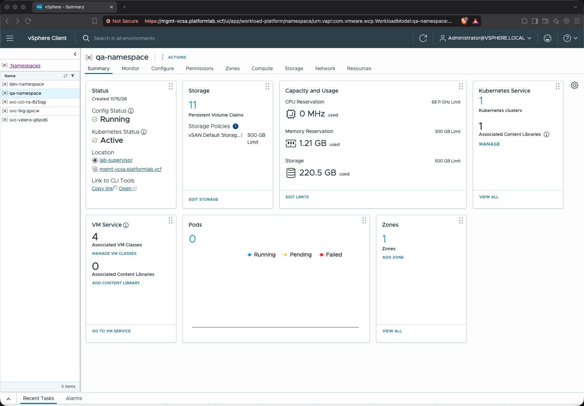

<!--
authors: "Julius M. Nicolescu, Qwen3-Coder-30B-A3B-Instruct-4bit, Qwen3.8-27B-8bit"
date: 2026-11-18
description: Create and configure DEV and QA vSphere namespaces on a VCF 9.1.1 Supervisor using vSphere Client, scripts, self-service templates or Terraform.
keywords: VCF 9.1.1, vSphere namespace, Supervisor, REST API, Namespace Service, Terraform
lang: en
-->

# Create and configure vSphere namespaces

Create **DEV and QA vSphere namespaces** on an existing VMware Cloud Foundation **9.1.1** Supervisor. Assign permissions, storage, resource limits and VM classes so that an authorized administrator can provision VKS clusters. Follow the manual vSphere Client procedure or use the supplied Bash, PowerShell, Windows CMD and Terraform examples.

**Documentation scope:** DEV is the worked example. QA follows the same steps with its own namespace name, directory and Terraform state. The screenshots and [Output](#output) table cover both environments.

| Target | Supervisor namespace | Existing Supervisor | Intended VKS cluster |
| --- | --- | --- | --- |
| DEV | `dev-namespace` | `lab-supervisor` | `dev-cluster-01` |
| QA | `qa-namespace` | `lab-supervisor` | `qa-cluster-02` |

Choose **one management method per namespace**. The UI, direct REST scripts, self-service scripts and Terraform alternatives target the same namespace names. Namespace creation prepares the resource and access boundary; continue with the [VKS cluster guide](../44-create-vks-cluster/Readme.md) to create a cluster.

## Contents

- [Reference Environment](#reference-environment)
- [Automated alternatives](#automated-alternatives)
- [Prerequisites](#prerequisites)
- [Prepare the configuration](#prepare-the-configuration)
- [Create DEV manually in vSphere Client](#create-dev-manually-in-vsphere-client)
- [Run on macOS/Linux](#run-on-macoslinux)
- [Run on Windows](#run-on-windows)
- [Self-service namespace alternative](#self-service-namespace-alternative)
- [Terraform deployment](#terraform-deployment)
- [Verify the deployment](#verify-the-deployment)
- [Namespace screenshots](#namespace-screenshots)
- [Project files](#project-files)
- [Optional cleanup](#optional-cleanup)
- [Troubleshooting](#troubleshooting)
- [Output](#output)
- [References](#references)

## Reference Environment

The supplied scripts target VCF **9.1.1**. The namespace reports and vSphere Client screenshots dated **2026-11-18** record the following lab settings; they are saved observations, not a new live validation.

| Component | Recorded value |
| --- | --- |
| vCenter | `mgmt-vcsa.platformlab.vcf` |
| Supervisor | `lab-supervisor` |
| Datacenter / compute cluster inputs | `platformlab-dc01` / `platformlab-cl01` |
| Namespace zone | `lab-zone-01` |
| Network provider | `NSX_VPC`; an automatically created VPC per namespace |
| Namespace configuration | `RUNNING` for DEV and QA |
| Kubernetes Service library | `Kubernetes Service Content Library`, associated with the Supervisor |

The screenshots show one Kubernetes cluster and four VM classes per namespace. Cluster deployment is covered by the next project. The **VM Service** card has zero content libraries; its libraries are separate from the **Kubernetes Service** library used for Kubernetes release images.

## Automated alternatives

The scripts are editable examples. Review the selected file's connection, credentials, target names and quotas before running it. The table uses **DEV** paths; use the matching files under `qa-namespace/` for QA. Choose one creation method, then verify the result.

### Direct REST creation and reporting

| Script | What it does | Run from this directory |
| --- | --- | --- |
| [01-create-vsphere-namespace.sh](./dev-namespace/01-create-vsphere-namespace.sh) | Create DEV through vCenter REST using Bash. | `dev-namespace`: `bash ./01-create-vsphere-namespace.sh` |
| [11-create-vsphere-namespace.ps1](./dev-namespace/11-create-vsphere-namespace.ps1) | Create DEV with native PowerShell HTTP commands. | `dev-namespace`: `pwsh -File ./11-create-vsphere-namespace.ps1` |
| [21-create-vsphere-namespace.bat](./dev-namespace/21-create-vsphere-namespace.bat) | Create DEV with curl/jq; install missing utilities through WinGet. | `dev-namespace`: `21-create-vsphere-namespace.bat` |
| [91-document-namespace-configuration.sh](./dev-namespace/91-document-namespace-configuration.sh) | Read namespace settings, associated libraries and image metadata; save a dated text report. | `dev-namespace`: `bash ./91-document-namespace-configuration.sh` |

Direct creation scripts save their JSON request in `deployment-files/`, submit it and report request acceptance. Check configuration readiness separately. They create a new namespace and do not reconcile an existing one. The report script does not change infrastructure; a same-day rerun replaces its report.

### Self-service and Terraform

| Method | What to use | Procedure |
| --- | --- | --- |
| Existing Namespace Service workflow | Shared template activation (`30`/`32`), followed by namespace creation (`41`/`43`). | [Self-service namespace alternative](#self-service-namespace-alternative) |
| Native Terraform | `terraform-create-vsphere-namespace/`; native namespace associations plus REST permissions and quotas. | [Terraform deployment](#terraform-deployment) |
| REST Terraform | `terraform-create-vsphere-namespace-restapi/`; namespace settings managed through a REST resource. | [Terraform deployment](#terraform-deployment) |

Removal scripts are listed under [Optional cleanup](#optional-cleanup). They delete the selected namespace and its contained workloads without a confirmation prompt.

## Prerequisites

| Requirement | Details |
| --- | --- |
| Infrastructure | VCF 9.1.1 with an enabled Supervisor, working workload networking, adequate capacity, existing storage policies and VM classes. Manual creation also requires an appropriate vSphere Zone. |
| Identity and permissions | Existing users/groups in the connected identity source. The operator needs inventory-read and namespace-management permissions. These scripts do not create users, groups or Supervisor role assignments. |
| macOS/Linux REST scripts | Bash 3.2+, curl, jq and tee. Template activation uses `curl --fail-with-body`, requiring curl 7.76+. |
| Windows REST PowerShell | PowerShell **7.4+** (`pwsh`) for the timeout parameters and native HTTP/JSON commands. Windows PowerShell 5.1 cannot run these REST `.ps1` files. |
| Windows CMD | Command Prompt, Windows PowerShell 5.1, curl.exe and jq.exe. The `.bat` scripts use WinGet to install missing curl/jq utilities and refresh PATH; package download access is needed when utilities are missing. |
| Self-service scripts | VCF CLI, kubectl and an authenticated context named `supervisor`; Bash 3.2+ or PowerShell 7.0+ for namespace creation/deletion. Namespace Service must be active and the user must have template-use permission. |
| Template administration | An inactive Namespace Service before activation, existing storage/classes/groups, and `Namespaces.SelfServiceManage` on the target cluster. REST PowerShell template scripts require 7.4+. |
| Terraform | Terraform **>= 1.10.0** on macOS, Linux or Windows; provider download access and write permission for local initialization, lock files and state. Bash runners additionally use tee and standard shell utilities. |
| Connectivity | HTTPS to vCenter for REST and Terraform; connectivity to the Supervisor Kubernetes API for kubectl. |
| Reporting | Bash, curl, jq 1.6+, column, tee and standard shell utilities; read access to the namespace, Supervisor, storage policies and associated libraries. No Kubernetes context is required. |
| Local files | Write permission beside scripts for generated `deployment-files/`; self-service also updates local VCF/kubeconfig state. |

See the [CLI installation guide](../41-install-vcf-cli-kubectl/Readme.md) and [Supervisor context guide](../42-create-vks-context/Readme.md). Direct REST and Terraform authenticate to vCenter and do not need a Kubernetes context. The Terraform roots require 1.10 even where runner header comments mention 1.5.

## Prepare the configuration

Edit the connection, namespace and resource settings in the selected script. For Terraform, edit `terraform.tfvars` in the selected root. Each script is self-contained; no shared environment file is sourced. Configure credentials locally and keep them out of documentation and committed changes.

### Connection and resource settings

The following are the supplied lab values. Replace them with values for your environment.

| Setting | DEV | QA |
| --- | --- | --- |
| vCenter | `mgmt-vcsa.platformlab.vcf` | Same |
| Supervisor | `lab-supervisor` | Same |
| Datacenter / compute cluster | `platformlab-dc01` / `platformlab-cl01` | Same |
| Namespace / REST description | `dev-namespace` | `qa-namespace` |
| API account | `labadministrator@vsphere.local` | Same |
| Storage policy | `vSAN Default Storage Policy` | Same |
| CPU quota | `68110` MHz | Same |
| Memory quota | `307200` MiB = 300 GiB | Same |
| Total and per-policy storage quota | `512000` MiB = 500 GiB | Same |
| VM classes | `best-effort-small`, `best-effort-medium`, `best-effort-large`, `best-effort-xlarge` | Same |
| Direct namespace principal | `vsphere.local` / `LabUsers` / `GROUP` / `VIEW` | Same |

Direct REST variables include `VCENTER`, `VC_USER`, `VC_PASS`, `DATACENTER_NAME`, `CLUSTER_NAME`, `STORAGE_POLICY_NAME`, `NAMESPACE_NAME`, `NAMESPACE_DESCRIPTION`, `NAMESPACE_DOMAIN`, `NAMESPACE_GROUP`, `NAMESPACE_ROLE`, `CPU_LIMIT_MHZ`, `MEMORY_LIMIT_MIB`, `STORAGE_LIMIT_MIB` and `VM_CLASSES`. Connection and request timeouts are 10 and 120 seconds.

The CPU quota is fixed at half the effective lab CPU capacity recorded on 2026-11-07; scripts do not query capacity to recalculate it. The examples bypass certificate verification through `curl -k`, PowerShell `-SkipCertificateCheck` or Terraform `insecure_tls = true`. Review that choice when adapting them to a trusted certificate configuration.

### Template configuration

The `default` template uses the quotas, policy and VM classes above. `TEMPLATE_DOMAIN=vsphere.local` and `TEMPLATE_ADMIN_GROUP=LabAdministrators` grant template use to that administrator group. For `VSPHERE_NETWORK`, activation discovers and includes the primary workload network. For `NSXT_CONTAINER_PLUGIN` and `NSX_VPC`, it omits `networks`; unsupported or missing network-provider values stop activation.

DEV and QA template copies affect the same service when they target the same compute cluster. Keep their settings consistent and activate once before creating self-service namespaces.

### How namespace permissions are defined

Supervisor administration, direct namespace access and permission to use a namespace template are separate assignments. The account making the API request is separate from the principal receiving access.

| Principal | Role or capability | Defined in | Managed here? |
| --- | --- | --- | --- |
| `VSPHERE.LOCAL\LabAdministrators` | Supervisor Administrator | Parent `lab-supervisor` inventory object; may appear inherited on namespaces. | Existing assignment; namespace creation does not create it. |
| `VSPHERE.LOCAL\LabUsers` | Namespaces View (`VIEW` / Can View) | Each DEV/QA namespace, shown as **This object**. | Requested by direct REST creation and both Terraform alternatives. |
| `LabAdministrators` in `vsphere.local` | Permission to create self-service namespaces | Shared `default` namespace template. | Configured by scripts 30/32. |
| Authenticated self-service creator | Namespace ownership on an enabled/upgraded Supervisor | Created self-service namespace. | Assigned through the self-service workflow. |

**Defined In** identifies the source of a permission. An inherited Supervisor role and a direct namespace role can appear together for different groups. Template `permissions` allow namespace creation; they contain no namespace `role` field and do not grant `LabUsers` a direct namespace role.

Direct REST creation includes this access fragment:

```json
{
  "access_list": [
    {
      "domain": "vsphere.local",
      "subject": "LabUsers",
      "subject_type": "GROUP",
      "role": "VIEW"
    }
  ]
}
```

`VIEW` supports the restricted user's read access on Supervisor. VKS lifecycle operations require additional rights, and application access inside a workload cluster requires suitable Kubernetes RBAC there. Review the [users and permissions guide](../40-create-vcenter-users/Readme.md). Membership in an administrator group changes the effective permissions of a restricted user.

### Update existing namespace permissions

Creation scripts do not reconcile an existing namespace. For UI/script-managed namespaces, use **Supervisor Management → Namespaces → select the namespace → Permissions** to change `LabUsers` from Owner to **Can View**, if needed. Repeat for QA. Edit an active template's permissions in the UI rather than rerunning activation merely to change access.

For Terraform-managed namespaces, change `namespace_access` in the owning root's `terraform.tfvars`, review the plan and apply through that state. Do not apply a second root to the same namespace. Verify permissions after signing in again as the intended user.

## Create DEV manually in vSphere Client

Use this procedure when you want to create and configure the namespace in the UI. Complete [Prerequisites](#prerequisites) first and use the [lab settings](#connection-and-resource-settings) as the worked example. Broadcom's [namespace procedure][manual-namespace] covers the VCF 9.1 UI workflow.

### 1. Open the namespace wizard

1. Sign in to vSphere Client with an account allowed to manage Supervisor namespaces.
2. Open the main menu and select **Supervisor Management**.
3. Select **Namespaces**, then click **New Namespace**.
4. Select **lab-supervisor** as the target Supervisor.

If `dev-namespace` already exists, open it and inspect its settings. Continue managing it through the method that created it.

### 2. Set the name, network and zone

| Wizard field | What to select or enter |
| --- | --- |
| **Name** | `dev-namespace` |
| **Default Network** | For vSphere networking, select the existing Supervisor workload network intended for DEV. |
| **Additional Networks** | Select only additional workload networks required by your design. |
| **Zone** | Select the intended existing zone; the supplied capture uses `lab-zone-01`. |
| **Description** | `dev-namespace` |

Network fields depend on the Supervisor network provider. The saved lab reports use **NSX VPC**, with automatically created namespace VPCs and no vSphere Default Workload Network. Follow the configured NSX VPC choices for that Supervisor. For classic NSX networking, leave **Override cluster network settings** clear when using the Supervisor's existing settings. Enable an override only with a separately planned network configuration.

Review the selections, click **Finish**, then open **dev-namespace → Summary**. Wait for **Config Status: Running** before continuing. If configuration fails, inspect the namespace's messages and network settings.

### 3. Grant the reader group access

1. Open the namespace's **Permissions** tab or its **Permissions → Add Permissions** action.
2. Select identity domain **vsphere.local** and group **LabUsers**.
3. Choose **Can View** / **Namespaces View**, corresponding to API role `VIEW`.
4. Save the permission and confirm it is assigned directly to this namespace.

`LabUsers` is the reader group in this example. Use an authorized administrator for VKS creation. An inherited **Supervisor Administrator** permission and a direct namespace permission have different scopes; see [How namespace permissions are defined](#how-namespace-permissions-are-defined).

### 4. Assign storage

1. On **Summary**, locate the **Storage** card and select **Add Storage**. If a policy is already assigned, the captured UI shows **Edit Storage**.
2. Select **vSAN Default Storage Policy** and confirm the selection.
3. Check that the policy appears in the namespace's storage list.

Use a policy suitable for the target datastores. A multi-zone Supervisor requires topology-aware policies. Assigning a policy creates the matching Kubernetes StorageClass for workloads. [Storage-policy behavior][manual-namespace] is described in the namespace guide.

### 5. Set resource limits

On **Summary → Capacity and Usage**, click **Edit Limits**. Set all four values below and save. Check the unit selector before entering each number.

| Limit | Worked lab value | Equivalent API input |
| --- | --- | --- |
| **CPU** | `68.11` GHz, or `68110` MHz when MHz is selected | `cpu_limit = 68110` |
| **Memory** | `300` GiB | `memory_limit = 307200` MiB |
| **Total storage** | `500` GiB | `storage_request_limit = 512000` MiB |
| **vSAN Default Storage Policy** | `500` GiB for this policy | `storage_specs[].limit = 512000` MiB |

The supplied UI labels memory and storage as **GB**; the report shows the binary equivalents as **GiB**. The namespace-wide storage limit and the individual policy limit are separate settings. Set both. These are limits, not resources already consumed; the CPU input is a fixed lab quota and is not recalculated by the scripts.

### 6. Associate VM classes

1. On **Summary**, locate **VM Service** and click **Manage VM Classes**; an empty namespace may show **Add VM Class**.
2. Add `best-effort-small`, `best-effort-medium`, `best-effort-large` and `best-effort-xlarge`.
3. Save and confirm **4 Associated VM Classes**.

The associated classes must include the class selected for VKS nodes. These examples do not bind a VM Service content library. Kubernetes release images use the Supervisor's Kubernetes Service library, which is configured separately. See [VM-class association guidance][vm-classes].

### 7. Check the completed namespace

On **Summary**, confirm **Config Status: Running**, **Kubernetes Status: Active**, the selected storage policy, the requested limits, the zone and four VM classes. Check the **Permissions** tab separately for `LabUsers` with **Can View**.

Use [Verify the deployment](#verify-the-deployment) to inspect the namespace from the Supervisor API and save its configuration report. Share the Supervisor control plane endpoint with the intended users through the [Supervisor context guide](../42-create-vks-context/Readme.md).

### 8. Apply the same procedure to QA

Repeat steps 1–7 using **qa-namespace** for both name and description. Select QA's intended network and zone and apply its own permissions, storage policy, quotas and VM classes. DEV settings do not propagate to QA. The supplied lab uses the same policy, limits and classes for both; [Namespace screenshots](#namespace-screenshots) shows their separate results.

## Run on macOS/Linux

This is an alternative to manual creation. Start in the directory containing this README. For QA, use `qa-namespace` in the directory command and edit the QA copy first.

### 1. Review the DEV script

Edit the [Bash creation script](./dev-namespace/01-create-vsphere-namespace.sh). Set vCenter credentials, datacenter/cluster names, storage-policy name, namespace access, quotas and VM classes. Existing inventory references are resolved by the script.

### 2. Create the namespace

```bash
# Enter the DEV environment directory.
cd dev-namespace

# Submit the namespace creation request to vCenter.
bash ./01-create-vsphere-namespace.sh
```

Inspect `deployment-files/dev-namespace.json` and the API result. Continue with [Verify the deployment](#verify-the-deployment); request acceptance is followed by asynchronous configuration.

## Run on Windows

Start in the README directory and review the selected DEV script's editable inputs. Choose **PowerShell or Command Prompt**. For QA, use `qa-namespace` and the corresponding QA script.

### PowerShell 7.4 or later

```powershell
# Enter the DEV environment directory.
Set-Location ./dev-namespace

# Submit the namespace request using native PowerShell HTTP commands.
pwsh -File ./11-create-vsphere-namespace.ps1
```

Use `pwsh`, not Windows PowerShell 5.1, for this REST script.

### Windows Command Prompt

```bat
REM Enter the DEV environment directory.
cd dev-namespace

REM Submit the namespace request using curl and jq.
21-create-vsphere-namespace.bat
```

The CMD script checks for curl/jq, installs missing utilities through WinGet and refreshes PATH. Review installation and request results, then complete [Verify the deployment](#verify-the-deployment).

## Self-service namespace alternative

This optional workflow uses the supplied **Supervisor Namespace Service template**. The [self-service API][self-service-api] is deprecated from vSphere API **9.1.0.0**; Broadcom directs new self-service use cases to VCF Automation. The steps below document the existing Supervisor workflow supplied in this project.

The template is **shared by DEV and QA on the same Supervisor**. Activate it once, then create only namespace names that do not already exist. Template permission authorizes namespace creation; it does not assign the `LabUsers` reader role.

### 1. Configure the template in vSphere Client

1. Select **lab-supervisor**, then open **Configure → Supervisor → General → Namespace Service**.
2. Turn **Status** on to open **Create Namespace Template**.
3. In **Configuration**, enter the CPU, memory and storage limits from [Prepare the configuration](#prepare-the-configuration). Select the storage policy, appropriate network when offered, and four VM classes. Add VM Service content libraries only if required for your VM workload.
4. Click **Next**. Under **Permissions**, select domain **vsphere.local** and group **LabAdministrators**.
5. Click **Next**, review the configuration and click **Done**.
6. Confirm the template is **Active**.

See the [official template procedure][template-guide]. Keep `LabUsers` out of template permissions when that group should have read access only.

### 2. Create DEV as an authorized template user

Authenticate as a user allowed by the template. Complete the [Supervisor context setup](../42-create-vks-context/Readme.md) first; the commands below assume a context named `supervisor` already exists. Run this block in one Bash session.

```bash
CLUSTER_NAME=supervisor

# Refresh workload cluster authentication and retain error messages.
vcf context refresh ${CLUSTER_NAME} >/dev/null 2>&1

# Select the Supervisor context for namespace creation.
vcf context use ${CLUSTER_NAME}

# Create DEV using the active namespace template.
kubectl create namespace dev-namespace
```

Use `qa-namespace` for a separate QA creation. The template supplies resources; [the self-service creator receives ownership on an enabled/upgraded Supervisor][self-service-create]. Add `LabUsers` with **Can View** separately if that access is required, then verify the effective settings.

### Optional script equivalents

Start each script in the directory shown. Activate with **30 or 32**, then create with **41 or 43**; the platform alternatives are not consecutive steps. Review inputs before running. QA has the same filenames under its own `using-a-namespace-template/` directory.

| Script | What it does | Run from this directory |
| --- | --- | --- |
| [30-create-namespace-template.sh](./dev-namespace/using-a-namespace-template/30-create-namespace-template.sh) | Configure the shared template and activate Namespace Service. | `dev-namespace/using-a-namespace-template`: `bash ./30-create-namespace-template.sh` |
| [32-create-namespace-template.ps1](./dev-namespace/using-a-namespace-template/32-create-namespace-template.ps1) | Configure and activate the template with PowerShell 7.4+. | `dev-namespace/using-a-namespace-template`: `pwsh -File ./32-create-namespace-template.ps1` |
| [41-create-vsphere-namespace-kubectl.sh](./dev-namespace/using-a-namespace-template/41-create-vsphere-namespace-kubectl.sh) | Generate namespace YAML and submit it using kubectl. | `dev-namespace/using-a-namespace-template`: `bash ./41-create-vsphere-namespace-kubectl.sh` |
| [43-create-vsphere-namespace-kubectl.ps1](./dev-namespace/using-a-namespace-template/43-create-vsphere-namespace-kubectl.ps1) | Generate and submit the YAML with PowerShell 7.0+. | `dev-namespace/using-a-namespace-template`: `pwsh -File ./43-create-vsphere-namespace-kubectl.ps1` |

Activation requires Namespace Service to be inactive. For an existing active template, edit it in vSphere Client. Self-service scripts do not consistently stop after every external-command failure; inspect context selection and kubectl results before proceeding.

## Terraform deployment

Terraform provides a reviewed plan and persistent state for ongoing namespace management. Unlike the creation scripts, it can reconcile changes to fields managed by its selected resources. The two supplied implementations have different coverage, particularly for permissions, quotas and namespace descriptions.

Four standalone roots provide separate DEV/QA state for the native and REST alternatives. Edit the chosen root's `terraform.tfvars` before initialization. Use **one root/state per namespace**; the alternatives manage the same namespace names.

### Providers and differences

| Behavior | Native: `terraform-create-vsphere-namespace` | REST: `terraform-create-vsphere-namespace-restapi` |
| --- | --- | --- |
| Namespace resource | `vsphere_namespace.namespace`. | `restapi_object.namespace`. |
| Placement | Discover exactly one Supervisor by `supervisor_name` and validate its UUID. | Resolve `datacenter_name` and `cluster_name` through vSphere data sources. |
| Description | Not managed by this configuration. | Managed through `description`. |
| Storage | Assign policies through the native resource; set each policy's `storage_limit_mib` through a separate REST quota operation. Current limit is 500 GiB. | Assign policies and each policy's `storage_limit_mib` in the namespace request. Current limit is 500 GiB. |
| CPU / memory / total storage quotas | Configure `cpu_limit_mhz`, `memory_limit_mib` and `storage_limit_mib` through `restful_operation.namespace_storage_quota` after namespace creation. | Configure the same quotas through `resource_spec` in the namespace creation and update bodies. |
| VM classes / content libraries | Resolve storage-policy and content-library names and assign configured VM classes. Current content-library list is empty. | Resolve storage-policy names and assign configured VM classes; this root has no content-library input. |
| Direct permissions | Separate `restful_resource.namespace_access` resources: POST to create, PUT to update, DELETE to remove. | Included in the namespace `access_list` on creation and update. |
| Namespace update | Native provider manages namespace associations; separate REST resources/operations manage permissions and quotas. | PATCH mutable settings; namespace name or cluster changes force replacement. |
| Quota reconciliation | Operation reruns when its inputs or namespace change; it does not detect quota drift made outside Terraform. Removing the operation does not reset quotas. | Desired quota fields are part of the managed REST request. Verify effective settings after changes. |
| Outputs | Namespace name/ID, Supervisor ID and storage-policy IDs. | Namespace name, compute-cluster ID, last observed configuration status and desired creation specification. |

Native provider constraints are `vmware/vsphere = 2.17.1` and `magodo/restful = 0.25.2`. REST roots use `vmware/vsphere ~> 2.16`, `magodo/restful ~> 0.25.2` and `Mastercard/restapi ~> 2.0`. Constraints define permitted versions; `terraform init` creates a lock file recording the selected versions for that root. This checkout does not currently supply those lock files.

Both implementations require Terraform **>= 1.10.0** and authenticate directly to vCenter. An ephemeral `restful_resource.vcenter_session` opens a REST session and closes it after use; there is no session token to copy manually. Credential variables are sensitive and ephemeral. Credentials supplied in a local `terraform.tfvars` file are still present in that file.

In native roots, `auth.tf` uses the `restful.session` provider alias to create the session. The default RESTful provider uses the returned token for Supervisor discovery, direct permissions and quota operations. REST roots define authentication in `main.tf` and pass the token to the REST API provider. All four roots configure their own providers and resources directly; they do not use child modules.

The native namespace resource has no quota arguments in the pinned provider's [resource schema][native-provider]; this project adds its REST quota operation. Both implementations therefore configure CPU, memory, total-storage and per-policy storage limits, although the native root handles them separately from `vsphere_namespace`.

The REST root separates the creation body (`local.create_spec`, including namespace and cluster identity) from the update body (`local.settings`, containing mutable settings only). `restapi_object.namespace` uses the namespace name as its known `object_id` because the create API does not return a resource object. This allows changes to description, access, quotas, storage and VM classes without resending creation-only fields.

### Terraform configuration

Edit the selected environment's inputs before initializing. Choose the native implementation for modeled namespace associations, optional VM Service content-library bindings, and separate permission/quota management. Choose the REST implementation when you need its managed description and a single namespace resource containing access and quota settings. Both use the current lab quota values.

| File | Purpose |
| --- | --- |
| `<environment>/terraform-create-vsphere-namespace/terraform.tfvars` | Native connection, namespace, policy/class/library, permission and quota inputs for `dev-namespace` or `qa-namespace`. |
| `<environment>/terraform-create-vsphere-namespace-restapi/terraform.tfvars` | REST connection, namespace description, datacenter/cluster, policy/class, permission and quota inputs for that environment. |
| Each root's `variables.tf` | Input declarations; credentials marked sensitive and ephemeral. |
| Each root's `providers.tf` | Terraform version, provider constraints, vCenter connections and TLS behavior. |
| Native roots' `auth.tf` | Temporary API session authentication and cleanup using `restful.session`. |
| Each root's `main.tf` | Inventory lookups and namespace resources; native roots also define separate permission resources and the quota operation, while REST roots include session authentication. |
| Each root's `outputs.tf` | Namespace identity and the implementation-specific outputs listed above. |
| `.terraform.lock.hcl` generated by initialization | Selected provider versions and checksums; retain it with the owning root. |

Here `<environment>` is `dev-namespace` or `qa-namespace`. Each root is independent; there is no shared `modules/vsphere-namespace/` directory.

| Input | Applies to | Purpose |
| --- | --- | --- |
| `vcenter`, `vcenter_user`, `vcenter_password`, `insecure_tls` | Both | vCenter connection, credentials and TLS verification choice. |
| `namespace_name` | Both | Namespace identity. |
| `supervisor_name` | Native | Supervisor lookup by name. |
| `datacenter_name`, `cluster_name`, `description` | REST | Cluster lookup and namespace description. |
| `storage_policy_names`, `vm_classes` | Both | Existing policy names and allowed VM classes. |
| `cpu_limit_mhz`, `memory_limit_mib`, `storage_limit_mib` | Both | CPU, memory, namespace storage and per-policy storage limits. |
| `namespace_access` | Both | List of identity-domain, subject, subject type and namespace role entries. |
| `content_library_names` | Native | Optional existing VM Service libraries; currently empty. |

Root configuration files: [DEV native inputs](dev-namespace/terraform-create-vsphere-namespace/terraform.tfvars), [QA native inputs](qa-namespace/terraform-create-vsphere-namespace/terraform.tfvars), [DEV REST inputs](dev-namespace/terraform-create-vsphere-namespace-restapi/terraform.tfvars), [QA REST inputs](qa-namespace/terraform-create-vsphere-namespace-restapi/terraform.tfvars).

### 1. Select and edit one root

Start from the README directory. Choose **one** root below; the DEV native root is the worked example. QA follows the same command sequence in its own selected root.

| Target / method | Root directory |
| --- | --- |
| DEV native | `dev-namespace/terraform-create-vsphere-namespace` |
| DEV REST | `dev-namespace/terraform-create-vsphere-namespace-restapi` |
| QA native | `qa-namespace/terraform-create-vsphere-namespace` |
| QA REST | `qa-namespace/terraform-create-vsphere-namespace-restapi` |

Edit that root's `terraform.tfvars`. Confirm the namespace name and all connection, resource and permission settings. Keep the root's state for later changes and removal.

### 2. Initialize and review the plan

Run the commands in the same terminal and selected directory. On Windows, use `Set-Location` for the first command; the Terraform commands are the same in PowerShell and CMD.

```bash
# Enter the DEV native Terraform root from the README directory.
cd dev-namespace/terraform-create-vsphere-namespace

# Download the required providers and initialize this root.
terraform init

# Check the Terraform configuration.
terraform validate

# Review the proposed namespace and settings changes.
terraform plan
```

Confirm the plan targets the intended namespace. If it proposes a duplicate or unexpected replacement, resolve the root/state or input mismatch before applying.

### 3. Apply and inspect the result

```bash
# Review the fresh plan and type yes when ready to apply it.
terraform apply

# Display the saved namespace outputs.
terraform output
```

Follow [Verify the deployment](#verify-the-deployment). An observed `CONFIGURING` status remains pending; wait for the namespace to reach `RUNNING` and check its effective settings.

### Optional Bash transcript runners

Each root contains the same three runners. Initialize and validate it first. The plan runner previews changes; apply and destroy use **`-auto-approve`** and run without a confirmation prompt. They forward arguments to Terraform.

| Script | What it does | Run from this directory |
| --- | --- | --- |
| [01-terraform-plan.sh](./dev-namespace/terraform-create-vsphere-namespace/01-terraform-plan.sh) | Preview changes and save terminal output. | Selected Terraform root: `bash ./01-terraform-plan.sh` |
| [02-terraform-apply.sh](./dev-namespace/terraform-create-vsphere-namespace/02-terraform-apply.sh) | Apply automatically and save terminal output. | Selected Terraform root: `bash ./02-terraform-apply.sh` |
| [03-terraform-destroy.sh](./dev-namespace/terraform-create-vsphere-namespace/03-terraform-destroy.sh) | Destroy automatically and save terminal output. | Selected Terraform root: `bash ./03-terraform-destroy.sh` |

The links show DEV native copies. Logs are written in the selected root's `output-YYYY-MM-DD/` as `01-terraform-plan.txt`, `02-terraform-apply.txt` or `03-terraform-destroy.txt`; a same-day rerun replaces the matching log. The plan runner saves an executable plan only when you pass `-out=namespace.tfplan`.

### Terraform outputs

| Output | Native | REST |
| --- | --- | --- |
| `namespace_name` | Namespace name. | Namespace name / REST object ID. |
| `namespace_id` | Native namespace identifier. | — |
| `supervisor_id` | Resolved Supervisor UUID. | — |
| `storage_policy_ids` | Assigned policy IDs. | — |
| `cluster_id` | — | Resolved compute cluster ID. |
| `create_spec` | — | Desired creation request containing resolved references. |
| `config_status` | — | Last observed status; `CONFIGURING` is pending. |

Run `terraform output` in the owning root. Outputs reflect saved state; verify current readiness through vSphere Client. To export the REST root's desired request explicitly:

```bash
# Export the REST root's desired namespace request from its saved outputs.
terraform output -json create_spec > namespace-create-spec.json
```

## Verify the deployment

Complete these checks for the selected namespace regardless of its creation method. Use QA's namespace name when repeating them for QA.

### 1. Inspect the vSphere configuration

In **Supervisor Management → Namespaces → dev-namespace**, confirm:

| Check | Success condition |
| --- | --- |
| **Summary → Status** | Config Status **Running**; Kubernetes Status **Active**. |
| **Permissions** | Direct `vsphere.local` / `LabUsers` assignment with **Can View** (`VIEW`). |
| **Storage** | Intended policy assigned with its own 500 GiB limit. |
| **Capacity and Usage** | CPU 68.11 GHz, memory 300 GiB and total storage 500 GiB for the worked example. |
| **VM Service** | All four intended VM classes associated. |
| **Zones / Network** | Intended zone and network placement; no configuration errors. |

Kubernetes `Active` alone does not establish that vSphere configuration is complete. The REST configuration status should reach **`RUNNING`**.

### 2. Check through the Supervisor Kubernetes API

Use an authenticated administrator context on the **Supervisor**. These namespace checks do not run against the VKS workload-cluster context. Run the following in one Bash session after creating the Supervisor context.

```bash
CLUSTER_NAME=supervisor

# Refresh workload cluster authentication and retain error messages.
vcf context refresh ${CLUSTER_NAME} >/dev/null 2>&1

# Select the Supervisor before querying namespace resources.
vcf context use ${CLUSTER_NAME}

# Check the DEV namespace phase.
kubectl get namespace dev-namespace

# Inspect the VM classes available in DEV.
kubectl -n dev-namespace get virtualmachineclass

# Inspect Kubernetes resource quotas in DEV.
kubectl -n dev-namespace get resourcequota
```

Use the vSphere Client or configuration report for authoritative vSphere CPU, memory and storage limits. Check reader access separately with the intended user's own authenticated context. `LabUsers` has `VIEW` access; VKS lifecycle work requires additional rights, and application access inside a VKS cluster requires Kubernetes RBAC there.

### 3. Save a namespace configuration report

Edit the report script's vCenter connection and credentials first. Starting in the **README directory**:

```bash
# Save DEV configuration, network and library metadata in a dated text report.
bash ./dev-namespace/91-document-namespace-configuration.sh
```

For QA, run the matching `qa-namespace/91-document-namespace-configuration.sh`. Each script saves `<namespace>-report.txt` in its own `output-YYYY-MM-DD/` directory and displays the report. It reads vCenter APIs and library metadata without downloading Kubernetes images. A same-day rerun replaces the report; screenshots are separate saved captures.

After namespace verification, continue with [Create VKS clusters](../44-create-vks-cluster/Readme.md).

## Namespace screenshots

The supplied **2026-11-18** captures show the namespace **Summary** pages. Both display **Running** configuration, **Active** Kubernetes status, the requested limits, four VM classes and one zone. Click either preview to open the full-size JPG.

| DEV — `dev-namespace` | QA — `qa-namespace` |
| --- | --- |
| [](./dev-namespace/output-2026-11-18/dev-namespace-view.jpg) | [](./qa-namespace/output-2026-11-18/qa-namespace-view.jpg) |

The screenshots record existing namespaces with VKS clusters and storage usage. A newly created empty namespace will have different usage and workload counts. The [Output](#output) table links both JPGs and their configuration reports.

## Project files

### Repository layout

DEV and QA have matching scripts and separate Terraform roots. This abbreviated layout shows the deployment choices and saved namespace captures:

```text
43-create-vsphere-namespace/
├── Readme.md
├── dev-namespace/
│   ├── 01-create-vsphere-namespace.sh
│   ├── 02-remove-vsphere-namespace.sh
│   ├── 11-create-vsphere-namespace.ps1
│   ├── 12-remove-vsphere-namespace.ps1
│   ├── 21-create-vsphere-namespace.bat
│   ├── 22-remove-vsphere-namespace.bat
│   ├── 91-document-namespace-configuration.sh
│   ├── deployment-files/
│   ├── using-a-namespace-template/
│   ├── terraform-create-vsphere-namespace/
│   ├── terraform-create-vsphere-namespace-restapi/
│   └── output-2026-11-18/
│       ├── dev-namespace-view.jpg
│       └── dev-namespace-report.txt
└── qa-namespace/
    ├── Same script and Terraform filenames, configured for QA
    └── output-2026-11-18/
        ├── qa-namespace-view.jpg
        └── qa-namespace-report.txt
```

Each Terraform root contains `providers.tf`, `variables.tf`, `terraform.tfvars`, `main.tf`, `outputs.tf` and the three Bash transcript runners; native roots also contain `auth.tf`.

### Generated deployment files

Creation scripts resolve their own directory and write deployment inputs to `deployment-files/` beside the selected script. Rerunning creation overwrites the corresponding generated file. Edit the script's settings to change future requests.

| Path pattern | Created by | Contents |
| --- | --- | --- |
| `<environment>/deployment-files/<namespace>.json` | Direct creation scripts 01, 11 or 21. | Namespace creation request with the resolved compute-cluster ID and storage-policy ID. |
| `<environment>/using-a-namespace-template/deployment-files/namespace-template-default.json` | Template activation script 30 or 32. | Shared template resources, permissions and provider-specific network settings. |
| `<environment>/using-a-namespace-template/deployment-files/create-namespace-<namespace>.yaml` | Self-service creation script 41 or 43. | Kubernetes Namespace request. |

Here `<environment>` and `<namespace>` are `dev-namespace` or `qa-namespace`. Existing examples include the [DEV REST payload](dev-namespace/deployment-files/dev-namespace.json), [QA REST payload](qa-namespace/deployment-files/qa-namespace.json), [DEV template payload](dev-namespace/using-a-namespace-template/deployment-files/namespace-template-default.json) and [DEV Namespace YAML](dev-namespace/using-a-namespace-template/deployment-files/create-namespace-dev-namespace.yaml).

These files are request inputs, not readiness evidence. Previously generated JSON can contain old inventory IDs; creation scripts resolve inventory again. Terraform keeps provider downloads, lock files and state in its selected root. Its Bash runners save transcripts under that root's `output-YYYY-MM-DD/`, using stable filenames that are replaced on a same-day rerun.

### What the scripts do

| Stage | Behavior |
| --- | --- |
| Authenticate | Open a vCenter session with `POST /api/session` and pass its token in `vmware-api-session-id`. |
| Discover inventory | Find the configured datacenter, compute cluster and storage policy. Inspect lookup errors and ensure names identify the intended objects. |
| Create directly | Save/print the request, submit `POST /api/vcenter/namespaces/instances`, then log out. This creates a namespace and does not update an existing one. |
| Activate self-service | Discover network-provider settings, save template JSON and call `POST /api/vcenter/namespaces/namespace-self-service/<cluster-id>?action=activateWithTemplate`. |
| Create from a template | Refresh/select the Supervisor context, generate YAML with `kubectl create namespace --dry-run=client -o yaml`, then submit it using `kubectl create -f`. |
| Delete a namespace | Direct scripts use `DELETE /api/vcenter/namespaces/instances/<namespace>`; self-service scripts use `kubectl delete namespace`. |
| Deactivate the service | Call the self-service API with `action=deactivate`. Existing namespaces and saved template configuration remain. |

Direct REST scripts report request acceptance and do not poll for provisioning completion. API logout occurs on the normal success path. Self-service scripts do not consistently stop after every external-command failure, and refresh output may be suppressed; confirm the selected context and inspect kubectl results. CMD scripts may install workstation utilities before contacting vCenter.

## Optional cleanup

Namespace removal deletes the namespace and its contained workloads. Remove dependent VKS clusters and workload resources through their owning workflow first, then inspect the selected namespace before deletion. Existing Supervisor infrastructure, storage policies and VM classes are retained. Local payloads and transcripts remain on disk.

### Remove the selected namespace

The table uses DEV paths from the README directory. For QA, use the same removal filename under `qa-namespace/`. Choose the method that owns the namespace:

| Method | Command |
| --- | --- |
| [Bash direct REST](./dev-namespace/02-remove-vsphere-namespace.sh) | `bash ./dev-namespace/02-remove-vsphere-namespace.sh` |
| [PowerShell direct REST](./dev-namespace/12-remove-vsphere-namespace.ps1) | `pwsh -File ./dev-namespace/12-remove-vsphere-namespace.ps1` |
| [CMD direct REST](./dev-namespace/22-remove-vsphere-namespace.bat) | `dev-namespace\22-remove-vsphere-namespace.bat` |
| Bash self-service | `bash ./dev-namespace/using-a-namespace-template/42-remove-vsphere-namespace-kubectl.sh` |
| PowerShell self-service | `pwsh -File ./dev-namespace/using-a-namespace-template/44-remove-vsphere-namespace-kubectl.ps1` |
| Terraform | Enter the owning DEV root, run `terraform plan -destroy`, then `terraform destroy`. |

For Terraform, remain in the owning root and review removal before confirming it:

```bash
# Review every resource Terraform will remove from this root.
terraform plan -destroy

# Confirm deletion of the namespace and resources managed by this state.
terraform destroy
```

Keep the state and lock file until cleanup completes. For self-service removal, the supplied [Bash](./dev-namespace/using-a-namespace-template/42-remove-vsphere-namespace-kubectl.sh) and [PowerShell](./dev-namespace/using-a-namespace-template/44-remove-vsphere-namespace-kubectl.ps1) scripts use the authenticated namespace owner. See [self-service deletion][self-service-delete].

In vSphere Client, select the namespace under **Supervisor Management → Namespaces** and use **Delete** when managing it manually. For self-service deletion, authenticate as the namespace owner. Verify removal has completed.

### Deactivate Namespace Service

Deactivation stops new self-service namespace creation and retains existing namespaces and template settings. It affects the shared Supervisor service for both DEV and QA. From the README directory, use one platform alternative:

```bash
# Stop new self-service namespace creation on the shared Supervisor.
bash ./dev-namespace/using-a-namespace-template/31-deactivate-namespace-template.sh
```

```powershell
# Deactivate the shared Namespace Service with PowerShell.
pwsh -File ./dev-namespace/using-a-namespace-template/33-deactivate-namespace-template.ps1
```

The UI equivalent is **Supervisor → Configure → Supervisor → General → Namespace Service → Status off**. See [Deactivate a Self-Service Namespace][self-service-deactivate].

## Troubleshooting

| Symptom | Check or action |
| --- | --- |
| Namespace already exists | Inspect it and identify its management method/state. Creation scripts use POST or `kubectl create` and do not update it. |
| Inventory lookup is empty or ambiguous | Check vCenter, datacenter, cluster, Supervisor and storage-policy names and the operator's inventory visibility. |
| Authentication fails | Check credentials and vCenter reachability. For kubectl, refresh/select the intended Supervisor context and inspect refresh errors. |
| PowerShell rejects timeout or certificate parameters | Use `pwsh` 7.4+ for REST scripts; use the stated runtime for each script. |
| CMD cannot find curl/jq or installation fails | Inspect WinGet and download access, Windows PowerShell availability and the refreshed PATH. |
| `kubectl create namespace` is forbidden | Check the authenticated user, active Namespace Service and template permissions. `LabUsers` is deliberately excluded from template use. |
| Namespace remains `CONFIGURING` | Inspect vSphere Client configuration errors, events, network availability, policy and VM classes. An accepted request is not a completed configuration. |
| VKS provisioning is denied for `LabUsers` | `VIEW` is intentional. Use an authorized administrator for lifecycle operations and a restricted account for read-access tests. |
| Expected VM class or StorageClass is missing | Inspect namespace bindings and policy compatibility, including topology-aware policies for a multi-zone Supervisor. |
| Quotas differ after native Terraform plan | Inspect the actual settings. The native root's REST quota operation does not detect out-of-band quota drift. |
| Terraform apply wants a duplicate namespace | Confirm the selected root and state. Do not use both implementations to manage the same namespace. |
| kubectl access fails despite an inherited role | Check direct namespace role bindings, group membership and identity case. See the permission conflict guidance below. |

### Conflict between inherited Supervisor and namespace permissions

The older lab notes describe a failed attempt to assign a namespace role to `LabAdministrators`, which already had an inherited Supervisor Administrator role. `LabUsers` was a separate principal used for the direct namespace assignment. These observations do not prove the current permissions in the lab.

[Broadcom KB 452923][permissions-kb] describes permission errors when the target principal already has a role higher in the inventory. The message can list many privileges and reference a folder UUID; that list alone does not establish that every privilege should be added to the operator's role.

Inspect **Defined In** for the affected principal and apply the KB workaround appropriate to that assignment. The KB also explains that namespace roles must create the corresponding Kubernetes role binding and that identity case matters. Preserve the intended administrative and read-only group separation; verify the resulting access as the affected user.

## Output

Namespace screenshots and configuration reports were captured on **2026-11-18**. Both reports record **`RUNNING`**, zone `lab-zone-01`, `LabUsers` with **`VIEW`**, four VM classes, **68110 MHz** CPU, **300 GiB** memory and **500 GiB** total/per-policy storage limits. They also record NSX VPC networking and the Supervisor's Kubernetes Service content library.

The older Terraform transcripts are dated **2026-11-15** and include complete plan/apply/destroy sequences. Both REST applies record `CONFIGURING`; their later destroy refreshes show `RUNNING` before removal. These are separate historical operations.

| Namespace | Output | Description |
| --- | --- | --- |
| `dev-namespace` | **2026-11-18**<br>[Summary screenshot (JPG)](./dev-namespace/output-2026-11-18/dev-namespace-view.jpg) · [Configuration report](./dev-namespace/output-2026-11-18/dev-namespace-report.txt) | vSphere Client Summary plus placement, quotas, storage policy, access, VM classes, libraries and network settings. |
| `qa-namespace` | **2026-11-18**<br>[Summary screenshot (JPG)](./qa-namespace/output-2026-11-18/qa-namespace-view.jpg) · [Configuration report](./qa-namespace/output-2026-11-18/qa-namespace-report.txt) | QA's separate Summary and configuration; its report fields identify `qa-namespace`. |
| `dev-namespace` | **Native Terraform — 2026-11-15**<br>[Plan](./dev-namespace/terraform-create-vsphere-namespace/output-2026-11-15/01-terraform-plan.txt) · [Apply](./dev-namespace/terraform-create-vsphere-namespace/output-2026-11-15/02-terraform-apply.txt) · [Destroy](./dev-namespace/terraform-create-vsphere-namespace/output-2026-11-15/03-terraform-destroy.txt) | 3 resources added and later destroyed: namespace, permission and quota operation. |
| `dev-namespace` | **REST Terraform — 2026-11-15**<br>[Plan](./dev-namespace/terraform-create-vsphere-namespace-restapi/output-2026-11-15/01-terraform-plan.txt) · [Apply](./dev-namespace/terraform-create-vsphere-namespace-restapi/output-2026-11-15/02-terraform-apply.txt) · [Destroy](./dev-namespace/terraform-create-vsphere-namespace-restapi/output-2026-11-15/03-terraform-destroy.txt) | 1 REST namespace resource added and later destroyed. |
| `qa-namespace` | **Native Terraform — 2026-11-15**<br>[Plan](./qa-namespace/terraform-create-vsphere-namespace/output-2026-11-15/01-terraform-plan.txt) · [Apply](./qa-namespace/terraform-create-vsphere-namespace/output-2026-11-15/02-terraform-apply.txt) · [Destroy](./qa-namespace/terraform-create-vsphere-namespace/output-2026-11-15/03-terraform-destroy.txt) | 3 resources added and later destroyed. |
| `qa-namespace` | **REST Terraform — 2026-11-15**<br>[Plan](./qa-namespace/terraform-create-vsphere-namespace-restapi/output-2026-11-15/01-terraform-plan.txt) · [Apply](./qa-namespace/terraform-create-vsphere-namespace-restapi/output-2026-11-15/02-terraform-apply.txt) · [Destroy](./qa-namespace/terraform-create-vsphere-namespace-restapi/output-2026-11-15/03-terraform-destroy.txt) | 1 REST namespace resource added and later destroyed. |

The QA report retains a copied `dev-namespace` title line; its `Namespace` and placement fields identify QA. The capture is preserved as supplied. Saved reports establish the recorded configuration, not the current live state or successful VKS/application testing.

## References

Reference destinations were opened and inspected on **2026-11-18**. Broadcom Supervisor procedures below target the VCF **9.1** documentation family; the API links target **9.1**. Provider links use explicit versions where available. The RESTful 0.25.2 overview URL currently redirects to `latest`; consult the installed provider schema and lock file for exact-version behavior.

| Reference | What it covers |
| --- | --- |
| [Create and Configure a vSphere Namespace on the Supervisor][manual-namespace] | Creation, networks/zones, permissions, policy assignment and resource limits. |
| [Associate a VM Class with a Namespace][vm-classes] | VM-class association guidance in VMware Validated Solutions; its UI uses the older Workload Management label. |
| [Create and Configure a Self-Service Namespace Template][template-guide] | Namespace Service activation, resource settings and template permissions. |
| [Create a Self-Service Namespace][self-service-create] | Creation by an authorized template user. |
| [Delete a Self-Service Namespace][self-service-delete] | Deletion by its creator. |
| [Deactivate a Self-Service Namespace][self-service-deactivate] | Stop new self-service creation while retaining existing namespaces. |
| [Broadcom KB 452923: Unable to Add Permission to Namespaces][permissions-kb] | Inherited permission conflicts, namespace bindings and identity case. |
| [vSphere 9.1 API: Namespace Instances][namespace-api] | Namespace creation, reads, updates and deletion. |
| [vSphere 9.1 API: Namespace Self-Service][self-service-api] | Activation/deactivation and API 9.1.0.0 deprecation notice. |
| [VMware vSphere 2.17.1: namespace resource][native-provider] | Native namespace associations and supported arguments. |
| [Mastercard REST API 2.0.1: object resource][restapi-provider] | Generic REST resource configuration used by the saved REST transcripts. |
| [Magodo RESTful provider][restful-provider] | REST resources, operations and authentication; requested 0.25.2 overview redirects to latest. |
| [Terraform CLI workflow][terraform-workflow] | Initialization context, plan, apply and destroy behavior. |

[manual-namespace]: https://techdocs.broadcom.com/us/en/vmware-cis/vcf/vcf-9-0-and-later/9-1/vsphere-supervisor-installation-and-configuration/configuring-and-managing-vsphere-namespaces/create-and-configure-a-vsphere-namespace.html
[vm-classes]: https://techdocs.broadcom.com/us/en/vmware-cis/vcf/vvs/1-0/associate-a-vm-class-with-a-namespace-in-vsphere-with-tanzu.html
[template-guide]: https://techdocs.broadcom.com/us/en/vmware-cis/vcf/vcf-9-0-and-later/9-1/vsphere-supervisor-installation-and-configuration/configuring-and-managing-vsphere-namespaces/provision-a-self-service-namespace/create-and-configure-a-self-service-namespace.html
[self-service-create]: https://techdocs.broadcom.com/us/en/vmware-cis/vcf/vcf-9-0-and-later/9-1/vsphere-supervisor-installation-and-configuration/configuring-and-managing-vsphere-namespaces/provision-a-self-service-namespace/create-a-self-service-namespace.html
[self-service-delete]: https://techdocs.broadcom.com/us/en/vmware-cis/vcf/vcf-9-0-and-later/9-1/vsphere-supervisor-installation-and-configuration/configuring-and-managing-vsphere-namespaces/provision-a-self-service-namespace/delete-a-self-service-namespace.html
[self-service-deactivate]: https://techdocs.broadcom.com/us/en/vmware-cis/vcf/vcf-9-0-and-later/9-1/vsphere-supervisor-installation-and-configuration/configuring-and-managing-vsphere-namespaces/provision-a-self-service-namespace/deactivate-a-self-service-namespace.html
[permissions-kb]: https://knowledge.broadcom.com/external/article/452923/unable-to-add-permission-to-namespaces.html
[namespace-api]: https://developer.broadcom.com/xapis/vsphere-automation-api/9.1/vcenter-namespaces/vcenter-namespaces-instances/
[self-service-api]: https://developer.broadcom.com/xapis/vsphere-automation-api/9.1/vcenter-namespaces/vcenter-namespaces-namespace-self-service/
[native-provider]: https://registry.terraform.io/providers/vmware/vsphere/2.17.1/docs/resources/namespace
[restapi-provider]: https://registry.terraform.io/providers/Mastercard/restapi/2.0.1/docs/resources/object
[restful-provider]: https://registry.terraform.io/providers/magodo/restful/0.25.2/docs
[terraform-workflow]: https://developer.hashicorp.com/terraform/cli/run
