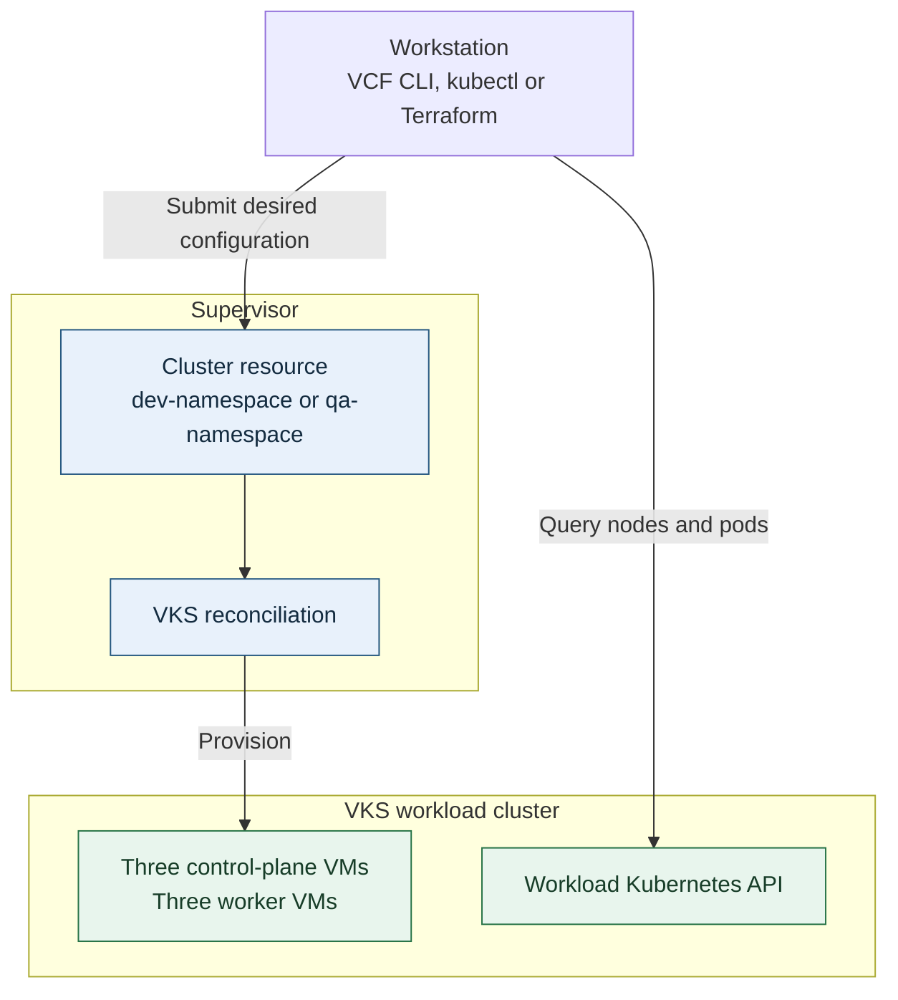
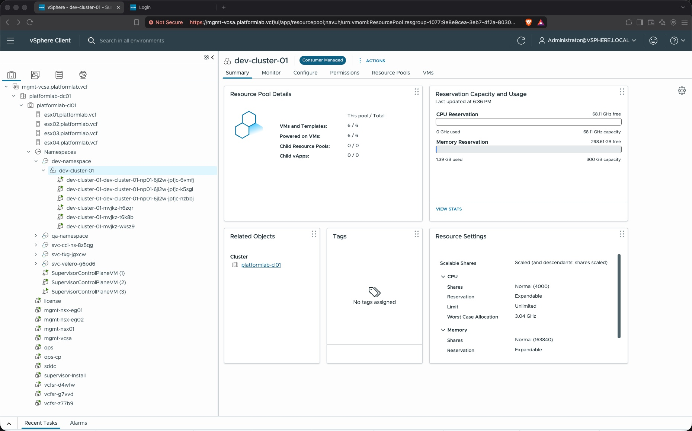
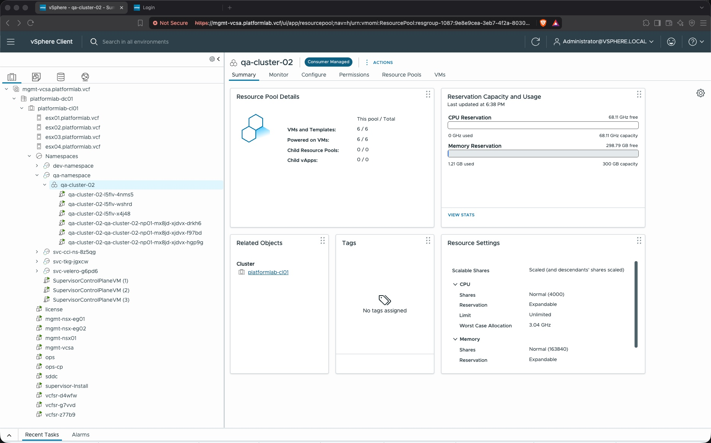
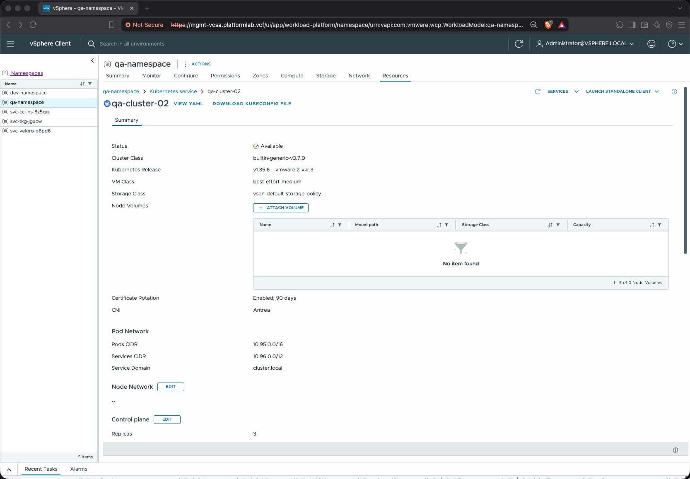

<!--
authors: "Julius M. Nicolescu, Qwen3-Coder-30B-A3B-Instruct-4bit, Qwen3.8-27B-8bit"
date: 2026-11-18
description: Create DEV and QA VKS clusters using manual YAML, Bash, PowerShell, Command Prompt or Terraform.
keywords: VCF 9.1.1, VKS, Supervisor, Cluster API, kubectl, YAML, Terraform
lang: en
-->

# Create VKS clusters

Create **DEV and QA VKS clusters** on VMware Cloud Foundation **9.1.1**, then connect to their workload Kubernetes APIs. Follow the manual YAML procedure or use the supplied Bash, PowerShell 7, Command Prompt or Terraform examples.

**Documentation scope:** DEV is the worked example. QA follows the same process with its own directory, namespace, Cluster name and contexts. Environment tables, cluster views and the [Output](#output) index cover both clusters.

Choose **one deployment method per Cluster**:

| Method | What it manages | When to use it |
| --- | --- | --- |
| Manual YAML | Apply the existing Cluster manifest with kubectl. | Review and submit YAML directly. |
| Platform scripts | Generate a manifest, apply it and wait for availability. | Run the matching Bash, PowerShell or batch examples. |
| Terraform | Manage the Supervisor Cluster and a local YAML copy through separate DEV/QA roots. | Keep infrastructure under Terraform state. |

Cluster lifecycle operations use **Supervisor**. Node, pod and application queries use the separate **VKS workload cluster** after provisioning.

| Target | Directory / VKS cluster | Supervisor namespace | Workload Kubernetes context |
| --- | --- | --- | --- |
| DEV | `dev-cluster-01` | `dev-namespace` | `dev-cluster-01:dev-cluster-01` |
| QA | `qa-cluster-02` | `qa-namespace` | `qa-cluster-02:qa-cluster-02` |

## Contents

- [Reference Environment](#reference-environment)
- [Prerequisites](#prerequisites)
- [VKS provisioning workflow](#vks-provisioning-workflow)
- [Prepare the DEV configuration](#prepare-the-dev-configuration)
- [Create the DEV VKS cluster](#create-the-dev-vks-cluster)
- [Terraform deployment](#terraform-deployment)
- [Verify the deployment](#verify-the-deployment)
- [Project files](#project-files)
- [Optional cleanup](#optional-cleanup)
- [Troubleshooting](#troubleshooting)
- [Output](#output)
- [References](#references)

## Reference Environment

The current manifests, script headers and supplied **2026-11-15** captures describe this lab configuration:

| Component | Version or setting |
| --- | --- |
| VMware Cloud Foundation | `9.1.1.0-545627-2026-09` |
| Cluster API | `cluster.x-k8s.io/v1beta2` |
| Versioned ClusterClass | `builtin-generic-v3.7.0` in `vmware-system-vks-public` |
| Workload Kubernetes release | `v1.35.6---vmware.2-vkr.3` |
| Node OS / CNI | Photon / Antrea |
| Nodes per cluster | Three control-plane nodes and three workers. |
| Supervisor authentication endpoint | `10.55.16.4` in the context scripts. |
| Captured DEV workload API | `https://10.55.16.8:6443` |
| Captured QA workload API | `https://10.55.16.9:6443` |

These are lab values and historical observations. Confirm the available release, ClusterClass, namespace assignments and capacity on the target Supervisor before deployment.

## Prerequisites

| Requirement | Details |
| --- | --- |
| macOS/Linux | Bash for `.sh` scripts; OpenSSL for certificate retrieval in context scripts. Invoking with `bash` does not require executable permissions. |
| Windows PowerShell | PowerShell **7.0 or later**, started with `pwsh`; certificate retrieval uses .NET, without OpenSSL. |
| Windows Command Prompt | `cmd.exe` for `.bat` scripts; VCF CLI and kubectl in `PATH`. Batch context scripts skip TLS certificate verification and do not require OpenSSL. |
| CLI tools | VCF Consumption CLI, its Kubernetes plugins and compatible `kubectl` in `PATH`. See the [CLI installation guide](../41-install-vcf-cli-kubectl/Readme.md). |
| Optional reports | Bash, VCF CLI, kubectl, jq and standard shell utilities; read access to the inventories collected by scripts `91`–`93`. |
| Terraform alternative | Terraform **>= 1.5.0**, `hashicorp/kubernetes ~> 3.0`, `hashicorp/local ~> 2.5`, and provider download access for `terraform init`. |
| Existing infrastructure | Configured Supervisor and VKS service serving `cluster.x-k8s.io/v1beta2`. Existing `dev-namespace` and/or `qa-namespace`; see the [namespace guide](../43-create-vsphere-namespace/Readme.md). |
| Authentication and permissions | Access to create, inspect, update and delete Cluster resources in the selected Supervisor namespace, and access to the resulting workload cluster. All-namespace/node queries may require additional read permissions. |
| Cluster resources | Selected VM and storage classes assigned to the namespace; compatible release and ClusterClass available; capacity and quota for three control-plane and three worker VMs per cluster. |
| Connectivity | Workstation access to Supervisor and workload APIs, plus working infrastructure networking, storage and image access for node provisioning. |
| Local files | Write access to VCF configuration, kubeconfig, temporary certificate location, the selected `deployment-files` directory, and the Terraform root for providers and state. |

## VKS provisioning workflow

The workstation submits a namespaced Cluster resource to Supervisor. VKS reconciles that desired configuration into control-plane and worker VMs. After availability, the workstation connects to the resulting workload API.



The arrows show provisioning and API access. This workflow prepares the platform for later application deployments.

## Prepare the DEV configuration

Start in the directory containing this README. Review the selected scripts before running them. The supplied endpoint `10.55.16.4` and account settings are lab values. Configure credentials locally; do not copy passwords into documentation or commit them to source control.

| Script setting | Purpose |
| --- | --- |
| `SUPERVISOR_API_ENDPOINT` | Supervisor address used to authenticate both Supervisor and workload connections. |
| `VCF_CLI_VSPHERE_USERNAME`, `VCF_CLI_VSPHERE_PASSWORD` | Credentials passed to the VCF CLI child process by the context scripts. |
| `CONTEXT_NAME` | Supervisor context; default `supervisor`. |
| `CLUSTER01_NAMESPACE`, `CLUSTER01_NAME`, `CLUSTER01_MANIFEST` | Namespace, Cluster name and generated filename used by creation scripts. Deletion uses the namespace and name. |
| `CLUSTER_NAMESPACE`, `CLUSTER_NAME` | Workload context target in both DEV and QA. |
| `DEPLOYMENT_FILES` | Manifest directory beside the creation script: `deployment-files`. |
| `REQUEST_TIMEOUT`, `WAIT_TIMEOUT` | 30-second Kubernetes request timeout where supplied and 1,800-second availability/deletion wait. These do not limit VCF authentication calls. |

Bash context scripts fetch `SUPERVISOR.crt` with OpenSSL into `/tmp`; PowerShell uses .NET and the system temporary directory. They replace the old certificate and named local VCF context, pass `--ca-certificate`, select the Kubernetes context and query nodes. Verify the endpoint's certificate before using it as the trust input. Batch context scripts use `--insecure-skip-tls-verify` and do not retrieve a certificate. See the [VCF context reference][context-reference] for connection arguments.

Creation and deletion scripts refresh the existing `supervisor` connection and explicitly select its Kubernetes context. Workload context scripts use `--workload-cluster-namespace` and `--workload-cluster-name` against the Supervisor endpoint.

| Cluster setting | DEV | QA |
| --- | --- | --- |
| Namespace | `dev-namespace` | `qa-namespace` |
| Cluster | `dev-cluster-01` | `qa-cluster-02` |
| API | `cluster.x-k8s.io/v1beta2` | Same |
| ClusterClass / namespace | `builtin-generic-v3.7.0` / `vmware-system-vks-public` | Same |
| Kubernetes release | `v1.35.6---vmware.2-vkr.3` | Same |
| VM class / OS | `best-effort-medium` / Photon | Same |
| Storage class | `vsan-default-storage-policy` | Same |
| Control-plane / worker replicas | `3` / `3` | Same |
| Pod / service CIDR | `10.95.0.0/16` / `10.96.0.0/12` | Same |
| Worker pool | `dev-cluster-01-np01` | `qa-cluster-02-np01` |
| CNI / service domain | Antrea / `cluster.local` | Same |

Edit the embedded YAML templates for lasting script changes, or edit the supplied YAML for manual deployment. The API version identifies the Cluster schema; `spec.topology.version` selects the workload Kubernetes release. Check release/class compatibility on your Supervisor before provisioning.

For VCF 9.1 and later, pod/service ranges must not overlap Supervisor workload networks or LoadBalancer ranges; VKS clusters may share these ranges with each other. See the [default Cluster example][default-cluster].

For Terraform input values and connection settings, see [Terraform deployment](#terraform-deployment). QA uses the same workflow from `qa-cluster-02/`, with its own namespace, Cluster name, manifest and workload context shown above.

### Cluster topology and coverage

This workflow exercises Supervisor authentication, Cluster API submission, VM provisioning, cluster availability and workload API access. It does not deploy an application or test application LoadBalancer traffic, PVC provisioning or failover.

| Resource or setting | Configuration and purpose |
| --- | --- |
| Cluster resource | One namespaced `Cluster` per target, reconciled by VKS on Supervisor. |
| Control plane | Three Photon VMs using the selected VM and storage classes. |
| Worker pool | Three Photon VMs in one `node-pool` machine deployment. |
| Worker storage | A 30 GiB volume mounted at `/var/lib/containerd`. |
| Networking | Antrea, explicit pod/service CIDRs and `cluster.local`. |
| Certificate rotation | Enabled with a 90-day renewal window. |
| Pod Security | Restricted auditing; privileged enforcement and warnings. |
| Terraform resources | `kubernetes_manifest.cluster` and `local_file.cluster_manifest`. |

Creation scripts wait for `Available=True` for up to 30 minutes. Terraform also waits for `Available=True`; its create, update and delete timeout is set by `cluster_wait_timeout`, currently `60m`. Verify workload nodes after either method completes. The supplied configuration does not explicitly set a default StorageClass for application PVCs or add trusted registry CAs; Terraform exposes optional CA Secret references, empty by default.

## Create the DEV VKS cluster

Start in the README directory. Complete the prerequisites and configuration review, then choose the manual procedure or the platform scripts. [Terraform deployment](#terraform-deployment) is a third alternative for the same Cluster.

### Option 1: manual deployment

#### 1. Connect to Supervisor

Use an authenticated `supervisor` context. If it does not exist, configure and run the Supervisor context script for your platform (`01`, `11` or `21`) from `dev-cluster-01/`, then return to the README directory. See the sibling [context guide](../42-create-vks-context/Readme.md).

The following refresh example uses Bash:

```bash
CLUSTER_NAME=supervisor

# Refresh workload cluster authentication and retain error messages.
vcf context refresh ${CLUSTER_NAME} >/dev/null 2>&1

# Select Supervisor for Cluster lifecycle operations.
kubectl config use-context supervisor

# Confirm the selected Kubernetes context.
kubectl config current-context
```

The refresh command suppresses both output and errors. Run `vcf context refresh supervisor` directly if it fails and the error needs inspection.

#### 2. Check the namespace, release and ClusterClass

Review the [DEV manifest](./dev-cluster-01/deployment-files/create-dev-cluster-01.yaml). Confirm the namespace, release, ClusterClass, VM class, storage, replicas and network ranges against Supervisor inventory.

```bash
# Select Supervisor before inspecting provisioning prerequisites.
kubectl config use-context supervisor

# Inspect DEV namespace storage assignments and quotas.
kubectl describe namespace dev-namespace

# List VM classes available to DEV.
kubectl -n dev-namespace get virtualmachineclass

# List Kubernetes releases and their Ready/Compatible status.
kubectl get kr

# List versioned ClusterClasses.
kubectl -n vmware-system-vks-public get clusterclass

# Inspect the topology schema served by Supervisor.
kubectl explain cluster.spec.topology --api-version=cluster.x-k8s.io/v1beta2
```

Use a release marked Ready and Compatible. The [official kubectl provisioning workflow][yaml-workflow] explains prerequisite discovery and manifest submission.

#### 3. Apply the manifest and wait for availability

```bash
# Submit the reviewed DEV Cluster manifest to Supervisor.
kubectl -n dev-namespace apply -f dev-cluster-01/deployment-files/create-dev-cluster-01.yaml

# Wait up to 30 minutes for Cluster availability.
kubectl --request-timeout=30s -n dev-namespace wait cluster/dev-cluster-01 --for=condition=Available=True --timeout=1800s

# Inspect the Cluster conditions after the wait.
kubectl -n dev-namespace get cluster dev-cluster-01 -o yaml
```

`apply` can update an existing Cluster. Review changes to release, sizing and topology before rerunning it. The kubectl commands also work in PowerShell or Command Prompt.

#### 4. Create the workload context

After availability succeeds, run the matching context script from `dev-cluster-01/`: `04` for Bash, `14` for PowerShell or `24` for Command Prompt. These are listed below. Then follow [Verify the deployment](#verify-the-deployment).

### Option 2: use the deployment scripts

The scripts are examples with editable lab settings. Run **Supervisor context → create Cluster → workload context**, using one platform below. Start in the README directory and enter `dev-cluster-01/`. For QA, enter `qa-cluster-02/` and use the same filenames with the QA configuration.

#### macOS/Linux — Bash

```bash
# Enter the DEV script directory.
cd dev-cluster-01
```

| Script | What it does | Run from this directory |
| --- | --- | --- |
| [01-create-supervisor-context.sh](./dev-cluster-01/01-create-supervisor-context.sh) | Recreate and select Supervisor context; query nodes. | `bash ./01-create-supervisor-context.sh` |
| [02-create-vks-cluster.sh](./dev-cluster-01/02-create-vks-cluster.sh) | Generate YAML, apply the Cluster and wait for availability. | `bash ./02-create-vks-cluster.sh` |
| [04-create-vks-cluster-context.sh](./dev-cluster-01/04-create-vks-cluster-context.sh) | Recreate and select the workload context; query nodes. | `bash ./04-create-vks-cluster-context.sh` |

#### Windows — PowerShell 7

```powershell
# Enter the DEV script directory.
Set-Location dev-cluster-01
```

| Script | What it does | Run from this directory |
| --- | --- | --- |
| [11-create-supervisor-context.ps1](./dev-cluster-01/11-create-supervisor-context.ps1) | Recreate and select Supervisor context; query nodes. | `pwsh -File ./11-create-supervisor-context.ps1` |
| [12-create-vks-cluster.ps1](./dev-cluster-01/12-create-vks-cluster.ps1) | Generate YAML, apply the Cluster and wait for availability. | `pwsh -File ./12-create-vks-cluster.ps1` |
| [14-create-vks-cluster-context.ps1](./dev-cluster-01/14-create-vks-cluster-context.ps1) | Recreate and select the workload context; query nodes. | `pwsh -File ./14-create-vks-cluster-context.ps1` |

#### Windows — Command Prompt

```bat
REM Enter the DEV script directory.
cd dev-cluster-01
```

| Script | What it does | Run from this directory |
| --- | --- | --- |
| [21-create-supervisor-context.bat](./dev-cluster-01/21-create-supervisor-context.bat) | Recreate and select Supervisor context using insecure TLS; query nodes. | `21-create-supervisor-context.bat` |
| [22-create-vks-cluster.bat](./dev-cluster-01/22-create-vks-cluster.bat) | Generate YAML, apply the Cluster and wait for availability. | `22-create-vks-cluster.bat` |
| [24-create-vks-cluster-context.bat](./dev-cluster-01/24-create-vks-cluster-context.bat) | Recreate and select the workload context using insecure TLS; query nodes. | `24-create-vks-cluster-context.bat` |

Creation scripts overwrite their generated YAML. Bash stops on command failure; PowerShell and batch scripts do not check every native command's exit status. Inspect errors and Cluster conditions before proceeding to workload access.

## Terraform deployment

Use the [DEV root](dev-cluster-01/terraform-create-vks-cluster/) or [QA root](qa-cluster-02/terraform-create-vks-cluster/) as an alternative to manual YAML or the creation scripts. Each root manages two resources: `kubernetes_manifest.cluster` on Supervisor and `local_file.cluster_manifest` on the workstation. DEV and QA have separate state and no shared module.

### Configuration and provider requirements

Edit the selected root's `terraform.tfvars` before initialization and planning.

| File | Purpose |
| --- | --- |
| `providers.tf` | Terraform and provider version constraints; Supervisor kubeconfig connection. |
| `variables.tf` | Input declarations, descriptions and validation. |
| `terraform.tfvars` ([DEV](dev-cluster-01/terraform-create-vks-cluster/terraform.tfvars), [QA](qa-cluster-02/terraform-create-vks-cluster/terraform.tfvars)) | Configured connection, topology, sizing and timeout values. |
| `main.tf` | Cluster manifest, availability wait and generated YAML resource. |
| `outputs.tf` | Cluster name, namespace, desired YAML and manifest path. |

| Input / requirement | Supplied value |
| --- | --- |
| Terraform | `>= 1.5.0` |
| Providers | `hashicorp/kubernetes ~> 3.0`; `hashicorp/local ~> 2.5` |
| `kubeconfig_path`, `supervisor_context` | `~/.kube/config`, `supervisor` |
| `cluster_name`, `namespace` | DEV: `dev-cluster-01`, `dev-namespace`; QA: `qa-cluster-02`, `qa-namespace` |
| `kubernetes_version` | `v1.35.6---vmware.2-vkr.3` |
| `cluster_class`, `cluster_class_namespace` | `builtin-generic-v3.7.0`, `vmware-system-vks-public` |
| `vm_class`, `storage_class` | `best-effort-medium`, `vsan-default-storage-policy` |
| `control_plane_count`, `worker_count` | `3`, `3` |
| `containerd_volume_capacity` | `30Gi` |
| `pod_cidrs`, `service_cidrs` | `["10.95.0.0/16"]`, `["10.96.0.0/12"]` |
| `additional_trusted_cas` | `[]`; optional entries reference existing Secrets with `secret_name` and `key`. |
| `cluster_wait_timeout` | `60m` for create, update and delete. |

The Kubernetes provider targets **Supervisor**, which must be reachable during planning and must already serve the Cluster schema. The [manifest resource documentation](https://registry.terraform.io/providers/hashicorp/kubernetes/latest/docs/resources/manifest) explains planning-time access, conditions and computed fields.

The supplied configuration waits for `Available=True` on create/update and uses the configured timeout for deletion. It allows Supervisor to populate annotations, labels, topology variables and the resolved release through `computed_fields`. Field ownership uses `terraform-vks-cluster` with `force_conflicts = false`. Node readiness remains a separate verification step.

Optional CA Secrets must already exist in the selected Supervisor namespace. The configuration does not create them. Terraform also explicitly sets Pod Security `deactivated = false`.

### Deploy DEV

Create the Supervisor context using the matching platform script first. From the README directory, enter the DEV Terraform root. For QA, use `qa-cluster-02/terraform-create-vks-cluster` instead; keep each root's state and inputs separate.

**Bash:**

```bash
# Enter the DEV Terraform root.
cd dev-cluster-01/terraform-create-vks-cluster

# Select Supervisor for Cluster lifecycle checks.
kubectl config use-context supervisor
```

**PowerShell 7:**

```powershell
# Enter the DEV Terraform root.
Set-Location dev-cluster-01/terraform-create-vks-cluster

# Select Supervisor for Cluster lifecycle checks.
kubectl config use-context supervisor
```

Run these commands one at a time in the selected root; they work in Bash and PowerShell.

```bash
# Install the required providers.
terraform init

# Check the Terraform configuration.
terraform validate

# Preview the Cluster and local YAML changes.
terraform plan

# Review the plan, confirm the changes and wait for availability.
terraform apply
```

After apply succeeds, create the matching workload context (`04`, `14` or `24`) from the cluster script directory and follow [Verify the deployment](#verify-the-deployment). An existing Cluster created outside this state requires an intentional import and reviewed plan before Terraform can manage it.

### Optional Bash runners

Run from the selected Terraform root after initialization and authentication. These runners capture terminal output; they do not refresh credentials or initialize providers.

| Script | What it does | Run from this directory |
| --- | --- | --- |
| [01-terraform-plan.sh](./dev-cluster-01/terraform-create-vks-cluster/01-terraform-plan.sh) | Preview changes and save the transcript. | `bash ./01-terraform-plan.sh` |
| [02-terraform-apply.sh](./dev-cluster-01/terraform-create-vks-cluster/02-terraform-apply.sh) | Apply changes with `-auto-approve` and save the transcript. | `bash ./02-terraform-apply.sh` |
| [03-terraform-destroy.sh](./dev-cluster-01/terraform-create-vks-cluster/03-terraform-destroy.sh) | Destroy resources with `-auto-approve`, wait for deletion and save the transcript. | `bash ./03-terraform-destroy.sh` |

The apply and destroy runners proceed without a confirmation prompt. Review the configuration and plan before invoking them. Logs are saved in `output-YYYY-MM-DD/` using the runner name with a `.txt` extension. The plan runner does not save a binary plan by default; a subsequent apply computes its own plan.

### Terraform outputs

Run from the root used for deployment:

```bash
# Show the managed Cluster name.
terraform output -raw cluster_name

# Show the Supervisor namespace.
terraform output -raw namespace

# Show the generated YAML path.
terraform output -raw manifest_file

# Display the desired Cluster YAML.
terraform output -raw manifest_yaml
```

Outputs describe configuration and state; they do not prove current node health. The generated YAML requests file mode `0600` and directory mode `0700` where supported, using the [Local file resource](https://registry.terraform.io/providers/hashicorp/local/latest/docs/resources/file).

### Terraform cleanup

Use the original Terraform root and state with valid Supervisor authentication. This removes the managed Cluster and local YAML artifact.

```bash
# Review and confirm deletion of the resources managed by this root.
terraform destroy
```

The provider waits for Cluster deletion using its saved timeout. Inspect Supervisor if deletion times out; stopping the command does not undo an accepted deletion request. The existing Supervisor namespace, local context entries, Terraform source files and provider installation remain. Keep the state files for follow-up operations.

## Verify the deployment

Use these checks after manual, script or Terraform deployment. Select Supervisor for Cluster resources, then the workload context for nodes and pods. The refresh assignment below uses Bash; on Windows, use the matching workload context script before the workload checks.

```bash
# Select Supervisor before inspecting Cluster resources.
kubectl config use-context supervisor

# Inspect Cluster status and conditions.
kubectl -n dev-namespace get cluster dev-cluster-01 -o yaml

# Inspect provisioned machines and VMs.
kubectl -n dev-namespace get machines,virtualmachines

CLUSTER_NAME=dev-cluster-01

# Refresh workload cluster authentication and retain error messages.
vcf context refresh ${CLUSTER_NAME} >/dev/null 2>&1

# Select the DEV workload Kubernetes context.
kubectl config use-context dev-cluster-01:dev-cluster-01

# Inspect node readiness and addresses.
kubectl get nodes -o wide

# Inspect system pod readiness.
kubectl -n kube-system get pods -o wide
```

### Deployment success conditions

| Check | What it establishes |
| --- | --- |
| Cluster has `Available=True` | Supervisor reports overall Cluster availability. |
| Six workload nodes are `Ready` | The configured three control-plane nodes and three workers are registered and ready. |
| System pods are healthy | Core services, CNI and CSI components are running as expected. |
| Workload API queries succeed | Authentication and connectivity to the selected workload API work. |

### Cluster views

The supplied **2026-11-15** screenshots show both clusters as **Available** and each inventory resource pool with **six powered-on VMs**. Open a preview for the full-size JPG.

In the vSphere Client, use **Hosts and Clusters → cluster → Namespaces → dev-namespace → dev-cluster-01 → Summary** for the inventory view. For the management view, select **dev-namespace → Resources → Kubernetes service → dev-cluster-01 → Summary**. Use the matching QA names for QA.

| View | DEV | QA |
| --- | --- | --- |
| **Inventory** | [](./dev-cluster-01/output-2026-11-15/dev-cluster-01-inventory-view.jpg) | [](./qa-cluster-02/output-2026-11-15/qa-cluster-02-inventory-view.jpg) |
| **Supervisor management** | [](./dev-cluster-01/output-2026-11-15/dev-cluster-01-supervisor-management-view.jpg) | [](./qa-cluster-02/output-2026-11-15/qa-cluster-02-supervisor-management-view.jpg) |

The screenshots and text reports are separate observations: VM names differ between the DEV inventory image and the DEV report. Use the saved files to inspect each capture and rerun the verification commands for current health.

### Capture cluster reports

From `dev-cluster-01/`, choose the report needed. These Bash collectors use VCF CLI, kubectl and jq, refresh local credentials, and save output and errors beside the script in `output-YYYY-MM-DD/`. Same-day reruns replace the corresponding report.

| Script | What it does | Run from this directory |
| --- | --- | --- |
| [91-document-vks-cluster.sh](./dev-cluster-01/91-document-vks-cluster.sh) | Workload configuration, network, node, storage, workload and image inventory. | `bash ./91-document-vks-cluster.sh` |
| [92-document-vks-cluster-ip.sh](./dev-cluster-01/92-document-vks-cluster-ip.sh) | Workload API, node/pod/service CIDRs, addresses, ingress and endpoints. | `bash ./92-document-vks-cluster-ip.sh` |
| [93-troubleshoot-vks-deployment.sh](./dev-cluster-01/93-troubleshoot-vks-deployment.sh) | Workload checks followed by Supervisor Cluster, machine, VM and event diagnostics. | `bash ./93-troubleshoot-vks-deployment.sh` |

Script `93` requires workload authentication before collecting Supervisor diagnostics and finishes in the Supervisor context. If workload authentication is unavailable, use Supervisor queries directly to investigate provisioning.

**Captured DEV network summary — 2026-11-15:** excerpt from the saved IP report; per-node pod ranges are smaller than the configured cluster pod CIDR.

```text
NETWORK              CIDRs / IPs
Node IPs             172.30.0.2,172.30.0.3,172.30.0.4,172.30.0.5,172.30.0.6,172.30.0.7
Pod CIDRs            10.95.0.0/24,10.95.1.0/24,10.95.2.0/24,10.95.3.0/24,10.95.5.0/24,10.95.6.0/24
Service CIDRs        10.96.0.0/12
Load balancer IPs    <none>
Ingress IPs          <none>
```

Both environments record node addresses `172.30.0.2`–`172.30.0.7`, service CIDR `10.96.0.0/12`, and no workload LoadBalancer or ingress IPs in these captures. Their workload API endpoints differ, as shown in [Reference Environment](#reference-environment). Full reports are linked in [Output](#output).

## Project files

### Repository layout

Both cluster directories use the same script names; their settings select different Cluster names and namespaces.

```text
44-create-vks-cluster/
├── Readme.md
├── 00-copy-dev-cluster-01-to-qa-cluster-02.sh
├── dev-cluster-01/
│   ├── 01–04  Bash lifecycle and context scripts
│   ├── 11–14  PowerShell lifecycle and context scripts
│   ├── 21–24  Command Prompt lifecycle and context scripts
│   ├── 91–93  Bash report and troubleshooting scripts
│   ├── deployment-files/
│   ├── output-YYYY-MM-DD/
│   └── terraform-create-vks-cluster/
│       ├── providers.tf, variables.tf, terraform.tfvars
│       ├── main.tf, outputs.tf
│       ├── 01-terraform-plan.sh
│       ├── 02-terraform-apply.sh
│       ├── 03-terraform-destroy.sh
│       ├── deployment-files/       (generated by Terraform)
│       └── output-YYYY-MM-DD/      (runner transcripts)
└── qa-cluster-02/                  (same layout, QA settings)
```

The root copy utility is a maintenance tool, not a deployment step. It deletes and recreates the local QA directory from DEV, replaces selected names and settings, and excludes generated manifests, reports, backups and Terraform state. Do not use it to provision a cluster or to preserve an existing QA working directory.

### Generated deployment files

The creation scripts generate one Cluster manifest beneath their own directory and apply it to Supervisor. Each run overwrites that file. For persistent script changes, edit the embedded YAML template; for manual deployment, edit the existing YAML directly.

| Method | DEV manifest path | QA manifest path |
| --- | --- | --- |
| Manual / scripts | [dev-cluster-01/deployment-files/create-dev-cluster-01.yaml](dev-cluster-01/deployment-files/create-dev-cluster-01.yaml) | [qa-cluster-02/deployment-files/create-qa-cluster-02.yaml](qa-cluster-02/deployment-files/create-qa-cluster-02.yaml) |
| Terraform | `dev-cluster-01/terraform-create-vks-cluster/deployment-files/create-dev-cluster-01.yaml` | `qa-cluster-02/terraform-create-vks-cluster/deployment-files/create-qa-cluster-02.yaml` |

Terraform generates its YAML from the HCL configuration and submits the Cluster through the Kubernetes provider. It does not read the script-generated YAML. Its YAML is a managed output artifact and is removed by `terraform destroy`.

Terraform initialization creates `.terraform/` and records provider selections in `.terraform.lock.hcl`. The local backend keeps state in the selected root. Retain that state for updates and cleanup. Optional Terraform runners and report scripts write text files under `output-YYYY-MM-DD/` beside their scripts; same-day reruns overwrite the corresponding transcript or report.

Bash scripts stop on command failures. PowerShell and batch scripts do not check every external command's exit status, so inspect command errors and actual cluster state before continuing. A failed operation can leave resources already created.

## Optional cleanup

Remove a Cluster when its workloads and data are no longer needed. For a manual or script-created Cluster, run one deletion script from `dev-cluster-01/` (or `qa-cluster-02/` for QA). For a Terraform-managed Cluster, use the original root and state with [Terraform cleanup](#terraform-cleanup).

| Script | What it does | Run from this directory |
| --- | --- | --- |
| [03-delete-vks-cluster.sh](./dev-cluster-01/03-delete-vks-cluster.sh) | Delete the Cluster and wait for removal using Bash. | `bash ./03-delete-vks-cluster.sh` |
| [13-delete-vks-cluster.ps1](./dev-cluster-01/13-delete-vks-cluster.ps1) | Delete the Cluster and wait for removal using PowerShell. | `pwsh -File ./13-delete-vks-cluster.ps1` |
| [23-delete-vks-cluster.bat](./dev-cluster-01/23-delete-vks-cluster.bat) | Delete the Cluster and wait for removal using Command Prompt. | `23-delete-vks-cluster.bat` |

Deletion scripts refresh and select `supervisor`, submit `kubectl delete cluster --wait=false`, then wait up to 30 minutes for the Cluster resource to disappear. A timeout stops waiting; it does not cancel the deletion request. Cluster deletion removes its managed node infrastructure and workload access. The existing Supervisor namespace, local context entries and script-generated manifests remain.

## Troubleshooting

| Symptom | Check or action |
| --- | --- |
| Script or manifest not found | Start from the documented directory. Scripts are inside `dev-cluster-01` and `qa-cluster-02`; manual YAML paths start from the README directory. |
| Missing certificate | Rerun the selected Bash/PowerShell context script; it retrieves the certificate before creating the connection. Bash needs OpenSSL. |
| Batch context prerequisites are unclear | The executable checks require VCF CLI and kubectl. The progress message mentions OpenSSL, but the batch scripts do not invoke it. |
| Authentication fails | Check endpoint and local credentials. Run `vcf context refresh supervisor` directly to see errors hidden by creation/deletion scripts. |
| kubectl reports version skew | The saved DEV configuration report records client `1.37` against server `1.35` and a skew warning. Use a compatible kubectl version; see the [CLI installation guide](../41-install-vcf-cli-kubectl/Readme.md). |
| Cluster resource type not found | Select `supervisor` and verify that VKS serves the v1beta2 Cluster API. Workload contexts are not the target for these lifecycle operations. |
| Namespace, class or release rejected | Inspect permissions, VM/storage assignments, quota, available ClusterClasses and Ready/Compatible releases. |
| Availability wait times out | Select Supervisor, describe the Cluster and inspect namespace events, machines and VMs. Check capacity, networking, storage and release availability. |
| Workload context fails after creation | Check Cluster conditions and workload API readiness before retrying the matching `04`, `14` or `24` script. |
| Terraform planning cannot reach the API | Refresh Supervisor authentication and check `kubeconfig_path` and `supervisor_context`; planning needs live Supervisor API access. |
| Terraform reports an existing resource or field conflict | Check which method owns the Cluster and review its state/configuration before import or changes. Do not force ownership merely to bypass the error. |
| Printed completion text follows an error | Inspect native CLI errors and current state. PowerShell/batch scripts do not check every native command's exit status. |
| Forbidden on all-namespace or node queries | Use namespace-scoped Cluster queries where permitted; confirm separately whether node/all-namespace read access is granted. |
| Certificate error after a certificate change | Verify the new certificate and recreate the affected context using the matching script. |

## Output

The saved records are in **`output-2026-11-15`**. Cluster views show Available status and six powered-on VMs per cluster; configuration/IP reports record workload API and network inventory. Terraform apply transcripts record two resources added, and destroy transcripts record two resources destroyed. These files capture different stages of the lab workflow.

| Cluster | Output | Description |
| --- | --- | --- |
| `dev-cluster-01` | **Cluster views**<br>[Inventory](./dev-cluster-01/output-2026-11-15/dev-cluster-01-inventory-view.jpg) · [Supervisor management](./dev-cluster-01/output-2026-11-15/dev-cluster-01-supervisor-management-view.jpg) | vSphere inventory and VKS configuration/status screenshots. |
| `dev-cluster-01` | [Cluster configuration report](./dev-cluster-01/output-2026-11-15/vks-cluster-configuration-report—dev-cluster-01.txt) | Network, nodes, namespaces, workloads, storage, CNI/CSI and resource inventory. |
| `dev-cluster-01` | [Cluster IP report](./dev-cluster-01/output-2026-11-15/vks-cluster-ip-report—dev-cluster-01.txt) | API endpoint, node/pod/service addresses, CIDRs and ingress inventory. |
| `dev-cluster-01` | [Deployment diagnostics](./dev-cluster-01/output-2026-11-15/vks-deployment-troubleshooting-dev-cluster-01.txt) | Supervisor Cluster conditions, machines, VMs, events and workload checks. |
| `dev-cluster-01` | **Terraform transcripts**<br>[Plan](./dev-cluster-01/terraform-create-vks-cluster/output-2026-11-15/01-terraform-plan.txt) · [Apply](./dev-cluster-01/terraform-create-vks-cluster/output-2026-11-15/02-terraform-apply.txt) · [Destroy](./dev-cluster-01/terraform-create-vks-cluster/output-2026-11-15/03-terraform-destroy.txt) | Recorded lifecycle of the Cluster and local YAML resource. |
| `qa-cluster-02` | **Cluster views**<br>[Inventory](./qa-cluster-02/output-2026-11-15/qa-cluster-02-inventory-view.jpg) · [Supervisor management](./qa-cluster-02/output-2026-11-15/qa-cluster-02-supervisor-management-view.jpg) | vSphere inventory and VKS configuration/status screenshots. |
| `qa-cluster-02` | [Cluster configuration report](./qa-cluster-02/output-2026-11-15/vks-cluster-configuration-report—qa-cluster-02.txt) | Network, nodes, namespaces, workloads, storage, CNI/CSI and resource inventory. |
| `qa-cluster-02` | [Cluster IP report](./qa-cluster-02/output-2026-11-15/vks-cluster-ip-report—qa-cluster-02.txt) | API endpoint, node/pod/service addresses, CIDRs and ingress inventory. |
| `qa-cluster-02` | [Deployment diagnostics](./qa-cluster-02/output-2026-11-15/vks-deployment-troubleshooting-qa-cluster-02.txt) | Supervisor Cluster conditions, machines, VMs, events and workload checks. |
| `qa-cluster-02` | **Terraform transcripts**<br>[Plan](./qa-cluster-02/terraform-create-vks-cluster/output-2026-11-15/01-terraform-plan.txt) · [Apply](./qa-cluster-02/terraform-create-vks-cluster/output-2026-11-15/02-terraform-apply.txt) · [Destroy](./qa-cluster-02/terraform-create-vks-cluster/output-2026-11-15/03-terraform-destroy.txt) | Recorded lifecycle of the Cluster and local YAML resource. |

Cluster image previews appear in [Cluster views](#cluster-views). Use [Verify the deployment](#verify-the-deployment) to check current availability and node health.

## References

Documentation destinations and content checked on **2026-11-18**. Broadcom links use the rolling **VCF Consumption / latest** documentation. Terraform links also follow latest documentation; this project's provider constraints are listed above.

| Reference | What it covers |
| --- | --- |
| [Workflow for provisioning VKS clusters using kubectl][yaml-workflow] | Prerequisite discovery, manifest submission and verification. |
| [Default Cluster v1beta1/v1beta2 example][default-cluster] | Cluster topology, class references and network range rules. |
| [VCF CLI context command reference][context-reference] | Context creation, authentication, certificate arguments and refresh. |
| [HashiCorp Kubernetes manifest resource](https://registry.terraform.io/providers/hashicorp/kubernetes/latest/docs/resources/manifest) | Custom resources, API access, field ownership and computed fields. |
| [HashiCorp Local file resource](https://registry.terraform.io/providers/hashicorp/local/latest/docs/resources/file) | Generated file content and permissions. |

[default-cluster]: https://techdocs.broadcom.com/us/en/vmware-cis/vcf/vcf-consumption/latest/managing-vsphere-kuberenetes-service-clusters-and-workloads/provisioning-tkg-service-clusters/using-the-cluster-v1beta1-api/using-the-versioned-clusterclass/v1beta1-example-default-cluster.html
[yaml-workflow]: https://techdocs.broadcom.com/us/en/vmware-cis/vcf/vcf-consumption/latest/managing-vsphere-kuberenetes-service-clusters-and-workloads/provisioning-tkg-service-clusters/workflow-for-provisioning-tkg-clusters-using-kubectl.html
[context-reference]: <https://techdocs.broadcom.com/us/en/vmware-cis/vcf/vcf-consumption/latest/consumer-interfaces-in-vcf/installing-and-using-vcf-cli-v9/command-reference2/system-commands(1)/context2.html>
