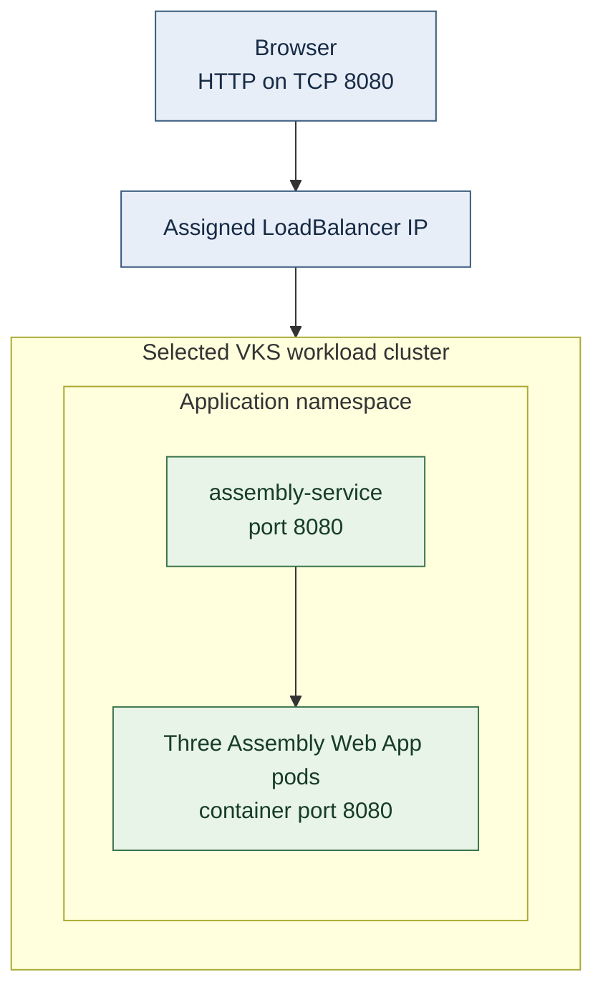
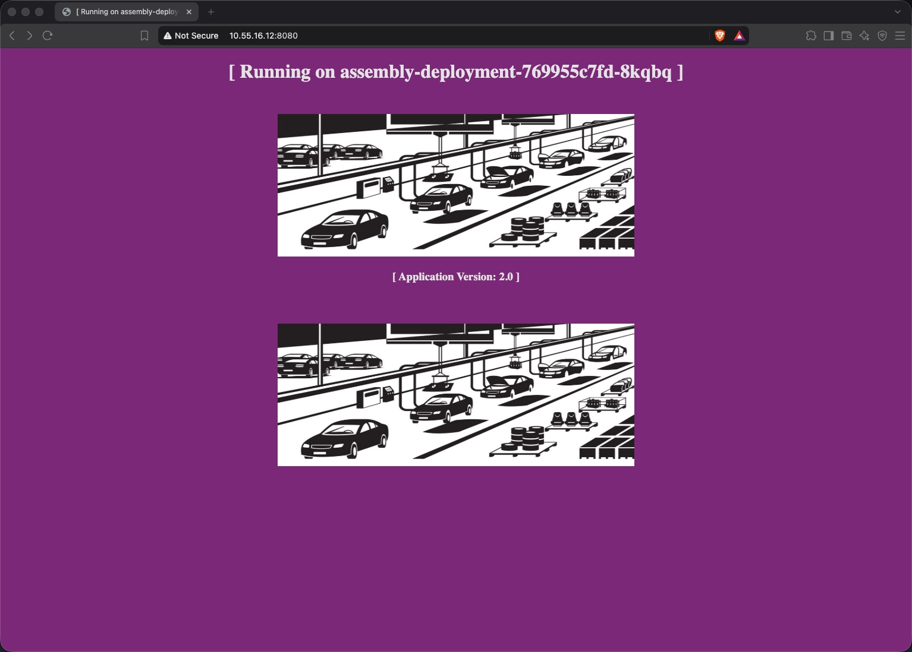
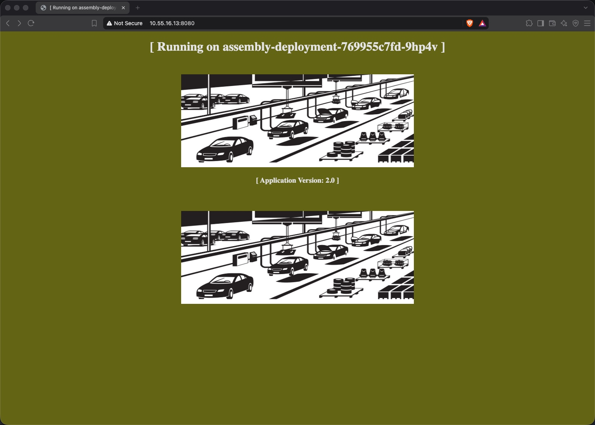

<!--
authors: "Julius M. Nicolescu, Qwen3-Coder-30B-A3B-Instruct-4bit, Qwen3.8-27B-8bit"
date: 2026-11-18
description: Deploy Assembly Web App on DEV and QA VKS clusters using manual manifests, platform scripts or Terraform, and verify LoadBalancer access.
keywords: VCF, VKS, Kubernetes, Assembly Web App, LoadBalancer, Terraform
lang: en
-->

# Deploy Assembly Web App on VKS

Deploy **Assembly Web App** on existing VKS clusters in VMware Cloud Foundation **9.1.1**, then access three web replicas through a Kubernetes **LoadBalancer Service** on port **8080**. Follow the manual procedure or use the supplied Bash, PowerShell, Command Prompt or Terraform examples.

**Documentation scope:** DEV is the worked example for procedures and terminal captures. QA follows the same process with its own directory, context and application namespace. Environment tables, application screenshots and the [Output](#output) index cover both clusters.

| Target | VKS cluster | Supervisor namespace | Workload Kubernetes context | Application namespace |
| --- | --- | --- | --- | --- |
| DEV | `dev-cluster-01` | `dev-namespace` | `dev-cluster-01:dev-cluster-01` | `dev-assembly-lb` |
| QA | `qa-cluster-02` | `qa-namespace` | `qa-cluster-02:qa-cluster-02` | `qa-assembly-lb` |

The Supervisor namespace identifies the existing VKS cluster during authentication. The application namespace is created inside that workload cluster. Choose one deployment method for each application namespace; the scripts and Terraform use the same resource names.

## Contents

- [Reference Environment](#reference-environment)
- [Automated alternatives](#automated-alternatives)
- [Prerequisites](#prerequisites)
- [Deployment model](#deployment-model)
- [Prepare the DEV configuration](#prepare-the-dev-configuration)
- [Deploy Assembly Web App on DEV](#deploy-assembly-web-app-on-dev)
- [Terraform deployment](#terraform-deployment)
- [Verify the deployment](#verify-the-deployment)
- [Application screenshots](#application-screenshots)
- [Project files](#project-files)
- [Optional cleanup](#optional-cleanup)
- [Troubleshooting](#troubleshooting)
- [Output](#output)
- [References](#references)

## Reference Environment

The current project files and supplied **2026-11-18** captures describe this lab:

| Component | Configuration or recorded result |
| --- | --- |
| VMware Cloud Foundation | `9.1.1`; context script headers identify `9.1.1.0-545627-2026-09`. |
| Supervisor API endpoint | `10.55.16.4`, configured in the DEV and QA context scripts. |
| Application image | `jmnicolescu/assembly-webapp:latest`; both browser captures show application version **2.0**. |
| DEV deployment | **3/3** ready replicas; `assembly-service` external IP **10.55.16.12**, TCP **8080**. |
| QA deployment | **3/3** ready replicas; `assembly-service` external IP **10.55.16.13**, TCP **8080**. |
| Terraform alternative | Terraform `>= 1.5.0`, Kubernetes provider `~> 3.0`, independent DEV and QA roots. |

The IPs and readiness values are saved observations from the [reports and screenshots](#output). Discover the assigned Service address after each deployment; these IPs are not requested by the manifests. This documentation update does not run a new deployment.

## Automated alternatives

The supplied scripts are examples with editable lab settings. Run commands from the selected cluster directory: `dev-cluster-01/` for the DEV walkthrough, or `qa-cluster-02/` for QA. The same filenames exist in both directories.

| Script | What it does | Run from this directory |
| --- | --- | --- |
| [01-create-vks-cluster-context.sh](./dev-cluster-01/01-create-vks-cluster-context.sh) | Recreate and activate the Bash workload context; list contexts and nodes. | `bash ./01-create-vks-cluster-context.sh` |
| [02-deploy-assembly-webapp-lb.sh](./dev-cluster-01/02-deploy-assembly-webapp-lb.sh) | Generate manifests, apply resources, wait for rollout and an external IP, then display diagnostics and the URL. | `bash ./02-deploy-assembly-webapp-lb.sh` |
| [03-delete-assembly-webapp-lb.sh](./dev-cluster-01/03-delete-assembly-webapp-lb.sh) | Delete application resources and the entire application namespace. | `bash ./03-delete-assembly-webapp-lb.sh` |
| [11-create-vks-cluster-context.ps1](./dev-cluster-01/11-create-vks-cluster-context.ps1) | Recreate and activate the PowerShell workload context; list contexts and nodes. | `pwsh -File ./11-create-vks-cluster-context.ps1` |
| [12-deploy-assembly-webapp-lb.ps1](./dev-cluster-01/12-deploy-assembly-webapp-lb.ps1) | Deploy and inspect the application using PowerShell 7. | `pwsh -File ./12-deploy-assembly-webapp-lb.ps1` |
| [13-delete-assembly-webapp-lb.ps1](./dev-cluster-01/13-delete-assembly-webapp-lb.ps1) | Delete application resources and the entire application namespace. | `pwsh -File ./13-delete-assembly-webapp-lb.ps1` |
| [21-create-vks-cluster-context.bat](./dev-cluster-01/21-create-vks-cluster-context.bat) | Recreate and activate the Command Prompt workload context; list contexts and nodes. | `21-create-vks-cluster-context.bat` |
| [22-deploy-assembly-webapp-lb.bat](./dev-cluster-01/22-deploy-assembly-webapp-lb.bat) | Deploy and inspect the application using Command Prompt. | `22-deploy-assembly-webapp-lb.bat` |
| [23-delete-assembly-webapp-lb.bat](./dev-cluster-01/23-delete-assembly-webapp-lb.bat) | Delete application resources and the entire application namespace. | `23-delete-assembly-webapp-lb.bat` |
| [91-document-application-namespace.sh](./dev-cluster-01/91-document-application-namespace.sh) | Save namespace diagnostics in the dated output directory. | `bash ./91-document-application-namespace.sh` |

Choose manual YAML, one platform's deployment script, or [Terraform](#terraform-deployment). Context creation comes first when access is not already configured. Cleanup is optional after testing. Context scripts change workstation configuration; deployment and deletion scripts change the selected workload cluster.

## Prerequisites

| Requirement | Details |
| --- | --- |
| Platform | Existing VCF 9.1.1 Supervisor and target VKS cluster with ready worker nodes. |
| macOS/Linux | Bash for `.sh` scripts; OpenSSL for the context helper. |
| Windows PowerShell | PowerShell **7.0 or later**, invoked with `pwsh`. The context helper retrieves a temporary Supervisor certificate through .NET. |
| Windows Command Prompt | `cmd.exe` for `.bat` scripts. These scripts do not require PowerShell or OpenSSL. |
| CLI tools | VCF Consumption CLI, its Kubernetes plugins and compatible kubectl in `PATH`; see the [CLI installation guide](../41-install-vcf-cli-kubectl/Readme.md). |
| Authentication | vCenter SSO account with access to the selected Supervisor namespace and VKS cluster; see the [context guide](../42-create-vks-context/Readme.md). |
| Permissions | Read cluster nodes and manage application namespaces, Deployments, Services and namespace resources. Cleanup removes the entire application namespace. |
| Connectivity | Workstation access to the Supervisor/workload APIs and assigned LoadBalancer address on TCP 8080; worker access to the application image registry. |
| LoadBalancer | Working VKS LoadBalancer integration with available external addresses and routing to clients. |
| Local access | Write VCF CLI configuration, kubeconfig, a temporary Supervisor certificate, `deployment-files/` and dated reports. |
| Terraform alternative | Terraform **>= 1.5.0**, provider **hashicorp/kubernetes ~> 3.0**, authenticated kubeconfig and provider-download connectivity. Retain each root's state. Optional Bash log runners also use `tee`. |

The application does not request persistent storage or require a StorageClass. It uses HTTP; the supplied manifests do not configure TLS, Ingress or Gateway API resources.

## Deployment model

| Resource | Configuration and purpose |
| --- | --- |
| Application Namespace | `dev-assembly-lb` for DEV; `qa-assembly-lb` for QA. Script-generated YAML sets `privileged` Pod Security enforcement, audit and warning labels. |
| `assembly-deployment` | Three replicas of `jmnicolescu/assembly-webapp:latest`, image pull policy `Always`, container port 8080. |
| Pod label and Service selector | `app: assembly-webapp`. |
| `assembly-service` | `LoadBalancer` Service exposing TCP 8080 to container port 8080. |
| Rollout/allocation waits | Scripts allow 300 seconds for each wait. Terraform uses five-minute input values. |



The arrows show the logical request path. The Service selects an available application pod. This lab exercises authentication, namespace creation, scheduling, image pulls, rollout, Service selection and external HTTP access. There are no application health probes or placement rules; confirm the page responds after Kubernetes reports readiness.

## Prepare the DEV configuration

Review the chosen context, deployment and cleanup scripts before running them. The endpoint and names below are supplied lab values; set credentials locally.

| Setting | DEV | QA |
| --- | --- | --- |
| Cluster directory | [dev-cluster-01](./dev-cluster-01/) | [qa-cluster-02](./qa-cluster-02/) |
| `SUPERVISOR_API_ENDPOINT` | `10.55.16.4` | `10.55.16.4` |
| `CLUSTER_NAMESPACE` | `dev-namespace` | `qa-namespace` |
| `CLUSTER_NAME` | `dev-cluster-01` | `qa-cluster-02` |
| `NAMESPACE` | `dev-assembly-lb` | `qa-assembly-lb` |
| `DEPLOYMENT_FILES` | `deployment-files` | `deployment-files` |
| `ROLLOUT_TIMEOUT` / `LOAD_BALANCER_TIMEOUT` | `300s` / `300s` | `300s` / `300s` |
| Recorded application URL, 2026-11-18 | `http://10.55.16.12:8080/` | `http://10.55.16.13:8080/` |

Configure `VCF_CLI_VSPHERE_USERNAME` and `VCF_CLI_VSPHERE_PASSWORD` in the selected context helper locally. Keep credentials out of shared documentation and commits.

Bash retrieves the Supervisor certificate with OpenSSL; PowerShell uses .NET. Both save a temporary `SUPERVISOR.crt` and pass it with `--ca-certificate`. The PowerShell retrieval callback accepts the presented certificate; confirm the intended endpoint before using the saved certificate. The batch helper uses `--insecure-skip-tls-verify`. Context helpers replace the named local VCF context and activate `cluster-name:cluster-name`; inspect the node query before deployment.

Run deployment scripts **from the cluster directory** because their `deployment-files` path is relative to the current working directory. Each run overwrites two manifests. Change the script settings/templates for persistent customization; manual YAML deployment applies the saved files as they stand. Terraform has separate inputs in `terraform.tfvars`.

## Deploy Assembly Web App on DEV

Start in the directory containing this README. QA follows these same steps using its directory, workload context and namespace from the settings table.

### 1. Connect to the workload cluster

Use the context helper for your workstation, after configuring its connection settings. Skip recreation if the intended context already exists and can be refreshed.

**macOS/Linux — Bash:**

```bash
# Enter the DEV cluster directory from the README directory.
cd dev-cluster-01

# Recreate and activate the workload context, then inspect nodes.
bash ./01-create-vks-cluster-context.sh
```

**Windows — PowerShell 7**, starting in the README directory:

```powershell
# Enter the DEV cluster directory.
Set-Location ./dev-cluster-01

# Recreate and activate the workload context, then inspect nodes.
pwsh -File ./11-create-vks-cluster-context.ps1
```

**Windows — Command Prompt**, starting in the README directory:

```bat
REM Enter the DEV cluster directory.
cd dev-cluster-01

REM Recreate and activate the workload context, then inspect nodes.
21-create-vks-cluster-context.bat
```

### 2. Choose one deployment method

#### Option 1: apply the manifests manually

Continue from `dev-cluster-01/` with an authenticated workload context. These kubectl commands work in Bash and PowerShell. If credentials have expired, refresh the VCF context first.

```bash
# Select the DEV workload Kubernetes context.
kubectl config use-context dev-cluster-01:dev-cluster-01

# Create or update the application namespace.
kubectl apply -f deployment-files/10-dev-assembly-lb-namespace.yaml

# Create or update the Deployment and LoadBalancer Service.
kubectl apply -f deployment-files/11-dev-assembly-lb-deployment.yaml

# Wait for the three replicas to finish rolling out.
kubectl rollout status deployment/assembly-deployment -n dev-assembly-lb --timeout=300s

# Wait for a LoadBalancer ingress IP address.
kubectl wait service/assembly-service -n dev-assembly-lb --for='jsonpath={.status.loadBalancer.ingress[0].ip}' --timeout=300s
```

#### Option 2: use a deployment script

Continue from the same cluster directory and choose one platform. Each script refreshes authentication, selects the workload context, generates and applies the two manifests, waits for rollout and an external IP, then displays resources, images, Service details, endpoints and the HTTP URL.

**macOS/Linux — Bash:**

```bash
# Generate manifests and deploy Assembly Web App on DEV.
bash ./02-deploy-assembly-webapp-lb.sh
```

**Windows — PowerShell 7:**

```powershell
# Generate manifests and deploy Assembly Web App on DEV.
pwsh -File ./12-deploy-assembly-webapp-lb.ps1
```

**Windows — Command Prompt:**

```bat
REM Generate manifests and deploy Assembly Web App on DEV.
22-deploy-assembly-webapp-lb.bat
```

Bash deployment stops on a failing command. PowerShell and batch deployment scripts check their main VCF/kubectl operations; their context helpers can continue after some failed native commands. A failed deployment can leave resources already created. Review the actual results and continue with [verification](#verify-the-deployment).

## Terraform deployment

Use the [DEV root](./dev-cluster-01/terraform-deploy-assembly-webapp-lb/) or [QA root](./qa-cluster-02/terraform-deploy-assembly-webapp-lb/). Each is an independent configuration with its own state and no shared module. Terraform manages the Namespace, Deployment and Service directly through the Kubernetes API; it does not apply `deployment-files` or create a VKS cluster.

Use Terraform as an alternative to the preceding deployment methods. Existing script-created resources are not automatically adopted; use a separate namespace or remove the previous example before switching management methods.

### 1. Review the inputs and provider

Edit the selected [DEV terraform.tfvars](./dev-cluster-01/terraform-deploy-assembly-webapp-lb/terraform.tfvars) or [QA terraform.tfvars](./qa-cluster-02/terraform-deploy-assembly-webapp-lb/terraform.tfvars).

| Input | DEV value | QA value |
| --- | --- | --- |
| `kubeconfig_path` | `~/.kube/config` | `~/.kube/config` |
| `kubernetes_context` | `dev-cluster-01:dev-cluster-01` | `qa-cluster-02:qa-cluster-02` |
| `namespace` | `dev-assembly-lb` | `qa-assembly-lb` |
| `app_name` | `assembly-webapp` | `assembly-webapp` |
| `deployment_name` | `assembly-deployment` | `assembly-deployment` |
| `service_name` | `assembly-service` | `assembly-service` |
| `image` | `jmnicolescu/assembly-webapp:latest` | `jmnicolescu/assembly-webapp:latest` |
| `replicas` / `port` | `3` / `8080` | `3` / `8080` |
| `rollout_timeout` / `load_balancer_timeout` | `5m` / `5m` | `5m` / `5m` |

The provider expands `~` in the kubeconfig path and selects `kubernetes_context` explicitly. Refresh VCF credentials before Terraform accesses the cluster; Terraform does not refresh them. The root requires Terraform `>= 1.5.0` and Kubernetes provider `~> 3.0`. The [provider reference](https://registry.terraform.io/providers/hashicorp/kubernetes/3.0.0/docs) describes `config_path` and `config_context`; the constraint permits later 3.x releases, with the installed selection recorded in `.terraform.lock.hcl`.

`kubernetes_namespace_v1.assembly` creates the namespace with privileged enforcement/warning labels; unlike the current script YAML, it does not set the audit label. `kubernetes_deployment_v1.assembly` waits for rollout, and `kubernetes_service_v1.assembly` waits for LoadBalancer allocation. Outputs expect an IP address in the first ingress entry.

### 2. Initialize, plan and apply

Create the workload context using the matching platform helper first. Starting in the README directory, enter `dev-cluster-01/terraform-deploy-assembly-webapp-lb` using `cd` in Bash/Command Prompt or `Set-Location` in PowerShell. Run the following in that root; the Terraform commands work on all three platforms.

Refresh authentication first. In Bash:

```bash
CLUSTER_NAME=dev-cluster-01

# Refresh workload cluster authentication and retain error messages.
vcf context refresh ${CLUSTER_NAME} >/dev/null 2>&1
```

In PowerShell or Command Prompt, run `vcf context refresh dev-cluster-01`. Confirm refresh succeeds before continuing.

```bash
# Initialize the working directory and install the required provider.
terraform init

# Validate the configuration.
terraform validate

# Preview the application resources to create or update.
terraform plan

# Review the fresh plan and confirm deployment when prompted.
terraform apply

# Display the assigned LoadBalancer IP recorded in state.
terraform output -raw load_balancer_ip

# Display the application URL recorded in state.
terraform output -raw app_url
```

For QA, use its root and refresh `qa-cluster-02`; the provider selects the QA context from its own inputs. Keep state separate and retain it for updates and cleanup. No remote backend is configured. Outputs read saved state; use the [verification procedure](#verify-the-deployment) to check current resources and browser access.

### Optional Bash log runners

After authentication and `terraform init`, these runners capture output directly in their root's `output-YYYY-MM-DD/` directory. They do not initialize Terraform or refresh credentials. Same-day reruns overwrite the corresponding log.

| Script | What it does | Run from this directory |
| --- | --- | --- |
| [01-terraform-plan.sh](./dev-cluster-01/terraform-deploy-assembly-webapp-lb/01-terraform-plan.sh) | Run a noninteractive plan and save `01-terraform-plan.txt`. | `bash ./01-terraform-plan.sh` |
| [02-terraform-apply.sh](./dev-cluster-01/terraform-deploy-assembly-webapp-lb/02-terraform-apply.sh) | Apply with `-auto-approve` and save `02-terraform-apply.txt`. | `bash ./02-terraform-apply.sh` |
| [03-terraform-destroy.sh](./dev-cluster-01/terraform-deploy-assembly-webapp-lb/03-terraform-destroy.sh) | Destroy with `-auto-approve` and save `03-terraform-destroy.txt`. | `bash ./03-terraform-destroy.sh` |

The apply/destroy runners change resources **without an interactive confirmation**. Use direct commands when you want to review and confirm the plan interactively.

## Verify the deployment

Select the DEV context before inspecting resources. These queries work for manual, script and Terraform deployments with the supplied names.

```bash
# Select the DEV workload Kubernetes context.
kubectl config use-context dev-cluster-01:dev-cluster-01

# Inspect readiness, pod placement, images and the external Service address.
kubectl get all -n dev-assembly-lb -o wide
```

**Captured DEV output — 2026-11-18**, from the namespace report:

```text
NAME                                       READY   STATUS    RESTARTS   AGE   IP           NODE                                                   NOMINATED NODE   READINESS GATES
pod/assembly-deployment-769955c7fd-62mr9   1/1     Running   0          82s   10.95.1.61   dev-cluster-01-dev-cluster-01-np01-6jl2w-jpfjc-nzbbj   <none>           <none>
pod/assembly-deployment-769955c7fd-8kqbq   1/1     Running   0          82s   10.95.3.67   dev-cluster-01-dev-cluster-01-np01-6jl2w-jpfjc-6vmfj   <none>           <none>
pod/assembly-deployment-769955c7fd-m47qw   1/1     Running   0          82s   10.95.2.61   dev-cluster-01-dev-cluster-01-np01-6jl2w-jpfjc-k5sgl   <none>           <none>

NAME                       TYPE           CLUSTER-IP     EXTERNAL-IP   PORT(S)          AGE   SELECTOR
service/assembly-service   LoadBalancer   10.107.54.71   10.55.16.12   8080:32483/TCP   82s   app=assembly-webapp

NAME                                  READY   UP-TO-DATE   AVAILABLE   AGE   CONTAINERS        IMAGES                               SELECTOR
deployment.apps/assembly-deployment   3/3     3            3           82s   assembly-webapp   jmnicolescu/assembly-webapp:latest   app=assembly-webapp

NAME                                             DESIRED   CURRENT   READY   AGE   CONTAINERS        IMAGES                               SELECTOR
replicaset.apps/assembly-deployment-769955c7fd   3         3         3       82s   assembly-webapp   jmnicolescu/assembly-webapp:latest   app=assembly-webapp,pod-template-hash=769955c7fd
```

```bash
# Check the Service's current pod backends.
kubectl get endpointslices -n dev-assembly-lb -o wide
```

**Captured DEV output — 2026-11-18:**

```text
NAME                     ADDRESSTYPE   PORTS   ENDPOINTS                          AGE
assembly-service-wnr2c   IPv4          8080    10.95.1.61,10.95.3.67,10.95.2.61   83s
```

| Success condition | What it establishes |
| --- | --- |
| Deployment shows `3/3` ready replicas and three pods are Running | Kubernetes has rolled out the configured replicas. |
| Service has an external IP and port 8080 | The LoadBalancer address has been allocated. |
| EndpointSlice lists the application pod IPs on port 8080 | The Service has application backends. |
| Browser opens `http://<EXTERNAL-IP>:8080/` | The tested client can reach and render the application through the LoadBalancer. |

Open the address actually assigned to the Service. The saved DEV browser capture uses `http://10.55.16.12:8080/`. QA uses its own context and `qa-assembly-lb`; the saved QA capture uses `http://10.55.16.13:8080/`.

### Capture a namespace report

From the selected cluster directory:

```bash
# Save namespace resources, images, Service configuration and diagnostic results.
bash ./91-document-application-namespace.sh
```

The report script resolves its own directory and saves `<namespace>-report.txt` directly in `output-YYYY-MM-DD/`, replacing that day's report on rerun. Existing DEV and QA captures are indexed in [Output](#output).

## Application screenshots

The supplied **2026-11-18** browser captures show **Assembly WebApp version 2.0** and the serving pod name. Click a preview to open the full-size image. The browser's **Not Secure** indicator reflects the HTTP URLs used by this lab.

| Application | DEV | QA |
| --- | --- | --- |
| **Assembly Web App** | [](./dev-cluster-01/output-2026-11-18/dev-assembly-deployment-10.55.16.12.jpg) | [](./qa-cluster-02/output-2026-11-18/qa-assembly-deployment-10.55.16.13.jpg) |

## Project files

### Repository layout

DEV and QA contain matching script filenames with environment-specific settings.

```text
45-deploy-assembly-webapp-lb/
├── Readme.md
├── dev-cluster-01/
│   ├── 01-create-vks-cluster-context.sh
│   ├── 02-deploy-assembly-webapp-lb.sh
│   ├── 03-delete-assembly-webapp-lb.sh
│   ├── 11-create-vks-cluster-context.ps1
│   ├── 12-deploy-assembly-webapp-lb.ps1
│   ├── 13-delete-assembly-webapp-lb.ps1
│   ├── 21-create-vks-cluster-context.bat
│   ├── 22-deploy-assembly-webapp-lb.bat
│   ├── 23-delete-assembly-webapp-lb.bat
│   ├── 91-document-application-namespace.sh
│   ├── deployment-files/
│   ├── terraform-deploy-assembly-webapp-lb/
│   └── output-2026-11-18/
└── qa-cluster-02/
    ├── deployment-files/
    ├── terraform-deploy-assembly-webapp-lb/
    └── output-2026-11-18/
```

### Generated deployment files

| DEV file | QA file | Purpose |
| --- | --- | --- |
| [10-dev-assembly-lb-namespace.yaml](./dev-cluster-01/deployment-files/10-dev-assembly-lb-namespace.yaml) | [10-qa-assembly-lb-namespace.yaml](./qa-cluster-02/deployment-files/10-qa-assembly-lb-namespace.yaml) | Application Namespace and Pod Security labels. |
| [11-dev-assembly-lb-deployment.yaml](./dev-cluster-01/deployment-files/11-dev-assembly-lb-deployment.yaml) | [11-qa-assembly-lb-deployment.yaml](./qa-cluster-02/deployment-files/11-qa-assembly-lb-deployment.yaml) | Deployment and LoadBalancer Service. |

Deployment scripts overwrite these files. The batch deployer also briefly writes `assembly-lb-ip.txt` and `assembly-lb-port.txt` in `deployment-files` to read Service values, then removes them.

### Terraform files

Each cluster's `terraform-deploy-assembly-webapp-lb/` directory contains:

| File | Purpose |
| --- | --- |
| `providers.tf` | Terraform/provider requirements and explicit kubeconfig connection. |
| `variables.tf` | Input declarations. |
| `terraform.tfvars` | Cluster-specific configured values. |
| `main.tf` | Namespace, Deployment and LoadBalancer Service resources. |
| `outputs.tf` | `load_balancer_ip` and `app_url`. |
| `01-terraform-plan.sh`, `02-terraform-apply.sh`, `03-terraform-destroy.sh` | Optional Bash log runners. |

Terraform initialization creates provider/lock files; apply writes local state. Runner logs go in that root's own dated output directory, separate from cluster-level namespace reports.

## Optional cleanup

Choose the cleanup method that matches how the application is managed. Deleting the application namespace also removes anything added separately inside it.

### Manual or script-managed deployment

From `dev-cluster-01/`, choose one platform:

| Platform | Cleanup command |
| --- | --- |
| macOS/Linux — Bash | `bash ./03-delete-assembly-webapp-lb.sh` |
| Windows — PowerShell 7 | `pwsh -File ./13-delete-assembly-webapp-lb.ps1` |
| Windows — Command Prompt | `23-delete-assembly-webapp-lb.bat` |

The scripts refresh authentication, select the workload context, delete workloads and Services, then Secrets/service accounts and the namespace. Bash explicitly deletes ConfigMaps too. Namespace deletion removes remaining namespaced resources. For QA, run the corresponding script from `qa-cluster-02/`.

### Terraform-managed deployment

Use the original Terraform root, inputs and state. Refresh the matching VCF context as shown in the [Terraform procedure](#terraform-deployment), then run:

```bash
# Review and confirm removal of the Terraform-managed application.
terraform destroy
```

Destroy removes the managed Service, Deployment and Namespace and updates state. Use Terraform cleanup for Terraform-managed resources.

Both cleanup paths retain the VKS cluster, Supervisor namespace, local contexts, source files, generated manifests and saved reports. Terraform's local state/provider files remain after destroy.

## Troubleshooting

| Symptom | Check or action |
| --- | --- |
| Context creation or refresh fails | Check the Supervisor endpoint, certificate, SSO credentials, namespace and cluster settings. Bash deployment suppresses refresh output; run `vcf context refresh dev-cluster-01` directly to inspect the error. |
| Context helper prints later steps after an error | Inspect context activation and `kubectl get nodes`. PowerShell/batch context helpers can continue after failed native commands. |
| `pwsh` is unavailable or a version error appears | Use PowerShell 7 in `PATH`, or the Command Prompt alternative. |
| PowerShell certificate retrieval fails | Check Supervisor address, TCP 443 access and TLS connectivity. |
| Pods remain Pending | Inspect pod events, worker capacity and namespace policies in the selected context. |
| Image pull fails | Check registry connectivity and availability of `jmnicolescu/assembly-webapp:latest`. The mutable tag may change between deployments. |
| Rollout times out | Inspect pod events and container logs. The script timeout is 300 seconds; earlier resources can remain deployed. |
| LoadBalancer has no external IP | Check VKS LoadBalancer integration, available addresses and Service events. Script waits and Terraform outputs expect an ingress IP. |
| IP is assigned but the page does not load | Check routing/TCP 8080, Service selectors, EndpointSlices and application logs. The workload has no health probes. |
| Generated manifests appear in another directory | Run the deployer from its cluster directory; its manifest path is relative to the working directory. |
| Terraform reports a missing context or unauthorized access | Check the root's kubeconfig path/context; create or refresh the matching VCF context before retrying. |
| Terraform reports missing providers | Run `terraform init` in the selected root and check provider-download access. |
| Terraform reports resources already exist | Use one management method per namespace; script-created resources are not automatically imported. |
| Terraform outputs are empty or stale | Check whether apply completed and inspect current Service status; outputs read saved state. |
| Cleanup stops before namespace removal | Inspect the failed operation and remaining resources. Preserve Terraform state while resolving destroy errors. |

## Output

The following **2026-11-18** reports and browser captures are supplied lab observations. Both reports show **3/3** ready replicas and three Running pods. They include resource inventory, image digests, Service configuration and EndpointSlices. The screenshots record rendered application pages at the assigned HTTP addresses.

| Cluster | Output | Description |
| --- | --- | --- |
| `dev-cluster-01` | [Namespace report](./dev-cluster-01/output-2026-11-18/dev-assembly-lb-report.txt) · [Application screenshot](./dev-cluster-01/output-2026-11-18/dev-assembly-deployment-10.55.16.12.jpg) | `dev-assembly-lb`; **3/3** ready; `http://10.55.16.12:8080/`. |
| `qa-cluster-02` | [Namespace report](./qa-cluster-02/output-2026-11-18/qa-assembly-lb-report.txt) · [Application screenshot](./qa-cluster-02/output-2026-11-18/qa-assembly-deployment-10.55.16.13.jpg) | `qa-assembly-lb`; **3/3** ready; `http://10.55.16.13:8080/`. |

## References

| Reference | What it covers |
| --- | --- |
| [Kubernetes Services](https://kubernetes.io/docs/concepts/services-networking/service/) | Service selectors, ports and LoadBalancer exposure. Current upstream documentation. |
| [Terraform CLI workflow](https://developer.hashicorp.com/terraform/cli/run) | Initialization requirements, plan, apply and destroy behavior. |
| [HashiCorp Kubernetes provider 3.0.0](https://registry.terraform.io/providers/hashicorp/kubernetes/3.0.0/docs) | Version-pinned kubeconfig and context settings. The project's `~> 3.0` constraint allows later 3.x releases. |

Reference destinations were opened and their relevant content reviewed for this documentation update. The provider reference is pinned to 3.0.0; Kubernetes and Terraform CLI links follow their current documentation.
