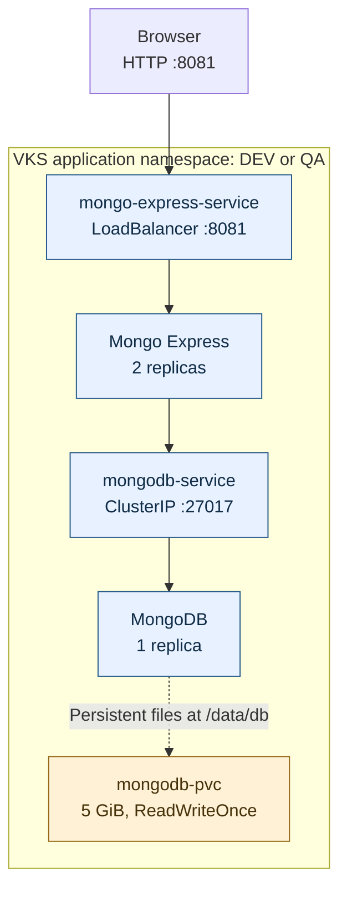
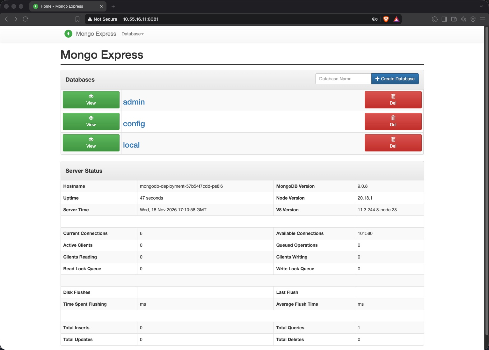

<!--
authors: "Julius M. Nicolescu, Qwen3-Coder-30B-A3B-Instruct-4bit, Qwen3.8-27B-8bit"
date: 2026-11-18
description: Deploy MongoDB and Mongo Express on DEV and QA VKS clusters with persistent storage and a LoadBalancer web interface.
keywords: VCF, VKS, Kubernetes, MongoDB, Mongo Express, LoadBalancer, Terraform
lang: en
-->

# Deploy MongoDB and Mongo Express on VKS

Deploy **MongoDB and Mongo Express** on existing VKS clusters in VMware Cloud Foundation **9.1.1**. MongoDB stores database files on a persistent volume; Mongo Express publishes a browser interface through a **LoadBalancer on TCP 8081**. Follow the manual procedure or choose the supplied Bash, PowerShell 7, Command Prompt or Terraform examples.

DEV is the worked example. QA follows the same steps with its own directory, context and namespaces. Environment tables and the [Output](#output) index cover both clusters.

| Target | VKS cluster / directory | Supervisor namespace | Application namespace | Workload Kubernetes context |
| --- | --- | --- | --- | --- |
| DEV | `dev-cluster-01` | `dev-namespace` | `dev-mongodb-lb` | `dev-cluster-01:dev-cluster-01` |
| QA | `qa-cluster-02` | `qa-namespace` | `qa-mongodb-lb` | `qa-cluster-02:qa-cluster-02` |

The Supervisor namespace identifies the existing VKS cluster during authentication. Application resources are created inside that workload cluster. Choose **one deployment method per application namespace**: manual YAML, platform scripts or Terraform.

## Contents

- [Reference Environment](#reference-environment)
- [Prerequisites](#prerequisites)
- [Application traffic flow](#application-traffic-flow)
- [Prepare the DEV configuration](#prepare-the-dev-configuration)
- [Deploy MongoDB and Mongo Express on DEV](#deploy-mongodb-and-mongo-express-on-dev)
- [Terraform deployment](#terraform-deployment)
- [Verify the deployment](#verify-the-deployment)
- [Project files](#project-files)
- [Optional cleanup](#optional-cleanup)
- [Troubleshooting](#troubleshooting)
- [Output](#output)
- [References](#references)

## Reference Environment

The current project files and saved **2026-11-18** application reports provide the following lab record:

| Component | Configuration or recorded result |
| --- | --- |
| VMware Cloud Foundation | Target release `9.1.1`; the Bash deployment header identifies `9.1.1.0-545627-2026-09`. |
| VKS clusters | Existing `dev-cluster-01` and `qa-cluster-02`; this project deploys applications, not clusters. |
| MongoDB | `mongo:9.0.8`, **1 replica**, internal TCP `27017`. |
| Mongo Express | `mongo-express:1.0.2-20-alpine3.19`, **2 replicas**, external HTTP on TCP `8081`. |
| Persistent storage | `mongodb-pvc`, **5 GiB**, `ReadWriteOnce`, StorageClass `vsan-default-storage-policy`. |
| DEV LoadBalancer | Captured address `10.55.16.10`; web URL `http://10.55.16.10:8081`. |
| QA LoadBalancer | Captured address `10.55.16.11`; web URL `http://10.55.16.11:8081`. |
| Terraform alternative | Project requirement `>= 1.5.0`, Kubernetes provider constraint `~> 3.0`. |

Both reports show MongoDB **1/1**, Mongo Express **2/2**, and a **Bound** PVC. The addresses are recorded allocations, not fixed IP requests in the manifests. These saved observations describe the capture date; the README update does not rerun the deployment.

## Prerequisites

| Requirement | Details |
| --- | --- |
| macOS/Linux | Bash for `.sh` scripts; OpenSSL for context creation. Run scripts with `bash` from the documented directory. |
| Windows PowerShell | PowerShell **7.0 or later**, started with `pwsh`; certificate retrieval uses .NET. |
| Windows Command Prompt | `cmd.exe` for `.bat` scripts; no PowerShell or OpenSSL dependency. |
| CLI tools | VCF Consumption CLI, its Kubernetes plugins and compatible `kubectl` in `PATH`. See the [CLI installation guide](../41-install-vcf-cli-kubectl/Readme.md). |
| Terraform alternative | Terraform **>= 1.5.0**, provider `hashicorp/kubernetes ~> 3.0`, and registry access for initialization. No lock file is currently supplied; `terraform init` selects a matching provider and creates one. |
| Existing infrastructure | The selected VKS cluster and Supervisor namespace, with ready worker nodes. |
| Authentication and permissions | Workload API access and permission to manage namespaces, Secrets, ConfigMaps, PVCs, Deployments and Services. Cleanup removes the entire application namespace, including its PVCs. |
| Connectivity | Workstation access to Supervisor/workload APIs and the LoadBalancer IP on TCP 8081; worker access to pull `mongo:9.0.8` and `mongo-express:1.0.2-20-alpine3.19`. |
| Storage | An existing StorageClass with dynamic provisioning and at least 5 GiB available for the MongoDB PVC. The supplied lab value is `vsan-default-storage-policy`. |
| LoadBalancer | Working VKS LoadBalancer integration with an available external IP. |
| Local files | Write access to VCF configuration, kubeconfig, `deployment-files`, report directories and the selected Terraform root. Bash/PowerShell context scripts also write a temporary certificate. |

[Docker Hub marks the image as deprecated](https://hub.docker.com/_/mongo-express) and describes private development use. The manifests expose HTTP without TLS; use a trusted lab network.

## Application traffic flow

Open `http://<LoadBalancer-IP>:8081` from a workstation that can reach the assigned address. Mongo Express uses the internal MongoDB Service for database operations.



Solid arrows show the request path; the dashed arrow shows the database's storage mount. The web Service selects `app: mongo-express`, and `mongodb-service` selects `app: mongodb`. MongoDB has no external LoadBalancer in this project.

This deployment exercises workload authentication, namespace creation, Secret and ConfigMap consumption, persistent volume provisioning, pod scheduling, image pulls, TCP probes, rollout waits and external LoadBalancer access.

| Resource | Configuration and purpose |
| --- | --- |
| Application namespace | `dev-mongodb-lb` or `qa-mongodb-lb`; scripts set Pod Security enforce, audit and warn labels to `privileged`. Terraform sets enforce and warn labels. |
| `mongodb-secret` | Supplies MongoDB root credentials and the Mongo Express web password. |
| `mongodb-pvc` | Requests `5Gi`, `ReadWriteOnce`, using `vsan-default-storage-policy`; mounted at `/data/db`. |
| `mongodb-deployment` | One `mongo:9.0.8` replica, `Recreate` strategy, label `app: mongodb`. |
| `mongodb-service` | Internal `ClusterIP` Service on TCP 27017, selecting MongoDB pods. |
| `mongodb-configmap` | Connection settings; Mongo Express reads `database_url` as the database hostname. |
| `mongo-express-deployment` | Two `mongo-express:1.0.2-20-alpine3.19` replicas, label `app: mongo-express`, HTTP on TCP 8081. |
| `mongo-express-service` | `LoadBalancer` Service exposing TCP 8081 to Mongo Express pods. |
| Container checks | Both Deployments use `IfNotPresent` and TCP startup, readiness and liveness probes. |

## Prepare the DEV configuration

Review the selected cluster's files before running commands. Supervisor endpoints, account settings and StorageClass names are lab values; replace them for your environment. Configure credentials locally.

| Script setting or file | Purpose |
| --- | --- |
| `SUPERVISOR_API_ENDPOINT` | Supervisor address used for authentication and certificate retrieval in Bash/PowerShell. |
| `VCF_CLI_VSPHERE_USERNAME`, `VCF_CLI_VSPHERE_PASSWORD` | Context-script credentials passed through the VCF CLI process environment. |
| `CLUSTER_NAMESPACE` | Existing Supervisor namespace containing the VKS cluster: `dev-namespace` or `qa-namespace`. |
| `CLUSTER_NAME` | Target workload cluster: `dev-cluster-01` or `qa-cluster-02`. |
| `NAMESPACE` | Application namespace: `dev-mongodb-lb` or `qa-mongodb-lb`. |
| `STORAGE_CLASS` | Existing StorageClass used by `mongodb-pvc`; supplied value `vsan-default-storage-policy`. |
| `DEPLOYMENT_FILES` | Fixed `deployment-files` directory beside the selected deployment script; generated YAML is overwritten on each run. |
| `ROLLOUT_TIMEOUT`, `LOAD_BALANCER_TIMEOUT` | Script waits, each set to `300s`. |
| Secret manifest and script templates | MongoDB root username/password and Mongo Express web password. The web username is configured in the Mongo Express Deployment template. |
| PVC and Deployment templates | Storage request (`5Gi`), images, replicas, ports and probes. Script generation overwrites manual YAML edits. |
| `terraform.tfvars` | Equivalent Terraform inputs; see [Terraform configuration](#terraform-configuration). |

MongoDB authentication and Mongo Express browser authentication serve different purposes. The Secret stores `mongo-root-username`, `mongo-root-password` and `mongo-express-password`. YAML Secret values are base64 encoded, which does not encrypt them. Review the local files for the configured credentials; this guide does not repeat passwords.

For manual deployment, edit the checked-in YAML. For scripted deployment, edit the script templates before regenerating YAML. For Terraform, edit the selected root's `terraform.tfvars`. Changing initialization credentials does not change a user already stored in an existing MongoDB data directory; see the [MongoDB image initialization documentation](https://hub.docker.com/_/mongo).

Context scripts replace the local named VCF context and activate `cluster-name:cluster-name`. Bash retrieves the Supervisor certificate with OpenSSL; PowerShell uses .NET. Both save `SUPERVISOR.crt` in a temporary directory and pass it with `--ca-certificate`. Batch uses `--insecure-skip-tls-verify`. Deployment and cleanup scripts refresh the existing context and select the workload context before changing resources.

Keep MongoDB at one replica with this shared PVC configuration. The supplied Deployment uses `Recreate` and one `ReadWriteOnce` volume; increasing `mongodb_replicas` does not configure a MongoDB replica set.

For QA, use `qa-cluster-02/` and the QA values in the environment table. The file structure, resource names within the application namespace, images and deployment order are the same. Review the matching context script, deployment templates and Terraform inputs together before choosing a method.

## Deploy MongoDB and Mongo Express on DEV

Start in the directory containing this README. Review the connection settings and credentials before creating a context. If an authenticated DEV context already exists, refresh it instead of recreating it.

### 1. Prepare workload access

For initial context creation, choose the command for your workstation:

| Platform | Context example | Run from the README directory |
| --- | --- | --- |
| macOS/Linux | [01-create-vks-cluster-context.sh](./dev-cluster-01/01-create-vks-cluster-context.sh) | `bash ./dev-cluster-01/01-create-vks-cluster-context.sh` |
| PowerShell 7 | [11-create-vks-cluster-context.ps1](./dev-cluster-01/11-create-vks-cluster-context.ps1) | `pwsh -File ./dev-cluster-01/11-create-vks-cluster-context.ps1` |
| Command Prompt | [21-create-vks-cluster-context.bat](./dev-cluster-01/21-create-vks-cluster-context.bat) | `dev-cluster-01\21-create-vks-cluster-context.bat` |

The context examples replace the local named VCF context, activate the workload context and query nodes. Confirm the target context and node result before deploying. See the sibling [context guide](../42-create-vks-context/Readme.md) for the authentication workflow.

### 2. Choose one deployment method

The following manual and script procedures create the same application. Terraform is a separate [alternative](#terraform-deployment).

### Option 1: manual deployment with kubectl

Apply the reviewed files in `dev-cluster-01/deployment-files/` without regenerating them. The following kubectl commands work in Bash and PowerShell.

Target: **`dev-cluster-01`** · Application namespace: **`dev-mongodb-lb`**.

1. **Select the workload context.**

   ```bash
   # Select the DEV workload Kubernetes context.
   kubectl config use-context dev-cluster-01:dev-cluster-01
   ```

2. **Create the namespace, credentials and persistent storage.**

   ```bash
   # Create or update the DEV application namespace.
   kubectl apply -f dev-cluster-01/deployment-files/10-dev-mongodb-lb-namespace.yaml

   # Create or update the reviewed DEV application Secret.
   kubectl apply -f dev-cluster-01/deployment-files/11-dev-mongodb-lb-secret.yaml

   # Request the DEV MongoDB persistent volume.
   kubectl apply -f dev-cluster-01/deployment-files/12-dev-mongodb-lb-pvc.yaml
   ```

3. **Deploy MongoDB and wait for it to become ready.**

   ```bash
   # Apply the MongoDB Deployment, internal Service and ConfigMap.
   kubectl apply -f dev-cluster-01/deployment-files/13-dev-mongodb-lb-deployment.yaml

   # Wait for the MongoDB replica to finish rolling out.
   kubectl rollout status deployment/mongodb-deployment -n dev-mongodb-lb --timeout=300s
   ```

4. **Deploy Mongo Express and wait for its external address.**

   ```bash
   # Apply the Mongo Express Deployment and LoadBalancer Service.
   kubectl apply -f dev-cluster-01/deployment-files/14-dev-mongodb-lb-mongoexpress-deployment.yaml

   # Wait for the two Mongo Express replicas to finish rolling out.
   kubectl rollout status deployment/mongo-express-deployment -n dev-mongodb-lb --timeout=300s

   # Wait for the Mongo Express Service to receive a LoadBalancer IP.
   kubectl wait service/mongo-express-service -n dev-mongodb-lb --for='jsonpath={.status.loadBalancer.ingress[0].ip}' --timeout=300s
   ```

5. **Check the resources.**

   ```bash
   # Inspect deployment readiness, pods, Service addresses and persistent storage.
   kubectl get deployments,pods,services,pvc -n dev-mongodb-lb
   ```

   Expect `mongodb-deployment` to show **`1/1`**, `mongo-express-deployment` to show **`2/2`**, `mongodb-pvc` to be **`Bound`**, and `mongo-express-service` to have an **`EXTERNAL-IP`**.

6. **Open Mongo Express.** Browse to `http://<EXTERNAL-IP>:8081` and sign in with the web credentials configured in the Deployment and Secret. Confirm that the database list loads. Mongo Express uses separate MongoDB credentials from the same Secret to connect to `mongodb-service:27017`.

### Option 2: use the platform scripts

These are automated examples. Edit the selected script's settings and templates first. Each deployment script refreshes authentication, selects the workload context, overwrites five manifests beside the script, applies them in order, waits for rollouts and a LoadBalancer IP, and prints resource details and the web URL.

| Platform | Script | What it does | Run from the README directory |
| --- | --- | --- | --- |
| macOS/Linux | [02-deploy-mongo-express-lb.sh](./dev-cluster-01/02-deploy-mongo-express-lb.sh) | Generate YAML and deploy DEV. | `bash ./dev-cluster-01/02-deploy-mongo-express-lb.sh` |
| PowerShell 7 | [12-deploy-mongo-express-lb.ps1](./dev-cluster-01/12-deploy-mongo-express-lb.ps1) | Generate YAML and deploy DEV. | `pwsh -File ./dev-cluster-01/12-deploy-mongo-express-lb.ps1` |
| Command Prompt | [22-deploy-mongo-express-lb.bat](./dev-cluster-01/22-deploy-mongo-express-lb.bat) | Generate YAML and deploy DEV. | `dev-cluster-01\22-deploy-mongo-express-lb.bat` |

**macOS/Linux — Bash**

```bash
# Generate manifests, deploy DEV and display the assigned web URL.
bash ./dev-cluster-01/02-deploy-mongo-express-lb.sh
```

**Windows — PowerShell 7**

```powershell
# Generate manifests, deploy DEV and display the assigned web URL.
pwsh -File ./dev-cluster-01/12-deploy-mongo-express-lb.ps1
```

**Windows — Command Prompt**

```bat
REM Generate manifests, deploy DEV and display the assigned web URL.
dev-cluster-01\22-deploy-mongo-express-lb.bat
```

For QA, use the matching scripts in `qa-cluster-02/`; they target `qa-cluster-02:qa-cluster-02` and `qa-mongodb-lb`. Continue with [verification](#verify-the-deployment) after either method.

## Terraform deployment

The [DEV configuration](./dev-cluster-01/terraform-deploy-mongo-express-lb/) and [QA configuration](./qa-cluster-02/terraform-deploy-mongo-express-lb/) are independent roots with separate local state. Each manages the application in an existing cluster directly through the Kubernetes API. Use Terraform for a namespace that is not already managed by the YAML or platform-script workflow.

### Kubernetes provider

| Provider setting | Configuration and purpose |
| --- | --- |
| Provider source | `hashicorp/kubernetes`. |
| Version constraint | `~> 3.0`, allowing compatible 3.x releases and excluding 4.0; no lock file is currently supplied. Initialization selects a matching version and writes `.terraform.lock.hcl`. |
| Terraform requirement | Project minimum `>= 1.5.0`. |
| Connection | [DEV providers.tf](dev-cluster-01/terraform-deploy-mongo-express-lb/providers.tf) / [QA providers.tf](qa-cluster-02/terraform-deploy-mongo-express-lb/providers.tf). |
| Kubeconfig | `config_path = pathexpand(var.kubeconfig_path)`, default configured path `~/.kube/config`. |
| Target context | Explicit `config_context` from `terraform.tfvars`: `dev-cluster-01:dev-cluster-01` or `qa-cluster-02:qa-cluster-02`. |
| Authentication | Uses kubeconfig credentials; create/refresh them with VCF CLI before accessing the cluster. |
| Installation | `terraform init` selects/installs a provider and initializes the root; retain its generated lock file. |

| Managed resource | Purpose |
| --- | --- |
| `kubernetes_namespace_v1.mongodb` | Application namespace and Pod Security labels. |
| `kubernetes_secret_v1.mongodb` | MongoDB root credentials and Mongo Express web password. |
| `kubernetes_persistent_volume_claim_v1.mongodb` | MongoDB storage request, without waiting for binding before scheduling the consumer. |
| `kubernetes_deployment_v1.mongodb` | Single MongoDB replica with persistent storage and TCP probes; waits for rollout. |
| `kubernetes_service_v1.mongodb` | Internal MongoDB Service on TCP 27017. |
| `kubernetes_config_map_v1.mongodb` | Database hostname, port and URI settings. |
| `kubernetes_deployment_v1.mongo_express` | Mongo Express replicas and TCP probes; depends on the MongoDB Deployment and waits for rollout. |
| `kubernetes_service_v1.mongo_express` | External HTTP Service on TCP 8081; waits for LoadBalancer allocation. |

The provider manages these eight resources directly; it does not run the scripts or apply generated YAML. VKS cluster provisioning is outside this root. See the [provider documentation](https://registry.terraform.io/providers/hashicorp/kubernetes/3.5.0/docs) for kubeconfig connection settings; the returned page's internal links use `latest`.

### Terraform configuration

Edit [DEV terraform.tfvars](dev-cluster-01/terraform-deploy-mongo-express-lb/terraform.tfvars) or [QA terraform.tfvars](qa-cluster-02/terraform-deploy-mongo-express-lb/terraform.tfvars). Terraform reads the selected root's file automatically.

| Variable | DEV value | QA value |
| --- | --- | --- |
| `kubeconfig_path` | `~/.kube/config` | `~/.kube/config` |
| `kubernetes_context` | `dev-cluster-01:dev-cluster-01` | `qa-cluster-02:qa-cluster-02` |
| `namespace` | `dev-mongodb-lb` | `qa-mongodb-lb` |
| `storage_class` | `vsan-default-storage-policy` | `vsan-default-storage-policy` |
| `storage_size` | `5Gi` | `5Gi` |
| `mongodb_image` | `mongo:9.0.8` | `mongo:9.0.8` |
| `mongodb_replicas` | `1` | `1` |
| `mongodb_port` | `27017` | `27017` |
| `mongodb_username` | Configure locally | Configure locally |
| `mongodb_password` | Configure locally; sensitive input | Configure locally; sensitive input |
| `mongo_express_image` | `mongo-express:1.0.2-20-alpine3.19` | `mongo-express:1.0.2-20-alpine3.19` |
| `mongo_express_replicas` | `2` | `2` |
| `mongo_express_port` | `8081` | `8081` |
| `mongo_express_username` | Configure locally | Configure locally |
| `mongo_express_password` | Configure locally; sensitive input | Configure locally; sensitive input |
| `rollout_timeout` | `5m` | `5m` |
| `load_balancer_timeout` | `5m` | `5m` |

Keep `mongodb_replicas = 1` with this storage design. Review credentials before the initial deployment. Sensitive inputs are hidden in normal Terraform output but remain in local state.

| Terraform file | Purpose |
| --- | --- |
| `providers.tf` | Terraform/provider constraints and kubeconfig connection. |
| `variables.tf` | All input declarations, types and sensitive flags. |
| `terraform.tfvars` | Cluster-specific configured values. |
| `main.tf` | Eight application resources with rollout and allocation waits. |
| `outputs.tf` | `load_balancer_ip` and `app_url`. |

Keep DEV and QA state separate and retain it for updates and cleanup. These roots use local state; no remote backend is configured. Terraform does not create or refresh VCF authentication. Run the matching context script for initial setup and refresh credentials before planning, applying or destroying resources.

### Deploy with Terraform

Start in the README directory. Use the same terminal session for changing directory, initialization, planning and applying. The direct Terraform commands below work in Bash and PowerShell 7.

```bash
# Enter the DEV Terraform root.
cd dev-cluster-01/terraform-deploy-mongo-express-lb

# Refresh workload authentication before the provider reads the API.
vcf context refresh dev-cluster-01

# Install the provider and initialize local state management.
terraform init

# Validate the configuration.
terraform validate

# Preview the application resources to create or update.
terraform plan

# Review the fresh plan and confirm deployment.
terraform apply

# Display the assigned application URL recorded in state.
terraform output -raw app_url
```

The `terraform.tfvars` context selects the target API independently of the current kubectl context. For QA, start from its Terraform root, refresh `qa-cluster-02` and use the same commands. Retain the generated lock file and state for subsequent changes and cleanup.

### Optional Bash runners

After initialization and authentication, the runners capture terminal output in `output-YYYY-MM-DD/` beside the Terraform files. Run from the selected Terraform root:

| Script | What it does | Run from this directory |
| --- | --- | --- |
| [01-terraform-plan.sh](./dev-cluster-01/terraform-deploy-mongo-express-lb/01-terraform-plan.sh) | Preview changes and save `01-terraform-plan.txt`. | `bash ./01-terraform-plan.sh` |
| [02-terraform-apply.sh](./dev-cluster-01/terraform-deploy-mongo-express-lb/02-terraform-apply.sh) | Apply automatically and save `02-terraform-apply.txt`. | `bash ./02-terraform-apply.sh` |
| [03-terraform-destroy.sh](./dev-cluster-01/terraform-deploy-mongo-express-lb/03-terraform-destroy.sh) | Destroy managed resources automatically and save `03-terraform-destroy.txt`. | `bash ./03-terraform-destroy.sh` |

The apply and destroy runners use `-auto-approve`; they do not prompt. The plan runner saves a text transcript, not a reusable binary plan. These runners do not create or refresh VCF authentication.

## Verify the deployment

Select DEV before running the Kubernetes checks. The resource query below is also recorded in the namespace report.

```bash
# Select the DEV workload context.
kubectl config use-context dev-cluster-01:dev-cluster-01

# Inspect workload readiness, Service addresses and pod placement.
kubectl get all -n dev-mongodb-lb -o wide
```

**Captured output — DEV, 2026-11-18** (pods, Services and Deployments excerpt from the saved report):

```text
NAME                                            READY   STATUS    RESTARTS   AGE   IP           NODE                                                   NOMINATED NODE   READINESS GATES
pod/mongo-express-deployment-868566b85c-jlfnm   1/1     Running   0          29s   10.95.3.66   dev-cluster-01-dev-cluster-01-np01-6jl2w-jpfjc-6vmfj   <none>           <none>
pod/mongo-express-deployment-868566b85c-lz9ww   1/1     Running   0          29s   10.95.1.60   dev-cluster-01-dev-cluster-01-np01-6jl2w-jpfjc-nzbbj   <none>           <none>
pod/mongodb-deployment-57b54f7cdd-ntnzf         1/1     Running   0          44s   10.95.2.60   dev-cluster-01-dev-cluster-01-np01-6jl2w-jpfjc-k5sgl   <none>           <none>

NAME                            TYPE           CLUSTER-IP      EXTERNAL-IP   PORT(S)          AGE   SELECTOR
service/mongo-express-service   LoadBalancer   10.106.146.10   10.55.16.10   8081:32761/TCP   29s   app=mongo-express
service/mongodb-service         ClusterIP      10.109.54.77    <none>        27017/TCP        44s   app=mongodb

NAME                                       READY   UP-TO-DATE   AVAILABLE   AGE   CONTAINERS      IMAGES                              SELECTOR
deployment.apps/mongo-express-deployment   2/2     2            2           29s   mongo-express   mongo-express:1.0.2-20-alpine3.19   app=mongo-express
deployment.apps/mongodb-deployment         1/1     1            1           44s   mongodb         mongo:9.0.8                         app=mongodb
```

```bash
# Confirm the MongoDB persistent volume is bound.
kubectl get pvc mongodb-pvc -n dev-mongodb-lb

# Inspect ready web backends and their port.
kubectl get endpointslices -n dev-mongodb-lb -l kubernetes.io/service-name=mongo-express-service
```

Success means MongoDB is **1/1**, Mongo Express is **2/2**, the PVC is **Bound**, and the web Service has an external IP with ready EndpointSlices. Open `http://<EXTERNAL-IP>:8081`, sign in with the configured web credentials and confirm that the database list and server status load. Browser credentials are separate from the MongoDB root credentials.

For an HTTP check, enter the configured web username when prompted for the password:

```bash
# Test the captured DEV endpoint with HTTP Basic authentication.
curl -f --max-time 15 --user '<web-username>' http://10.55.16.10:8081/
```

Use the newly assigned IP if it differs from the capture. Bash and batch print a curl example; PowerShell prints an `Invoke-WebRequest` example. These are displayed commands, not executed HTTP tests.

### Capture a namespace report

From the README directory:

```bash
# Save namespace, image, storage, Service, EndpointSlice and event details.
bash ./dev-cluster-01/91-document-application-namespace.sh
```

The script refreshes authentication, selects DEV and overwrites `dev-cluster-01/output-YYYY-MM-DD/dev-mongodb-lb-report.txt` for that local date. It records image tags and runtime image IDs, plus namespace labels, resources, Service YAML and events. QA has the same report script in its own cluster directory.

### Application screenshots

The **2026-11-18** browser captures show the database list (`admin`, `config`, `local`) and MongoDB **9.0.8** server status. Click a preview to open the original image.

| DEV — `10.55.16.10:8081` | QA — `10.55.16.11:8081` |
| --- | --- |
| [](./dev-cluster-01/output-2026-11-18/dev-mongodb-lb-10.55.16.10.jpg) | [](./qa-cluster-02/output-2026-11-18/qa-mongodb-lb-10.55.16.11.jpg) |

The captures use HTTP, matching the Service configuration. They were taken at different moments from the reports, so pod names and uptime can differ.

## Project files

### Repository layout

Both environment directories contain the same workflow with environment-specific values. The DEV branch below expands the common structure:

```text
.
├── Readme.md
├── dev-cluster-01/
│   ├── 01-create-vks-cluster-context.sh
│   ├── 02-deploy-mongo-express-lb.sh
│   ├── 03-delete-mongo-express-lb.sh
│   ├── 11-create-vks-cluster-context.ps1
│   ├── 12-deploy-mongo-express-lb.ps1
│   ├── 13-delete-mongo-express-lb.ps1
│   ├── 21-create-vks-cluster-context.bat
│   ├── 22-deploy-mongo-express-lb.bat
│   ├── 23-delete-mongo-express-lb.bat
│   ├── 91-document-application-namespace.sh
│   ├── deployment-files/
│   ├── output-2026-11-18/
│   └── terraform-deploy-mongo-express-lb/
│       ├── providers.tf
│       ├── variables.tf
│       ├── terraform.tfvars
│       ├── main.tf
│       ├── outputs.tf
│       ├── 01-terraform-plan.sh
│       ├── 02-terraform-apply.sh
│       ├── 03-terraform-destroy.sh
│       └── output-2026-11-14/
└── qa-cluster-02/
    ├── deployment-files/
    ├── output-2026-11-18/
    └── terraform-deploy-mongo-express-lb/
```

### Generated deployment files

Deployment scripts create `deployment-files` and overwrite **five YAML files** on each run. Change the script settings/templates for lasting changes to generated content.

| DEV file | QA file | Resources |
| --- | --- | --- |
| [10-dev-mongodb-lb-namespace.yaml](dev-cluster-01/deployment-files/10-dev-mongodb-lb-namespace.yaml) | [10-qa-mongodb-lb-namespace.yaml](qa-cluster-02/deployment-files/10-qa-mongodb-lb-namespace.yaml) | Application Namespace and Pod Security labels. |
| [11-dev-mongodb-lb-secret.yaml](dev-cluster-01/deployment-files/11-dev-mongodb-lb-secret.yaml) | [11-qa-mongodb-lb-secret.yaml](qa-cluster-02/deployment-files/11-qa-mongodb-lb-secret.yaml) | Application credentials in `mongodb-secret`. |
| [12-dev-mongodb-lb-pvc.yaml](dev-cluster-01/deployment-files/12-dev-mongodb-lb-pvc.yaml) | [12-qa-mongodb-lb-pvc.yaml](qa-cluster-02/deployment-files/12-qa-mongodb-lb-pvc.yaml) | Persistent storage request `mongodb-pvc`. |
| [13-dev-mongodb-lb-deployment.yaml](dev-cluster-01/deployment-files/13-dev-mongodb-lb-deployment.yaml) | [13-qa-mongodb-lb-deployment.yaml](qa-cluster-02/deployment-files/13-qa-mongodb-lb-deployment.yaml) | MongoDB Deployment, ClusterIP Service and ConfigMap. |
| [14-dev-mongodb-lb-mongoexpress-deployment.yaml](dev-cluster-01/deployment-files/14-dev-mongodb-lb-mongoexpress-deployment.yaml) | [14-qa-mongodb-lb-mongoexpress-deployment.yaml](qa-cluster-02/deployment-files/14-qa-mongodb-lb-mongoexpress-deployment.yaml) | Mongo Express Deployment and LoadBalancer Service. |

Scripts apply files 10–13, wait for MongoDB, apply file 14, wait for Mongo Express and its external IP, list resources, and print `http://<LoadBalancer-IP>:8081`. The batch script reads the IP through `for /f`; it does not create an IP-address text file.

Terraform manages resources from `.tf` configuration and does not generate or apply these YAML files. Initialization installs providers under `.terraform`; the selected root keeps its lock file and local state. State contains application credentials, including inputs marked sensitive.

Failed deployment can leave resources already created. Bash deployment scripts use `set -e`; PowerShell and batch deployment scripts stop on their main VCF/kubectl failures. Their context scripts do not explicitly stop on every failed native command, so inspect context activation and the node query before deployment.

## Optional cleanup

Cleanup deletes the **entire selected application namespace**, including database PVCs and any additional resources placed there. Backing volume removal follows the PV reclaim policy. The VKS cluster, Supervisor namespace, local manifests, screenshots and reports are retained. Choose the cleanup method matching the deployment method.

### Manual YAML or platform scripts

Run the matching DEV example from the README directory:

| Platform | Script | What it does | Run from this directory |
| --- | --- | --- | --- |
| macOS/Linux | [03-delete-mongo-express-lb.sh](./dev-cluster-01/03-delete-mongo-express-lb.sh) | Delete application resources, PVCs and namespace. | `bash ./dev-cluster-01/03-delete-mongo-express-lb.sh` |
| PowerShell 7 | [13-delete-mongo-express-lb.ps1](./dev-cluster-01/13-delete-mongo-express-lb.ps1) | Delete application resources, PVCs and namespace. | `pwsh -File ./dev-cluster-01/13-delete-mongo-express-lb.ps1` |
| Command Prompt | [23-delete-mongo-express-lb.bat](./dev-cluster-01/23-delete-mongo-express-lb.bat) | Delete application resources, PVCs and namespace. | `dev-cluster-01\23-delete-mongo-express-lb.bat` |

The scripts refresh authentication, select the workload context, delete workloads and Services, delete configuration and service accounts, delete PVCs, then delete the namespace. For QA, use the same filenames in `qa-cluster-02/`.

### Terraform-managed resources

From the selected Terraform root, use its retained state:

```bash
# Refresh DEV authentication before destroying managed resources.
vcf context refresh dev-cluster-01

# Review and confirm removal of the application managed by this root.
terraform destroy
```

Do not use namespace-deletion scripts to bypass Terraform state management. The optional destroy runner performs the same Terraform operation with automatic approval.

## Troubleshooting

| Symptom | Check or action |
| --- | --- |
| Context creation or refresh fails | Check Supervisor connectivity, account permissions, endpoint, certificate and target settings. For Bash refresh errors, run `vcf context refresh dev-cluster-01` or `vcf context refresh qa-cluster-02` directly to see suppressed output. |
| Context script continues after an error | Inspect context activation and the node query. PowerShell/batch context scripts can continue after failed native commands. |
| `pwsh` is not recognized | Use PowerShell 7 with `pwsh` in `PATH`, or choose the batch alternative. |
| MongoDB pod or PVC stays `Pending` | Inspect PVC/pod events, the configured StorageClass, storage capacity and CSI provisioning. Delayed binding may wait for a consuming pod; apply the MongoDB Deployment before expecting binding. |
| Image pull fails | Check worker registry access and availability of `mongo:9.0.8` and `mongo-express:1.0.2-20-alpine3.19`. The supplied Mongo Express image is deprecated. |
| Rollout or TCP probe fails | Inspect container logs and pod events. MongoDB waits for storage; Mongo Express needs a reachable database. Defaults allow 300 seconds per script wait or five minutes per Terraform wait. |
| Mongo Express cannot connect to MongoDB | Check `mongodb-service`, its EndpointSlices, `mongodb-configmap`, and Secret key references. Inspect `kubectl logs deployment/mongo-express-deployment -n dev-mongodb-lb` after selecting DEV; use the QA namespace for QA. |
| Browser login fails | Use the web username/password configured for Mongo Express. They are distinct from MongoDB root credentials. |
| MongoDB authentication fails after changing the Secret | Initialization variables do not update users in an existing database directory. Update the existing database credentials through MongoDB and align the consumers. |
| LoadBalancer has no external IP | Inspect Service events, VKS LoadBalancer integration and address availability. Script waits and Terraform outputs expect an IP, not a hostname-only allocation. |
| Web URL cannot be reached | Check routing and TCP 8081 to the assigned IP, Service selectors, EndpointSlices and web pod logs. Then confirm the database connection. |
| Generated YAML edits disappear | Deployment scripts overwrite all five files. Change the matching script settings/templates, or use the manual method. |
| Generated files appear in an unexpected location | The current deployment scripts write to `deployment-files` beside the script, regardless of the working directory. Check which environment script was invoked. |
| Terraform reports missing context or unauthorized access | Review `kubeconfig_path` and `kubernetes_context`; create/refresh the matching VCF context before retrying. |
| Terraform reports missing providers | Run `terraform init` from the selected root and check registry/download access. |
| Terraform reports a resource already exists | Use one method per namespace. Terraform does not automatically adopt manually/script-created resources. Review data retention before removing an existing namespace. |
| Terraform output is empty or stale | Check Service status and whether apply completed; outputs read saved state and assume an ingress IP. |
| Cleanup stops or storage remains | Inspect the failed command, remaining resources and PVC protection/finalizers. Check the PV reclaim policy; `Retain` requires administrator handling. Keep original Terraform state for destroy retries. |

The November 18 reports contain early `FailedScheduling` events for unbound PVCs and `SyncLoadBalancerFailed` events while the VirtualMachineService had no IP. Later entries show successful volume provisioning and LoadBalancer allocation; the captured resource tables show ready workloads and bound storage. Check the latest state and event sequence before treating an earlier warning as an unresolved failure.

## Output

The application reports and screenshots below were captured on **2026-11-18**. Reports record workload readiness, image tags/IDs, Service addresses, EndpointSlices, PVCs and events; screenshots show the rendered database list and server status.

| Cluster | Application report | Browser screenshot | Recorded result |
| --- | --- | --- | --- |
| `dev-cluster-01` | [dev-mongodb-lb-report.txt](./dev-cluster-01/output-2026-11-18/dev-mongodb-lb-report.txt) | [dev-mongodb-lb-10.55.16.10.jpg](./dev-cluster-01/output-2026-11-18/dev-mongodb-lb-10.55.16.10.jpg) | MongoDB **1/1**, Mongo Express **2/2**, PVC **Bound, 5 GiB**, HTTP `10.55.16.10:8081`. |
| `qa-cluster-02` | [qa-mongodb-lb-report.txt](./qa-cluster-02/output-2026-11-18/qa-mongodb-lb-report.txt) | [qa-mongodb-lb-10.55.16.11.jpg](./qa-cluster-02/output-2026-11-18/qa-mongodb-lb-10.55.16.11.jpg) | MongoDB **1/1**, Mongo Express **2/2**, PVC **Bound, 5 GiB**, HTTP `10.55.16.11:8081`. |
| `dev-cluster-01` | **Earlier Terraform transcripts — 2026-11-14**<br>[Plan](./dev-cluster-01/terraform-deploy-mongo-express-lb/output-2026-11-14/01-terraform-plan.txt) · [Apply](./dev-cluster-01/terraform-deploy-mongo-express-lb/output-2026-11-14/02-terraform-apply.txt) · [Destroy](./dev-cluster-01/terraform-deploy-mongo-express-lb/output-2026-11-14/03-terraform-destroy.txt) | — | Separate earlier run: 8 resources planned, added and subsequently destroyed. |

## References

The following official documentation pages were opened and reviewed on **2026-11-18**. The Registry's `3.5.0` provider URL returns content whose internal links use `latest`; it is general provider guidance, not proof that this checkout pins `3.5.0`. Current container and Kubernetes documentation may cover newer releases than the saved lab captures.

| Reference | What it covers |
| --- | --- |
| [MongoDB container image](https://hub.docker.com/_/mongo) | Initial root-user creation, environment variables and persistent data. |
| [Mongo Express container image](https://hub.docker.com/_/mongo-express) | Database connection, web authentication, HTTP port and the image deprecation notice. |
| [Kubernetes Services](https://kubernetes.io/docs/concepts/services-networking/service/) | ClusterIP and LoadBalancer Services, selectors, ports and backend discovery. |
| [Kubernetes persistent volumes](https://kubernetes.io/docs/concepts/storage/persistent-volumes/) | PVC binding, access modes, storage provisioning and reclaim policies. |
| [Terraform CLI workflow](https://developer.hashicorp.com/terraform/cli/run) | Initialization and the plan, apply and destroy workflow. |
| [HashiCorp Kubernetes provider](https://registry.terraform.io/providers/hashicorp/kubernetes/3.5.0/docs) | Kubeconfig connection settings and Kubernetes resource management; returned documentation links use `latest`. |
