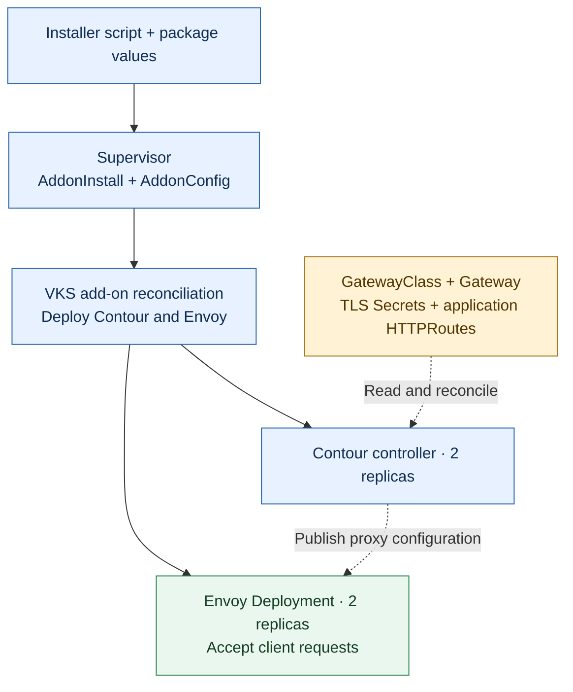
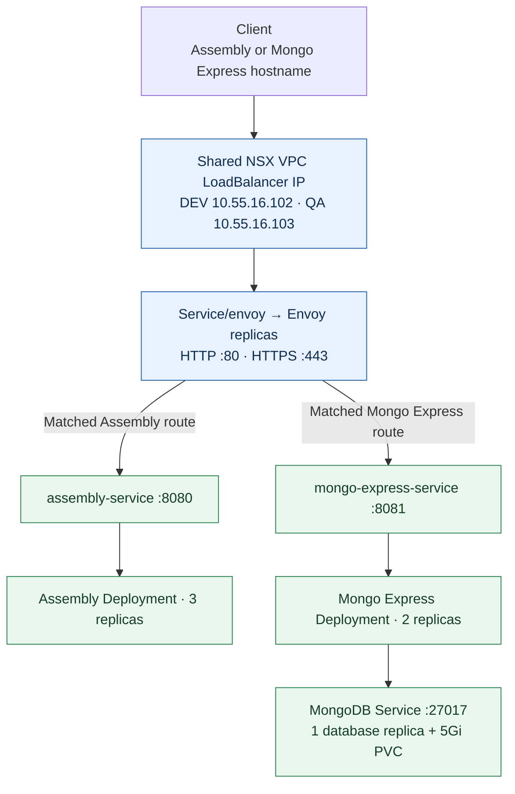
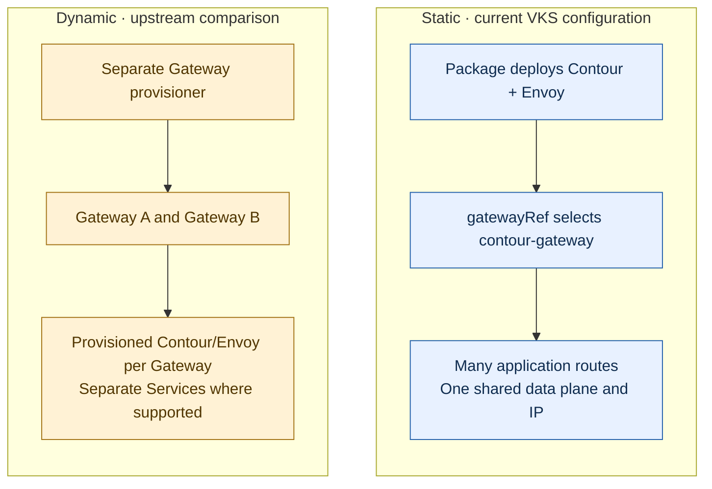
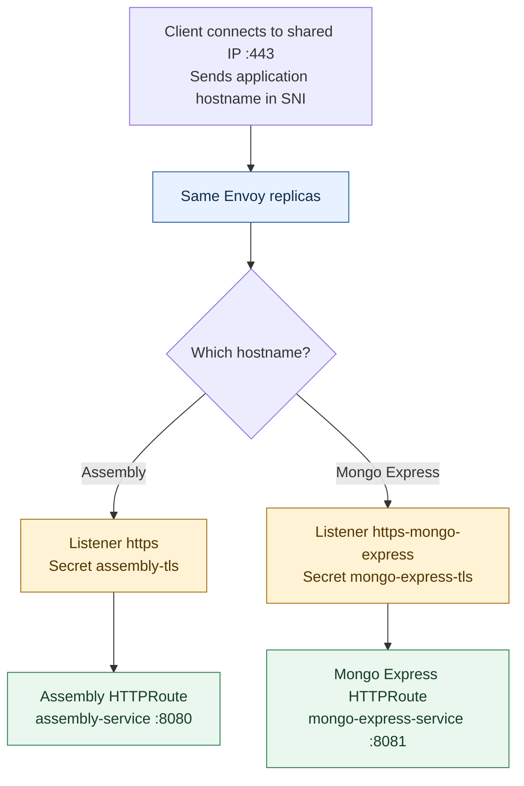
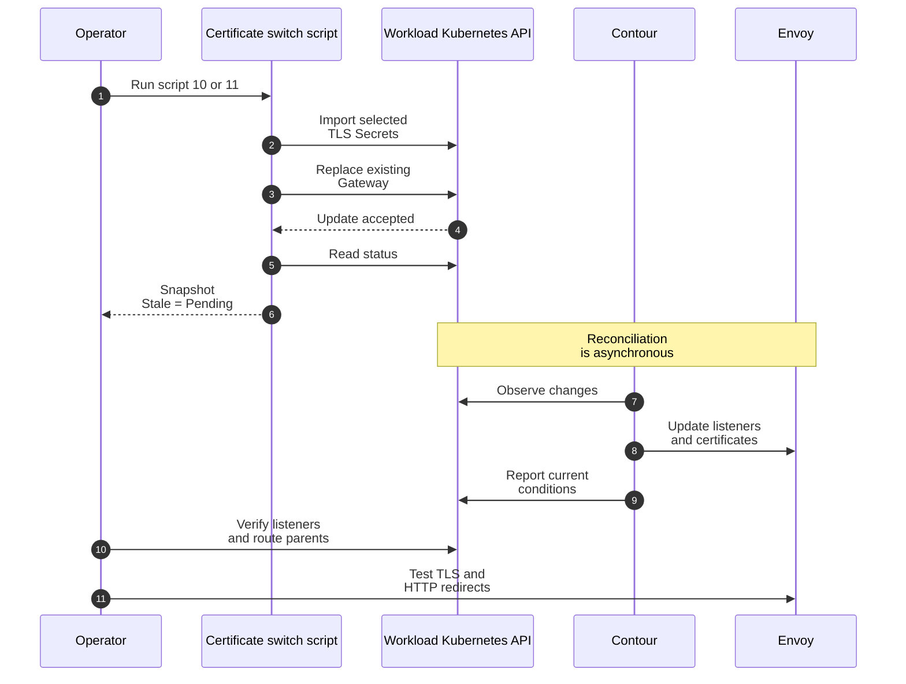

<!--
authors: "Julius M. Nicolescu, Qwen3-Coder-30B-A3B-Instruct-4bit, Qwen3.8-27B-8bit"
date: 2026-11-18
description: Explain the VKS Contour static Gateway design using the project's installers, package values, Gateways, HTTPRoutes and certificate-switch scripts.
keywords: VCF, VKS, Contour, Envoy, Gateway API, static provisioning, HTTPRoute, TLS, SNI
lang: en
-->

# VKS Contour Gateway API — Provisioning and TLS Configuration

Publish Assembly WebApp and Mongo Express through **one shared Contour Gateway per VKS cluster**, using either a wildcard certificate or separate application certificates. This guide explains how the actual project configuration connects the Supervisor add-on installation, Contour controller, Envoy proxies, listeners and application routes.

| Scope | Configuration |
| --- | --- |
| Platform | VMware Cloud Foundation 9.1.1 and vSphere Kubernetes Service (VKS). |
| Ingress | VKS Contour add-on, Envoy and NSX VPC native Load Balancing. |
| Provisioning | Static: one referenced Gateway, one Envoy Deployment with two replicas, one LoadBalancer Service/IP per environment. |
| Applications | Assembly WebApp; Mongo Express with an internal MongoDB database and PVC. |
| Environments | Independent DEV and QA workload clusters. |
| Package pins in the installers | cert-manager `1.20.2+vmware.1-vks.1`; Contour `1.33.4+vmware.1-vks.1`. |

For the full installation procedure and captured add-on outputs, use the [main project README](Readme.md). This guide focuses on how the configuration works. Configuration files describe desired behavior; saved reports record historical observations. No live infrastructure changes or traffic tests were performed for this review.

## Contents

- [1. Purpose and scope](#1-purpose-and-scope)
- [2. Architecture and traffic flow](#2-architecture-and-traffic-flow)
- [3. Static provisioning versus dynamic provisioning](#3-static-provisioning-versus-dynamic-provisioning)
- [4. DNS design](#4-dns-design)
- [5. Prerequisites and operational controls](#5-prerequisites-and-operational-controls)
- [6. Create GatewayClass and shared Gateway with wildcard TLS](#6-create-gatewayclass-and-shared-gateway-with-wildcard-tls)
- [7. Option A — Shared wildcard TLS certificate](#7-option-a--shared-wildcard-tls-certificate)
- [8. Option B — Individual application TLS certificates](#8-option-b--individual-application-tls-certificates)
- [9. Wildcard versus individual TLS — decision matrix](#9-wildcard-versus-individual-tls--decision-matrix)
- [10. Switching procedure and change control](#10-switching-procedure-and-change-control)
- [11. Validation commands](#11-validation-commands)
- [12. Security and operational considerations](#12-security-and-operational-considerations)
- [13. Recommendation](#13-recommendation)
- [Output](#output)
- [14. References and source scripts](#14-references-and-source-scripts)

## 1. Purpose and scope

The design separates three decisions:

| Decision | What controls it | Configuration used here |
| --- | --- | --- |
| Which infrastructure serves the Gateway? | Contour package provisioning and `gatewayRef`. | One static Contour/Envoy installation per cluster. |
| Which certificate does HTTPS present? | Gateway HTTPS listener hostname and TLS Secret. | One wildcard listener, or two application-specific HTTPS listeners. |
| Which application receives a request? | HTTPRoute hostname, path, parent and backend Service. | Application-owned routes for Assembly and Mongo Express. |

Changing certificates changes listener configuration on the existing Gateway. It does not add proxy replicas, create a new LoadBalancer, or assign another external IP. Each application has its own namespace and routes while sharing the ingress infrastructure.

The current Assembly-directory switching scripts are [10-switch-to-wildcard-certificate.sh](dev-cluster-01/deploy-assembly-webapp/10-switch-to-wildcard-certificate.sh), version **1.4**, and [11-switch-to-individual-certificates.sh](dev-cluster-01/deploy-assembly-webapp/11-switch-to-individual-certificates.sh), version **1.6**, both updated **2026-11-18**. Equivalent scripts exist in the Mongo Express directory and under QA. Both replace the same existing Gateway configuration and leave HTTPRoutes unchanged.

Broadcom documents the VKS package's **static provisioning** and listener **ports 80/443** in the [current Contour package reference][ref-package]. This is a limit on distinct ports. The supplied individual-certificate output shows four listener definitions sharing those two ports.

## 2. Architecture and traffic flow

### Configuration flow: from files to the running proxy

The **control plane** reads Kubernetes objects and builds proxy configuration. The **data plane** handles application requests. GatewayClass, Gateway and HTTPRoute are API objects; they are not separate machines that each request traverses.



Dashed arrows show configuration updates. The Supervisor installs and maintains the package; Contour configures Envoy inside the workload cluster. Client requests reach Envoy directly through the LoadBalancer rather than passing through the Supervisor or Contour controller.

### Request flow: shared ingress, separate backends



This is a logical request path: a Kubernetes Service defines forwarding to its endpoints, rather than introducing an additional proxy appliance. The Gateway status address advertises the associated Envoy LoadBalancer address. TLS terminates in Envoy; the illustrated Assembly and Mongo Express backend connections use HTTP. MongoDB is an internal backend of Mongo Express.

### Resource responsibilities

| Resource | Responsibility | Location and ownership |
| --- | --- | --- |
| AddonInstall | Select package release, target cluster and configuration. | Supervisor namespace; platform administrator. |
| AddonConfig | Supply package values, including static Gateway association and Envoy settings. | Supervisor namespace; platform administrator. |
| GatewayClass `contour` | Select controller `projectcontour.io/gateway-controller`. | Cluster-scoped in the workload cluster. |
| Gateway `contour-gateway` | Define listeners, TLS references and route admission. | `tanzu-system-ingress`; platform-owned shared configuration. |
| TLS Secret | Store the matching certificate chain and private key. | Beside the Gateway in `tanzu-system-ingress`. |
| HTTPRoute | Select hostname/path and either redirect or forward to a Service. | Application namespace; application-owned configuration. |
| Envoy Deployment/Service | Run proxies and expose their shared external address. | `tanzu-system-ingress`; VKS package-managed resources. |
| Application Service/Deployment | Provide backend ports and ready application endpoints. | Application namespace. |

### Trace each concept to its input file

The scripts contain editable deployment inputs and regenerate their files under `deployment-files/`. The generated files are Kubernetes or package inputs, not proof of live state.

| Concept | Script or configuration | What to inspect |
| --- | --- | --- |
| Package installation | [DEV VCF CLI installer](dev-cluster-01/10-install-contour-addon-vcf-cli.sh), [DEV kubectl installer](dev-cluster-01/20-install-contour-addon-kubectl.sh) | `CERT_MANAGER_RELEASE`, `CONTOUR_RELEASE`, `ENVOY_LB_IP`, target cluster/namespace. |
| Supervisor ownership | [AddonInstall](dev-cluster-01/deployment-files/contour-addoninstall.yaml), [AddonConfig](dev-cluster-01/deployment-files/contour-addonconfig.yaml) | Release reference, cluster selector, `clusterName`, `spec.values`. |
| Static association and proxy sizing | [DEV Contour values](dev-cluster-01/deployment-files/contour-data-values.yaml), [QA values](qa-cluster-02/deployment-files/contour-data-values.yaml) | `gatewayRef`, controller/Envoy replicas and Service IP request. |
| Initial listener layout | [DEV GatewayClass/Gateway manifest](dev-cluster-01/deployment-files/contour-gateway-resource.yaml), [QA manifest](qa-cluster-02/deployment-files/contour-gateway-resource.yaml) | Controller name, Gateway identity, wildcard TLS listener and allowed routes. |
| Assembly application inputs | [DEV deployment script](dev-cluster-01/deploy-assembly-webapp/02-deploy-assembly-webapp-static-gateway.sh), [QA deployment script](qa-cluster-02/deploy-assembly-webapp/02-deploy-assembly-webapp-static-gateway.sh) | `NAMESPACE`, `APP_FQDN`, replicas and Gateway parent names. |
| Assembly routing | [DEV HTTPRoutes](dev-cluster-01/deploy-assembly-webapp/deployment-files/13-dev-assembly-contour-httproute.yaml), [QA HTTPRoutes](qa-cluster-02/deploy-assembly-webapp/deployment-files/13-qa-assembly-contour-httproute.yaml) | Listener names `https`/`http`, Service port 8080 and redirect filter. |
| MongoDB/Mongo Express inputs | [DEV deployment script](dev-cluster-01/deploy-mongo-express/02-deploy-mongo-express-static-gateway.sh), [QA deployment script](qa-cluster-02/deploy-mongo-express/02-deploy-mongo-express-static-gateway.sh) | Namespace, hostname, storage class, PVC and application replicas. |
| Mongo Express routing | [DEV HTTPRoutes](dev-cluster-01/deploy-mongo-express/deployment-files/16-dev-mongodb-contour-httproute.yaml), [QA HTTPRoutes](qa-cluster-02/deploy-mongo-express/deployment-files/16-qa-mongodb-contour-httproute.yaml) | Parent ports 443/80, Service port 8081 and redirect filter. |
| Wildcard certificate replacement | [DEV script 10](dev-cluster-01/deploy-assembly-webapp/10-switch-to-wildcard-certificate.sh), [QA script 10](qa-cluster-02/deploy-assembly-webapp/10-switch-to-wildcard-certificate.sh) | Wildcard hostname, TLS Secret and local certificate basename. |
| Individual certificate replacement | [DEV script 11](dev-cluster-01/deploy-assembly-webapp/11-switch-to-individual-certificates.sh), [QA script 11](qa-cluster-02/deploy-assembly-webapp/11-switch-to-individual-certificates.sh) | Both application FQDNs, both TLS Secrets and all four listeners. |

## 3. Static provisioning versus dynamic provisioning

### 3.1 Static Gateway provisioning — VKS Contour package

In static provisioning, the Contour controller and Envoy infrastructure are deployed and configured **before** applications create routes. A particular Gateway is associated with the existing Contour/Envoy configuration. Adding another Gateway object does **not** automatically create another Envoy deployment, LoadBalancer Service, or external IP.

For the supplied VKS add-on deployment, use **one shared Gateway** and attach multiple HTTPRoutes to it. If another dedicated external IP is required, a separately supported controller/data-plane deployment design must be evaluated; simply setting `spec.addresses` on a new Gateway does not provision it.

The relevant excerpt from the [DEV values file](dev-cluster-01/deployment-files/contour-data-values.yaml) is:

```yaml
contour:
  configFileContents:
    gateway:
      gatewayRef:
        name: contour-gateway
        namespace: tanzu-system-ingress
  replicas: 2
envoy:
  service:
    type: LoadBalancer
    loadBalancerIP: 10.55.16.102
    loadBalancerTLSTermination: false
  workload:
    type: Deployment
    replicas: 2
```

This is a focused excerpt, not the complete package values file. `gatewayRef` names the Gateway this installation reconciles. `envoy.service.loadBalancerIP` requests the Service address; verify allocation by the provider. `replicas: 2` means two Pods in one Deployment, rather than two Gateways or two external IPs. QA has the same settings with IP request `10.55.16.103`.

The package's internal `certificates.*` settings secure Contour/Envoy communication. Application-facing certificates are imported separately into Gateway TLS Secrets. cert-manager's [values](dev-cluster-01/deployment-files/cert-manager-data-values.yaml) enable Gateway API integration but configure `issuers: []`; these switching scripts do not automate application certificate renewal.

### 3.2 Dynamic Gateway provisioning — upstream Contour capability

In upstream Contour's dynamic provisioning model, a provisioning controller can manage separate Contour/Envoy resources for individual Gateways. This can enable Gateway-level isolation and distinct LoadBalancer Services/IPs. **Do not treat this as available in the VKS-managed Contour package without explicit product support.** Requested Gateway IP addresses also depend on the controller and NSX VPC load-balancer integration honoring them.



This comparison explains upstream capability; the project does not deploy the dynamic provisioner. See [Contour 1.33 Gateway API documentation][ref-contour-133] for the two modes.

### 3.3 Comparison

| Consideration | Static provisioning (VKS package) | Dynamic provisioning (upstream capability) |
|---|---|---|
| Envoy infrastructure | Predeployed and shared | Provisioned per Gateway where supported |
| New Gateway automatically creates Envoy | No | Can, when provisioner is enabled |
| New Gateway automatically gets a new IP | No | May, subject to LB allocation |
| Common deployment pattern | One Gateway, many HTTPRoutes | Multiple Gateways, potentially separate data planes |
| Resource consumption | Lower | Higher per Gateway |
| Operational complexity | Lower | Higher |
| Application isolation | Logical host/route isolation | Can provide data-plane separation |
| Independent scaling | Shared Envoy scaling | Potential per-Gateway scaling |
| Separate static IP per Gateway | Not automatic | Possible only with supported IP allocation |
| VKS add-on support | Target model in this guide | **Not supported by the stated VKS Contour package** |

### 3.4 Advantages and disadvantages

| Model | Advantages | Disadvantages |
|---|---|---|
| **Static** | Fewer Envoy instances, simpler day-2 operations, lower infrastructure overhead, centralized TLS/routing, fits managed add-on | Shared failure/scale domain, no automatic per-Gateway Envoy/IP, shared controller configuration, possible routing and certificate governance complexity |
| **Dynamic** | Better per-Gateway data-plane isolation, potentially independent IPs and scaling, natural tenant separation | Additional Envoy/LoadBalancer resources, more IP consumption, greater cost and operational complexity, not available through the VKS add-on in scope |

**Decision:** Use **static provisioning with a single shared Gateway** for DEV and a separate shared Gateway in QA. Use separate HTTPRoutes for each application. Do not create another Gateway merely to give an application another hostname or certificate.

## 4. DNS design

Each environment has its own external Envoy LoadBalancer IP. Within an environment, application aliases point to that shared address.

| Setting | DEV | QA |
| --- | --- | --- |
| Workload cluster | `dev-cluster-01` | `qa-cluster-02` |
| Shared Envoy IP request | `10.55.16.102` | `10.55.16.103` |
| Gateway DNS name | `dev-contour-gateway.platformlab.vcf` | `qa-contour-gateway.platformlab.vcf` |
| Assembly hostname | `dev-assembly-contour.platformlab.vcf` | `qa-assembly-contour.platformlab.vcf` |
| Mongo Express hostname | `dev-mongo-express-contour.platformlab.vcf` | `qa-mongo-express-contour.platformlab.vcf` |
| Application namespaces | `dev-assembly-contour`, `dev-mongodb-contour` | `qa-assembly-contour`, `qa-mongodb-contour` |

### Forward DNS

```dns
; DEV
dev-contour-gateway         IN A        10.55.16.102
dev-assembly-contour        IN CNAME    dev-contour-gateway.platformlab.vcf.
dev-mongo-express-contour   IN CNAME    dev-contour-gateway.platformlab.vcf.

; QA
qa-contour-gateway          IN A        10.55.16.103
qa-assembly-contour         IN CNAME    qa-contour-gateway.platformlab.vcf.
qa-mongo-express-contour    IN CNAME    qa-contour-gateway.platformlab.vcf.
```

### Reverse DNS

```dns
; In the appropriate reverse zone for 10.55.16.0/24
102  IN PTR     dev-contour-gateway.platformlab.vcf.
103  IN PTR     qa-contour-gateway.platformlab.vcf.
```

The application names above match the current deployment scripts, HTTPRoutes, individual listeners and certificate filenames. Older reference material used `*-assembly-gateway` and `*-mongo-express-gateway` aliases. A CNAME changes DNS resolution; it does not change the hostname the browser sends through TLS SNI and HTTP. Use consistent names across DNS, certificate SANs, listeners and routes.

## 5. Prerequisites and operational controls

| Requirement | Detail |
| --- | --- |
| Platform | Existing VCF 9.1.1 Supervisor and independent DEV/QA VKS clusters. |
| Existing ingress | cert-manager and Contour installed; Contour/Envoy ready; assigned Envoy LoadBalancer IP. See the [installation guide](Readme.md#install-contour-on-dev). |
| Gateway API | Compatible GatewayClass, Gateway and HTTPRoute CRDs in the workload cluster. |
| Tools | VCF CLI, kubectl, jq and `column`; curl/OpenSSL for request and certificate checks. |
| Access | Refreshable contexts; permission to manage the workload Gateway, TLS Secrets and application routes. |
| Files | Matching `.key` and `.cer.plusCA` files in the invoked script's own `certificates/` directory. |
| DNS | Both application hostnames resolve to the environment's assigned shared IP. |
| Existing Gateway | Required by certificate-switch scripts, which use `kubectl replace`. Initial creation is separate. |

### Select the correct API context

| Operation | DEV context | QA context |
| --- | --- | --- |
| Supervisor add-on installation/configuration | `supervisor:dev-namespace` | `supervisor:qa-namespace` |
| Gateway, TLS Secret, HTTPRoute, Service and Pod operations | `dev-cluster-01:dev-cluster-01` | `qa-cluster-02:qa-cluster-02` |

Start beside this README. The manual examples below use the following DEV settings in one Bash session:

```bash
PROJECT_DIR=$(pwd)
CLUSTER_NAME=dev-cluster-01
GATEWAY_NAME=contour-gateway
GATEWAY_NAMESPACE=tanzu-system-ingress
GATEWAY_CLASS_NAME=contour
vcf context refresh ${CLUSTER_NAME}
kubectl config use-context ${CLUSTER_NAME}:${CLUSTER_NAME}
```

For QA, use `CLUSTER_NAME=qa-cluster-02` and `qa-cluster-02:qa-cluster-02`. The same Gateway name/namespace exists independently in each cluster. Local path variables shown in a command block apply to that example; each script resolves its own directory automatically.

TLS Secrets contain private keys. The Secret-import pipeline sends the key to Kubernetes without saving a generated Secret file. Protect the original key files and avoid logging the pipeline's YAML. The Gateway manifest itself contains Secret references rather than key contents.

## 6. Create GatewayClass and shared Gateway with wildcard TLS

The [installer's generated manifest](dev-cluster-01/deployment-files/contour-gateway-resource.yaml) contains **two resources**: cluster-scoped `GatewayClass/contour` and namespaced `Gateway/contour-gateway`. Its Gateway identity must match the `gatewayRef` in the package values. The installer configures those values before applying this manifest.

For initial creation, use the workload context selected above, the cluster's wildcard certificate files and a dedicated generated-file path:

```bash
DEPLOYMENT_FILES=${PROJECT_DIR}/${CLUSTER_NAME}/deployment-files
CERTIFICATES_DIR=${PROJECT_DIR}/${CLUSTER_NAME}/certificates
mkdir -p "${DEPLOYMENT_FILES}"
kubectl create namespace ${GATEWAY_NAMESPACE} --dry-run=client -o yaml | kubectl apply -f -
kubectl create secret tls platformlab-wildcard-tls \
  --cert="${CERTIFICATES_DIR}/wildcard.platformlab.vcf.cer.plusCA" \
  --key="${CERTIFICATES_DIR}/wildcard.platformlab.vcf.key" \
  --namespace=${GATEWAY_NAMESPACE} --dry-run=client -o yaml | kubectl apply -f -
```

The following creation manifest matches the installer's wildcard configuration. Certificate-switch script `10` instead generates a **Gateway-only** manifest and replaces an existing Gateway; it does not create a GatewayClass.

```bash
echo "Create GatewayClass and Gateway API resource with HTTP and HTTPS."
cat << EOF > "${DEPLOYMENT_FILES}/${GATEWAY_NAME}-resource.yaml"
apiVersion: gateway.networking.k8s.io/v1
kind: GatewayClass
metadata:
  name: contour
spec:
  controllerName: projectcontour.io/gateway-controller
---
apiVersion: gateway.networking.k8s.io/v1
kind: Gateway
metadata:
  name: ${GATEWAY_NAME}
  namespace: ${GATEWAY_NAMESPACE}
spec:
  gatewayClassName: contour
  listeners:
    # HTTP listener
    - name: http
      protocol: HTTP
      port: 80
      allowedRoutes:
        namespaces:
          from: All
    # HTTPS listener with wildcard TLS certificate
    - name: https
      hostname: "*.platformlab.vcf"
      protocol: HTTPS
      port: 443
      tls:
        mode: Terminate
        certificateRefs:
          - group: ""
            kind: Secret
            name: platformlab-wildcard-tls
      allowedRoutes:
        namespaces:
          from: All
EOF
```

**Apply the creation manifest** (after creating the TLS Secret):

```bash
kubectl apply -f "${DEPLOYMENT_FILES}/${GATEWAY_NAME}-resource.yaml"
kubectl get gatewayclass contour
kubectl wait gateway/${GATEWAY_NAME} -n ${GATEWAY_NAMESPACE} \
  --for=condition=Programmed --timeout=10m
kubectl get gateway "${GATEWAY_NAME}" -n "${GATEWAY_NAMESPACE}" -o yaml
```

**Important distinctions:**

- `GatewayClass` is cluster-scoped and generally created **once**, not once per namespace. Check `kubectl get gatewayclass contour` first; do not overwrite an existing add-on-managed GatewayClass blindly.
- The `Gateway` is namespace-scoped.
- `allowedRoutes.namespaces.from: All` permits route attachment from all namespaces; for production, use a selector where practical.
- The GatewayClass controller name must match the controller installed by the VKS Contour add-on.
- Use `kubectl apply` for this two-resource creation manifest. The original scripts use `kubectl replace` for an existing Gateway and should not be treated as initial GatewayClass creation scripts.

The [VCF CLI installer](dev-cluster-01/10-install-contour-addon-vcf-cli.sh) and [kubectl installer](dev-cluster-01/20-install-contour-addon-kubectl.sh) both install cert-manager/Contour and apply this shared Gateway. They are alternative installation methods. Script `10` has its failure-stop setting commented out, so later output can follow a failed command; script `20` enables `set -eo pipefail`. Verify the resulting conditions rather than treating the final printed line as installation success.

## 7. Option A — Shared wildcard TLS certificate

**Source:** [DEV wildcard switch](dev-cluster-01/deploy-assembly-webapp/10-switch-to-wildcard-certificate.sh), version 1.4; [QA equivalent](qa-cluster-02/deploy-assembly-webapp/10-switch-to-wildcard-certificate.sh).

### 7.1 Purpose

Provide HTTPS for both Assembly and Mongo Express using a **single wildcard certificate**, one TLS Secret, and one HTTPS listener on the shared Gateway.

### 7.2 Key script settings

```bash
CLUSTER_NAME=dev-cluster-01
GATEWAY_NAME=contour-gateway
GATEWAY_CLASS_NAME=contour
GATEWAY_NAMESPACE=tanzu-system-ingress

WILDCARD_HOSTNAME='*.platformlab.vcf'
CERTIFICATE_NAME=wildcard.platformlab.vcf
TLS_SECRET_NAME=platformlab-wildcard-tls
CERTIFICATES_DIR=${PROJECT_DIR}/${CLUSTER_NAME}/deploy-assembly-webapp/certificates
```

Expected certificate files:

```text
certificates/wildcard.platformlab.vcf.key
certificates/wildcard.platformlab.vcf.cer.plusCA
```

### 7.3 Create or update wildcard Secret

```bash
kubectl create secret tls "${TLS_SECRET_NAME}" \
  --cert="${CERTIFICATES_DIR}/${CERTIFICATE_NAME}.cer.plusCA" \
  --key="${CERTIFICATES_DIR}/${CERTIFICATE_NAME}.key" \
  --namespace="${GATEWAY_NAMESPACE}" \
  --dry-run=client -o yaml | kubectl apply -f -
```

### 7.4 Wildcard HTTPS listener

```yaml
- name: https
  hostname: "*.platformlab.vcf"
  protocol: HTTPS
  port: 443
  tls:
    mode: Terminate
    certificateRefs:
      - group: ""
        kind: Secret
        name: platformlab-wildcard-tls
  allowedRoutes:
    namespaces:
      from: All
```

A wildcard for `*.platformlab.vcf` covers one DNS label, such as `dev-assembly-contour.platformlab.vcf` and `qa-mongo-express-contour.platformlab.vcf`; it does not cover `platformlab.vcf` itself or a deeper name such as `app.dev.platformlab.vcf`.

### 7.5 Sample application HTTPRoutes

These are the actual DEV application manifests. Each contains **two HTTPRoute resources**: one forwards HTTPS requests to a backend; the other returns an HTTP-to-HTTPS redirect. The TLS Secret belongs to the Gateway, so neither HTTPRoute embeds a certificate.

**Assembly:** [actual generated route configuration](dev-cluster-01/deploy-assembly-webapp/deployment-files/13-dev-assembly-contour-httproute.yaml)

```yaml
apiVersion: gateway.networking.k8s.io/v1
kind: HTTPRoute
metadata:
  name: assembly-httproute
  namespace: dev-assembly-contour
spec:
  parentRefs:
    - name: contour-gateway
      namespace: tanzu-system-ingress
      sectionName: https
  hostnames:
    - dev-assembly-contour.platformlab.vcf
  rules:
    - matches:
        - path:
            type: PathPrefix
            value: /
      backendRefs:
        - name: assembly-service
          port: 8080
---
apiVersion: gateway.networking.k8s.io/v1
kind: HTTPRoute
metadata:
  name: assembly-http-redirect
  namespace: dev-assembly-contour
spec:
  parentRefs:
    - name: contour-gateway
      namespace: tanzu-system-ingress
      sectionName: http
  hostnames:
    - dev-assembly-contour.platformlab.vcf
  rules:
    - matches:
        - path:
            type: PathPrefix
            value: /
      filters:
        - type: RequestRedirect
          requestRedirect:
            scheme: https
            statusCode: 301
```

**Mongo Express:** [actual generated route configuration](dev-cluster-01/deploy-mongo-express/deployment-files/16-dev-mongodb-contour-httproute.yaml)

```yaml
apiVersion: gateway.networking.k8s.io/v1
kind: HTTPRoute
metadata:
  name: mongo-express-httproute
  namespace: dev-mongodb-contour
spec:
  parentRefs:
    - name: contour-gateway
      namespace: tanzu-system-ingress
      port: 443
  hostnames:
    - dev-mongo-express-contour.platformlab.vcf
  rules:
    - matches:
        - path:
            type: PathPrefix
            value: /
      backendRefs:
        - name: mongo-express-service
          port: 8081
---
apiVersion: gateway.networking.k8s.io/v1
kind: HTTPRoute
metadata:
  name: mongo-express-http-redirect
  namespace: dev-mongodb-contour
spec:
  parentRefs:
    - name: contour-gateway
      namespace: tanzu-system-ingress
      port: 80
  hostnames:
    - dev-mongo-express-contour.platformlab.vcf
  rules:
    - matches:
        - path:
            type: PathPrefix
            value: /
      filters:
        - type: RequestRedirect
          requestRedirect:
            scheme: https
            port: 443
            statusCode: 301
```

| Field | Meaning in these manifests |
| --- | --- |
| `metadata.namespace` | Application namespace; also the namespace of the referenced backend Service. |
| `parentRefs.name` / `namespace` | Shared Gateway `tanzu-system-ingress/contour-gateway`, across the namespace boundary. |
| Assembly `sectionName` | Select the named `https` or `http` listener. |
| Mongo Express `port` | Select eligible listeners on 443 or 80; hostname matching distinguishes application listeners. |
| `hostnames` | Restrict HTTP requests to the application's FQDN and determine listener hostname intersection. |
| `backendRefs.port` | Internal application Service port, 8080 or 8081, rather than the external listener port 443. |
| `RequestRedirect` | Return HTTP 301 with an HTTPS destination; this route does not forward to the application. |

The listeners' `allowedRoutes.namespaces.from: All` permits routes from these application namespaces. A valid parent reference still needs matching hostnames and controller acceptance. Route-to-Gateway attachment and route-to-backend references are separate checks.

### 7.6 Advantages and disadvantages

| Advantages | Disadvantages |
|---|---|
| One certificate and one TLS Secret | Shared private-key compromise affects all covered hostnames |
| Simplifies application onboarding | All applications share renewal/rotation lifecycle |
| Fewer Gateway listener definitions | Centralized certificate ownership may not fit every team |
| Works naturally with many HTTPRoutes | Broad wildcard scope can be undesirable for stricter trust boundaries |
| Less repetitive configuration | Certificate expiration affects every application using it |

## 8. Option B — Individual application TLS certificates

**Source:** [DEV individual-certificate switch](dev-cluster-01/deploy-assembly-webapp/11-switch-to-individual-certificates.sh), version 1.6; [QA equivalent](qa-cluster-02/deploy-assembly-webapp/11-switch-to-individual-certificates.sh).

### 8.1 Purpose

Use **separate certificates** for Assembly and Mongo Express while retaining the same Gateway, Envoy deployment, NSX LoadBalancer, and external IP. Envoy uses TLS **SNI** (the hostname the client sends during the TLS handshake) to select the certificate. Once TLS is established, HTTPRoute hostname/path rules select the application backend.



In wildcard mode the same two hostnames use one `https` listener and `platformlab-wildcard-tls`. In individual mode the listener hostnames are exact FQDNs and each references its own Secret. The external IP and port remain the same.

### 8.2 Key script settings (as supplied)

```bash
CLUSTER_NAME=dev-cluster-01
GATEWAY_NAME=contour-gateway
GATEWAY_CLASS_NAME=contour
GATEWAY_NAMESPACE=tanzu-system-ingress

ASSEMBLY_FQDN=dev-assembly-contour.platformlab.vcf
ASSEMBLY_TLS_SECRET=assembly-tls

MONGO_FQDN=dev-mongo-express-contour.platformlab.vcf
MONGO_TLS_SECRET=mongo-express-tls
CERTIFICATES_DIR=${PROJECT_DIR}/${CLUSTER_NAME}/deploy-assembly-webapp/certificates
```

These FQDNs match the DNS records in section 4 and the actual application routes in section 7. Place **both application certificate/key pairs** in this one script directory. Running the switch from Assembly still reconfigures TLS for Mongo Express as well.

### 8.3 Create or update individual TLS Secrets

```bash
kubectl create secret tls "${ASSEMBLY_TLS_SECRET}" \
  --cert="${CERTIFICATES_DIR}/${ASSEMBLY_FQDN}.cer.plusCA" \
  --key="${CERTIFICATES_DIR}/${ASSEMBLY_FQDN}.key" \
  --namespace="${GATEWAY_NAMESPACE}" \
  --dry-run=client -o yaml | kubectl apply -f -

kubectl create secret tls "${MONGO_TLS_SECRET}" \
  --cert="${CERTIFICATES_DIR}/${MONGO_FQDN}.cer.plusCA" \
  --key="${CERTIFICATES_DIR}/${MONGO_FQDN}.key" \
  --namespace="${GATEWAY_NAMESPACE}" \
  --dry-run=client -o yaml | kubectl apply -f -
```

### 8.4 Gateway listeners — individual certificates

This reproduces the **four-listener** design from the supplied script: **two HTTP listeners on port 80** and **two HTTPS listeners on port 443**. The distinct port count remains **two**.

```yaml
listeners:
  - name: http
    hostname: dev-assembly-contour.platformlab.vcf
    protocol: HTTP
    port: 80
    allowedRoutes:
      namespaces:
        from: All
  - name: http-mongo-express
    hostname: dev-mongo-express-contour.platformlab.vcf
    protocol: HTTP
    port: 80
    allowedRoutes:
      namespaces:
        from: All
  - name: https
    hostname: dev-assembly-contour.platformlab.vcf
    protocol: HTTPS
    port: 443
    tls:
      mode: Terminate
      certificateRefs:
        - group: ""
          kind: Secret
          name: assembly-tls
    allowedRoutes:
      namespaces:
        from: All
  - name: https-mongo-express
    hostname: dev-mongo-express-contour.platformlab.vcf
    protocol: HTTPS
    port: 443
    tls:
      mode: Terminate
      certificateRefs:
        - group: ""
          kind: Secret
          name: mongo-express-tls
    allowedRoutes:
      namespaces:
        from: All
```

**Current route behavior:** Assembly keeps `sectionName: https` and `sectionName: http`, which remain its listener names in both modes. Mongo Express selects `port: 443` and `port: 80`; its hostname selects the corresponding Mongo Express listener in individual mode. The supplied current routes therefore do not need a `sectionName` rewrite when switching modes. If you adapt an older route that explicitly selects `https`, compare that parent with the new listener's hostname before switching.

Two HTTP listeners and two HTTPS listeners produce **four listener definitions on two ports**. Port 80 does not select a certificate. Each application's HTTPRoute redirect sends the client to port 443, where SNI/certificate selection takes place.

### 8.5 Advantages and disadvantages

| Advantages | Disadvantages |
|---|---|
| Independent certificate/key rotation | More TLS Secrets and listener configuration |
| Smaller blast radius for a compromised application key | More PKI issuance, monitoring and renewal overhead |
| Separate application certificate ownership | Every new application may require Gateway edits |
| SNI selects the correct certificate on the same IP:443 | Listener/HTTPRoute hostname and `sectionName` mismatches are easier to introduce |
| Supports distinct certificate policy per app | Shared Envoy remains a common data plane |

## 9. Wildcard versus individual TLS — decision matrix

| Category | Wildcard TLS | Individual certificates |
|---|---|---|
| Gateway provisioning | Static | Static |
| Envoy Deployment / desired replicas | 1 / 2 per environment | 1 / 2 per environment |
| External IPs | 1 per environment | 1 per environment |
| HTTPS listener definitions in examples | 1 | 2 |
| HTTPS listener port | 443 | 443 (shared by both listeners) |
| TLS Secrets referenced by active listeners | 1 | 2 |
| Certificate scope | `*.platformlab.vcf` | Specific application FQDN |
| Onboarding effort | Low | Medium |
| Renewal ownership | Centralized | Independent |
| Private-key isolation | Shared | Per application |
| Risk if one key is compromised | Broad within wildcard scope | Narrower, per certificate |
| Best fit | Platform-managed DEV/QA shared ingress | Applications needing separate certificate governance |

**Key takeaway:** The TLS certificate model does **not** change the static provisioning model. Using individual certificates does not create additional Gateways, Envoy Deployments, replicas, or external IPs.

Secrets from the previous mode can remain in Kubernetes after switching; only the Secrets referenced by the active Gateway listeners are used by that configuration. Separate application certificates allow separate rotation, but the scripts import existing files and do not configure automatic renewal.

## 10. Switching procedure and change control

Both switch scripts enable `set -e -o pipefail`, refresh the selected workload context, import TLS Secrets, generate a complete Gateway-only manifest and run `kubectl replace -f`. They change neither the package values nor the application HTTPRoutes. Both print a status snapshot immediately after replacement; they do not wait for listener reconciliation or test traffic.



### 10.1 Switch to wildcard TLS

From the project root, with the wildcard pair in `dev-cluster-01/deploy-assembly-webapp/certificates/`, capture the existing configuration and run the selected switch:

```bash
kubectl config use-context dev-cluster-01:dev-cluster-01
kubectl get gateway contour-gateway -n tanzu-system-ingress -o yaml > /tmp/dev-contour-gateway-before-switch.yaml
kubectl get httproute -n dev-assembly-contour -o yaml > /tmp/dev-assembly-routes-before-switch.yaml
kubectl get httproute -n dev-mongodb-contour -o yaml > /tmp/dev-mongo-routes-before-switch.yaml
bash dev-cluster-01/deploy-assembly-webapp/10-switch-to-wildcard-certificate.sh
```

Verify `platformlab-wildcard-tls`, the two listeners, each HTTPS route and each HTTP redirect route. Assembly retains its named parents; Mongo Express retains its port-based parents. Use the validation commands in section 11 and keep the previous configuration capture if a comparison is needed.

### 10.2 Switch to individual TLS

Prepare both DEV application `.key` and `.cer.plusCA` pairs in that same switch directory. Capture the current Gateway/routes as above before making this change, then run:

```bash
kubectl config use-context dev-cluster-01:dev-cluster-01
bash dev-cluster-01/deploy-assembly-webapp/11-switch-to-individual-certificates.sh
```

Verify `assembly-tls`, `mongo-express-tls`, all four listeners, both applications' route parents and certificate selection. The current routes remain unchanged. Confirm that both individual certificate SANs cover their `*-contour.platformlab.vcf` names.

For **QA**, prepare both QA certificate pairs under `qa-cluster-02/deploy-assembly-webapp/certificates/` and select one mode:

| Mode | Command from project root |
| --- | --- |
| Wildcard | `bash qa-cluster-02/deploy-assembly-webapp/10-switch-to-wildcard-certificate.sh` |
| Individual | `bash qa-cluster-02/deploy-assembly-webapp/11-switch-to-individual-certificates.sh` |

The QA scripts select `qa-cluster-02:qa-cluster-02` and change only that cluster's shared Gateway. Equivalent switch copies in each Mongo Express directory have the same cluster-wide effect; choose one copy rather than treating them as separate per-application operations.

### 10.3 Rollback considerations

Re-run the prior mode's switch script with its certificate files available to restore that listener layout. Revalidate current-generation Gateway/listener conditions, routes and traffic. If you made custom route changes outside the supplied scripts, restore those changes separately. A retained wildcard Secret alone does not reactivate a wildcard listener.

Each switch regenerates `deployment-files/contour-gateway-resource.yaml` beside the invoked script. The file is the latest desired Gateway configuration, not a versioned backup. The installer has its own creation manifest at the cluster level; re-running installation can reapply its wildcard Gateway. Coordinate these operations because they all manage the same live Gateway.

## 11. Validation commands

Run DEV commands from the project root after selecting the workload context. For QA, select `qa-cluster-02:qa-cluster-02`, use the QA application namespaces/FQDNs and inspect its assigned Service IP.

```bash
kubectl config use-context dev-cluster-01:dev-cluster-01
```

### 11.1 GatewayClass and Gateway

```bash
kubectl get gatewayclass contour -o yaml
kubectl get gateway contour-gateway -n tanzu-system-ingress -o yaml
kubectl get gateway -A -o wide
```

Look for `Accepted=True` on the GatewayClass; current `Accepted=True` and `Programmed=True` on the Gateway; and current `Accepted`, `Programmed` and `ResolvedRefs` conditions on the listeners as reported by this controller. Compare each condition's `observedGeneration` with the relevant object's `metadata.generation`.

| Observation | Meaning |
| --- | --- |
| API command succeeds | Kubernetes accepted the requested update. |
| Listener `Accepted=True` | The controller accepts that listener's configuration. |
| Listener `ResolvedRefs=True` | Its references, including the TLS Secret, resolve. |
| Gateway/listener `Programmed=True` | The controller reports the data-plane configuration programmed. |
| HTTPRoute `Accepted=True` / `ResolvedRefs=True` | The route attaches to its parent and backend references resolve. |
| Successful trusted request | The tested hostname, certificate, route and backend path work together. |

The supplied listener tables display **Pending** when a condition is absent or its `observedGeneration` is stale. Pending is a reporting label used by the script, not a replacement for the raw condition's API status. A previously true condition does not establish that the newest configuration is ready.

### 11.2 Envoy LoadBalancer and IP

```bash
kubectl get svc -n tanzu-system-ingress -o wide
kubectl get gateway contour-gateway -n tanzu-system-ingress \
  -o jsonpath='{.status.addresses[*].value}{"\n"}'
```

The Gateway address should correspond to the Envoy LoadBalancer address for this static deployment. IP assignment comes from the NSX VPC LoadBalancer integration; changing Gateway TLS listeners does not allocate another IP.

### 11.3 TLS Secrets and HTTPRoutes

```bash
kubectl get secret platformlab-wildcard-tls assembly-tls mongo-express-tls \
  -n tanzu-system-ingress --ignore-not-found
kubectl get httproute -A
kubectl get httproute assembly-httproute assembly-http-redirect -n dev-assembly-contour -o yaml
kubectl get httproute mongo-express-httproute mongo-express-http-redirect -n dev-mongodb-contour -o yaml
```

Inspect every HTTPS and redirect route parent for current `Accepted=True` and `ResolvedRefs=True`. Also inspect ready backend endpoints and MongoDB storage:

```bash
kubectl get endpointslices -n dev-assembly-contour
kubectl get endpointslices -n dev-mongodb-contour
kubectl get pvc -n dev-mongodb-contour
```

### 11.4 HTTPS and SNI tests

Use the currently assigned DEV Service IP and the lab CA certificate, from the project root:

```bash
LB_IP=$(kubectl get svc envoy -n tanzu-system-ingress -o jsonpath='{.status.loadBalancer.ingress[0].ip}')
nslookup dev-assembly-contour.platformlab.vcf
nslookup dev-mongo-express-contour.platformlab.vcf
curl --cacert utilities/certificates/ca_platformlab_vcf.crt \
  --resolve dev-assembly-contour.platformlab.vcf:443:${LB_IP} \
  https://dev-assembly-contour.platformlab.vcf/
curl --cacert utilities/certificates/ca_platformlab_vcf.crt \
  --resolve dev-mongo-express-contour.platformlab.vcf:443:${LB_IP} \
  https://dev-mongo-express-contour.platformlab.vcf/
curl -I --resolve dev-assembly-contour.platformlab.vcf:80:${LB_IP} \
  http://dev-assembly-contour.platformlab.vcf/
curl -I --resolve dev-mongo-express-contour.platformlab.vcf:80:${LB_IP} \
  http://dev-mongo-express-contour.platformlab.vcf/
```

`--resolve` bypasses DNS lookup while retaining the requested hostname for SNI, certificate verification and HTTP routing. Repeat the HTTPS requests without `--resolve` to test normal DNS access. The HTTP requests should return the configured 301 HTTPS redirect. Mongo Express can return an authentication challenge until its configured credentials are supplied; that is separate from a routing failure.

Inspect the public certificate returned for each SNI hostname:

```bash
openssl s_client -connect ${LB_IP}:443 \
  -servername dev-assembly-contour.platformlab.vcf </dev/null \
  2>/dev/null | openssl x509 -noout -subject -issuer -dates -ext subjectAltName
openssl s_client -connect ${LB_IP}:443 \
  -servername dev-mongo-express-contour.platformlab.vcf </dev/null \
  2>/dev/null | openssl x509 -noout -subject -issuer -dates -ext subjectAltName
```

Wildcard mode should present the wildcard certificate for both names; individual mode should present the matching application's certificate. These OpenSSL pipelines inspect certificate identity; the curl commands above validate trust. Installing a certificate in a Secret does not itself make clients trust its CA.

### 11.5 Actual Gateway listener output after script execution

The following DEV and QA captures show the listener summaries supplied after running scripts 10 and 11. Each cluster has its own `tanzu-system-ingress/contour-gateway`; identical resource names do not mean that DEV and QA share a Gateway. These are recorded controller-status snapshots, rather than expected output or a new live check.

#### How to read the TLS output

| Column or value | Explanation |
| --- | --- |
| `LISTENER` | Name of a listener within this Gateway. Routes can select a listener by `sectionName`, or select matching listeners by port and hostname. |
| `PROTOCOL` / `PORT` | `HTTP` on 80 accepts plaintext requests; `HTTPS` on 443 terminates TLS at Envoy using the referenced certificate. |
| `HOSTNAME` | Hostname scope of the listener. `All` means that no listener hostname is configured; `*.platformlab.vcf` is the wildcard scope; an application FQDN selects that application's listener. |
| `CERTIFICATE_SECRET` | Kubernetes `namespace/Secret` reference used by an HTTPS listener. `-` means the HTTP listener has no TLS certificate. This column identifies the Secret, not the certificate's issuer, validity or SANs. |
| `ACCEPTED=True` | The controller accepts the listener configuration. |
| `PROGRAMMED=True` | The controller reports that the listener configuration is programmed in the data plane. |
| `RESOLVED_REFS=True` | The listener's references, including its TLS Secret where configured, resolve successfully. |
| `Pending` | The script found no condition for the current Gateway generation, or found a stale condition. Recheck after reconciliation; an older `True` does not establish readiness for the new configuration. |

In individual mode, the client's SNI hostname selects the matching HTTPS listener and application certificate. In wildcard mode, both application names use the wildcard listener and its certificate. HTTPRoutes then select the application backend. An HTTP listener needs an accepted `RequestRedirect` route to provide the configured HTTPS redirect.

The switch scripts replace the complete Gateway configuration and leave HTTPRoutes unchanged. They print a snapshot without waiting for reconciliation or testing requests; use the validation commands above and the linked namespace reports to check routes and public certificate details.

#### DEV — Script 10: wildcard TLS certificate

**Script:** [10-switch-to-wildcard-certificate.sh](dev-cluster-01/deploy-assembly-webapp/10-switch-to-wildcard-certificate.sh). Run from the project root:

```bash
bash dev-cluster-01/deploy-assembly-webapp/10-switch-to-wildcard-certificate.sh
```

```text
+--------------------------------------------------------------------------------------------------------------------------------------------------------+
| Gateway listener summary: tanzu-system-ingress/contour-gateway                                                                                         |
+--------------------------------------------------------------------------------------------------------------------------------------------------------+

LISTENER  PROTOCOL  PORT  HOSTNAME           CERTIFICATE_SECRET                             ACCEPTED  PROGRAMMED  RESOLVED_REFS
http      HTTP      80    All                -                                              True      True        True
https     HTTPS     443   *.platformlab.vcf  tanzu-system-ingress/platformlab-wildcard-tls  True      True        True
Pending means the controller has not reported a condition for the current Gateway generation.
This table shows Gateway configuration and status; use script 91 for certificate details and HTTPRoute status.
```

**Interpretation:** The Gateway has one unrestricted-hostname HTTP listener on port 80 and one wildcard-hostname HTTPS listener on port 443. The HTTPS listener references `platformlab-wildcard-tls`. All three reported conditions (`Accepted`, `Programmed`, `ResolvedRefs`) are `True` for both listeners.

#### DEV — Script 11: individual TLS certificates

**Script:** [11-switch-to-individual-certificates.sh](dev-cluster-01/deploy-assembly-webapp/11-switch-to-individual-certificates.sh). Run from the project root:

```bash
bash dev-cluster-01/deploy-assembly-webapp/11-switch-to-individual-certificates.sh
```

```text
+--------------------------------------------------------------------------------------------------------------------------------------------------------+
| Gateway listener summary: tanzu-system-ingress/contour-gateway                                                                                         |
+--------------------------------------------------------------------------------------------------------------------------------------------------------+

LISTENER             PROTOCOL  PORT  HOSTNAME                                   CERTIFICATE_SECRET                      ACCEPTED  PROGRAMMED  RESOLVED_REFS
http                 HTTP      80    dev-assembly-contour.platformlab.vcf       -                                       True      True        True
http-mongo-express   HTTP      80    dev-mongo-express-contour.platformlab.vcf  -                                       True      True        True
https                HTTPS     443   dev-assembly-contour.platformlab.vcf       tanzu-system-ingress/assembly-tls       True      True        True
https-mongo-express  HTTPS     443   dev-mongo-express-contour.platformlab.vcf  tanzu-system-ingress/mongo-express-tls  True      True        True
Pending means the controller has not reported a condition for the current Gateway generation.
This table shows Gateway configuration and status; use script 91 for certificate details and HTTPRoute status.
```

**Interpretation:** The same Gateway now has four hostname-specific listeners, with two listeners sharing port 80 and two sharing port 443. Each HTTPS listener references its own TLS Secret. All three reported conditions are `True` for all four listeners.

#### QA — Script 11: individual TLS certificates

**Script:** [11-switch-to-individual-certificates.sh](qa-cluster-02/deploy-assembly-webapp/11-switch-to-individual-certificates.sh). Run from the project root:

```bash
bash qa-cluster-02/deploy-assembly-webapp/11-switch-to-individual-certificates.sh
```

```text
+--------------------------------------------------------------------------------------------------------------------------------------------------------+
| Gateway listener summary: tanzu-system-ingress/contour-gateway                                                                                         |
+--------------------------------------------------------------------------------------------------------------------------------------------------------+

LISTENER             PROTOCOL  PORT  HOSTNAME                                  CERTIFICATE_SECRET                      ACCEPTED  PROGRAMMED  RESOLVED_REFS
http                 HTTP      80    qa-assembly-contour.platformlab.vcf       -                                       True      True        True
http-mongo-express   HTTP      80    qa-mongo-express-contour.platformlab.vcf  -                                       True      True        True
https                HTTPS     443   qa-assembly-contour.platformlab.vcf       tanzu-system-ingress/assembly-tls       True      True        True
https-mongo-express  HTTPS     443   qa-mongo-express-contour.platformlab.vcf  tanzu-system-ingress/mongo-express-tls  True      True        True
```

**Interpretation:** QA has four hostname-specific listeners using ports 80 and 443. `https` uses `assembly-tls` for `qa-assembly-contour.platformlab.vcf`; `https-mongo-express` uses `mongo-express-tls` for `qa-mongo-express-contour.platformlab.vcf`. The HTTP listeners carry no certificate. All three conditions are `True` for every listener. These Secrets belong to QA's cluster, independently of the identically named DEV Secrets.

#### QA — Script 10: wildcard TLS certificate

**Script:** [10-switch-to-wildcard-certificate.sh](qa-cluster-02/deploy-assembly-webapp/10-switch-to-wildcard-certificate.sh). Run from the project root:

```bash
bash qa-cluster-02/deploy-assembly-webapp/10-switch-to-wildcard-certificate.sh
```

```text
+--------------------------------------------------------------------------------------------------------------------------------------------------------+
| Gateway listener summary: tanzu-system-ingress/contour-gateway                                                                                         |
+--------------------------------------------------------------------------------------------------------------------------------------------------------+

LISTENER  PROTOCOL  PORT  HOSTNAME           CERTIFICATE_SECRET                             ACCEPTED  PROGRAMMED  RESOLVED_REFS
http      HTTP      80    All                -                                              True      True        True
https     HTTPS     443   *.platformlab.vcf  tanzu-system-ingress/platformlab-wildcard-tls  True      True        True
```

**Interpretation:** QA uses the same wildcard layout as DEV: one HTTP listener without a hostname restriction, plus one HTTPS listener referencing `platformlab-wildcard-tls`. Both QA application names fall within `*.platformlab.vcf`. All three conditions are `True` for both listeners. The identical table describes equivalent configuration in two separate clusters.

#### Comparison of the observed results

| Item | After script 10 (wildcard) | After script 11 (individual) |
|---|---|---|
| Gateway | `tanzu-system-ingress/contour-gateway` | Same Gateway |
| Listener definitions | 2 | 4 |
| Distinct listener ports | 80, 443 | 80, 443 |
| HTTPS hostname scope | `*.platformlab.vcf` | Explicit Assembly and Mongo Express FQDNs |
| TLS Secrets referenced | `platformlab-wildcard-tls` | `assembly-tls`, `mongo-express-tls` |
| Reported listener conditions | All `True` | All `True` |
| Additional external IP shown | No | No |

**Key observation:** The DEV and QA results confirm that the static Contour configuration can have **more than two listener definitions**, while still using only **two distinct listener ports (80 and 443)**. They demonstrate successful listener reconciliation, **not** end-to-end application connectivity, certificate trust, DNS correctness, or HTTPRoute attachment. Validate those separately using the commands above and script 91.

The separate namespace reports under [Output](#output) add an important limit to these listener snapshots: each wildcard report contains an HTTP redirect route rejected with `NoMatchingListenerHostname`. Individual-certificate reports show accepted application routes. The listener summaries alone do not prove that the wildcard HTTP redirect works, and the stored reports alone do not establish the root cause or a subsequent fix.

## 12. Security and operational considerations

- **Restrict route attachment:** `allowedRoutes.namespaces.from: All` is suitable for a controlled lab, but consider namespace selectors for production.
- **TLS Secret namespace:** The supplied Gateway references Secrets in `tanzu-system-ingress`. Cross-namespace references require explicit support and authorization.
- **Certificate chains:** Ensure `.cer.plusCA` contains the correct leaf certificate and intermediate chain in the expected order.
- **Certificate coverage:** A wildcard certificate covers a single DNS-label depth, not arbitrary subdomains.
- **Private keys:** Restrict filesystem and Kubernetes Secret access; enable appropriate Secret encryption and audit controls.
- **Shared failure domain:** Individual certificates do **not** provide Envoy or LoadBalancer isolation.
- **HTTP-to-HTTPS:** Both current application route files already contain `RequestRedirect` filters. The port 80 listener alone does not redirect traffic; verify route admission and the actual 301 response, especially for the recorded wildcard failures.
- **Controller limits:** Verify listener conflict behavior, supported Gateway API features, and port restrictions against the actual installed VKS Contour package; do not assume upstream feature parity.
- **Configuration ownership:** Installation and either application directory can regenerate a manifest for the same live Gateway. The last applied/replaced configuration controls its listeners. Keep one agreed configuration owner and retain versioned changes when needed.
- **Renewal:** The scripts import certificates from disk. Enabling Gateway API support in cert-manager does not create an Issuer or automatic renewal policy for these imported application Secrets.
- **Replica count:** A shared data plane includes two Envoy replicas in this lab; individual certificates do not change that capacity.

## 13. Recommendation

For **DEV and QA**, retain the VMware-managed Contour add-on in **static provisioning mode**, with **one shared Gateway and one NSX VPC LoadBalancer IP per environment**. Expose Assembly and Mongo Express using **separate HTTPRoutes**. Use **wildcard TLS** as the simple default for platform-owned lab services. Use **individual TLS certificates** when separate certificate ownership, renewal, or key isolation is required.

Do **not** introduce a second Gateway solely to obtain another hostname or TLS certificate. If a genuinely dedicated external IP or isolated Envoy data plane is required, evaluate a separately supported ingress/controller deployment pattern rather than assuming the VKS Contour package supports dynamic provisioning.

Use the existing `*-contour.platformlab.vcf` application names and preserve the current route-parent selections. Before relying on wildcard mode, investigate its recorded redirect rejection and verify both HTTP and HTTPS independently. Choose the certificate model based on ownership and renewal needs while keeping the static provisioning design unchanged.

## Output

The following table links all eight application reports and all eight supplied screenshot files from the **2026-11-18** output directories. Reports were produced by each application's `91-document-application-namespace.sh` collector. Their `Captured:` header fields are blank, so the date comes from the directory name; no exact capture time or timezone is asserted.

Reports record workloads, Gateway/listener conditions, referenced public certificate metadata, HTTPRoutes and Envoy resources. In both clusters, wildcard reports show the HTTPS application route accepted and the HTTP redirect route rejected with `NoMatchingListenerHostname`; individual reports show both application and redirect routes accepted. The reports contain no successful request test.

The screenshots show Assembly version 2.0 and the Mongo Express database/status page loaded at their DEV or QA HTTPS URLs. Each browser displays **Not Secure**. These images record application rendering, but do not establish trusted certificate validation, a working HTTP redirect, or which TLS mode was active. Both application directories contain screenshots of both applications; all supplied copies are linked below.

| Cluster | Output | Description |
| --- | --- | --- |
| `dev-cluster-01` | [Assembly report — wildcard TLS](dev-cluster-01/deploy-assembly-webapp/output-2026-11-18/dev-assembly-contour-report-wildcard-tls.txt) | Wildcard certificate SAN and two listeners; HTTPS route accepted; HTTP redirect rejected with `NoMatchingListenerHostname`. |
| `dev-cluster-01` | [Assembly report — individual TLS](dev-cluster-01/deploy-assembly-webapp/output-2026-11-18/dev-assembly-contour-report-individual-tls.txt) | Application certificate SANs and four listeners; HTTPS and HTTP redirect routes accepted. |
| `dev-cluster-01` | [Assembly screenshot — `deploy-assembly-webapp` copy](dev-cluster-01/deploy-assembly-webapp/output-2026-11-18/dev-assembly-contour.platformlab.vcf.jpg) | Assembly version 2.0 rendered at `dev-assembly-contour.platformlab.vcf`; browser shows Not Secure. |
| `dev-cluster-01` | [Mongo Express screenshot — `deploy-assembly-webapp` copy](dev-cluster-01/deploy-assembly-webapp/output-2026-11-18/dev-mongo-express-contour.platformlab.vcf.jpg) | Database list and server status at `dev-mongo-express-contour.platformlab.vcf`; browser shows Not Secure. |
| `dev-cluster-01` | [MongoDB + Mongo Express report — wildcard TLS](dev-cluster-01/deploy-mongo-express/output-2026-11-18/dev-mongodb-contour-report-wildcard-tls.txt) | Wildcard certificate SAN and two listeners; HTTPS route accepted; HTTP redirect rejected with `NoMatchingListenerHostname`. |
| `dev-cluster-01` | [MongoDB + Mongo Express report — individual TLS](dev-cluster-01/deploy-mongo-express/output-2026-11-18/dev-mongodb-contour-report-individual-tls.txt) | Application certificate SANs and four listeners; HTTPS and HTTP redirect routes accepted. |
| `dev-cluster-01` | [Assembly screenshot — `deploy-mongo-express` copy](dev-cluster-01/deploy-mongo-express/output-2026-11-18/dev-assembly-contour.platformlab.vcf.jpg) | Assembly version 2.0 rendered at `dev-assembly-contour.platformlab.vcf`; browser shows Not Secure. |
| `dev-cluster-01` | [Mongo Express screenshot — `deploy-mongo-express` copy](dev-cluster-01/deploy-mongo-express/output-2026-11-18/dev-mongo-express-contour.platformlab.vcf.jpg) | Database list and server status at `dev-mongo-express-contour.platformlab.vcf`; browser shows Not Secure. |
| `qa-cluster-02` | [Assembly report — wildcard TLS](qa-cluster-02/deploy-assembly-webapp/output-2026-11-18/qa-assembly-contour-report-wildcard-tls.txt) | Wildcard certificate SAN and two listeners; HTTPS route accepted; HTTP redirect rejected with `NoMatchingListenerHostname`. |
| `qa-cluster-02` | [Assembly report — individual TLS](qa-cluster-02/deploy-assembly-webapp/output-2026-11-18/qa-assembly-contour-report-individual-tls.txt) | Application certificate SANs and four listeners; HTTPS and HTTP redirect routes accepted. |
| `qa-cluster-02` | [Assembly screenshot — `deploy-assembly-webapp` copy](qa-cluster-02/deploy-assembly-webapp/output-2026-11-18/qa-assembly-contour.platformlab.vcf.jpg) | Assembly version 2.0 rendered at `qa-assembly-contour.platformlab.vcf`; browser shows Not Secure. |
| `qa-cluster-02` | [Mongo Express screenshot — `deploy-assembly-webapp` copy](qa-cluster-02/deploy-assembly-webapp/output-2026-11-18/qa-mongo-express-contour.platformlab.vcf.jpg) | Database list and server status at `qa-mongo-express-contour.platformlab.vcf`; browser shows Not Secure. |
| `qa-cluster-02` | [MongoDB + Mongo Express report — wildcard TLS](qa-cluster-02/deploy-mongo-express/output-2026-11-18/qa-mongodb-contour-report-wildcard-tls.txt) | Wildcard certificate SAN and two listeners; HTTPS route accepted; HTTP redirect rejected with `NoMatchingListenerHostname`. |
| `qa-cluster-02` | [MongoDB + Mongo Express report — individual TLS](qa-cluster-02/deploy-mongo-express/output-2026-11-18/qa-mongodb-contour-report-individual-tls.txt) | Application certificate SANs and four listeners; HTTPS and HTTP redirect routes accepted. |
| `qa-cluster-02` | [Assembly screenshot — `deploy-mongo-express` copy](qa-cluster-02/deploy-mongo-express/output-2026-11-18/qa-assembly-contour.platformlab.vcf.jpg) | Assembly version 2.0 rendered at `qa-assembly-contour.platformlab.vcf`; browser shows Not Secure. |
| `qa-cluster-02` | [Mongo Express screenshot — `deploy-mongo-express` copy](qa-cluster-02/deploy-mongo-express/output-2026-11-18/qa-mongo-express-contour.platformlab.vcf.jpg) | Database list and server status at `qa-mongo-express-contour.platformlab.vcf`; browser shows Not Secure. |

## 14. References and source scripts

| Reference | Use |
| --- | --- |
| [Broadcom Contour package reference][ref-package] | VKS static Gateway association, package values and supported ports 80/443. |
| [Project Contour 1.33 — Gateway API][ref-contour-133] | Upstream static and dynamic provisioning concepts for this package's base version. |
| [Project Contour 1.26 — enabling Gateway API](https://projectcontour.io/docs/1.26/config/gateway-api/#enabling-gateway-api-in-contour) | Original version-specific reference retained from this guide. |
| [Gateway API documentation](https://gateway-api.sigs.k8s.io/) | GatewayClass, Gateway, HTTPRoute, listeners and status concepts. |
| [Gateway API cross-namespace routing][ref-cross-namespace] | Shared Gateway admission and application-owned routes in other namespaces. |
| [Main installation README](Readme.md) | Platform versions, full installation procedure, package inventories, application deployment and cleanup. |
| [DEV wildcard script 10](dev-cluster-01/deploy-assembly-webapp/10-switch-to-wildcard-certificate.sh) | Version 1.4, updated 2026-11-18; wildcard Secret import and complete Gateway replacement. |
| [DEV individual script 11](dev-cluster-01/deploy-assembly-webapp/11-switch-to-individual-certificates.sh) | Version 1.6, updated 2026-11-18; both application Secrets and four-listener replacement. |
| [Assembly report collector](dev-cluster-01/deploy-assembly-webapp/91-document-application-namespace.sh), [Mongo Express collector](dev-cluster-01/deploy-mongo-express/91-document-application-namespace.sh) | Workload/routing snapshots and public certificate metadata. |

The linked scripts and generated configuration files are the implementation basis for this guide. The current Broadcom and Contour documentation was retrieved on **2026-11-18** during the accompanying project documentation review. External documentation explains the supported model; local files establish the selected names and inputs; saved reports establish only the conditions they captured.

[ref-package]: https://techdocs.broadcom.com/us/en/vmware-cis/vcf/vcf-consumption/latest/installing-addons-on-vks-clusters/installing-standard-packages-on-tkg-service-clusters-standard-package-reference-contour-package-reference.html
[ref-contour-133]: https://projectcontour.io/docs/1.33/config/gateway-api/
[ref-cross-namespace]: https://gateway-api.sigs.k8s.io/guides/user-guides/multiple-ns/
