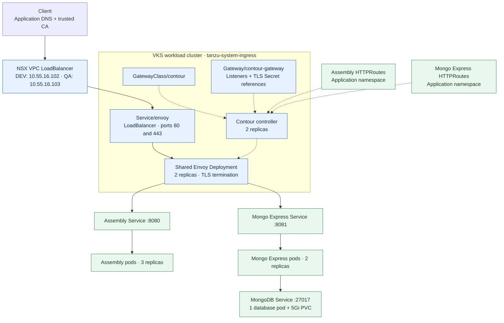
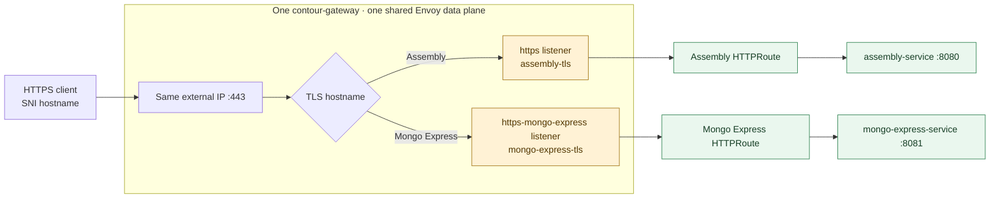
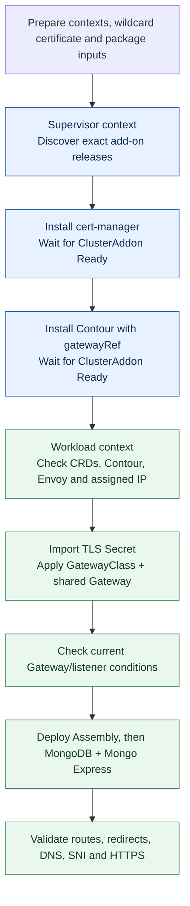
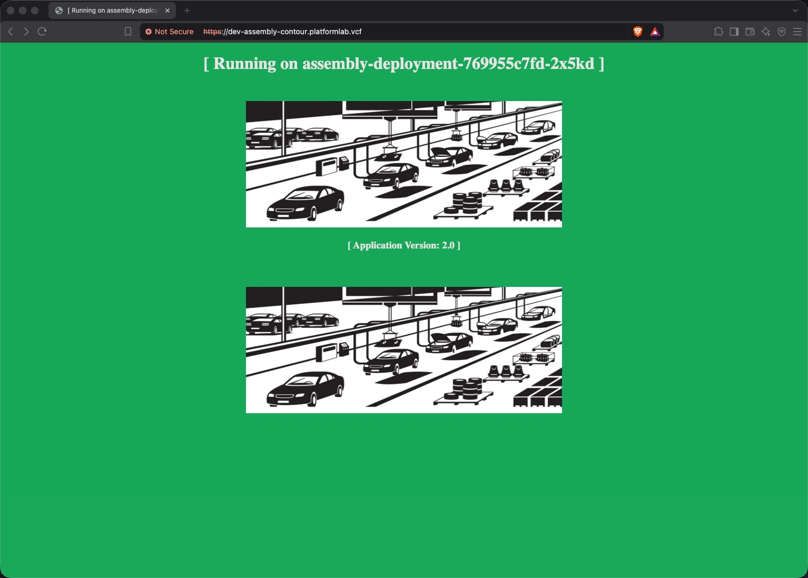
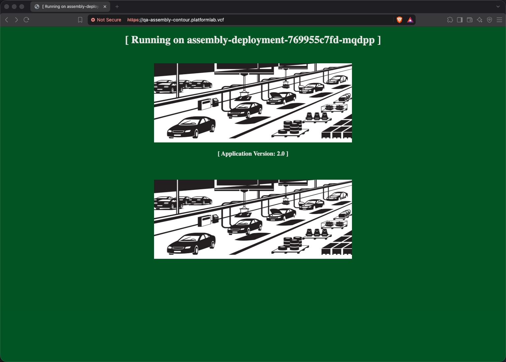
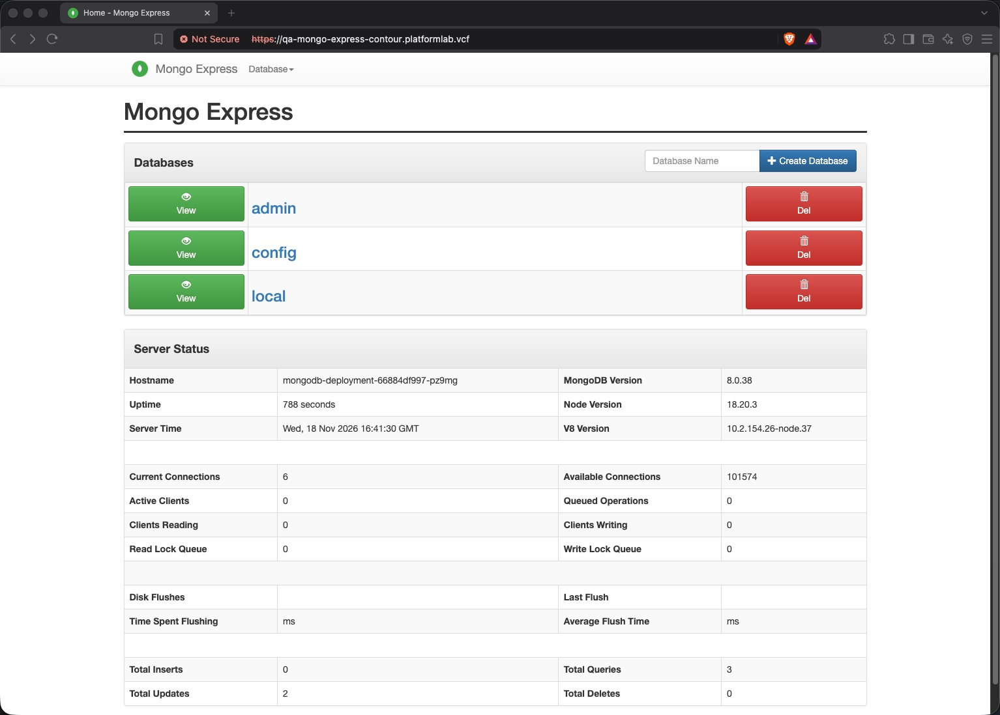

<!--
authors: "Julius M. Nicolescu, Qwen3-Coder-30B-A3B-Instruct-4bit, Qwen3.8-27B-8bit"
date: 2026-11-18
description: Install cert-manager and Contour on VKS and publish applications through a static shared Gateway with wildcard or individual TLS certificates.
keywords: VCF, VKS, Contour, Envoy, cert-manager, Gateway API, HTTPRoute, Assembly, Mongo Express, TLS
lang: en
-->

# Install the Contour add-on on VKS

Install **cert-manager and Contour** on existing VKS clusters in VMware Cloud Foundation **9.1.1**, then publish Assembly WebApp and Mongo Express through **Kubernetes Gateway API**. Each environment uses one static `contour-gateway`, a shared Envoy Deployment and one external LoadBalancer IP. Contour translates Gateway API configuration into Envoy routing; Envoy terminates HTTPS and forwards requests to application Services.

**Documentation scope:** DEV is the worked example for manual installation, package configuration and captured command output. QA uses the same procedure with the cluster, Supervisor namespace, IP addresses, application names and certificate files shown below. Separate QA script commands are provided. Captured output records historical observations; this rewrite does not perform a live installation or application test.

Choose the certificate configuration for the shared Gateway:

| Option | Gateway configuration | Use |
| --- | --- | --- |
| Wildcard certificate | One HTTP listener and one HTTPS listener referencing `platformlab-wildcard-tls`. | Central certificate covering `*.platformlab.vcf`. |
| Individual application certificates | Two hostname-specific HTTP listeners and two HTTPS listeners referencing `assembly-tls` and `mongo-express-tls`. | Separate keys and certificate rotation for Assembly and Mongo Express. |

Both options retain the same Gateway, Envoy Deployment, Service and external IP. Application HTTPRoutes provide HTTPS forwarding and HTTP-to-HTTPS redirects. Mongo Express also exercises MongoDB connectivity and persistent storage.

| Target | VKS cluster | Supervisor namespace | Supervisor Kubernetes context | Workload Kubernetes context |
| --- | --- | --- | --- | --- |
| DEV | `dev-cluster-01` | `dev-namespace` | `supervisor:dev-namespace` | `dev-cluster-01:dev-cluster-01` |
| QA | `qa-cluster-02` | `qa-namespace` | `supervisor:qa-namespace` | `qa-cluster-02:qa-cluster-02` |

Add-on installation resources (`AddonInstall`, `AddonConfig`, `ClusterAddon`) belong to the **Supervisor**. Contour, Envoy, Gateways, TLS Secrets, HTTPRoutes and application workloads belong to the **VKS workload cluster**. A Supervisor namespace such as `dev-namespace` is separate from the workload namespace `dev-assembly-contour`.

## Contents

- [Reference Environment](#reference-environment)
- [Check Supported VKr Versions in VKS Add-ons v3.8.0+20261021](#check-supported-vkr-versions-in-vks-add-ons-v38020261021)
- [Prerequisites](#prerequisites)
- [Shared versus dedicated Contour Gateways](#shared-versus-dedicated-contour-gateways)
- [Prepare the DEV configuration](#prepare-the-dev-configuration)
- [Install Contour on DEV](#install-contour-on-dev)
- [Deploy the DEV applications](#deploy-the-dev-applications)
- [Application screenshots](#application-screenshots)
- [Project files](#project-files)
- [Optional cleanup](#optional-cleanup)
- [Troubleshooting](#troubleshooting)
- [Output](#output)
- [References](#references)

## Reference Environment

The supplied lab record identifies these platform versions. The installation captures and current scripts use the older package releases listed separately below.

| Component | Recorded version |
| --- | --- |
| VMware Cloud Foundation | `9.1.1.0-545627-2026-09` |
| Supervisor Release | `v1.34.9+vmware.1-vsc9.1.1.0-25712839` |
| vSphere Kubernetes Service | `3.7.0-embedded+v1.36` |
| VKS Release | `v1.35.6---vmware.2-vkr.3` |
| VKS Add-ons Release | `v3.8.0+20261021` |
| cert-manager Version | `1.20.3+vmware.1-vks.1` |
| Contour Version | `1.33.5+vmware.1-vks.1` |

| Evidence | cert-manager | Contour |
| --- | --- | --- |
| Reference environment above | `1.20.3+vmware.1-vks.1` | `1.33.5+vmware.1-vks.1` |
| Captured installation and current DEV/QA script pins | `1.20.2+vmware.1-vks.1` | `1.33.4+vmware.1-vks.1` |
| Supplied v3.8.0 compatibility record | `1.21.2`, `1.20.4`, `1.19.6` package releases | `1.33.7+vmware.1-vks.1` |

These are distinct records. Discover releases in the target Supervisor before choosing a version; the compatibility table does not establish support for every older release.

### VKS Add-Ons

VKS Add-Ons extend VKS clusters with packaged components such as certificate management and ingress routing. The Supervisor exposes the available add-ons and reconciles their installation into a selected workload cluster.

Use the [VKS Add-ons release notes][ref-release] for supported VKr/package combinations and release changes. Use `vcf addon available list` to inspect the repositories configured in your environment.

## Check Supported VKr Versions in VKS Add-ons v3.8.0+20261021

The supplied compatibility record lists these releases. Check the [release notes][ref-release] and actual repository inventory before deployment or upgrade.

| Package | Support tier | Package version | v1.37 | v1.36 | v1.35 | v1.34 | v1.33 |
| --- | --- | --- | --- | --- | --- | --- | --- |
| Cert Manager | Product | `1.21.2+vmware.1-vks.1` | Yes | Yes | Yes | Yes | Yes |
| Cert Manager | Product | `1.20.4+vmware.1-vks.1` | Yes | Yes | Yes | Yes | Yes |
| Cert Manager | Product | `1.19.6+vmware.4-vks.1` | Yes | Yes | Yes | Yes | Yes |
| Contour | Ecosystem | `1.33.7+vmware.1-vks.1` | Yes | Yes | Yes | Yes | Yes |

The manual example below follows the captured `1.20.2` / `1.33.4` installation and existing script inputs. It does not upgrade the environment to this table's package releases.

## Prerequisites

| Requirement | Details |
| --- | --- |
| Platform | Existing VCF 9.1.1 Supervisor and VKS workload cluster. |
| Package availability | Confirm both exact AddonRelease names and compatibility with the target VKr. |
| Runtime and tools | Bash on macOS/Linux, VCF CLI 9.1.1, compatible kubectl and standard shell utilities. Application/report scripts use jq; listener tables use `column`; diagnostics use curl, nslookup and OpenSSL. |
| Authentication | Refreshable Supervisor and workload contexts. See the [context guide](../42-create-vks-context/Readme.md) and [CLI installation guide](../41-install-vcf-cli-kubectl/Readme.md). |
| Permissions | Manage Supervisor add-ons; manage workload namespaces, Secrets, Deployments, Services, Gateways and HTTPRoutes; inspect CRDs and GatewayClasses. |
| Gateway API | Compatible GatewayClass, Gateway and HTTPRoute CRDs already installed in the workload cluster. |
| Networking | Reach both APIs and image registries. The reference design uses NSX VPC native Load Balancing with capacity for DEV `10.55.16.102` and QA `10.55.16.103`. |
| Certificates and DNS | Matching keys/full-chain certificates in local `certificates/` directories; application DNS points to the assigned Envoy address; clients trust the issuing CA. |
| Storage | MongoDB requires dynamic provisioning through `vsan-default-storage-policy` and a `5Gi` ReadWriteOnce PVC. |
| Local files | Write access to kubeconfig/VCF configuration, `deployment-files/`, certificates and dated report directories. |

The application manifests use privileged Pod Security namespace labels and sample MongoDB/Mongo Express credentials. Review these editable lab inputs before reuse. Certificate utilities require OpenSSL 3.3 or later.

## Shared versus dedicated Contour Gateways

### Architecture comparison

The VKS Contour package uses **static provisioning**. It deploys Contour and Envoy, and `contour.configFileContents.gateway.gatewayRef` associates that installation with one named Gateway. Creating another Gateway alone does not create another Envoy Deployment, LoadBalancer Service or IP. Broadcom documents this model and its supported HTTP/HTTPS ports in the [current Contour package reference][ref-contour-current].

| Decision factor | Shared static Gateway used here | Dedicated Gateways through upstream dynamic provisioning |
| --- | --- | --- |
| Provisioning | VKS add-on deploys Contour/Envoy; package values select the Gateway. | A separate Gateway provisioner creates a Contour/Envoy instance for each Gateway. |
| Gateway and external IP count | One per workload cluster. | Potentially one data plane and IP per Gateway, subject to provider support. |
| Application routing | Separate HTTPRoutes share Envoy and the external IP. | Routes can use separate data planes. |
| TLS | Wildcard or individual certificates on the same shared Gateway. | Each Gateway can have its own certificates. |
| Scaling and failure impact | Both applications share Envoy capacity and availability. | Potential independent data-plane scaling and failure domains. |
| Operations and resources | Central configuration; fewer proxies and IP allocations. | More controller/proxy resources, IPs and lifecycle work. |
| Supported workflow in this project | Implemented by both DEV and QA scripts. | No installer or supported VKS package workflow supplied here. |

The [Contour 1.33 documentation][ref-contour-133] explains both upstream provisioning modes. Upstream capability does not establish VKS add-on support. A dedicated external IP requires a separately supported deployment design.

### How the current scripts implement these options

Both certificate options use `GatewayClass/contour`, controller `projectcontour.io/gateway-controller`, and Gateway `tanzu-system-ingress/contour-gateway`.

| Component | Responsibility and location |
| --- | --- |
| Supervisor AddonInstall/AddonConfig | Select the workload cluster, package release and package values. |
| Contour Deployment | Two controller replicas in `tanzu-system-ingress`; translate Gateway API resources into Envoy configuration. |
| Envoy Deployment and Service | Two proxy replicas behind `Service/envoy`, type `LoadBalancer`, in `tanzu-system-ingress`. |
| GatewayClass | Cluster-scoped selection of the Contour controller. |
| Gateway | Namespaced listener, TLS and route-admission configuration. |
| TLS Secrets | Wildcard or individual application certificate/key pairs beside the Gateway. |
| Application HTTPRoutes | Hostname/path matching, HTTPS forwarding and HTTP redirects in each application namespace. |
| Application Services | Internal ClusterIP backends for Assembly, Mongo Express and MongoDB. |

Gateway listeners allow routes from all namespaces (`from: All`) in this lab. The application route must also reference the Gateway and match a listener's hostname and selection rules. See [Gateway API cross-namespace routing][ref-cross-namespace]. TLS Secrets stay in the Gateway namespace; application backends stay beside their HTTPRoutes.

### Choose a design

Use one shared static Gateway per environment. Choose wildcard TLS for simple central certificate management, or individual certificates for independent keys and rotation. Individual certificates retain the shared proxy capacity and LoadBalancer IP.

| Item | Wildcard TLS | Individual certificates |
| --- | --- | --- |
| Gateway resources per cluster | 1 | 1 |
| Envoy Deployments / replicas | 1 / 2 | 1 / 2 |
| LoadBalancer Services / IPs | 1 / 1 | 1 / 1 |
| Listener definitions | 2: `http`, `https` | 4: `http`, `http-mongo-express`, `https`, `https-mongo-express` |
| Distinct listener ports | 80, 443 | 80, 443 |
| Referenced TLS Secrets | `platformlab-wildcard-tls` | `assembly-tls`, `mongo-express-tls` |
| Certificate scope | `*.platformlab.vcf` | Exact application hostnames |
| Rotation | Shared certificate lifecycle | Separate application certificate lifecycles |

The package's **two-port limit means ports 80 and 443**, rather than a maximum of two listener definitions. The supplied individual-certificate capture shows four accepted/programmed listeners using those two ports. Each HTTPS listener references one TLS Secret. A wildcard covers one label beneath `platformlab.vcf`; it does not cover the zone apex or deeper names such as `app.dev.platformlab.vcf`.

### Current script traffic flows

#### Shared Gateway

Solid arrows carry requests; dashed arrows show configuration. The Gateway's status address advertises the Envoy LoadBalancer IP; it is not an additional network hop.



HTTP requests use an application `RequestRedirect` route to return HTTPS URLs. A port 80 listener alone does not redirect traffic. HTTPS terminates in Envoy; the shown backend Service connections use HTTP. MongoDB remains internal to the workload cluster.

#### Dedicated certificates on the shared Gateway



SNI selects the hostname's certificate during TLS negotiation; HTTPRoute matching then selects the application backend. The wildcard option uses the same traffic path with one wildcard HTTPS listener.

## Prepare the DEV configuration

### Cluster, namespace and package settings

The scripts themselves are the editable input files. Review the linked DEV and QA files before running them; generated manifests are overwritten on reruns.

| Input | DEV | QA |
| --- | --- | --- |
| Add-on inputs | [VCF CLI installer](dev-cluster-01/10-install-contour-addon-vcf-cli.sh), [kubectl installer](dev-cluster-01/20-install-contour-addon-kubectl.sh) | [VCF CLI installer](qa-cluster-02/10-install-contour-addon-vcf-cli.sh), [kubectl installer](qa-cluster-02/20-install-contour-addon-kubectl.sh) |
| Assembly application inputs | [Deployment script](dev-cluster-01/deploy-assembly-webapp/02-deploy-assembly-webapp-static-gateway.sh) | [Deployment script](qa-cluster-02/deploy-assembly-webapp/02-deploy-assembly-webapp-static-gateway.sh) |
| MongoDB + Mongo Express inputs | [Deployment script](dev-cluster-01/deploy-mongo-express/02-deploy-mongo-express-static-gateway.sh) | [Deployment script](qa-cluster-02/deploy-mongo-express/02-deploy-mongo-express-static-gateway.sh) |
| Wildcard certificate switch inputs | [Switch script](dev-cluster-01/deploy-assembly-webapp/10-switch-to-wildcard-certificate.sh) | [Switch script](qa-cluster-02/deploy-assembly-webapp/10-switch-to-wildcard-certificate.sh) |
| Individual certificate switch inputs | [Switch script](dev-cluster-01/deploy-assembly-webapp/11-switch-to-individual-certificates.sh) | [Switch script](qa-cluster-02/deploy-assembly-webapp/11-switch-to-individual-certificates.sh) |

| Setting | Value or purpose |
| --- | --- |
| `CONTEXT_NAME` | `supervisor`; refresh the base context before selecting a namespace context. |
| `CLUSTER_NAMESPACE` / `CLUSTER_NAME` | `dev-namespace` / `dev-cluster-01`; QA uses `qa-namespace` / `qa-cluster-02`. |
| `CERT_MANAGER_RELEASE` | `cert-manager.kubernetes.vmware.com.1.20.2-vmware.1-vks.1`. |
| `CONTOUR_RELEASE` | `contour.kubernetes.vmware.com.1.33.4-vmware.1-vks.1`. |
| `GATEWAY_NAMESPACE` / `GATEWAY_NAME` | `tanzu-system-ingress` / `contour-gateway`, in each workload cluster. |
| `ENVOY_LB_IP` | DEV `10.55.16.102`; QA `10.55.16.103`; verify actual assignment. |
| `READY_TIMEOUT` | `10m` for installation waits. |
| `NAMESPACE` / `APP_FQDN` | Application namespace and hostname, independently configured in each deployment script. |
| `STORAGE_CLASS` | `vsan-default-storage-policy` in MongoDB deployment inputs. |

| Workload component | DEV namespace | QA namespace |
| --- | --- | --- |
| Certificate management | `cert-manager` | `cert-manager` |
| Contour, Envoy, Gateway and TLS Secrets | `tanzu-system-ingress` | `tanzu-system-ingress` |
| Assembly | `dev-assembly-contour` | `qa-assembly-contour` |
| MongoDB + Mongo Express | `dev-mongodb-contour` | `qa-mongodb-contour` |

### Contour package values — Gateway API and static provisioning

The package values must include the matching Gateway reference. An empty `configFileContents` can leave a Gateway waiting for a controller while Contour and Envoy pods are healthy. The installation example includes the reference already present in both current installers.

```yaml
contour:
  configFileContents:
    gateway:
      gatewayRef:
        name: contour-gateway
        namespace: tanzu-system-ingress
```

| Setting | Lab value | Purpose |
| --- | --- | --- |
| `controller.enableGatewayAPI` in cert-manager values | `true` | Enable Gateway API certificate integration. |
| `controller.enableGatewayAPIListenerSet` | `false` | Keep experimental ListenerSet integration disabled. |
| `issuers` | `[]` | No issuer is configured by this values file. |
| `contour.replicas` | `2` | Two controller replicas. |
| `contour.disableGRPCRoutes` | `true` | Use HTTPRoute for these applications. |
| `contour.listenIPFamily` / `envoy.listenIPFamily` | `IPv4` | IPv4 listeners. |
| `contour.useProxyProtocol` | `false` | PROXY protocol disabled. |
| `envoy.workload.type` / `replicas` | `Deployment` / `2` | Two shared proxy replicas. |
| `envoy.service.type` | `LoadBalancer` | External ingress through the networking provider. |
| `envoy.service.loadBalancerIP` | `10.55.16.102` on DEV | Request the Service address; verify provider allocation. |
| `envoy.service.externalTrafficPolicy` | `Cluster` | Permit forwarding to Envoy endpoints across nodes. |
| `envoy.service.loadBalancerTLSTermination` | `false` | Application TLS terminates at Envoy. |
| `envoy.hostNetwork` / `envoy.hostPorts.enable` | `false` / `false` | Use normal Pod networking without host port binding. |
| `envoy.terminationGracePeriodSeconds` | `300` | Allow graceful proxy shutdown. |
| `certificates.caDuration` / `caRenewBefore` | `8760h` / `720h` | Package-managed internal CA lifetime/renewal interval. |
| `certificates.leafDuration` / `leafRenewBefore` | `720h` / `360h` | Internal component certificate lifetime/renewal interval. |
| `namespace` | `tanzu-system-ingress` | Contour/Envoy workload namespace. |
| `registry_secret_names` | `[contour-reg-creds]` | Retain the package registry Secret setting. |

The package's internal certificates are separate from the application-facing TLS Secrets. Importing application certificates does not configure cert-manager renewal. The [current package reference][ref-contour-current] documents the values and notes that `loadBalancerIP` maps to the deprecated Kubernetes Service field; its effect depends on the networking provider.

### Application DNS records

Use names that agree across DNS, certificate SANs, Gateway listeners and HTTPRoutes. The **current application inputs and individual certificates use `-contour` names**:

| Gateway / application | DEV | QA |
| --- | --- | --- |
| Shared Envoy IP | `10.55.16.102` | `10.55.16.103` |
| Gateway DNS | `dev-contour-gateway.platformlab.vcf` | `qa-contour-gateway.platformlab.vcf` |
| Assembly | `dev-assembly-contour.platformlab.vcf` | `qa-assembly-contour.platformlab.vcf` |
| Mongo Express | `dev-mongo-express-contour.platformlab.vcf` | `qa-mongo-express-contour.platformlab.vcf` |

Corresponding forward records in the `platformlab.vcf` zone:

```dns
dev-contour-gateway        IN A      10.55.16.102
dev-assembly-contour       IN CNAME  dev-contour-gateway.platformlab.vcf.
dev-mongo-express-contour  IN CNAME  dev-contour-gateway.platformlab.vcf.

qa-contour-gateway         IN A      10.55.16.103
qa-assembly-contour        IN CNAME  qa-contour-gateway.platformlab.vcf.
qa-mongo-express-contour   IN CNAME  qa-contour-gateway.platformlab.vcf.
```

The supplied DNS record uses older **`-gateway` application aliases**. It is retained here for comparison; those aliases do not match the current exact-hostname listeners and individual application certificates:

```dns
dev-contour-gateway         IN A        10.55.16.102
dev-assembly-gateway        IN CNAME    dev-contour-gateway.platformlab.vcf.
dev-mongo-express-gateway   IN CNAME    dev-contour-gateway.platformlab.vcf.

# QA - Contour Gateway
qa-contour-gateway          IN A        10.55.16.103
qa-assembly-gateway         IN CNAME    qa-contour-gateway.platformlab.vcf.
qa-mongo-express-gateway    IN CNAME    qa-contour-gateway.platformlab.vcf.

# Reverse DNS (PTR)
102  IN PTR     dev-contour-gateway.platformlab.vcf.
103  IN PTR     qa-contour-gateway.platformlab.vcf.
```

The PTR entries belong in the reverse zone for `10.55.16.0/24`. Select the current application names above unless you also change every corresponding application/listener/certificate input. A DNS alias alone does not change the hostname a browser sends through SNI and HTTP.

### Application certificates

| Helper | Purpose |
| --- | --- |
| [01-create-custom-ca-cert.sh](utilities/01-create-custom-ca-cert.sh) | Create the lab CA. |
| [02-create-wildcard.platformlab.vcf.sh](utilities/02-create-wildcard.platformlab.vcf.sh) | Create the wildcard certificate. |
| [03-create-dev-assembly-contour.platformlab.vcf.sh](utilities/03-create-dev-assembly-contour.platformlab.vcf.sh) | Create the DEV Assembly certificate. |
| [04-create-dev-mongo-express-contour.platformlab.vcf.sh](utilities/04-create-dev-mongo-express-contour.platformlab.vcf.sh) | Create the DEV Mongo Express certificate. |
| [05-create-qa-assembly-contour.platformlab.vcf.sh](utilities/05-create-qa-assembly-contour.platformlab.vcf.sh) | Create the QA Assembly certificate. |
| [06-create-qa-mongo-express-contour.platformlab.vcf.sh](utilities/06-create-qa-mongo-express-contour.platformlab.vcf.sh) | Create the QA Mongo Express certificate. |

Run the CA helper once if the CA does not exist, then the required server-certificate helpers. Starting beside this README, for example:

```bash
bash utilities/01-create-custom-ca-cert.sh
bash utilities/02-create-wildcard.platformlab.vcf.sh
bash utilities/03-create-dev-assembly-contour.platformlab.vcf.sh
bash utilities/04-create-dev-mongo-express-contour.platformlab.vcf.sh
```

Helpers save files under `utilities/certificates/` and refuse to overwrite existing key/certificate files. Copy the required files into the directory used by the script you will invoke:

| Operation | Certificate directory | Required `.key` and `.cer.plusCA` basename |
| --- | --- | --- |
| DEV installation | `dev-cluster-01/certificates/` | `wildcard.platformlab.vcf` |
| DEV switch from Assembly directory | `dev-cluster-01/deploy-assembly-webapp/certificates/` | Wildcard file, or both `dev-assembly-contour.platformlab.vcf` and `dev-mongo-express-contour.platformlab.vcf`. |
| DEV switch from Mongo Express directory | `dev-cluster-01/deploy-mongo-express/certificates/` | Same set for the selected mode. |
| QA installation/switching | Matching directories under `qa-cluster-02/` | Wildcard file, or both QA application basenames. |

Each individual-certificate switch configures **both applications**, so its own `certificates/` directory needs both application certificate/key pairs. TLS Secrets are created in `tanzu-system-ingress`. Trust the lab CA on clients and retain private-key access controls. No private keys are included in this guide.

## Install Contour on DEV

Choose the manual procedure or one supplied installer. Both paths install cert-manager and Contour and create the shared wildcard HTTP/HTTPS Gateway. Applications are deployed separately.



### Option 1: manual installation

Run these steps in one Bash session, starting beside this README, with existing authenticated contexts. Commands write generated files under the selected cluster's `deployment-files/` directory. `create` commands below are for a new installation; for an existing installation use the supported configuration-update path described under the script option.

**Captured lab output:** every text block below preserves the supplied command and result, including historical IPs, resource names, status and header typos. Commands in `bash` blocks are the reusable procedure. Undated captures remain undated.

#### 1. Select DEV

```bash
cd dev-cluster-01

CONTEXT_NAME=supervisor
CLUSTER_NAMESPACE=dev-namespace
CLUSTER_NAME=dev-cluster-01
CERT_MANAGER_RELEASE=cert-manager.kubernetes.vmware.com.1.20.2-vmware.1-vks.1
CONTOUR_RELEASE=contour.kubernetes.vmware.com.1.33.4-vmware.1-vks.1
ENVOY_LB_IP=10.55.16.102
GATEWAY_NAME=contour-gateway
GATEWAY_NAMESPACE=tanzu-system-ingress
READY_TIMEOUT=10m
SCRIPT_DIR=$(pwd)
DEPLOYMENT_FILES=${SCRIPT_DIR}/deployment-files
CERTIFICATES_DIR=${SCRIPT_DIR}/certificates
mkdir -p "${DEPLOYMENT_FILES}"

vcf context refresh ${CONTEXT_NAME}
vcf context use ${CONTEXT_NAME}:${CLUSTER_NAMESPACE}
kubectl config use-context ${CONTEXT_NAME}:${CLUSTER_NAMESPACE}
```

Supervisor add-on discovery and installation use `supervisor:dev-namespace`. Change to `dev-cluster-01:dev-cluster-01` only for workload resources.

#### 2. Discover the cert-manager and Contour releases

```bash
vcf addon install list --cluster-name ${CLUSTER_NAME}
```

Captured installed inventory before adding cert-manager and Contour:

```text
vcf addon install list --cluster-name ${CLUSTER_NAME}
  ADDONNAME        NAMESPACE      ADDONRELEASENAME                                                     PAUSED  READY  DELETE/UPGRADE  
  helm-controller  dev-namespace  helm-controller.kubernetes.vmware.com.1.5.4-v4.01.04-vmware.1-vks.1  false   True   NotAllowed
```

```bash
vcf addon available list
```

Captured available add-ons:

```text
vcf addon available list                               
  NAMESPACE                 ADDONNAME                    DESCRIPTION                                                                       
  vmware-system-vks-public  ako                          Integrates VMware NSX Advanced Load Balancer with Kubernetes for L4-L7 services.  
  vmware-system-vks-public  cert-manager                 Certificate management                                                            
  vmware-system-vks-public  contour                      An ingress controller                                                             
  vmware-system-vks-public  external-dns                 This package provides DNS synchronization functionality.                          
  vmware-system-vks-public  fluent-bit                   Fluent Bit is a fast Log Processor and Forwarder                                  
  vmware-system-vks-public  gatekeeper                   Policy enforcement for Kubernetes via OPA Gatekeeper                              
  vmware-system-vks-public  harbor                       OCI Registry                                                                      
  vmware-system-vks-public  headlamp                     Web UI for Kubernetes (Headlamp).                                                 
  vmware-system-vks-public  helm-controller              declarative Helm chart lifecycle management                                       
  vmware-system-vks-public  istio                        networking service mesh solution for containers                                   
  vmware-system-vks-public  multus-cni                   This package provides the ability for enabling attaching multiple network         
                                                         interfaces to pods in Kubernetes                                                  
  vmware-system-vks-public  nfs-client                   A CSI for NFS.                                                                    
  vmware-system-vks-public  prometheus                   A time series database for your metrics                                           
  vmware-system-vks-public  sriov-network-device-plugin  The SR-IOV Network Device Plugin is Kubernetes device plugin for discovering and  
                                                         advertising SR-IOV virtual functions (VFs) available on a Kubernetes host         
  vmware-system-vks-public  telegraf                     collect and report metrics                                                        
  vmware-system-vks-public  vault-injector               Vault Agent Injector for Secret Store Service                                     
  vmware-system-vks-public  velero                       Velero is an open source tool to safely backup and restore, perform disaster      
                                                         recovery, and migrate Kubernetes cluster resources and persistent volumes.        
  vmware-system-vks-public  vsphere-pv-csi-webhook       vSphere paravirtual CSI provider webhook                                          
  vmware-system-vks-public  whereabouts                  A CNI IPAM plugin that assigns IP addresses cluster-wide                          
  vmware-system-vks-public  windows-gmsa-webhook         Windows Group Managed Service Accounts (GMSA) Kubernetes Webhook
```

```bash
vcf addon available list cert-manager
```

Captured cert-manager releases:

```text
vcf addon available list cert-manager
  NAMESPACE                 ADDONNAME     VERSION                ADDON-RELEASE-NAME                                        PACKAGE                                                   
  vmware-system-vks-public  cert-manager  1.19.4+vmware.2-vks.1  cert-manager.kubernetes.vmware.com.1.19.4-vmware.2-vks.1  cert-manager.kubernetes.vmware.com/1.19.4+vmware.2-vks.1  
  vmware-system-vks-public  cert-manager  1.20.2+vmware.1-vks.1  cert-manager.kubernetes.vmware.com.1.20.2-vmware.1-vks.1  cert-manager.kubernetes.vmware.com/1.20.2+vmware.1-vks.1
```

```bash
vcf addon available list contour
```

Captured Contour release:

```text
vcf addon available list contour
  NAMESPACE                 ADDONNAME  VERSION                ADDON-RELEASE-NAME                                   PACKAGE                                              
  vmware-system-vks-public  contour    1.33.4+vmware.1-vks.1  contour.kubernetes.vmware.com.1.33.4-vmware.1-vks.1  contour.kubernetes.vmware.com/1.33.4+vmware.1-vks.1
```

Export defaults from the exact selected releases. Keep these defaults for comparison with the reviewed values:

```bash
vcf addon available-releases get ${CERT_MANAGER_RELEASE} \
  --values-config-file-output "${DEPLOYMENT_FILES}/cert-manager-default-data-values.yaml"
vcf addon available-releases get ${CONTOUR_RELEASE} \
  --values-config-file-output "${DEPLOYMENT_FILES}/contour-default-data-values.yaml"
```

#### 3. Write the Gateway API values

Create the cert-manager values. The file enables Gateway API integration and leaves issuer configuration empty:

```bash
cat << 'EOF' > "${DEPLOYMENT_FILES}/cert-manager-data-values.yaml"
certManager:
  pspNames:
    - vmware-system-privileged
controller:
  enableGatewayAPI: true
  enableGatewayAPIListenerSet: false
deploymentMode:
  resources:
    requests:
      cpu: 10m
      memory: 64Mi
issuers: []
kubernetes_distribution: ""
kubernetes_version: ""
namespace: cert-manager
nsLimitRange:
  defaultRequests:
    cpu: 10m
    memory: 64Mi
priorityClassName: ""
EOF
```

Create the Contour values with the matching static Gateway reference, two controller replicas, two Envoy replicas and the requested external IP:

```bash
cat << EOF > "${DEPLOYMENT_FILES}/contour-data-values.yaml"
certificates:
  caDuration: 8760h
  caRenewBefore: 720h
  leafDuration: 720h
  leafRenewBefore: 360h

contour:
  configFileContents:
    gateway:
      gatewayRef:
        name: ${GATEWAY_NAME}
        namespace: ${GATEWAY_NAMESPACE}
  disableGRPCRoutes: true
  listenIPFamily: IPv4
  logLevel: info
  pspNames: vmware-system-restricted
  replicas: 2
  resources:
    contour:
      requests:
        cpu: 128m
        memory: 256Mi
  service:
    ipFamilies: []
    ipFamilyPolicy: ""
  useProxyProtocol: false

enableSupervisorServiceRbac: false

envoy:
  bootstrap:
    overloadManager:
      downstreamMaxConnections: 0
      maxHeap: 0
  hostNetwork: false
  hostPorts:
    enable: false
    http: 80
    https: 443
  listenIPFamily: IPv4
  logLevel: info
  pspNames: ""
  service:
    aws:
      LBType: classic
    disableWait: false
    externalTrafficPolicy: Cluster
    ipFamilies: []
    ipFamilyPolicy: ""
    loadBalancerIP: ${ENVOY_LB_IP}
    loadBalancerTLSTermination: false
    nodePorts:
      http: 0
      https: 0
    type: LoadBalancer
  terminationGracePeriodSeconds: 300
  workload:
    replicas: 2
    resources:
      envoy:
        requests:
          cpu: 128m
          memory: 256Mi
      envoyInitConfig:
        requests:
          cpu: 128m
          memory: 256Mi
      shutdownManager:
        requests:
          cpu: 10m
          memory: 16Mi
    type: Deployment

infrastructure_provider: vsphere
kubernetes_distribution: ""
kubernetes_version: 0.0.0
namespace: tanzu-system-ingress
nsLimitRange:
  defaultRequests:
    cpu: 128m
    memory: 256Mi
priorityClassName: ""
registry_secret_names:
  - contour-reg-creds
EOF
```

These match the current installer's values. The older recorded Contour values omitted `gatewayRef`, left `loadBalancerIP` empty and used a different filename in the install command. The procedure uses one consistent `contour-data-values.yaml` path and includes the static association. Likewise, the cert-manager install command separates the values filename from `--yes`.

#### 4. Install cert-manager and Contour and wait for readiness

Install cert-manager first, then inspect Supervisor readiness:

```bash
kubectl config use-context ${CONTEXT_NAME}:${CLUSTER_NAMESPACE}
vcf addon install create cert-manager \
  --cluster-name ${CLUSTER_NAME} --namespace ${CLUSTER_NAMESPACE} \
  --addon-release-name ${CERT_MANAGER_RELEASE} \
  --values-config-file "${DEPLOYMENT_FILES}/cert-manager-data-values.yaml" --yes
kubectl wait clusteraddon/${CLUSTER_NAME}-cert-manager -n ${CLUSTER_NAMESPACE} \
  --for=create --timeout=${READY_TIMEOUT}
kubectl wait clusteraddon/${CLUSTER_NAME}-cert-manager -n ${CLUSTER_NAMESPACE} \
  --for=condition=Ready --timeout=${READY_TIMEOUT}
vcf addon install list --cluster-name ${CLUSTER_NAME} -n ${CLUSTER_NAMESPACE}
```

Captured add-on readiness:

```text
vcf addon install list --cluster-name ${CLUSTER_NAME} -n ${CLUSTER_NAMESPACE}
  ADDONNAME        NAMESPACE      ADDONRELEASENAME                                                     PAUSED  READY  DELETE/UPGRADE  
  cert-manager     dev-namespace  cert-manager.kubernetes.vmware.com.1.20.2-vmware.1-vks.1             false   True   Allowed         
  helm-controller  dev-namespace  helm-controller.kubernetes.vmware.com.1.5.4-v4.01.04-vmware.1-vks.1  false   True   NotAllowed
```

Verify cert-manager inside the workload cluster:

```bash
vcf context refresh ${CLUSTER_NAME}
vcf context use ${CLUSTER_NAME}:${CLUSTER_NAME}
kubectl config use-context ${CLUSTER_NAME}:${CLUSTER_NAME}
kubectl get all -n cert-manager
```

Captured cert-manager resources (the original first header reads `AME`):

```text
kubectl get all -n cert-manager
AME                                           READY   STATUS    RESTARTS   AGE
pod/cert-manager-bbd7cbf87-c485c               1/1     Running   0          2m58s
pod/cert-manager-cainjector-7d8fbc48cf-584tz   1/1     Running   0          2m58s
pod/cert-manager-webhook-7dc4b456cc-n4m7l      1/1     Running   0          2m58s

NAME                              TYPE        CLUSTER-IP       EXTERNAL-IP   PORT(S)            AGE
service/cert-manager              ClusterIP   10.111.187.154   <none>        9402/TCP           2m58s
service/cert-manager-cainjector   ClusterIP   10.102.52.181    <none>        9402/TCP           2m58s
service/cert-manager-webhook      ClusterIP   10.96.116.195    <none>        443/TCP,9402/TCP   2m58s

NAME                                      READY   UP-TO-DATE   AVAILABLE   AGE
deployment.apps/cert-manager              1/1     1            1           2m58s
deployment.apps/cert-manager-cainjector   1/1     1            1           2m58s
deployment.apps/cert-manager-webhook      1/1     1            1           2m58s

NAME                                                 DESIRED   CURRENT   READY   AGE
replicaset.apps/cert-manager-bbd7cbf87               1         1         1       2m58s
replicaset.apps/cert-manager-cainjector-7d8fbc48cf   1         1         1       2m58s
replicaset.apps/cert-manager-webhook-7dc4b456cc      1         1         1       2m58s
```

Return to the Supervisor context to install Contour:

```bash
vcf context use ${CONTEXT_NAME}:${CLUSTER_NAMESPACE}
kubectl config use-context ${CONTEXT_NAME}:${CLUSTER_NAMESPACE}
vcf addon install create contour \
  --cluster-name ${CLUSTER_NAME} --namespace ${CLUSTER_NAMESPACE} \
  --addon-release-name ${CONTOUR_RELEASE} \
  --values-config-file "${DEPLOYMENT_FILES}/contour-data-values.yaml" --yes
kubectl wait clusteraddon/${CLUSTER_NAME}-contour -n ${CLUSTER_NAMESPACE} \
  --for=create --timeout=${READY_TIMEOUT}
kubectl wait clusteraddon/${CLUSTER_NAME}-contour -n ${CLUSTER_NAMESPACE} \
  --for=condition=Ready --timeout=${READY_TIMEOUT}
vcf addon install list --cluster-name ${CLUSTER_NAME} -n ${CLUSTER_NAMESPACE}
```

Captured installed add-ons:

```text
vcf addon install list --cluster-name ${CLUSTER_NAME} -n ${CLUSTER_NAMESPACE}
  ADDONNAME        NAMESPACE      ADDONRELEASENAME                                                     PAUSED  READY  DELETE/UPGRADE  
  cert-manager     dev-namespace  cert-manager.kubernetes.vmware.com.1.20.2-vmware.1-vks.1             false   True   Allowed         
  contour          dev-namespace  contour.kubernetes.vmware.com.1.33.4-vmware.1-vks.1                  false   True   Allowed         
  helm-controller  dev-namespace  helm-controller.kubernetes.vmware.com.1.5.4-v4.01.04-vmware.1-vks.1  false   True   NotAllowed
```

#### 5. Verify the control plane and Gateway API

```bash
vcf context refresh ${CLUSTER_NAME}
vcf context use ${CLUSTER_NAME}:${CLUSTER_NAME}
kubectl config use-context ${CLUSTER_NAME}:${CLUSTER_NAME}
kubectl get crd gateways.gateway.networking.k8s.io
kubectl get crd gatewayclasses.gateway.networking.k8s.io
kubectl get crd httproutes.gateway.networking.k8s.io
```

Captured Gateway CRD:

```text
kubectl get crd gateways.gateway.networking.k8s.io
NAME                                 CREATED AT
gateways.gateway.networking.k8s.io   2026-11-15T22:24:16Z
```

Inspect an existing GatewayClass before creating or updating one. The recorded class was present but not accepted at this stage; an absent class on a new installation is created in step 6.

```bash
kubectl get gatewayclass
```

```text
kubectl get gatewayclass
NAME      CONTROLLER                             ACCEPTED   AGE
contour   projectcontour.io/gateway-controller   Unknown    4m21s
```

```bash
kubectl get service -n tanzu-system-ingress
kubectl get pods -n tanzu-system-ingress
```

Captured Service inventory and controller/proxy pods:

```text
kubectl get service -n tanzu-system-ingress
NAME      TYPE           CLUSTER-IP      EXTERNAL-IP    PORT(S)                      AGE
contour   ClusterIP      10.107.101.60   <none>         8001/TCP                     9m58s
envoy     LoadBalancer   10.100.114.28   10.55.16.102   80:31655/TCP,443:32559/TCP   9m58s
```

```text
kubectl get pods -n tanzu-system-ingress
NAME                       READY   STATUS    RESTARTS   AGE
contour-7fb6f47d78-6zzbz   1/1     Running   0          10m
contour-7fb6f47d78-pdd5d   1/1     Running   0          10m
envoy-dd74d884b-fds4s      2/2     Running   0          10m
envoy-dd74d884b-hkt8g      2/2     Running   0          10m
```

The capture shows Envoy IP `10.55.16.102` and two Contour/two Envoy pods. Envoy pods show `2/2` ready containers; that column is not a replica count. Healthy pods alone do not establish Gateway reconciliation or application reachability.

#### 6. Create the shared HTTP/HTTPS Gateway

Continue in the workload context. Import the wildcard certificate/key beside the Gateway:

```bash
kubectl config use-context ${CLUSTER_NAME}:${CLUSTER_NAME}
kubectl create namespace ${GATEWAY_NAMESPACE} --dry-run=client -o yaml | kubectl apply -f -
kubectl create secret tls platformlab-wildcard-tls \
  --cert="${CERTIFICATES_DIR}/wildcard.platformlab.vcf.cer.plusCA" \
  --key="${CERTIFICATES_DIR}/wildcard.platformlab.vcf.key" \
  --namespace=${GATEWAY_NAMESPACE} --dry-run=client -o yaml | kubectl apply -f -
```

Write the cluster-scoped GatewayClass and namespaced Gateway. Reuse a matching existing class; confirm ownership before changing it:

```bash
cat << EOF > "${DEPLOYMENT_FILES}/${GATEWAY_NAME}-resource.yaml"
apiVersion: gateway.networking.k8s.io/v1
kind: GatewayClass
metadata:
  name: contour
spec:
  controllerName: projectcontour.io/gateway-controller
---
apiVersion: gateway.networking.k8s.io/v1
kind: Gateway
metadata:
  name: ${GATEWAY_NAME}
  namespace: ${GATEWAY_NAMESPACE}
spec:
  gatewayClassName: contour
  listeners:
    - name: http
      protocol: HTTP
      port: 80
      allowedRoutes:
        namespaces:
          from: All
    - name: https
      hostname: "*.platformlab.vcf"
      protocol: HTTPS
      port: 443
      tls:
        mode: Terminate
        certificateRefs:
          - group: ""
            kind: Secret
            name: platformlab-wildcard-tls
      allowedRoutes:
        namespaces:
          from: All
EOF
kubectl apply -f "${DEPLOYMENT_FILES}/${GATEWAY_NAME}-resource.yaml"
kubectl get gatewayclass
kubectl get gateway -n tanzu-system-ingress
```

Captured intermediate results:

```text
kubectl get gatewayclass
NAME      CONTROLLER                             ACCEPTED   AGE
contour   projectcontour.io/gateway-controller   Unknown    73s
```

```text
kubectl get gateway -n tanzu-system-ingress
NAME      CLASS     ADDRESS   PROGRAMMED   AGE
contour   contour             Unknown      79s
```

The historical Gateway row is named `contour` and reports `Programmed=Unknown` without an address. The current manifest and controller reference use **`contour-gateway`**. These captures show a pending intermediate state; they do not verify the current manifest's completion. Before the controller reconciles its referenced Gateway, an unprogrammed state is possible.

Wait for the actual configured Gateway, then inspect its complete status and the shared proxy:

```bash
kubectl wait gateway/${GATEWAY_NAME} -n ${GATEWAY_NAMESPACE} \
  --for=condition=Programmed --timeout=${READY_TIMEOUT}
kubectl get gateway ${GATEWAY_NAME} -n ${GATEWAY_NAMESPACE} -o yaml
kubectl get deployments -n tanzu-system-ingress
kubectl get pods -n tanzu-system-ingress
kubectl get svc -n tanzu-system-ingress
```

Captured Deployment, pod and Service checks:

```text
kubectl get deployments -n tanzu-system-ingress
NAME      READY   UP-TO-DATE   AVAILABLE   AGE
contour   2/2     2            2           14m
envoy     2/2     2            2           14m
```

```text
kubectl get pods -n tanzu-system-ingress
NAME                       READY   STATUS    RESTARTS   AGE
contour-55bc686d94-4w6vr   1/1     Running   0          15m
contour-55bc686d94-vl92d   1/1     Running   0          15m
envoy-6dc4d9bb94-fgszq     2/2     Running   0          15m
envoy-6dc4d9bb94-gssdn     2/2     Running   0          15m
```

```text
kubectl get svc -n tanzu-system-ingress
NAME      TYPE           CLUSTER-IP     EXTERNAL-IP   PORT(S)                      AGE
contour   ClusterIP      10.99.51.203   <none>        8001/TCP                     15m
envoy     LoadBalancer   10.96.177.94   10.55.16.14   80:32294/TCP,443:32577/TCP   15m
```

This separate Service capture shows **`10.55.16.14`**, while the earlier capture and current DEV input use **`10.55.16.102`**. Both are preserved as recorded. Use the address assigned in the target cluster; do not derive current DNS from an older output block.

```bash
kubectl get svc envoy -n ${GATEWAY_NAMESPACE} \
  -o custom-columns='NAME:.metadata.name,EXTERNAL-IP:.status.loadBalancer.ingress[*].ip'
kubectl get gateway ${GATEWAY_NAME} -n ${GATEWAY_NAMESPACE} -o json | jq '.status.listeners'
```

### Option 2: use the installation scripts

Use this path instead of the manual installation. From the README directory, create/recreate the contexts, then choose **one** installer. The context helpers change local VCF/kubeconfig settings.

```bash
cd dev-cluster-01
bash ./01-create-supervisor-context.sh
bash ./02-create-vks-cluster-context.sh
```

| Installer | Behavior | Command from the DEV cluster directory |
| --- | --- | --- |
| [VCF CLI installer](dev-cluster-01/10-install-contour-addon-vcf-cli.sh) | Install cert-manager and Contour, wait for readiness, import wildcard TLS and apply GatewayClass/Gateway. Existing AddonInstall resources select `vcf addon install update` with new values. | `bash ./10-install-contour-addon-vcf-cli.sh` |
| [kubectl installer](dev-cluster-01/20-install-contour-addon-kubectl.sh) | Apply Supervisor AddonConfig/AddonInstall resources, wait for readiness and configure the same wildcard Gateway. | `bash ./20-install-contour-addon-kubectl.sh` |

Script `10` retains the installed release on its update branch; re-running it is not an automatic upgrade to a changed release pin. Script `20` selects releases through its generated AddonInstall manifests. Review package availability and supported update procedures before changing versions.

**Existing script behavior:** script `10` has `set -eo pipefail` commented out, so command failures and wait timeouts can be followed by later commands despite the header's stop-on-failure claim. Script `20` enables it. Inspect the final resource conditions before proceeding. This documentation update leaves the scripts unchanged.

For **QA**, start beside this README and run the matching context helpers and one QA installer:

```bash
cd qa-cluster-02
bash ./01-create-supervisor-context.sh
bash ./02-create-vks-cluster-context.sh
bash ./10-install-contour-addon-vcf-cli.sh
```

Use [QA script 20](qa-cluster-02/20-install-contour-addon-kubectl.sh) instead of `10` for the kubectl method. QA uses Supervisor context `supervisor:qa-namespace`, workload context `qa-cluster-02:qa-cluster-02` and IP request `10.55.16.103`.

### Installation success conditions

| Check | What it establishes |
| --- | --- |
| Both Supervisor ClusterAddons have `Ready=True` | cert-manager and Contour add-on reconciliation completed. |
| cert-manager Deployments are ready | Controller, CA injector and webhook are running. |
| Contour and Envoy Deployments are `2/2` ready | The configured controller/proxy replicas are available. |
| GatewayClass `contour` has `Accepted=True` | The intended controller accepts the class. |
| Gateway `contour-gateway` has current `Accepted=True` and `Programmed=True` | The static Gateway is accepted and programmed. |
| Listener conditions are current and `ResolvedRefs=True` | TLS/listener references resolve. |
| Envoy Service has the intended external IP | The networking provider assigned the expected address. |

Missing or stale listener conditions are **Pending** in the supplied summary scripts. Check each condition's `observedGeneration` against the Gateway's generation. A programmed Gateway still needs accepted application routes and working backends.

## Deploy the DEV applications

### Option 1: shared Gateway

The two application input files define workloads, Services and HTTPRoutes for the existing static Gateway. They do not create separate application Gateways. Start in `dev-cluster-01/` after installing the add-ons:

```bash
kubectl config use-context dev-cluster-01:dev-cluster-01
bash ./deploy-assembly-webapp/01-create-vks-cluster-context.sh
bash ./deploy-assembly-webapp/02-deploy-assembly-webapp-static-gateway.sh
bash ./deploy-assembly-webapp/91-document-application-namespace.sh

bash ./deploy-mongo-express/01-create-vks-cluster-context.sh
bash ./deploy-mongo-express/02-deploy-mongo-express-static-gateway.sh
bash ./deploy-mongo-express/91-document-application-namespace.sh
```

| Application input file | Resources and behavior |
| --- | --- |
| [Assembly deployment inputs](dev-cluster-01/deploy-assembly-webapp/02-deploy-assembly-webapp-static-gateway.sh) | Namespace `dev-assembly-contour`, three Assembly replicas, `assembly-service:8080`, HTTPS HTTPRoute and HTTP redirect. The route parents select `https` and `http` by `sectionName`. |
| [MongoDB/Mongo Express deployment inputs](dev-cluster-01/deploy-mongo-express/02-deploy-mongo-express-static-gateway.sh) | Namespace `dev-mongodb-contour`, sample credentials, `5Gi` PVC, one MongoDB replica, two Mongo Express replicas, internal Services and two HTTPRoutes. Parents select ports `443` and `80`. |

Both deployment scripts enable `set -eo pipefail`, wait for workload rollouts and the shared Gateway, and display diagnostics. Printed curl commands are manual test instructions, rather than evidence that traffic was tested.

For **QA**, start in `qa-cluster-02/` and run the matching sequence:

```bash
kubectl config use-context qa-cluster-02:qa-cluster-02
bash ./deploy-assembly-webapp/01-create-vks-cluster-context.sh
bash ./deploy-assembly-webapp/02-deploy-assembly-webapp-static-gateway.sh
bash ./deploy-assembly-webapp/91-document-application-namespace.sh

bash ./deploy-mongo-express/01-create-vks-cluster-context.sh
bash ./deploy-mongo-express/02-deploy-mongo-express-static-gateway.sh
bash ./deploy-mongo-express/91-document-application-namespace.sh
```

The [QA Assembly input](qa-cluster-02/deploy-assembly-webapp/02-deploy-assembly-webapp-static-gateway.sh) and [QA Mongo Express input](qa-cluster-02/deploy-mongo-express/02-deploy-mongo-express-static-gateway.sh) use the QA namespaces and `qa-*-contour.platformlab.vcf` hostnames.

### Option 2: individual certificates on the shared Gateway

This changes the certificate configuration for **both applications on the existing Gateway**. A separate external IP is not created. Use one application's switch scripts per cluster; equivalent copies are present in both application directories.

Ensure both application certificate/key pairs exist in the selected switch script's own `certificates/` directory. From `dev-cluster-01/`, save the existing Gateway and routes outside the generated manifest path:

```bash
kubectl config use-context dev-cluster-01:dev-cluster-01
kubectl get gateway contour-gateway -n tanzu-system-ingress -o yaml > gateway-before-tls-switch.yaml
kubectl get httproute -n dev-assembly-contour -o yaml > assembly-routes-before-tls-switch.yaml
kubectl get httproute -n dev-mongodb-contour -o yaml > mongo-routes-before-tls-switch.yaml
bash ./deploy-assembly-webapp/11-switch-to-individual-certificates.sh
```

Script `11` imports `assembly-tls` and `mongo-express-tls`, writes a complete Gateway manifest and runs `kubectl replace -f`. It preserves the Gateway identity, uses per-application HTTP/HTTPS listeners and leaves HTTPRoutes unchanged. Script `10` performs the equivalent replacement for wildcard TLS:

```bash
bash ./deploy-assembly-webapp/10-switch-to-wildcard-certificate.sh
```

For QA, run the same relative switch commands from `qa-cluster-02/` with both QA certificate pairs prepared. Switching affects every application using the shared Gateway, including when the command is launched from only one application directory.

| Route | Current parent selection | Wildcard mode | Individual mode |
| --- | --- | --- | --- |
| Assembly HTTPS | `sectionName: https` | Wildcard `https` | Assembly `https` |
| Assembly redirect | `sectionName: http` | Shared `http` | Assembly `http` |
| Mongo Express HTTPS | `port: 443` | Wildcard `https` | Hostname selects `https-mongo-express` |
| Mongo Express redirect | `port: 80` | Shared `http` | Hostname selects `http-mongo-express` |

Current Mongo Express routes select ports, so switching modes does not require rewriting their `sectionName`. If adapting an older route that explicitly selects `https`, align it with the actual listener layout. The technical reference's sample route names and `default` namespace are illustrative; use this project's namespaces and [application route inputs](#generated-deployment-files).

#### DEV — Run 11-switch-to-individual-certificates.sh: individual TLS certificates

Captured output from the [DEV individual-certificate script](dev-cluster-01/deploy-assembly-webapp/11-switch-to-individual-certificates.sh):

```text
+--------------------------------------------------------------------------------------------------------------------------------------------------------+
| Gateway listener summary: tanzu-system-ingress/contour-gateway                                                                                         |
+--------------------------------------------------------------------------------------------------------------------------------------------------------+

LISTENER             PROTOCOL  PORT  HOSTNAME                                   CERTIFICATE_SECRET                      ACCEPTED  PROGRAMMED  RESOLVED_REFS
http                 HTTP      80    dev-assembly-contour.platformlab.vcf       -                                       True      True        True
http-mongo-express   HTTP      80    dev-mongo-express-contour.platformlab.vcf  -                                       True      True        True
https                HTTPS     443   dev-assembly-contour.platformlab.vcf       tanzu-system-ingress/assembly-tls       True      True        True
https-mongo-express  HTTPS     443   dev-mongo-express-contour.platformlab.vcf  tanzu-system-ingress/mongo-express-tls  True      True        True
Pending means the controller has not reported a condition for the current Gateway generation.
This table shows Gateway configuration and status; use script 91 for certificate details and HTTPRoute status.
```

#### DEV — Run 10-switch-to-wildcard-certificate.sh: wildcard TLS certificate

Captured output from the [DEV wildcard-certificate script](dev-cluster-01/deploy-assembly-webapp/10-switch-to-wildcard-certificate.sh):

```text
+--------------------------------------------------------------------------------------------------------------------------------------------------------+
| Gateway listener summary: tanzu-system-ingress/contour-gateway                                                                                         |
+--------------------------------------------------------------------------------------------------------------------------------------------------------+

LISTENER  PROTOCOL  PORT  HOSTNAME           CERTIFICATE_SECRET                             ACCEPTED  PROGRAMMED  RESOLVED_REFS
http      HTTP      80    All                -                                              True      True        True
https     HTTPS     443   *.platformlab.vcf  tanzu-system-ingress/platformlab-wildcard-tls  True      True        True
Pending means the controller has not reported a condition for the current Gateway generation.
This table shows Gateway configuration and status; use script 91 for certificate details and HTTPRoute status.
```

#### QA — Run 11-switch-to-individual-certificates.sh: individual TLS certificates

Captured output from the [QA individual-certificate script](qa-cluster-02/deploy-assembly-webapp/11-switch-to-individual-certificates.sh). Run `bash ./deploy-assembly-webapp/11-switch-to-individual-certificates.sh` from `qa-cluster-02/`:

```text
+--------------------------------------------------------------------------------------------------------------------------------------------------------+
| Gateway listener summary: tanzu-system-ingress/contour-gateway                                                                                         |
+--------------------------------------------------------------------------------------------------------------------------------------------------------+

LISTENER             PROTOCOL  PORT  HOSTNAME                                  CERTIFICATE_SECRET                      ACCEPTED  PROGRAMMED  RESOLVED_REFS
http                 HTTP      80    qa-assembly-contour.platformlab.vcf       -                                       True      True        True
http-mongo-express   HTTP      80    qa-mongo-express-contour.platformlab.vcf  -                                       True      True        True
https                HTTPS     443   qa-assembly-contour.platformlab.vcf       tanzu-system-ingress/assembly-tls       True      True        True
https-mongo-express  HTTPS     443   qa-mongo-express-contour.platformlab.vcf  tanzu-system-ingress/mongo-express-tls  True      True        True
```

Four hostname-specific listeners share ports 80 and 443. Assembly HTTPS references `assembly-tls`; Mongo Express HTTPS references `mongo-express-tls`. All three listener conditions are `True`. The QA Gateway and Secrets are independent of the identically named DEV resources.

#### QA — Run 10-switch-to-wildcard-certificate.sh: wildcard TLS certificate

Captured output from the [QA wildcard-certificate script](qa-cluster-02/deploy-assembly-webapp/10-switch-to-wildcard-certificate.sh). Run `bash ./deploy-assembly-webapp/10-switch-to-wildcard-certificate.sh` from `qa-cluster-02/`:

```text
+--------------------------------------------------------------------------------------------------------------------------------------------------------+
| Gateway listener summary: tanzu-system-ingress/contour-gateway                                                                                         |
+--------------------------------------------------------------------------------------------------------------------------------------------------------+

LISTENER  PROTOCOL  PORT  HOSTNAME           CERTIFICATE_SECRET                             ACCEPTED  PROGRAMMED  RESOLVED_REFS
http      HTTP      80    All                -                                              True      True        True
https     HTTPS     443   *.platformlab.vcf  tanzu-system-ingress/platformlab-wildcard-tls  True      True        True
```

One HTTP listener accepts all hostnames; one HTTPS listener uses `*.platformlab.vcf` and `platformlab-wildcard-tls` for both QA application names. All three listener conditions are `True`. The QA Gateway and Secrets are independent of the identically named DEV resources.

#### Interpret the listener results

| Output | Meaning |
| --- | --- |
| `HOSTNAME: All` | No listener hostname restriction is configured. Application routes still control request matching. |
| `CERTIFICATE_SECRET` | The HTTPS listener's `namespace/Secret` reference; `-` means that the HTTP listener has no certificate. |
| `ACCEPTED=True` | The controller accepts the listener configuration. |
| `PROGRAMMED=True` | The controller reports the listener configuration programmed in the data plane. |
| `RESOLVED_REFS=True` | The listener's references, including its TLS Secret where applicable, resolve. |

In individual mode, SNI selects the matching application listener and certificate. In wildcard mode, both application hostnames use the wildcard certificate. HTTPRoutes select the backend and provide the HTTP-to-HTTPS redirect. Both modes retain one shared Gateway, Envoy Deployment, LoadBalancer Service and external IP per cluster.

These outputs show successful listener reconciliation for both layouts, including four definitions on ports 80/443 in individual mode. They do not establish application route acceptance, DNS correctness, certificate trust or a successful HTTPS response. Neither switch script waits for reconciliation before printing the summary; **Pending** can be expected until the controller reports current conditions. Re-running the previous switch restores that layout; separately restore any route changes made during a custom migration.

### Application success conditions

| Check | What it establishes |
| --- | --- |
| Every HTTPS and redirect HTTPRoute parent has current `Accepted=True` and `ResolvedRefs=True` | Listener admission, hostname matching and backend references succeed. |
| Assembly `3/3`, Mongo Express `2/2`, MongoDB `1/1` | Desired application replicas are ready. |
| MongoDB PVC is Bound; Services have ready endpoints | Storage and backend connectivity are available. |
| DNS resolves to the assigned shared Envoy IP | Clients reach the intended environment. |
| Trusted HTTPS requests succeed and SNI returns the intended certificate | The tested certificate, hostname and application request path work. |
| HTTP returns a redirect to HTTPS | The separate HTTP redirect route works. |

**Recorded limitation:** all four wildcard namespace reports linked under [Output](#output) contain an HTTP redirect route with `Accepted=False`, reason `NoMatchingListenerHostname`, despite their healthy Gateway listener summaries. The individual-certificate reports show accepted application routes. Preserve that distinction: wildcard listener readiness is not proof of a working redirect. The saved reports alone do not establish the cause or a subsequent fix.

Inspect current configuration and routes without changing context implicitly:

```bash
kubectl config use-context dev-cluster-01:dev-cluster-01
kubectl get gateway -A -o wide
kubectl get gateway contour-gateway -n tanzu-system-ingress -o yaml
kubectl get httproutes -n dev-assembly-contour -o yaml
kubectl get httproutes -n dev-mongodb-contour -o yaml
kubectl get endpointslices -n dev-assembly-contour
kubectl get endpointslices -n dev-mongodb-contour
kubectl get pvc -n dev-mongodb-contour
```

From the DEV cluster directory, test with the current Service IP and trusted lab CA:

```bash
LB_IP=$(kubectl get svc envoy -n tanzu-system-ingress -o jsonpath='{.status.loadBalancer.ingress[0].ip}')
nslookup dev-assembly-contour.platformlab.vcf
nslookup dev-mongo-express-contour.platformlab.vcf
curl --cacert ../utilities/certificates/ca_platformlab_vcf.crt --resolve dev-assembly-contour.platformlab.vcf:443:${LB_IP} \
  https://dev-assembly-contour.platformlab.vcf/
curl --cacert ../utilities/certificates/ca_platformlab_vcf.crt --resolve dev-mongo-express-contour.platformlab.vcf:443:${LB_IP} \
  https://dev-mongo-express-contour.platformlab.vcf/
curl -I --resolve dev-assembly-contour.platformlab.vcf:80:${LB_IP} \
  http://dev-assembly-contour.platformlab.vcf/
curl -I --resolve dev-mongo-express-contour.platformlab.vcf:80:${LB_IP} \
  http://dev-mongo-express-contour.platformlab.vcf/
```

Mongo Express may require its configured basic authentication before returning the UI. `--resolve` bypasses DNS lookup while retaining the URL hostname for HTTP and TLS; repeat HTTPS requests without it to verify normal DNS access. Use the actual CA certificate path if it differs locally. These tests keep certificate validation enabled.

```bash
openssl s_client -connect ${LB_IP}:443 -servername dev-assembly-contour.platformlab.vcf </dev/null \
  2>/dev/null | openssl x509 -noout -subject -issuer -dates -ext subjectAltName
openssl s_client -connect ${LB_IP}:443 -servername dev-mongo-express-contour.platformlab.vcf </dev/null \
  2>/dev/null | openssl x509 -noout -subject -issuer -dates -ext subjectAltName
```

These OpenSSL commands inspect the selected public certificate; the curl commands above perform trust validation. In wildcard mode both hostnames select the wildcard certificate; in individual mode each selects its own certificate.

### Capture namespace reports

From the relevant cluster directory:

```bash
bash ./deploy-assembly-webapp/91-document-application-namespace.sh
bash ./deploy-mongo-express/91-document-application-namespace.sh
```

Each collector writes `<namespace>-report.txt` directly in its own `output-YYYY-MM-DD/` directory. Reports include workload inventory, Gateway/listener conditions, referenced public certificate metadata, HTTPRoutes and Envoy resources. They inspect `tls.crt`, not private-key contents. Preserve a copy with a `-wildcard-tls` or `-individual-tls` suffix before another run overwrites the day's stable filename.

### Application screenshots

The supplied captures show Assembly WebApp version **2.0** and Mongo Express with its database list and server status. Open a preview for the full-size image; all eight file copies are linked in [Output](#output).

| Application | DEV | QA |
| --- | --- | --- |
| **Assembly WebApp** | [](./dev-cluster-01/deploy-assembly-webapp/output-2026-11-18/dev-assembly-contour.platformlab.vcf.jpg) | [](./qa-cluster-02/deploy-assembly-webapp/output-2026-11-18/qa-assembly-contour.platformlab.vcf.jpg) |
| **Mongo Express** | [](./dev-cluster-01/deploy-assembly-webapp/output-2026-11-18/dev-mongo-express-contour.platformlab.vcf.jpg) | [](./qa-cluster-02/deploy-assembly-webapp/output-2026-11-18/qa-mongo-express-contour.platformlab.vcf.jpg) |

The browser captures show a **Not Secure** indicator at HTTPS URLs. They record the rendered pages; validate client CA trust separately. The filenames do not identify the TLS mode or establish that HTTP redirects worked.

## Project files

### Repository layout

DEV and QA have the same script roles and their own inputs, generated manifests, certificates and reports:

```text
.
├── Readme.md
├── dev-cluster-01/
│   ├── 01-create-supervisor-context.sh
│   ├── 02-create-vks-cluster-context.sh
│   ├── 10-install-contour-addon-vcf-cli.sh
│   ├── 11-delete-contour-addon-vcf-cli.sh
│   ├── 12-delete-cert-manager-addon-vcf-cli.sh
│   ├── 20-install-contour-addon-kubectl.sh
│   ├── 21-delete-contour-addon-kubectl.sh
│   ├── 22-delete-cert-manager-addon-kubectl.sh
│   ├── certificates/
│   ├── deployment-files/
│   ├── deploy-assembly-webapp/
│   │   ├── 01-create-vks-cluster-context.sh
│   │   ├── 02-deploy-assembly-webapp-static-gateway.sh
│   │   ├── 03-delete-assembly-webapp-static-gateway.sh
│   │   ├── 10-switch-to-wildcard-certificate.sh
│   │   ├── 11-switch-to-individual-certificates.sh
│   │   ├── 91-document-application-namespace.sh
│   │   ├── certificates/
│   │   ├── deployment-files/
│   │   └── output-YYYY-MM-DD/
│   └── deploy-mongo-express/
│       ├── 01-create-vks-cluster-context.sh
│       ├── 02-deploy-mongo-express-static-gateway.sh
│       ├── 03-delete-mongo-express-static-gateway.sh
│       ├── 10-switch-to-wildcard-certificate.sh
│       ├── 11-switch-to-individual-certificates.sh
│       ├── 91-document-application-namespace.sh
│       ├── certificates/
│       ├── deployment-files/
│       └── output-YYYY-MM-DD/
├── qa-cluster-02/
│   └── Same roles, with QA cluster, namespace, hostname and IP inputs
└── utilities/
    ├── 01-create-custom-ca-cert.sh
    ├── 02-create-wildcard.platformlab.vcf.sh
    ├── 03-create-dev-assembly-contour.platformlab.vcf.sh
    ├── 04-create-dev-mongo-express-contour.platformlab.vcf.sh
    ├── 05-create-qa-assembly-contour.platformlab.vcf.sh
    ├── 06-create-qa-mongo-express-contour.platformlab.vcf.sh
    └── certificates/
```

### Generated deployment files

Generated files live in `deployment-files/` beside their producing script. The deployment scripts are the persistent editable inputs; reruns regenerate their manifests.

| Add-on file | DEV | QA | Purpose |
| --- | --- | --- | --- |
| cert-manager values | [Values](dev-cluster-01/deployment-files/cert-manager-data-values.yaml) | [Values](qa-cluster-02/deployment-files/cert-manager-data-values.yaml) | Reviewed certificate-management package input. |
| Contour values | [Values](dev-cluster-01/deployment-files/contour-data-values.yaml) | [Values](qa-cluster-02/deployment-files/contour-data-values.yaml) | Gateway reference, replicas and Envoy Service IP request. |
| GatewayClass and Gateway | [Manifest](dev-cluster-01/deployment-files/contour-gateway-resource.yaml) | [Manifest](qa-cluster-02/deployment-files/contour-gateway-resource.yaml) | Installer's shared wildcard configuration. |

Script `10` exports `cert-manager-default-data-values.yaml` and `contour-default-data-values.yaml`. Script `20` generates `cert-manager-addonconfig.yaml`, `cert-manager-addoninstall.yaml`, `contour-addonconfig.yaml` and `contour-addoninstall.yaml` for the Supervisor. Application switch scripts generate a Gateway-only `contour-gateway-resource.yaml` in their own deployment directory; their replacement manifest differs from the installer's two-resource creation manifest.

| Application manifest | DEV input artifact | QA input artifact |
| --- | --- | --- |
| Assembly namespace | [Namespace](dev-cluster-01/deploy-assembly-webapp/deployment-files/11-dev-assembly-contour-namespace.yaml) | [Namespace](qa-cluster-02/deploy-assembly-webapp/deployment-files/11-qa-assembly-contour-namespace.yaml) |
| Assembly Deployment and Service | [Workload](dev-cluster-01/deploy-assembly-webapp/deployment-files/12-dev-assembly-contour-deployment.yaml) | [Workload](qa-cluster-02/deploy-assembly-webapp/deployment-files/12-qa-assembly-contour-deployment.yaml) |
| Assembly HTTPS and redirect routes | [HTTPRoutes](dev-cluster-01/deploy-assembly-webapp/deployment-files/13-dev-assembly-contour-httproute.yaml) | [HTTPRoutes](qa-cluster-02/deploy-assembly-webapp/deployment-files/13-qa-assembly-contour-httproute.yaml) |
| MongoDB namespace | [Namespace](dev-cluster-01/deploy-mongo-express/deployment-files/11-dev-mongodb-contour-namespace.yaml) | [Namespace](qa-cluster-02/deploy-mongo-express/deployment-files/11-qa-mongodb-contour-namespace.yaml) |
| MongoDB/Mongo Express credentials | [Secret](dev-cluster-01/deploy-mongo-express/deployment-files/12-dev-mongodb-contour-secret.yaml) | [Secret](qa-cluster-02/deploy-mongo-express/deployment-files/12-qa-mongodb-contour-secret.yaml) |
| MongoDB storage | [PVC](dev-cluster-01/deploy-mongo-express/deployment-files/13-dev-mongodb-contour-pvc.yaml) | [PVC](qa-cluster-02/deploy-mongo-express/deployment-files/13-qa-mongodb-contour-pvc.yaml) |
| MongoDB workload and configuration | [Workload](dev-cluster-01/deploy-mongo-express/deployment-files/14-dev-mongodb-contour-deployment.yaml) | [Workload](qa-cluster-02/deploy-mongo-express/deployment-files/14-qa-mongodb-contour-deployment.yaml) |
| Mongo Express Deployment and Service | [Workload](dev-cluster-01/deploy-mongo-express/deployment-files/15-dev-mongodb-contour-mongoexpress-deployment.yaml) | [Workload](qa-cluster-02/deploy-mongo-express/deployment-files/15-qa-mongodb-contour-mongoexpress-deployment.yaml) |
| Mongo Express HTTPS and redirect routes | [HTTPRoutes](dev-cluster-01/deploy-mongo-express/deployment-files/16-dev-mongodb-contour-httproute.yaml) | [HTTPRoutes](qa-cluster-02/deploy-mongo-express/deployment-files/16-qa-mongodb-contour-httproute.yaml) |

Package values are not Kubernetes resource manifests. Apply the specific generated resource files required for the operation; an entire directory can contain values files and Gateway configurations from different certificate modes. Generated manifests describe desired configuration; captured reports below record observed state.

## Optional cleanup

From the selected cluster directory, remove application examples before removing Contour:

```bash
bash ./deploy-assembly-webapp/03-delete-assembly-webapp-static-gateway.sh
bash ./deploy-mongo-express/03-delete-mongo-express-static-gateway.sh
```

These scripts delete resources in the selected application namespace and then delete that namespace. They retain the shared Gateway. MongoDB namespace deletion also deletes its PVC; backing-volume retention depends on the PV reclaim policy. Preserve required database data first.

Choose one Contour removal method. cert-manager has separate removal scripts and can be retained when other workloads use it.

| Target | VCF CLI removal | kubectl removal |
| --- | --- | --- |
| DEV Contour | [Script 11](dev-cluster-01/11-delete-contour-addon-vcf-cli.sh): `bash ./11-delete-contour-addon-vcf-cli.sh` | [Script 21](dev-cluster-01/21-delete-contour-addon-kubectl.sh): `bash ./21-delete-contour-addon-kubectl.sh` |
| DEV cert-manager | [Script 12](dev-cluster-01/12-delete-cert-manager-addon-vcf-cli.sh): `bash ./12-delete-cert-manager-addon-vcf-cli.sh` | [Script 22](dev-cluster-01/22-delete-cert-manager-addon-kubectl.sh): `bash ./22-delete-cert-manager-addon-kubectl.sh` |
| QA Contour | [Script 11](qa-cluster-02/11-delete-contour-addon-vcf-cli.sh): run from `qa-cluster-02/`. | [Script 21](qa-cluster-02/21-delete-contour-addon-kubectl.sh): run from `qa-cluster-02/`. |
| QA cert-manager | [Script 12](qa-cluster-02/12-delete-cert-manager-addon-vcf-cli.sh): run from `qa-cluster-02/`. | [Script 22](qa-cluster-02/22-delete-cert-manager-addon-kubectl.sh): run from `qa-cluster-02/`. |

Contour removal deletes the add-on and its Envoy infrastructure, waits for ClusterAddon deletion, then deletes `Gateway/contour-gateway` and `GatewayClass/contour`. The kubectl scripts explicitly delete the corresponding AddonConfig. The scripts do not explicitly delete the ingress namespace or its TLS Secrets; inspect retained resources after package reconciliation. Local certificates, generated files and reports are retained. VCF CLI deletion scripts `11`/`12` have failure-stop settings commented out; kubectl scripts `21`/`22` enable them.

Retain Gateway API CRDs needed by other controllers. Manage the VKS add-on lifecycle through its Supervisor installation.

## Troubleshooting

| Symptom | Check or action |
| --- | --- |
| Package or cluster not found | Select `supervisor:<namespace>`; check cluster name, configured repository and exact release. |
| Add-on stays unready | Inspect Supervisor ClusterAddon/AddonInstall/AddonConfig YAML and events; check image access, capacity and package/VKr compatibility. |
| Gateway API resource type is unknown | Select the workload context and check compatible GatewayClass, Gateway and HTTPRoute CRDs. |
| Gateway waits for controller despite healthy pods | Compare package `gatewayRef.name`/`namespace` with the actual Gateway; inspect the mounted Contour configuration. |
| Another Gateway has no separate IP | Static provisioning does not create a new Envoy/LoadBalancer for that object. Use the shared Gateway or evaluate a separately supported design. |
| Service IP differs from the request | Inspect `Service/envoy`, provider events and available NSX VPC address capacity. The IP request depends on provider support. |
| Listener shows Pending | Wait for current-generation conditions; missing/stale conditions are not success. |
| HTTPS has unresolved references | Confirm the correct TLS Secret exists in `tanzu-system-ingress`, certificate/key match and full chain is present. |
| HTTPRoute has `NoMatchingListenerHostname` | Compare actual listener hostnames, route hostnames, selected port/section and admission rules. The saved wildcard redirect failures require this check. |
| Certificate switch breaks Mongo Express attachment | Check whether the route uses current port-based parents or an older `sectionName`; do not assume the switch changes HTTPRoutes. |
| HTTP does not redirect | Inspect the HTTP redirect HTTPRoute separately; opening port 80 alone does not create a redirect. |
| HTTPS returns 404 | Inspect HTTPRoute acceptance and hostname/path matching at the Gateway receiving the request. |
| Envoy returns 503 | Inspect backend Service ports, EndpointSlices, workload readiness and application/database connectivity. |
| `--resolve` works but the normal URL fails | Check DNS records/caches and the assigned Envoy IP. |
| TLS validation fails | Use the application FQDN, matching certificate SAN and trusted CA; `-gateway` aliases differ from current `-contour` certificates. |
| MongoDB PVC stays Pending | Inspect StorageClass, PVC events, capacity and namespace quota. |
| Installation continues after a failed wait | VCF CLI script `10` has its failure-stop setting commented out; inspect actual conditions before continuing. |

Select the workload context before inspecting the controller and proxy:

```bash
kubectl config use-context dev-cluster-01:dev-cluster-01
kubectl get gatewayclass contour -o yaml
kubectl get gateway -A -o wide
kubectl get gateway contour-gateway -n tanzu-system-ingress -o yaml
kubectl get configmaps -n tanzu-system-ingress -o yaml
kubectl get svc envoy -n tanzu-system-ingress -o yaml
kubectl logs deployment/contour -n tanzu-system-ingress --tail=100
kubectl logs deployment/envoy -n tanzu-system-ingress -c envoy --tail=100
kubectl get events -n tanzu-system-ingress --sort-by=.lastTimestamp
```

Use `supervisor:dev-namespace` when inspecting Supervisor add-on resources, then return to the workload context for ingress diagnostics. Retain failed conditions and earlier output when collecting evidence; a later healthy listener table does not erase a recorded route failure.

## Output

Installation command captures remain beside their procedures. The four certificate-switch listener summaries above cover DEV and QA in individual and wildcard TLS modes. Older installation conditions, historical names, original DNS records and captured typos are retained as recorded evidence.

Application reports and screenshots are saved in `output-2026-11-18`. The eight reports include workloads, Gateway/listener conditions, HTTPRoute attachments, public certificate metadata and Envoy resources. Their `Captured:` fields are blank; the folder supplies the date. The reports contain no captured end-to-end HTTP/HTTPS test.

In both environments, wildcard reports show the HTTPS application route accepted and the HTTP redirect rejected with `NoMatchingListenerHostname`. Individual-certificate reports show both routes accepted. The screenshots record rendered applications with a browser **Not Secure** indicator; they do not identify which certificate mode was active.

| Cluster | Output | Description |
| --- | --- | --- |
| `dev-cluster-01` | **Assembly reports**<br>[Individual TLS](./dev-cluster-01/deploy-assembly-webapp/output-2026-11-18/dev-assembly-contour-report-individual-tls.txt) · [Wildcard TLS](./dev-cluster-01/deploy-assembly-webapp/output-2026-11-18/dev-assembly-contour-report-wildcard-tls.txt) | Individual: four listeners and accepted routes. Wildcard: two listeners; HTTP redirect rejected. |
| `dev-cluster-01` | **Mongo Express reports**<br>[Individual TLS](./dev-cluster-01/deploy-mongo-express/output-2026-11-18/dev-mongodb-contour-report-individual-tls.txt) · [Wildcard TLS](./dev-cluster-01/deploy-mongo-express/output-2026-11-18/dev-mongodb-contour-report-wildcard-tls.txt) | Individual: four listeners and accepted routes. Wildcard: two listeners; HTTP redirect rejected. |
| `dev-cluster-01` | **Screenshots** — `deploy-assembly-webapp`<br>[Assembly WebApp](./dev-cluster-01/deploy-assembly-webapp/output-2026-11-18/dev-assembly-contour.platformlab.vcf.jpg) · [Mongo Express](./dev-cluster-01/deploy-assembly-webapp/output-2026-11-18/dev-mongo-express-contour.platformlab.vcf.jpg) | Assembly version 2.0 and MongoDB database/status page; browser shows Not Secure. |
| `dev-cluster-01` | **Screenshots** — `deploy-mongo-express`<br>[Assembly WebApp](./dev-cluster-01/deploy-mongo-express/output-2026-11-18/dev-assembly-contour.platformlab.vcf.jpg) · [Mongo Express](./dev-cluster-01/deploy-mongo-express/output-2026-11-18/dev-mongo-express-contour.platformlab.vcf.jpg) | Assembly version 2.0 and MongoDB database/status page; browser shows Not Secure. |
| `qa-cluster-02` | **Assembly reports**<br>[Individual TLS](./qa-cluster-02/deploy-assembly-webapp/output-2026-11-18/qa-assembly-contour-report-individual-tls.txt) · [Wildcard TLS](./qa-cluster-02/deploy-assembly-webapp/output-2026-11-18/qa-assembly-contour-report-wildcard-tls.txt) | Individual: four listeners and accepted routes. Wildcard: two listeners; HTTP redirect rejected. |
| `qa-cluster-02` | **Mongo Express reports**<br>[Individual TLS](./qa-cluster-02/deploy-mongo-express/output-2026-11-18/qa-mongodb-contour-report-individual-tls.txt) · [Wildcard TLS](./qa-cluster-02/deploy-mongo-express/output-2026-11-18/qa-mongodb-contour-report-wildcard-tls.txt) | Individual: four listeners and accepted routes. Wildcard: two listeners; HTTP redirect rejected. |
| `qa-cluster-02` | **Screenshots** — `deploy-assembly-webapp`<br>[Assembly WebApp](./qa-cluster-02/deploy-assembly-webapp/output-2026-11-18/qa-assembly-contour.platformlab.vcf.jpg) · [Mongo Express](./qa-cluster-02/deploy-assembly-webapp/output-2026-11-18/qa-mongo-express-contour.platformlab.vcf.jpg) | Assembly version 2.0 and MongoDB database/status page; browser shows Not Secure. |
| `qa-cluster-02` | **Screenshots** — `deploy-mongo-express`<br>[Assembly WebApp](./qa-cluster-02/deploy-mongo-express/output-2026-11-18/qa-assembly-contour.platformlab.vcf.jpg) · [Mongo Express](./qa-cluster-02/deploy-mongo-express/output-2026-11-18/qa-mongo-express-contour.platformlab.vcf.jpg) | Assembly version 2.0 and MongoDB database/status page; browser shows Not Secure. |

Application previews appear in [Application screenshots](#application-screenshots). For a detailed explanation of listener selection and certificate switching, see the [Contour Gateway API technical guide](Readme-contour-gateway-api-technical-guide.md).

## References

All external references supplied with the installation and technical material are retained below. The supplied Broadcom and Contour links were checked on **2026-11-18**. The original Contour package-reference URL returned **404**; the current VCF Consumption reference was opened successfully and is used for package behavior. The other supplied installation/reference links retain their original versioned paths. Their example package versions can differ from this lab's captures.

| Reference | What it covers |
| --- | --- |
| [VKS Add-ons release notes — VCF 9.1][ref-release] | Add-on releases, supported VKr versions and release changes. |
| [Install Cert Manager Addon using VCF CLI][ref-cert-cli] | Supervisor-context installation and readiness checks; supplied 9.0 path. |
| [Install Cert Manager Addon using Kubectl][ref-cert-kubectl] | Supervisor AddonConfig/AddonInstall workflow; supplied 9.0 path. |
| [Cert Manager Package Reference][ref-cert-package] | Package values and component configuration. |
| [Contour package reference — original supplied URL][ref-contour-original] | Retained reference; returned 404 during this review. |
| [Contour package reference — current VCF Consumption][ref-contour-current] | Retrieved package settings, static `gatewayRef`, Service IP request and ports 80/443. |
| [Install Contour Addon using VCF CLI][ref-contour-cli] | Add-on installation, values and verification; original URL includes `install-contour-with-envoy(1)`. |
| [Contour 1.26 — enabling Gateway API][ref-contour-126] | Original version-specific upstream static/dynamic provisioning reference. |
| [Contour 1.33 — Gateway API][ref-contour-133] | Upstream provisioning behavior for the installed package's base version. |
| [Broadcom KB 369752][ref-lb-kb] | Supplied LoadBalancer IP example. The article concerns Cloud Director CSE/Edge Gateway errors; it does not establish VKS NSX VPC support. |
| [Kubernetes Gateway API documentation][ref-gateway-api] | GatewayClass, Gateway, HTTPRoute, listeners and status concepts. |
| [Gateway API cross-namespace routing][ref-cross-namespace] | Shared Gateway admission and application-owned routes across namespaces. |

[ref-release]: <https://techdocs.broadcom.com/us/en/vmware-cis/vcf/vcf-service-administration-and-development/9-1/release-notes/vks-addons-release-notes.html>
[ref-cert-cli]: <https://techdocs.broadcom.com/us/en/vmware-cis/vcf/vcf-service-administration-and-development/9-0/managing-vsphere-kuberenetes-service-clusters-and-workloads/installing-standard-packages-on-tkg-service-clusters/installing-standard-packages-on-tkg-cluster-using-tkr-for-vsphere-8-x/install-cert-manager/install-cert-manager-addon.html>
[ref-cert-kubectl]: <https://techdocs.broadcom.com/us/en/vmware-cis/vcf/vcf-service-administration-and-development/9-0/managing-vsphere-kuberenetes-service-clusters-and-workloads/installing-standard-packages-on-tkg-service-clusters/installing-standard-packages-on-tkg-cluster-using-tkr-for-vsphere-8-x/install-cert-manager/install-cert-manager-addon-using-kubectl.html>
[ref-cert-package]: <https://techdocs.broadcom.com/us/en/vmware-cis/vcf/vcf-service-administration-and-development/9-0/managing-vsphere-kuberenetes-service-clusters-and-workloads/installing-standard-packages-on-tkg-service-clusters/standard-package-reference/cert-manager-package-reference.html>
[ref-contour-original]: <https://techdocs.broadcom.com/us/en/vmware-cis/vcf/vcf-service-administration-and-development/9-0/managing-vsphere-kuberenetes-service-clusters-and-workloads/installing-standard-packages-on-tkg-service-clusters/standard-package-reference/contour-package-reference.html>
[ref-contour-126]: <https://projectcontour.io/docs/1.26/config/gateway-api/#enabling-gateway-api-in-contour>
[ref-contour-cli]: <https://techdocs.broadcom.com/us/en/vmware-cis/vcf/vcf-service-administration-and-development/9-0/managing-vsphere-kuberenetes-service-clusters-and-workloads/installing-standard-packages-on-tkg-service-clusters/installing-standard-packages-on-tkg-cluster-using-tkr-for-vsphere-8-x/install-contour-with-envoy(1)/install-contour-with-envoy-addon.html>
[ref-lb-kb]: <https://knowledge.broadcom.com/external/article?articleId=369752>
[ref-contour-current]: <https://techdocs.broadcom.com/us/en/vmware-cis/vcf/vcf-consumption/latest/installing-addons-on-vks-clusters/installing-standard-packages-on-tkg-service-clusters-standard-package-reference-contour-package-reference.html>
[ref-contour-133]: <https://projectcontour.io/docs/1.33/config/gateway-api/>
[ref-gateway-api]: <https://gateway-api.sigs.k8s.io/>
[ref-cross-namespace]: <https://gateway-api.sigs.k8s.io/guides/user-guides/multiple-ns/>
