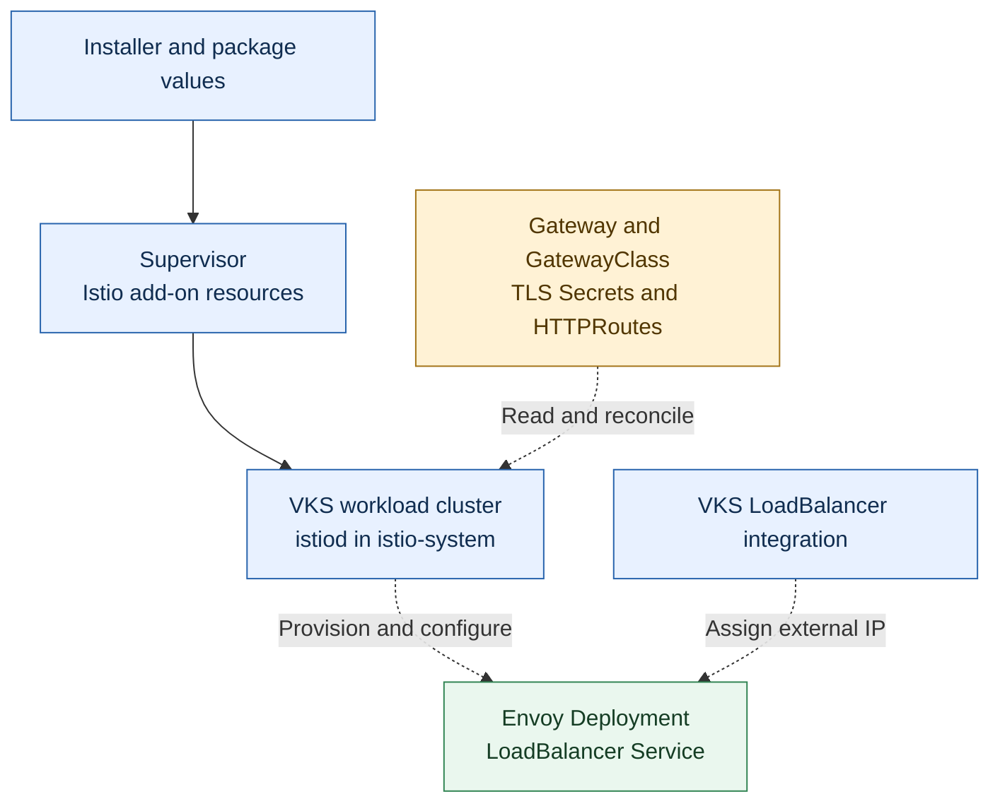
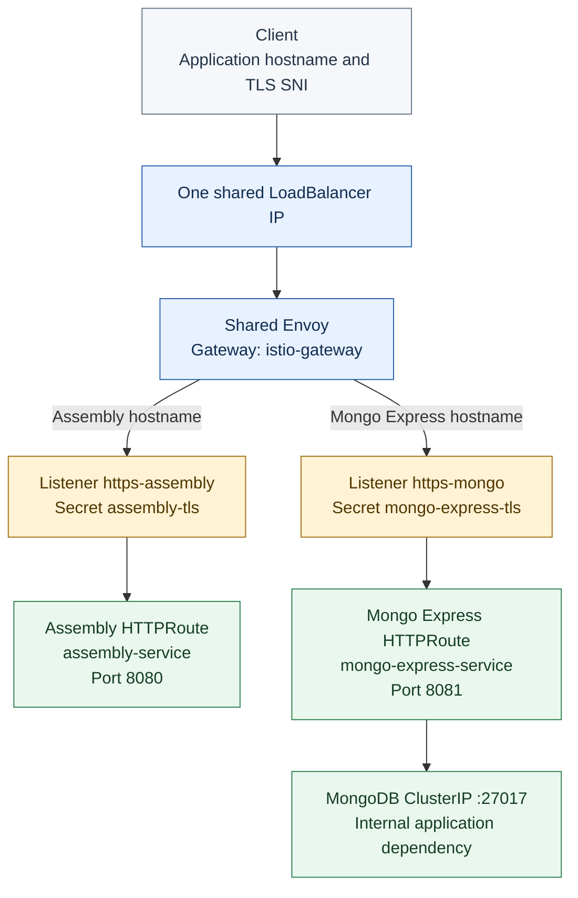
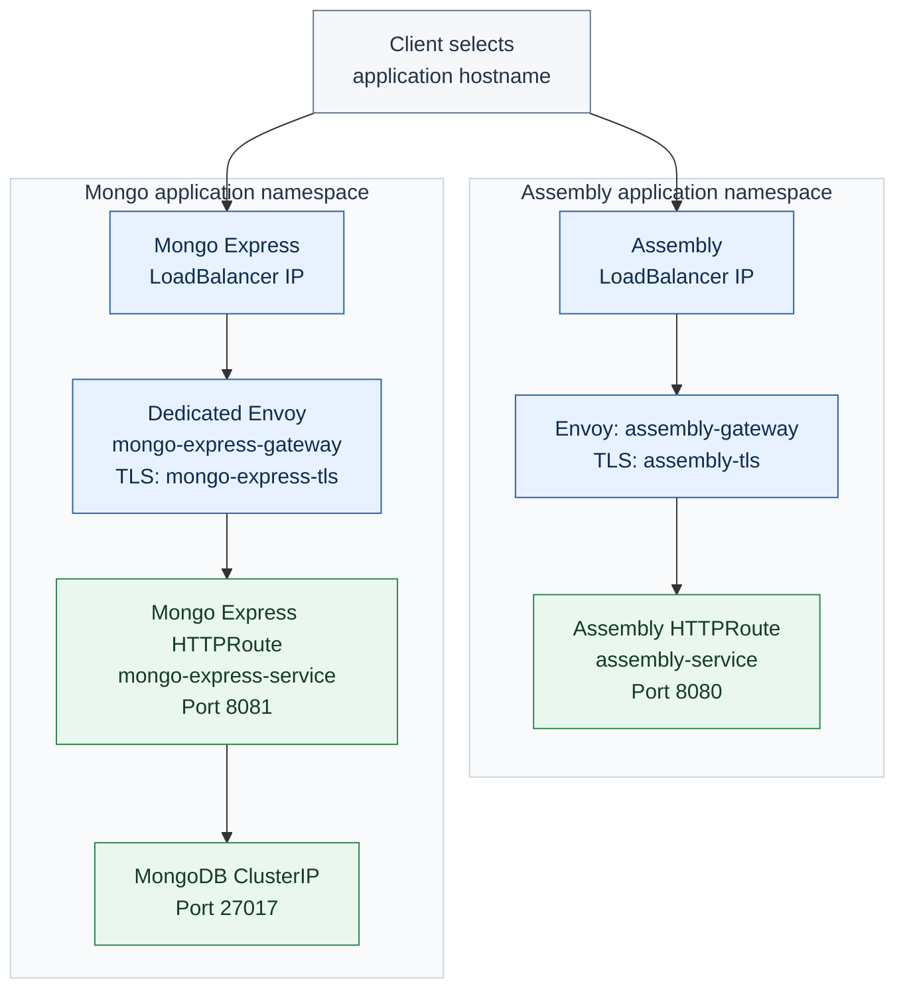
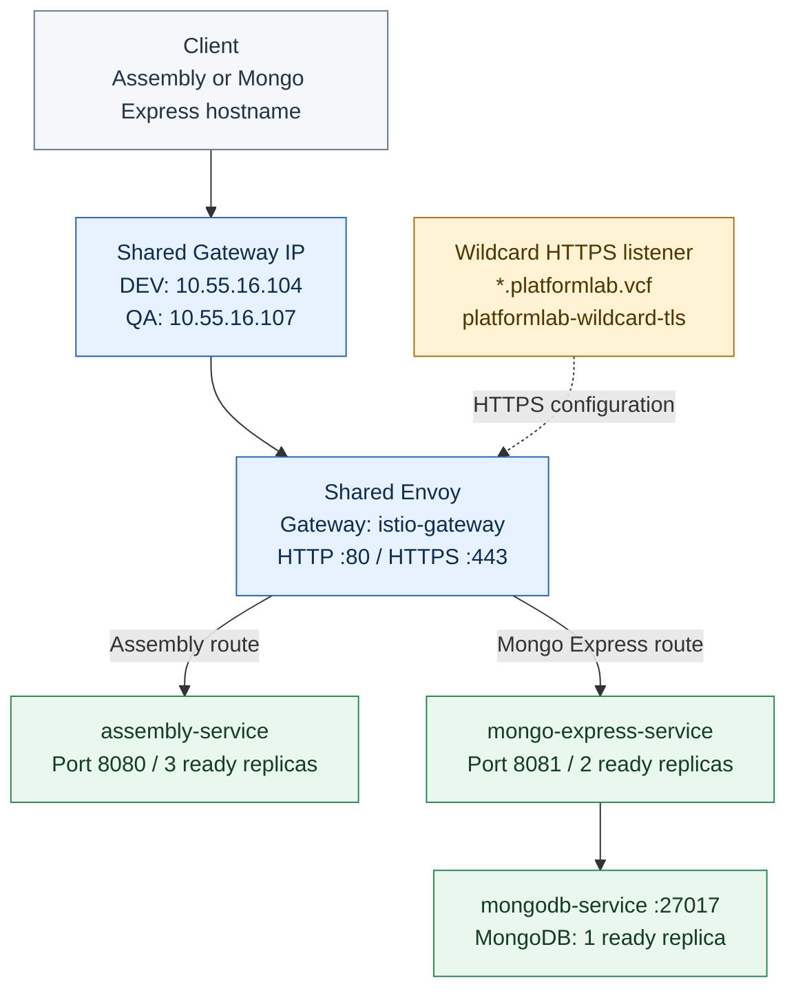
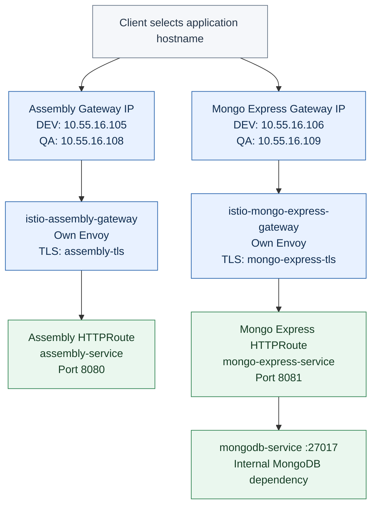
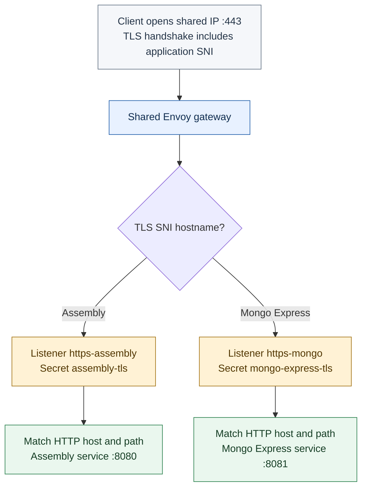
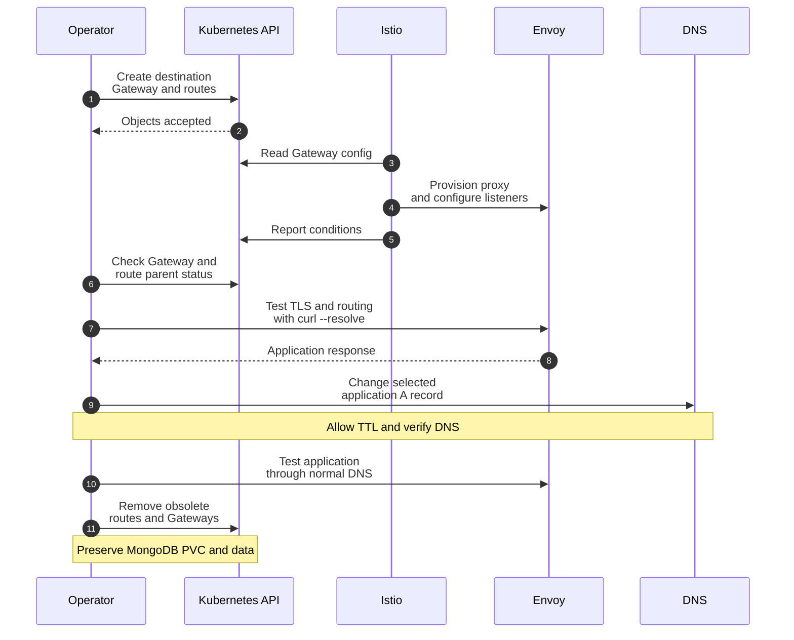
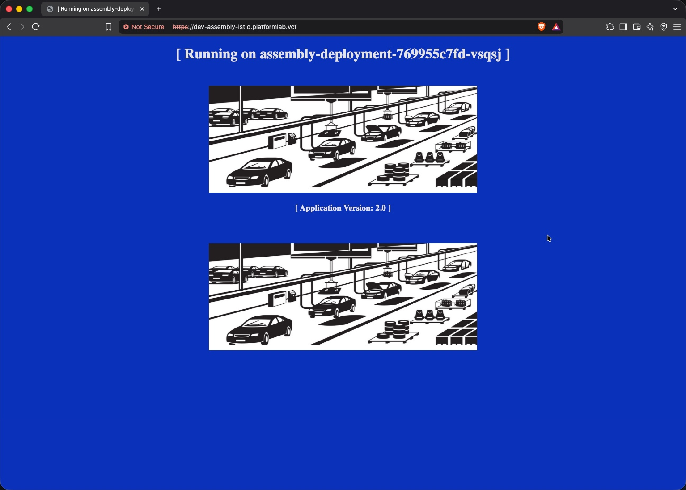
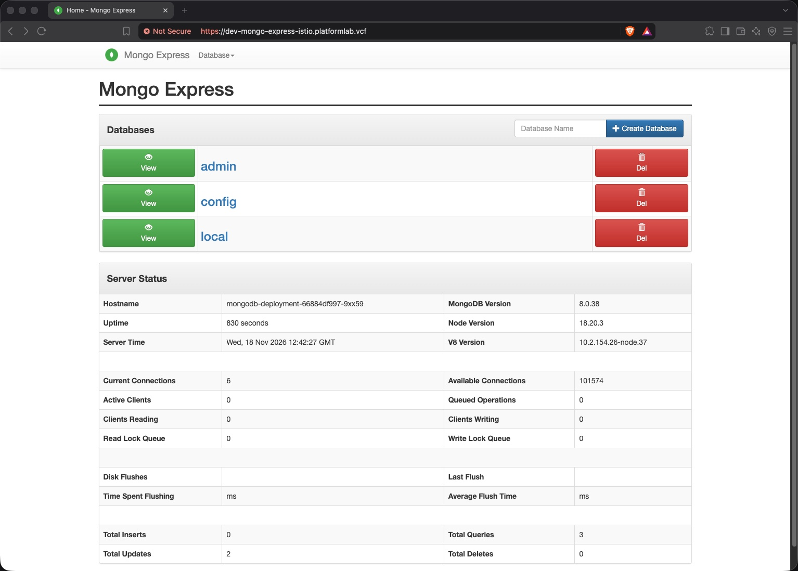

<!--
authors: "Julius M. Nicolescu, Qwen3-Coder-30B-A3B-Instruct-4bit, Qwen3.8-27B-8bit"
date: 2026-11-17
description: Install the VKS Istio add-on and use Kubernetes Gateway API to publish applications through shared or dedicated Gateways.
keywords: VCF, VKS, Istio, Envoy, Gateway API, HTTPRoute, Assembly, Mongo Express
lang: en
-->

# Publish applications with Istio Gateway API on VKS

Publish **Assembly WebApp** and **Mongo Express** over HTTPS on existing VKS clusters in VMware Cloud Foundation **9.1.1** using **Kubernetes Gateway API**. Istio manages Gateway and HTTPRoute configuration; Envoy terminates TLS and forwards requests to application Services. This guide explains the architecture, namespace ownership, certificates, DNS, deployment and troubleshooting for shared and dedicated Gateways.

DEV is the worked example for the embedded reference manifests. QA follows the same approach with its own cluster, namespaces, hostnames, IP addresses and certificates. Saved reports and application screenshots cover both environments.

Choose how applications use their Gateways:

| Option | Gateway resources | When to use it |
| --- | --- | --- |
| **Design A — shared Gateway** | One platform-owned Gateway, Envoy Deployment and LoadBalancer IP for both applications. | Share ingress capacity and IP allocation while keeping application HTTPRoutes separate. |
| **Design B — dedicated Gateways** | One Gateway, Envoy Deployment and LoadBalancer IP per application. | Manage each application's ingress capacity, certificate and Gateway lifecycle independently. |

The reference shared design uses individual application certificates. The captured lab shared Gateway uses a wildcard certificate, and the lab dedicated Gateways are kept in the central `istio-gateway` namespace. See the [implementation comparison](#14-current-dev-and-qa-lab-implementation) for the exact differences. Choose one design per application.

| Target | VKS cluster | Supervisor namespace | Workload Kubernetes context |
| --- | --- | --- | --- |
| DEV | `dev-cluster-01` | `dev-namespace` | `dev-cluster-01:dev-cluster-01` |
| QA | `qa-cluster-02` | `qa-namespace` | `qa-cluster-02:qa-cluster-02` |

Add-on installation resources live on the **Supervisor**. Istio controllers, Envoy Gateways and application resources run inside each **VKS workload cluster**.

All **18 YAML files** are embedded beside their configuration steps. Save each block to its stated path relative to an `Istio_Gateway_API_Examples/` working directory, and supply your own certificates, private keys and MongoDB credentials. The [lab DNS records](#56-application-deployment--dns-records), [listener summaries](#75-captured-dev-and-qa-gateway-listeners) and [application pages](#76-captured-application-pages) explain the saved DEV/QA results; the [Output index](#output) links all eight reports and eight screenshots.

## Contents

- [Reference Environment](#reference-environment)
- [Scope and assumptions](#1-scope-and-assumptions)
- [Gateway API building blocks](#2-gateway-api-building-blocks)
- [Design A — shared Istio Gateway](#3-design-a--shared-istio-gateway)
- [Design B — dedicated Gateways](#4-design-b--dedicated-gateways)
- [Deployment runbooks](#5-deployment-runbooks)
- [Application deployment — DNS records](#56-application-deployment--dns-records)
- [Operations, TLS, and security](#6-operations-tls-and-security)
- [Validation and troubleshooting](#7-validation-and-troubleshooting)
- [Captured DEV and QA Gateway listeners](#75-captured-dev-and-qa-gateway-listeners)
- [Captured application pages](#76-captured-application-pages)
- [Architecture decision](#8-architecture-decision)
- [Manifest inventory](#9-manifest-inventory)
- [Output](#output)
- [References](#references)


## Reference Environment

The procedures and configurations in this document were validated against the following platform versions, as recorded in the supplied lab reference environment:

| Component | Version |
| --- | --- |
| VMware Cloud Foundation | `9.1.1.0-545627-2026-09` |
| Supervisor Release | `v1.34.9+vmware.1-vsc9.1.1.0-25712839` |
| vSphere Kubernetes Service | `3.7.0-embedded+v1.36` |
| VKS Release | `v1.35.6---vmware.2-vkr.3` |
| VKS Add-ons Release | `v3.8.0+20261021` |
| cert-manager Version | `1.20.3+vmware.1-vks.1` |
| Contour Version | `1.33.5+vmware.1-vks.1` |

---

## 1. Scope and assumptions

### 1.1 Applications and existing source alignment

The settings below describe the embedded reference examples and their original source inputs. For the current checkout's deployment scripts, hostnames and namespaces, use [Section 1.4](#14-current-dev-and-qa-lab-implementation) and the [lab DNS table](#56-application-deployment--dns-records).

| Parameter | Assembly WebApp | Mongo Express |
|---|---|---|
| Existing script | `02-deploy-assembly-webapp-gateway-api.sh` | `02-deploy-mongo-express-gateway-api.sh` |
| Existing gateway technology | Istio | **Contour**, converted to Istio in this design |
| VKS cluster | `dev-cluster-01` | `dev-cluster-01` |
| Application namespace | `dev-assembly-istio` | `dev-mongodb-istio-gateway-api` (proposed new namespace) |
| FQDN | `dev-assembly-istio.platformlab.vcf` | `dev-mongo-express-gateway.platformlab.vcf` |
| Deployment | `assembly-deployment`, 3 replicas | `mongo-express-deployment`, 2 replicas |
| Container | `jmnicolescu/assembly-webapp:latest` | `mongo-express:1.0.2` |
| Backend Service | `assembly-service:8080` | `mongo-express-service:8081` |
| TLS certificate Secret | `assembly-tls` | `mongo-express-tls` |
| Internal dependency | None described | MongoDB 8.0 with ClusterIP `mongodb-service:27017` |
| Storage | None | 5 Gi PVC, StorageClass `vsan-default-storage-policy` |

**Scope:** TLS termination occurs at the Istio-managed Envoy gateway. The illustrated backend connections from Envoy to application Services are HTTP; this **does not claim end-to-end TLS**. MongoDB remains internal-only and must not receive an external LoadBalancer Service. Supply your own MongoDB and Mongo Express credentials through `mongodb-secret`.

### 1.2 Prerequisites

- VCF CLI and `kubectl` configured for the correct Supervisor and VKS workload-cluster contexts.
- Istio add-on installed and Ready in the VKS cluster. GatewayClass `istio` is accepted.
- Gateway API v1 `Gateway`, `GatewayClass`, and `HTTPRoute` CRDs are present.
- The VKS LoadBalancer implementation (NSX or Avi as configured) can provision a `LoadBalancer` Service; external IP capacity is available.
- Two **individual hostname-specific TLS certificates** exist, with matching private keys and certificate chains (PEM format).
- DNS for both FQDNs can be updated. Clients trust the issuing CA.
- MongoDB StorageClass `vsan-default-storage-policy` is valid in the workload cluster.
- Permissions: platform administrators can modify shared Gateway listeners and Secrets; application teams can manage their own workloads and HTTPRoutes.

The exact Istio add-on release and VKS Kubernetes release compatibility must be validated against the available releases on the Supervisor; manifests here are architecture examples, not a compatibility certification.

### 1.3 Preflight commands

```bash
kubectl config current-context
kubectl get gatewayclass
kubectl get crd gateways.gateway.networking.k8s.io
kubectl get crd httproutes.gateway.networking.k8s.io
kubectl get storageclass
kubectl get pods -n istio-system
kubectl get svc -A --field-selector spec.type=LoadBalancer
```

### 1.4 Current DEV and QA lab implementation

The supplied reports record two configurations of the same applications in each cluster. The shared and dedicated reports are separate snapshots. The current scripts implement the same choice of shared or dedicated ingress as the reference designs, with these differences:

| Setting | Embedded reference examples | Current scripts and saved lab reports |
| --- | --- | --- |
| Shared Gateway TLS | Two exact-hostname HTTPS listeners, `https-assembly` and `https-mongo`, using individual certificates. | One `https` listener for `*.platformlab.vcf`, using `istio-gateway/platformlab-wildcard-tls`. |
| Dedicated Gateway location | Gateways and TLS Secrets in each application's namespace. | Both dedicated Gateways and their TLS Secrets in `istio-gateway`. |
| Dedicated Gateway names | `assembly-gateway` and `mongo-express-gateway`. | `istio-assembly-gateway` and `istio-mongo-express-gateway`. |
| Route admission | Namespace selector for shared ingress; same namespace for dedicated ingress. | `allowedRoutes.namespaces.from: All`; application HTTPRoutes attach across namespaces. |
| Mongo Express hostname | `dev-mongo-express-gateway.platformlab.vcf`. | `dev-mongo-express-istio.platformlab.vcf` or `qa-mongo-express-istio.platformlab.vcf`. |
| Mongo application namespace | `dev-mongodb-istio-gateway-api`. | `dev-mongodb-istio` or `qa-mongodb-istio`. |
| Retained shared Gateway | Reference diagrams show the selected design's active Gateways. | Dedicated captures also retain the shared Gateway, its Envoy Deployment and LoadBalancer Service, with no attached routes. |

The shared Gateway is defined in the generated [DEV Gateway manifest](./dev-cluster-01/deployment-files/istio-gateway-resource.yaml) and [QA Gateway manifest](./qa-cluster-02/deployment-files/istio-gateway-resource.yaml). Application scripts `02` select dedicated Gateways; scripts `03` attach routes to the shared Gateway. See the [project README](./Readme.md#deploy-the-dev-applications) for their deployment procedure. Use the names and listener `sectionName` values for the selected implementation together; the embedded reference manifests do not reproduce the saved lab configuration unchanged.

## 2. Gateway API building blocks

| Resource | Owner / location | Role |
|---|---|---|
| Istio add-on | Platform · VKS cluster | Runs `istiod`, CNI, supporting components |
| GatewayClass `istio` | Cluster-scoped; created by Istio | Selects the `istio.io/gateway-controller` implementation |
| `Gateway` | Gateway namespace (Design A) or application namespace (Design B) | Defines HTTP/HTTPS listeners, hostname matching, TLS certificate references |
| TLS Secret | Usually the **same namespace as the Gateway** | Stores the certificate chain and private key for HTTPS termination |
| Envoy Deployment + LoadBalancer Service | Automatically provisioned by the managed Istio Gateway | Serves ingress traffic; the VKS networking provider supplies the reachable VIP |
| `HTTPRoute` | Application namespace | Associates hostname/path to a Gateway listener and an application Service |
| Application `Service` | Application namespace | Stable ClusterIP endpoint; backend for HTTPRoute |
| DNS A record | DNS system | Resolves application hostname to the selected Gateway VIP |

An `HTTPRoute` can live in a different namespace from its Gateway when the Gateway listener's `allowedRoutes` permits it. An HTTPRoute pointing to a Service **in its own namespace** does not need a `ReferenceGrant`. Cross-namespace Secret references are possible with `ReferenceGrant` where supported, but this document intentionally keeps TLS Secrets co-located with their respective Gateways.

### Configuration flow: from package values to Envoy

The add-on resources are managed on the Supervisor. Inside the VKS cluster, Istio observes Gateway API configuration and provisions a proxy Deployment and LoadBalancer Service for each managed Gateway. The cluster's LoadBalancer integration assigns the external IP.



Solid arrows show the installation flow; dashed arrows show reconciliation and configuration. These are control-plane relationships, not client traffic. The request-flow diagrams below use blue for ingress infrastructure, green for application backends and gold for TLS configuration.

**Sequence:** install Istio → confirm GatewayClass and CRDs → create namespaces → create TLS Secrets → create Gateway(s) → deploy app workloads and Services → attach HTTPRoutes → validate IP, listener, certificates and end-to-end routing.

---

## 3. Design A — Shared Istio Gateway

### 3.1 Concept and topology

One platform-owned Gateway named `istio-gateway` resides in `istio-gateway`. Its Envoy gateway Deployment is exposed through **one LoadBalancer Service and one external VIP**. The Gateway uses a shared HTTP listener on port 80 for redirects and **two hostname-specific HTTPS listeners** on port 443, each referencing its own TLS Secret.



The listener and HTTPRoute boxes show routing decisions made inside Envoy. The application Services are the upstream destinations. This reference design uses individual certificates; the captured lab shared Gateway uses the wildcard configuration shown in Section 5.6.

**Data path:** Client → provider LoadBalancer VIP → Envoy → hostname-specific listener/TLS certificate → application HTTPRoute → ClusterIP Service → application Pod. HTTP requests on port 80 follow the application-owned redirect routes to HTTPS.

### 3.2 Ownership and certificate placement

| Namespace | Objects | Owner |
|---|---|---|
| `istio-system` | Istio control plane and CNI | Platform |
| `istio-gateway` | `istio-gateway`, `assembly-tls`, `mongo-express-tls`, generated Envoy Deployment and LoadBalancer Service | Platform |
| `dev-assembly-istio` | Assembly Deployment, Service, HTTPS HTTPRoute, redirect HTTPRoute | Assembly app team |
| `dev-mongodb-istio-gateway-api` | MongoDB PVC/Deployment/Service, Mongo Express Deployment/Service, two HTTPRoutes | Mongo app team |

| Listener | Hostname | Port | TLS Secret | Route attachment |
|---|---|---:|---|---|
| `http` | Any (redirect routes each match an FQDN) | 80 | None | Labeled application namespaces |
| `https-assembly` | `dev-assembly-istio.platformlab.vcf` | 443 | `assembly-tls` | Assembly HTTPS HTTPRoute |
| `https-mongo` | `dev-mongo-express-gateway.platformlab.vcf` | 443 | `mongo-express-tls` | Mongo Express HTTPS HTTPRoute |

The two HTTPS listeners share port 443 but have **distinct exact hostnames**, allowing SNI-based selection of each application's certificate. No wildcard certificate is used. Both DNS A records point to the **same** Gateway VIP.

### 3.3 Step A1 — Create namespaces and route admission labels

A shared Gateway should not accept routes from every namespace in a multi-team cluster. This design uses `allowedRoutes.namespaces.from: Selector`, accepting HTTPRoutes only from namespaces carrying `shared-gateway-access: "true"`.

<a id="file-01-shared-gateway-00-namespaces-yaml"></a>

**Configuration file:** `01-shared-gateway/00-namespaces.yaml`

```yaml
# Design A: One shared Gateway, with application routes permitted by namespace label.
apiVersion: v1
kind: Namespace
metadata:
  name: istio-gateway
  labels:
    app.kubernetes.io/part-of: istio-gateway-api-poc
---
apiVersion: v1
kind: Namespace
metadata:
  name: dev-assembly-istio
  labels:
    shared-gateway-access: "true"
    app.kubernetes.io/part-of: istio-gateway-api-poc
---
apiVersion: v1
kind: Namespace
metadata:
  name: dev-mongodb-istio-gateway-api
  labels:
    shared-gateway-access: "true"
    app.kubernetes.io/part-of: istio-gateway-api-poc
```

### 3.4 Step A2 — Create each application's TLS Secret

Certificates use the private-key and full-chain filenames already present in your scripts. **For Design A, both TLS Secrets must be created in the `istio-gateway` namespace** because the Gateway is there. The actual keys are never stored in the sample YAML or Git.

```bash
kubectl create secret tls assembly-tls -n istio-gateway \
  --cert ./certificates/dev-assembly-istio.platformlab.vcf.cer.plusCA \
  --key ./certificates/dev-assembly-istio.platformlab.vcf.key \
  --dry-run=client -o yaml | kubectl apply -f -

kubectl create secret tls mongo-express-tls -n istio-gateway \
  --cert ./certificates/dev-mongo-express-gateway.platformlab.vcf.cer.plusCA \
  --key ./certificates/dev-mongo-express-gateway.platformlab.vcf.key \
  --dry-run=client -o yaml | kubectl apply -f -

kubectl get secret assembly-tls mongo-express-tls -n istio-gateway
```

### 3.5 Step A3 — Apply the single authoritative shared Gateway manifest

This is **the only file that should define or update shared Gateway listeners**. Do not have separate app scripts apply partial Gateway definitions or use JSON Merge Patch to append to `spec.listeners`; arrays can be replaced, removing another app's listener. Use centrally reviewed Git changes or a single platform deployment pipeline.

<a id="file-01-shared-gateway-01-shared-istio-gateway-yaml"></a>

**Configuration file:** `01-shared-gateway/01-shared-istio-gateway.yaml`

```yaml
# Design A: Platform-owned Gateway; all application listeners live in ONE manifest.
# Apply TLS Secrets to the istio-gateway namespace before applying this manifest.
# The VKS L4 provider allocates one VIP for this managed Gateway's LoadBalancer Service.
apiVersion: gateway.networking.k8s.io/v1
kind: Gateway
metadata:
  name: istio-gateway
  namespace: istio-gateway
spec:
  gatewayClassName: istio
  # Optional: a requested IP is Extended support and depends on the LB provider.
  # addresses:
  #   - type: IPAddress
  #     value: 10.55.16.10
  listeners:
    - name: http
      protocol: HTTP
      port: 80
      allowedRoutes:
        namespaces:
          from: Selector
          selector:
            matchLabels:
              shared-gateway-access: "true"
    - name: https-assembly
      hostname: dev-assembly-istio.platformlab.vcf
      protocol: HTTPS
      port: 443
      tls:
        mode: Terminate
        certificateRefs:
          - kind: Secret
            name: assembly-tls
      allowedRoutes:
        namespaces:
          from: Selector
          selector:
            matchLabels:
              shared-gateway-access: "true"
    - name: https-mongo
      hostname: dev-mongo-express-gateway.platformlab.vcf
      protocol: HTTPS
      port: 443
      tls:
        mode: Terminate
        certificateRefs:
          - kind: Secret
            name: mongo-express-tls
      allowedRoutes:
        namespaces:
          from: Selector
          selector:
            matchLabels:
              shared-gateway-access: "true"
```

`spec.addresses` is intentionally commented out in the sample. Requesting a particular IP is an **Extended** Gateway API feature; Istio maps the requested address toward the generated LoadBalancer Service, but NSX/Avi allocation and reuse depend on the provider. If you need a fixed VIP, use a verified available IP and validate both Gateway and Service statuses.

### 3.6 Step A4 — Deploy application backends

Application manifests are independent of the shared Gateway. Assembly exposes `assembly-service:8080`; Mongo Express exposes `mongo-express-service:8081`, while MongoDB remains private on `mongodb-service:27017` with a 5 Gi PVC. The example YAML files include Deployments, Services, secret references, and basic probes.

| File | Contents |
|---|---|
| `02-assembly-deployment-service.yaml` | Assembly Deployment (3 replicas) and ClusterIP Service 8080 |
| `04-mongodb-pvc.yaml` | MongoDB PVC, StorageClass and 5 Gi storage request |
| `05-mongodb-deployment-service.yaml` | MongoDB Deployment, ConfigMap, ClusterIP Service 27017 |
| `06-mongo-express-deployment-service.yaml` | Mongo Express Deployment (2 replicas) and ClusterIP Service 8081 |

Create `mongodb-secret` in `dev-mongodb-istio-gateway-api` using your secret-management system **before** deploying MongoDB and Mongo Express. It must contain `mongo-root-username`, `mongo-root-password`, `mongo-express-username` and `mongo-express-password`. Supply your own credential values.

#### A4.1 — Assembly Deployment and Service

<a id="file-01-shared-gateway-02-assembly-deployment-service-yaml"></a>

**Configuration file:** `01-shared-gateway/02-assembly-deployment-service.yaml`

```yaml
# From Assembly script: 3 replicas, jmnicolescu/assembly-webapp:latest, port 8080.
# For production, pin the image by digest instead of using :latest.
apiVersion: apps/v1
kind: Deployment
metadata:
  name: assembly-deployment
  namespace: dev-assembly-istio
spec:
  replicas: 3
  selector:
    matchLabels:
      app: assembly-webapp
  template:
    metadata:
      labels:
        app: assembly-webapp
    spec:
      containers:
        - name: assembly-webapp
          image: jmnicolescu/assembly-webapp:latest
          imagePullPolicy: Always
          ports:
            - name: http
              containerPort: 8080
          readinessProbe:
            tcpSocket:
              port: http
            initialDelaySeconds: 5
            periodSeconds: 10
---
apiVersion: v1
kind: Service
metadata:
  name: assembly-service
  namespace: dev-assembly-istio
spec:
  type: ClusterIP
  selector:
    app: assembly-webapp
  ports:
    - name: http
      port: 8080
      targetPort: http
```

#### A4.2 — MongoDB persistent storage

<a id="file-01-shared-gateway-04-mongodb-pvc-yaml"></a>

**Configuration file:** `01-shared-gateway/04-mongodb-pvc.yaml`

```yaml
# Based on the MongoDB script: 5Gi PVC and provided vSAN storage policy.
# Verify StorageClass is available on the target VKS cluster.
apiVersion: v1
kind: PersistentVolumeClaim
metadata:
  name: mongodb-pvc
  namespace: dev-mongodb-istio-gateway-api
spec:
  accessModes: [ReadWriteOnce]
  storageClassName: vsan-default-storage-policy
  resources:
    requests:
      storage: 5Gi
```

#### A4.3 — MongoDB ConfigMap, Deployment, and Service

<a id="file-01-shared-gateway-05-mongodb-deployment-service-yaml"></a>

**Configuration file:** `01-shared-gateway/05-mongodb-deployment-service.yaml`

```yaml
# Secret mongodb-secret must exist before deploying the database.
apiVersion: v1
kind: ConfigMap
metadata:
  name: mongodb-configmap
  namespace: dev-mongodb-istio-gateway-api
data:
  database_host: mongodb-service
---
apiVersion: apps/v1
kind: Deployment
metadata:
  name: mongodb-deployment
  namespace: dev-mongodb-istio-gateway-api
spec:
  replicas: 1
  strategy:
    type: Recreate
  selector:
    matchLabels:
      app: mongodb
  template:
    metadata:
      labels:
        app: mongodb
    spec:
      containers:
        - name: mongodb
          image: mongo:8.0
          imagePullPolicy: IfNotPresent
          ports:
            - name: mongodb
              containerPort: 27017
          env:
            - name: MONGO_INITDB_ROOT_USERNAME
              valueFrom:
                secretKeyRef:
                  name: mongodb-secret
                  key: mongo-root-username
            - name: MONGO_INITDB_ROOT_PASSWORD
              valueFrom:
                secretKeyRef:
                  name: mongodb-secret
                  key: mongo-root-password
          volumeMounts:
            - name: mongodb-storage
              mountPath: /data/db
          startupProbe:
            tcpSocket:
              port: mongodb
            periodSeconds: 10
            failureThreshold: 30
          readinessProbe:
            tcpSocket:
              port: mongodb
            initialDelaySeconds: 5
            periodSeconds: 10
          livenessProbe:
            tcpSocket:
              port: mongodb
            initialDelaySeconds: 30
            periodSeconds: 20
      volumes:
        - name: mongodb-storage
          persistentVolumeClaim:
            claimName: mongodb-pvc
---
apiVersion: v1
kind: Service
metadata:
  name: mongodb-service
  namespace: dev-mongodb-istio-gateway-api
spec:
  type: ClusterIP
  selector:
    app: mongodb
  ports:
    - name: mongodb
      port: 27017
      targetPort: mongodb
```

#### A4.4 — Mongo Express Deployment and Service

<a id="file-01-shared-gateway-06-mongo-express-deployment-service-yaml"></a>

**Configuration file:** `01-shared-gateway/06-mongo-express-deployment-service.yaml`

```yaml
# Based on the Mongo Express script: 2 replicas, mongo-express:1.0.2, port 8081.
# Credentials are referenced from Kubernetes Secret (not stored in source YAML).
apiVersion: apps/v1
kind: Deployment
metadata:
  name: mongo-express-deployment
  namespace: dev-mongodb-istio-gateway-api
spec:
  replicas: 2
  selector:
    matchLabels:
      app: mongo-express
  template:
    metadata:
      labels:
        app: mongo-express
    spec:
      containers:
        - name: mongo-express
          image: mongo-express:1.0.2
          imagePullPolicy: IfNotPresent
          ports:
            - name: http
              containerPort: 8081
          env:
            - name: ME_CONFIG_MONGODB_ADMINUSERNAME
              valueFrom:
                secretKeyRef:
                  name: mongodb-secret
                  key: mongo-root-username
            - name: ME_CONFIG_MONGODB_ADMINPASSWORD
              valueFrom:
                secretKeyRef:
                  name: mongodb-secret
                  key: mongo-root-password
            - name: ME_CONFIG_MONGODB_SERVER
              valueFrom:
                configMapKeyRef:
                  name: mongodb-configmap
                  key: database_host
            - name: ME_CONFIG_MONGODB_PORT
              value: "27017"
            - name: ME_CONFIG_MONGODB_ENABLE_ADMIN
              value: "true"
            - name: ME_CONFIG_BASICAUTH
              value: "true"
            - name: ME_CONFIG_BASICAUTH_USERNAME
              valueFrom:
                secretKeyRef:
                  name: mongodb-secret
                  key: mongo-express-username
            - name: ME_CONFIG_BASICAUTH_PASSWORD
              valueFrom:
                secretKeyRef:
                  name: mongodb-secret
                  key: mongo-express-password
          startupProbe:
            tcpSocket:
              port: http
            periodSeconds: 10
            failureThreshold: 30
          readinessProbe:
            tcpSocket:
              port: http
            periodSeconds: 10
          livenessProbe:
            tcpSocket:
              port: http
            periodSeconds: 20
---
apiVersion: v1
kind: Service
metadata:
  name: mongo-express-service
  namespace: dev-mongodb-istio-gateway-api
spec:
  type: ClusterIP
  selector:
    app: mongo-express
  ports:
    - name: http
      port: 8081
      targetPort: http
```

### 3.7 Step A5 — Create Assembly HTTPS routing and HTTP redirect

The Assembly app team deploys the following `HTTPRoute` resources in its own namespace. The HTTPS route explicitly attaches to `https-assembly`; the redirect attaches to the shared `http` listener.

<a id="file-01-shared-gateway-03-assembly-httproutes-yaml"></a>

**Configuration file:** `01-shared-gateway/03-assembly-httproutes.yaml`

```yaml
# HTTPS application route and HTTP->HTTPS redirect (app-owned).
apiVersion: gateway.networking.k8s.io/v1
kind: HTTPRoute
metadata:
  name: assembly-httproute
  namespace: dev-assembly-istio
spec:
  parentRefs:
    - name: istio-gateway
      namespace: istio-gateway
      sectionName: https-assembly
  hostnames:
    - dev-assembly-istio.platformlab.vcf
  rules:
    - matches:
        - path:
            type: PathPrefix
            value: /
      backendRefs:
        - name: assembly-service
          port: 8080
---
apiVersion: gateway.networking.k8s.io/v1
kind: HTTPRoute
metadata:
  name: assembly-http-redirect
  namespace: dev-assembly-istio
spec:
  parentRefs:
    - name: istio-gateway
      namespace: istio-gateway
      sectionName: http
  hostnames:
    - dev-assembly-istio.platformlab.vcf
  rules:
    - filters:
        - type: RequestRedirect
          requestRedirect:
            scheme: https
            statusCode: 301
```

### 3.8 Step A6 — Create Mongo Express HTTPS routing and HTTP redirect

Mongo Express remains independently routed in its own application namespace. The HTTPS route attaches to `https-mongo`, and its backend is `mongo-express-service:8081`.

<a id="file-01-shared-gateway-07-mongo-express-httproutes-yaml"></a>

**Configuration file:** `01-shared-gateway/07-mongo-express-httproutes.yaml`

```yaml
# HTTPS application route and HTTP->HTTPS redirect (app-owned).
apiVersion: gateway.networking.k8s.io/v1
kind: HTTPRoute
metadata:
  name: mongo-express-httproute
  namespace: dev-mongodb-istio-gateway-api
spec:
  parentRefs:
    - name: istio-gateway
      namespace: istio-gateway
      sectionName: https-mongo
  hostnames:
    - dev-mongo-express-gateway.platformlab.vcf
  rules:
    - matches:
        - path:
            type: PathPrefix
            value: /
      backendRefs:
        - name: mongo-express-service
          port: 8081
---
apiVersion: gateway.networking.k8s.io/v1
kind: HTTPRoute
metadata:
  name: mongo-express-http-redirect
  namespace: dev-mongodb-istio-gateway-api
spec:
  parentRefs:
    - name: istio-gateway
      namespace: istio-gateway
      sectionName: http
  hostnames:
    - dev-mongo-express-gateway.platformlab.vcf
  rules:
    - filters:
        - type: RequestRedirect
          requestRedirect:
            scheme: https
            statusCode: 301
```

### 3.9 Onboard a third application to Design A

1. Platform approves the application namespace and labels it `shared-gateway-access: "true"`.
2. Platform issues or receives an **exact-hostname** TLS certificate and creates its Secret in `istio-gateway`.
3. Platform adds one distinct HTTPS listener with its own `hostname`, `name`, and `certificateRefs` to **the same authoritative Gateway YAML file**, then reapplies it.
4. Application team deploys Deployment/Service and a new HTTPS HTTPRoute referencing the new `sectionName`, plus an HTTP redirect route if needed.
5. DNS owner points the application hostname to the **existing** shared Gateway VIP; validate certificate chain and routing.

**Design A benefit:** one Envoy entry point and one LoadBalancer IP. **Design A cost:** every new hostname-specific certificate requires a centrally controlled Gateway listener update. That is acceptable for a small POC and deliberate platform-managed onboarding.

---

## 4. Design B — Dedicated Gateways

### 4.1 Concept and topology

Each application creates its **own Gateway resource in its application namespace**, and its TLS Secret remains in the same namespace. Both Gateways use the shared `istio` GatewayClass and shared Istio control plane, but Istio normally provisions **one Envoy Deployment and one LoadBalancer Service per Gateway**. Each application can therefore have a dedicated VIP, proxy capacity, and Gateway lifecycle.



Both proxies use the same Istio control plane and GatewayClass `istio`. Arrows show the request path and application dependency; TLS labels identify each proxy's certificate Secret. In this reference layout each Gateway and Secret is in its application's namespace. The captured lab layout instead keeps both dedicated Gateways in `istio-gateway`, as shown in Section 5.6.

### 4.2 Ownership comparison

| Resource | Assembly | Mongo Express |
|---|---|---|
| Namespace | `dev-assembly-istio` | `dev-mongodb-istio-gateway-api` |
| Gateway | `assembly-gateway` | `mongo-express-gateway` |
| TLS Secret | `assembly-tls` (same namespace as Gateway) | `mongo-express-tls` (same namespace as Gateway) |
| HTTPS listener | `https`, port 443 | `https`, port 443 |
| Allowed routes | `from: Same` | `from: Same` |
| Backend | `assembly-service:8080` | `mongo-express-service:8081` |
| LoadBalancer VIP | VIP A | VIP B (typically different) |

### 4.3 Step B1 — Create application namespaces

<a id="file-02-dedicated-gateways-00-namespaces-yaml"></a>

**Configuration file:** `02-dedicated-gateways/00-namespaces.yaml`

```yaml
# Design B: All Gateway API and application resources are owned by their application namespace.
apiVersion: v1
kind: Namespace
metadata:
  name: dev-assembly-istio
  labels:
    app.kubernetes.io/part-of: istio-gateway-api-poc
---
apiVersion: v1
kind: Namespace
metadata:
  name: dev-mongodb-istio-gateway-api
  labels:
    app.kubernetes.io/part-of: istio-gateway-api-poc
```

### 4.4 Step B2 — Create application-specific TLS Secrets

In Design B, Secrets are created **in the corresponding application's own namespace**. The same distinct certificate/key pairs from Design A are used.

```bash
kubectl create secret tls assembly-tls -n dev-assembly-istio \
  --cert ./certificates/dev-assembly-istio.platformlab.vcf.cer.plusCA \
  --key ./certificates/dev-assembly-istio.platformlab.vcf.key \
  --dry-run=client -o yaml | kubectl apply -f -

kubectl create secret tls mongo-express-tls -n dev-mongodb-istio-gateway-api \
  --cert ./certificates/dev-mongo-express-gateway.platformlab.vcf.cer.plusCA \
  --key ./certificates/dev-mongo-express-gateway.platformlab.vcf.key \
  --dry-run=client -o yaml | kubectl apply -f -
```

### 4.5 Step B3 — Create the Assembly Gateway

This Gateway provisions an Envoy gateway and Service in `dev-assembly-istio`. It accepts only same-namespace routes.

<a id="file-02-dedicated-gateways-01-assembly-gateway-yaml"></a>

**Configuration file:** `02-dedicated-gateways/01-assembly-gateway.yaml`

```yaml
# Design B: Gateway, TLS Secret, routes and Service are co-located.
# Istio normally creates an independent Envoy Deployment + LoadBalancer Service.
apiVersion: gateway.networking.k8s.io/v1
kind: Gateway
metadata:
  name: assembly-gateway
  namespace: dev-assembly-istio
spec:
  gatewayClassName: istio
  # Optional: request a different available IP for each Gateway if your VKS LB supports it.
  # addresses:
  #   - type: IPAddress
  #     value: <AVAILABLE_LB_IP>
  listeners:
    - name: http
      protocol: HTTP
      port: 80
      allowedRoutes:
        namespaces:
          from: Same
    - name: https
      hostname: dev-assembly-istio.platformlab.vcf
      protocol: HTTPS
      port: 443
      tls:
        mode: Terminate
        certificateRefs:
          - kind: Secret
            name: assembly-tls
      allowedRoutes:
        namespaces:
          from: Same
```

### 4.6 Step B4 — Create the Mongo Express Gateway

The Mongo Express Gateway is a separate resource, with its own listener and its own TLS Secret.

<a id="file-02-dedicated-gateways-02-mongo-express-gateway-yaml"></a>

**Configuration file:** `02-dedicated-gateways/02-mongo-express-gateway.yaml`

```yaml
# Design B: Gateway, TLS Secret, routes and Service are co-located.
# Istio normally creates an independent Envoy Deployment + LoadBalancer Service.
apiVersion: gateway.networking.k8s.io/v1
kind: Gateway
metadata:
  name: mongo-express-gateway
  namespace: dev-mongodb-istio-gateway-api
spec:
  gatewayClassName: istio
  # Optional: request a different available IP for each Gateway if your VKS LB supports it.
  # addresses:
  #   - type: IPAddress
  #     value: <AVAILABLE_LB_IP>
  listeners:
    - name: http
      protocol: HTTP
      port: 80
      allowedRoutes:
        namespaces:
          from: Same
    - name: https
      hostname: dev-mongo-express-gateway.platformlab.vcf
      protocol: HTTPS
      port: 443
      tls:
        mode: Terminate
        certificateRefs:
          - kind: Secret
            name: mongo-express-tls
      allowedRoutes:
        namespaces:
          from: Same
```

### 4.7 Step B5 — Deploy backends and application-owned HTTPRoutes

The application Deployments, Services, MongoDB PVC and credentials follow the same design as in Design A. The **only routing difference** is the `parentRefs`: each HTTPRoute references the local application's Gateway. No cross-namespace Gateway parent reference is needed.

#### B5.1 — Assembly Deployment and Service

<a id="file-02-dedicated-gateways-03-assembly-deployment-service-yaml"></a>

**Configuration file:** `02-dedicated-gateways/03-assembly-deployment-service.yaml`

```yaml
# From Assembly script: 3 replicas, jmnicolescu/assembly-webapp:latest, port 8080.
# For production, pin the image by digest instead of using :latest.
apiVersion: apps/v1
kind: Deployment
metadata:
  name: assembly-deployment
  namespace: dev-assembly-istio
spec:
  replicas: 3
  selector:
    matchLabels:
      app: assembly-webapp
  template:
    metadata:
      labels:
        app: assembly-webapp
    spec:
      containers:
        - name: assembly-webapp
          image: jmnicolescu/assembly-webapp:latest
          imagePullPolicy: Always
          ports:
            - name: http
              containerPort: 8080
          readinessProbe:
            tcpSocket:
              port: http
            initialDelaySeconds: 5
            periodSeconds: 10
---
apiVersion: v1
kind: Service
metadata:
  name: assembly-service
  namespace: dev-assembly-istio
spec:
  type: ClusterIP
  selector:
    app: assembly-webapp
  ports:
    - name: http
      port: 8080
      targetPort: http
```

#### B5.2 — MongoDB persistent storage

<a id="file-02-dedicated-gateways-05-mongodb-pvc-yaml"></a>

**Configuration file:** `02-dedicated-gateways/05-mongodb-pvc.yaml`

```yaml
# Based on the MongoDB script: 5Gi PVC and provided vSAN storage policy.
# Verify StorageClass is available on the target VKS cluster.
apiVersion: v1
kind: PersistentVolumeClaim
metadata:
  name: mongodb-pvc
  namespace: dev-mongodb-istio-gateway-api
spec:
  accessModes: [ReadWriteOnce]
  storageClassName: vsan-default-storage-policy
  resources:
    requests:
      storage: 5Gi
```

#### B5.3 — MongoDB ConfigMap, Deployment, and Service

<a id="file-02-dedicated-gateways-06-mongodb-deployment-service-yaml"></a>

**Configuration file:** `02-dedicated-gateways/06-mongodb-deployment-service.yaml`

```yaml
# Secret mongodb-secret must exist before deploying the database.
apiVersion: v1
kind: ConfigMap
metadata:
  name: mongodb-configmap
  namespace: dev-mongodb-istio-gateway-api
data:
  database_host: mongodb-service
---
apiVersion: apps/v1
kind: Deployment
metadata:
  name: mongodb-deployment
  namespace: dev-mongodb-istio-gateway-api
spec:
  replicas: 1
  strategy:
    type: Recreate
  selector:
    matchLabels:
      app: mongodb
  template:
    metadata:
      labels:
        app: mongodb
    spec:
      containers:
        - name: mongodb
          image: mongo:8.0
          imagePullPolicy: IfNotPresent
          ports:
            - name: mongodb
              containerPort: 27017
          env:
            - name: MONGO_INITDB_ROOT_USERNAME
              valueFrom:
                secretKeyRef:
                  name: mongodb-secret
                  key: mongo-root-username
            - name: MONGO_INITDB_ROOT_PASSWORD
              valueFrom:
                secretKeyRef:
                  name: mongodb-secret
                  key: mongo-root-password
          volumeMounts:
            - name: mongodb-storage
              mountPath: /data/db
          startupProbe:
            tcpSocket:
              port: mongodb
            periodSeconds: 10
            failureThreshold: 30
          readinessProbe:
            tcpSocket:
              port: mongodb
            initialDelaySeconds: 5
            periodSeconds: 10
          livenessProbe:
            tcpSocket:
              port: mongodb
            initialDelaySeconds: 30
            periodSeconds: 20
      volumes:
        - name: mongodb-storage
          persistentVolumeClaim:
            claimName: mongodb-pvc
---
apiVersion: v1
kind: Service
metadata:
  name: mongodb-service
  namespace: dev-mongodb-istio-gateway-api
spec:
  type: ClusterIP
  selector:
    app: mongodb
  ports:
    - name: mongodb
      port: 27017
      targetPort: mongodb
```

#### B5.4 — Mongo Express Deployment and Service

<a id="file-02-dedicated-gateways-07-mongo-express-deployment-service-yaml"></a>

**Configuration file:** `02-dedicated-gateways/07-mongo-express-deployment-service.yaml`

```yaml
# Based on the Mongo Express script: 2 replicas, mongo-express:1.0.2, port 8081.
# Credentials are referenced from Kubernetes Secret (not stored in source YAML).
apiVersion: apps/v1
kind: Deployment
metadata:
  name: mongo-express-deployment
  namespace: dev-mongodb-istio-gateway-api
spec:
  replicas: 2
  selector:
    matchLabels:
      app: mongo-express
  template:
    metadata:
      labels:
        app: mongo-express
    spec:
      containers:
        - name: mongo-express
          image: mongo-express:1.0.2
          imagePullPolicy: IfNotPresent
          ports:
            - name: http
              containerPort: 8081
          env:
            - name: ME_CONFIG_MONGODB_ADMINUSERNAME
              valueFrom:
                secretKeyRef:
                  name: mongodb-secret
                  key: mongo-root-username
            - name: ME_CONFIG_MONGODB_ADMINPASSWORD
              valueFrom:
                secretKeyRef:
                  name: mongodb-secret
                  key: mongo-root-password
            - name: ME_CONFIG_MONGODB_SERVER
              valueFrom:
                configMapKeyRef:
                  name: mongodb-configmap
                  key: database_host
            - name: ME_CONFIG_MONGODB_PORT
              value: "27017"
            - name: ME_CONFIG_MONGODB_ENABLE_ADMIN
              value: "true"
            - name: ME_CONFIG_BASICAUTH
              value: "true"
            - name: ME_CONFIG_BASICAUTH_USERNAME
              valueFrom:
                secretKeyRef:
                  name: mongodb-secret
                  key: mongo-express-username
            - name: ME_CONFIG_BASICAUTH_PASSWORD
              valueFrom:
                secretKeyRef:
                  name: mongodb-secret
                  key: mongo-express-password
          startupProbe:
            tcpSocket:
              port: http
            periodSeconds: 10
            failureThreshold: 30
          readinessProbe:
            tcpSocket:
              port: http
            periodSeconds: 10
          livenessProbe:
            tcpSocket:
              port: http
            periodSeconds: 20
---
apiVersion: v1
kind: Service
metadata:
  name: mongo-express-service
  namespace: dev-mongodb-istio-gateway-api
spec:
  type: ClusterIP
  selector:
    app: mongo-express
  ports:
    - name: http
      port: 8081
      targetPort: http
```

#### B5.5 — Assembly HTTPS routing and HTTP redirect

<a id="file-02-dedicated-gateways-04-assembly-httproutes-yaml"></a>

**Configuration file:** `02-dedicated-gateways/04-assembly-httproutes.yaml`

```yaml
# HTTPS application route and HTTP->HTTPS redirect (app-owned).
apiVersion: gateway.networking.k8s.io/v1
kind: HTTPRoute
metadata:
  name: assembly-httproute
  namespace: dev-assembly-istio
spec:
  parentRefs:
    - name: assembly-gateway
      sectionName: https
  hostnames:
    - dev-assembly-istio.platformlab.vcf
  rules:
    - matches:
        - path:
            type: PathPrefix
            value: /
      backendRefs:
        - name: assembly-service
          port: 8080
---
apiVersion: gateway.networking.k8s.io/v1
kind: HTTPRoute
metadata:
  name: assembly-http-redirect
  namespace: dev-assembly-istio
spec:
  parentRefs:
    - name: assembly-gateway
      sectionName: http
  hostnames:
    - dev-assembly-istio.platformlab.vcf
  rules:
    - filters:
        - type: RequestRedirect
          requestRedirect:
            scheme: https
            statusCode: 301
```

#### B5.6 — Mongo Express HTTPS routing and HTTP redirect

<a id="file-02-dedicated-gateways-08-mongo-express-httproutes-yaml"></a>

**Configuration file:** `02-dedicated-gateways/08-mongo-express-httproutes.yaml`

```yaml
# HTTPS application route and HTTP->HTTPS redirect (app-owned).
apiVersion: gateway.networking.k8s.io/v1
kind: HTTPRoute
metadata:
  name: mongo-express-httproute
  namespace: dev-mongodb-istio-gateway-api
spec:
  parentRefs:
    - name: mongo-express-gateway
      sectionName: https
  hostnames:
    - dev-mongo-express-gateway.platformlab.vcf
  rules:
    - matches:
        - path:
            type: PathPrefix
            value: /
      backendRefs:
        - name: mongo-express-service
          port: 8081
---
apiVersion: gateway.networking.k8s.io/v1
kind: HTTPRoute
metadata:
  name: mongo-express-http-redirect
  namespace: dev-mongodb-istio-gateway-api
spec:
  parentRefs:
    - name: mongo-express-gateway
      sectionName: http
  hostnames:
    - dev-mongo-express-gateway.platformlab.vcf
  rules:
    - filters:
        - type: RequestRedirect
          requestRedirect:
            scheme: https
            statusCode: 301
```

### 4.8 When Design B is preferable

Use dedicated Gateways when application teams must own their Gateway changes without coordinating a common listener list, when gateway Envoy replicas or policies differ, when fault domains/traffic exposure must be separated, or when each app requires a separate VIP. This is **not absolute isolation**: the Istio control plane and underlying Kubernetes cluster are still shared, and workload security depends on additional RBAC/network policy/secret-management controls.

---

## 5. Deployment runbooks

All YAML files used by the runbooks are embedded in this document: the shared design in Section 3, the dedicated design in Section 4, and the platform values in Section 5.1. **Run one design at a time.**

Create a local working directory, then save each complete code block using its stated relative filename. No companion ZIP is needed. The commands below assume this working directory; follow the explicit runbook order, including Secret creation before the workloads that consume them.

```bash
mkdir -p Istio_Gateway_API_Examples/00-platform \
  Istio_Gateway_API_Examples/01-shared-gateway \
  Istio_Gateway_API_Examples/02-dedicated-gateways
cd Istio_Gateway_API_Examples
```

### 5.1 Initial Istio installation (only if not already installed)

The two designs **reuse** the existing Istio add-on, so do not reinstall it when switching Gateway topology. The POC values file is included in `00-platform/istio-addon-poc-data-values.yaml` and disables traditional ingress/egress gateways and Ambient Mesh, while keeping the Istio control plane and CNI enabled.

<a id="file-00-platform-istio-addon-poc-data-values-yaml"></a>

**Configuration file:** `00-platform/istio-addon-poc-data-values.yaml`

```yaml
# --------------------------------------------------------------------------------------------------
# VCF 9.1.1 / VKS 3.7.0 - Istio Add-On - Gateway API Proof of Concept
# --------------------------------------------------------------------------------------------------
# Goal:
#   - Use Kubernetes Gateway API (GatewayClass, Gateway, HTTPRoute) for application ingress.
#   - Let Istio provision the gateway proxy Service and Deployment when a Gateway is created.
#   - Do NOT install the legacy/preconfigured Istio ingress or egress gateways.
#   - Keep Ambient Mesh and mesh-wide STRICT mTLS disabled for initial evaluation.
#   - Retain useful access logging, Prometheus metrics and a redundant Istio control plane.
#
# Prerequisites (not configured by this file):
#   - Compatible Gateway API CRDs in the VKS workload cluster (check before installing/updating).
#   - An Istio-managed GatewayClass (usually named "istio") after the add-on is ready.
#   - A working Service type LoadBalancer implementation to assign an IP to the Gateway proxy.
#   - A Gateway and HTTPRoute created separately in the VKS workload cluster.
#
# Note: enableGatewayAPIInference refers to the Gateway API Inference Extension,
#       not standard Gateway / HTTPRoute support.
# --------------------------------------------------------------------------------------------------

istio:
  # 1. Standard sidecar model; no Ambient Mesh / ztunnel for this PoC.
  ambientMode:
    enabled: false
    ztunnel:
      resources:
        requests:
          cpu: 200m
          memory: 512Mi

  # 2. Standard Gateway API needs no AI inference extension.
  enableGatewayAPIInference: false

  # 3. Do not impose mesh-wide STRICT mTLS on non-mesh PoC backends.
  enableStrictMTLS: false

  # 4. No preconfigured legacy Istio gateways: Gateway API provisions its own proxy.
  gateways:
    egress:
      autoscaling:
        enabled: false
        maxReplicas: 5
        minReplicas: 1
      enabled: false
      namespace: istio-egress
      namespaceLimitRange:
        defaultRequests:
          cpu: 100m
          memory: 128Mi
      priorityClassName: ""
      replicas: 1
      resources:
        limits:
          cpu: 2000m
          memory: 1024Mi
        requests:
          cpu: 100m
          memory: 128Mi

    ingress:
      autoscaling:
        enabled: false
        maxReplicas: 5
        minReplicas: 1
      enabled: false
      namespace: istio-ingress
      namespaceLimitRange:
        defaultRequests:
          cpu: 100m
          memory: 128Mi
      priorityClassName: ""
      replicas: 1
      resources:
        limits:
          cpu: 2000m
          memory: 1024Mi
        requests:
          cpu: 100m
          memory: 128Mi

  # 5. Retain vendor default Istio CNI support (available for later sidecar testing).
  istioCNI:
    enabled: true
    resources:
      requests:
        cpu: 100m
        memory: 100Mi

  # 6. Mesh observability and networking defaults suitable for PoC.
  meshConfig:
    accessLogFile: /dev/stdout
    connectTimeout: 10s
    enableDNSProxy: false
    enablePrometheusMerge: true
    # Without a tracing collector, turning on tracing adds little value to the PoC.
    enableTracing: false
    externalIstiod: false
    # This governs traditional Istio/Kubernetes Ingress handling, not Gateway API enablement.
    ingressControllerMode: STRICT
    ingressSelector: ingressgateway
    meshID: ""
    meshMTLS:
      minProtocolVersion: TLSV1_2
    network: ""
    proxy:
      resources:
        limits:
          cpu: 2000m
          memory: 1024Mi
        requests:
          cpu: 100m
          memory: 128Mi
    trustDomain: cluster.local
    trustDomainAliases: []
    waypoint:
      resources:
        limits:
          cpu: "2"
          memory: 1Gi
        requests:
          cpu: 100m
          memory: 128Mi

  # 7. Dedicated control-plane namespace.
  namespace: istio-system

  # 8. Default container requests within the Istio control-plane namespace.
  namespaceLimitRange:
    defaultRequests:
      cpu: 100m
      memory: 64Mi

  # 9. Redundant istiod control plane, no autoscaler needed for small PoC.
  pilot:
    autoscaling:
      enabled: false
      maxReplicas: 5
      minReplicas: 2
    priorityClassName: ""
    replicas: 2
    resources:
      requests:
        cpu: 500m
        memory: 2048Mi

  # 10. Add-on supporting resources.
  support:
    priorityClassName: ""
    resources:
      requests:
        cpu: 100m
        memory: 64Mi

# Leave blank unless the add-on documentation requires a specific VKS cluster version override.
vks_cluster_version: ""
```

```bash
# Run using the Supervisor VCF context (update cluster/namespace to match yours).
vcf addon available list istio
vcf addon install list --cluster-name dev-cluster-01

# When installation is necessary, choose a compatible Istio release first:
# vcf addon install create istio --cluster-name dev-cluster-01 \
#   --namespace dev-namespace --values-config-file \
#   00-platform/istio-addon-poc-data-values.yaml --yes
```

**Do not activate `enableGatewayAPIInference`** for standard Gateway/HTTPRoute features: that setting refers to AI inference integration, not ordinary Kubernetes Gateway API.

### 5.2 Design A — install shared Gateway resources

```bash
# Create the namespaces and route-admission labels.
kubectl apply -f 01-shared-gateway/00-namespaces.yaml
```

Create the application TLS Secrets using [Step A2](#34-step-a2--create-each-applications-tls-secret), then prepare `mongodb-secret` as described in [Step A4](#36-step-a4--deploy-application-backends). Continue with the Gateway, backends and routes:

```bash
# Apply the platform-owned shared Gateway with both HTTPS listeners.
kubectl apply -f 01-shared-gateway/01-shared-istio-gateway.yaml

# Deploy Assembly.
kubectl apply -f 01-shared-gateway/02-assembly-deployment-service.yaml

# Create MongoDB persistent storage.
kubectl apply -f 01-shared-gateway/04-mongodb-pvc.yaml

# Deploy MongoDB.
kubectl apply -f 01-shared-gateway/05-mongodb-deployment-service.yaml

# Deploy Mongo Express.
kubectl apply -f 01-shared-gateway/06-mongo-express-deployment-service.yaml

# Attach the Assembly HTTPS and redirect routes.
kubectl apply -f 01-shared-gateway/03-assembly-httproutes.yaml

# Attach the Mongo Express HTTPS and redirect routes.
kubectl apply -f 01-shared-gateway/07-mongo-express-httproutes.yaml
```

Verify the deployment using [Section 5.4](#54-deployment-and-rollout-verification) and the listener checks in [Section 7.1](#71-gateway-status-and-listener-verification).

### 5.3 Design B — deploy dedicated application Gateways

Use this alternative after choosing the dedicated design or planning a transition from the shared design.

```bash
# Create the application namespaces.
kubectl apply -f 02-dedicated-gateways/00-namespaces.yaml
```

Create the application TLS Secrets using [Step B2](#44-step-b2--create-application-specific-tls-secrets), then prepare `mongodb-secret` as described in [Step A4](#36-step-a4--deploy-application-backends). Both reference designs use `dev-mongodb-istio-gateway-api` for MongoDB credentials. Continue with the dedicated Gateways, backends and routes:

```bash
# Create the Assembly Gateway.
kubectl apply -f 02-dedicated-gateways/01-assembly-gateway.yaml

# Create the Mongo Express Gateway.
kubectl apply -f 02-dedicated-gateways/02-mongo-express-gateway.yaml

# Deploy Assembly.
kubectl apply -f 02-dedicated-gateways/03-assembly-deployment-service.yaml

# Create MongoDB persistent storage.
kubectl apply -f 02-dedicated-gateways/05-mongodb-pvc.yaml

# Deploy MongoDB.
kubectl apply -f 02-dedicated-gateways/06-mongodb-deployment-service.yaml

# Deploy Mongo Express.
kubectl apply -f 02-dedicated-gateways/07-mongo-express-deployment-service.yaml

# Attach the Assembly HTTPS and redirect routes.
kubectl apply -f 02-dedicated-gateways/04-assembly-httproutes.yaml

# Attach the Mongo Express HTTPS and redirect routes.
kubectl apply -f 02-dedicated-gateways/08-mongo-express-httproutes.yaml
```

Verify the deployment using [Section 5.4](#54-deployment-and-rollout-verification) and the listener checks in [Section 7.1](#71-gateway-status-and-listener-verification).

### 5.4 Deployment and rollout verification

```bash
kubectl rollout status deployment/assembly-deployment -n dev-assembly-istio --timeout=300s
kubectl rollout status deployment/mongodb-deployment -n dev-mongodb-istio-gateway-api --timeout=300s
kubectl rollout status deployment/mongo-express-deployment -n dev-mongodb-istio-gateway-api --timeout=300s

kubectl get gateway -A
kubectl get httproute -A
kubectl get svc -A --field-selector spec.type=LoadBalancer
kubectl get pvc -n dev-mongodb-istio-gateway-api
```

### 5.5 DNS and external IP assignments

For Design A, both FQDNs point to **one** assigned IP. For Design B, each points to its **own** assigned IP. Do not hard-code illustrative IPs unless they are actually assigned and reachable. Example retrieval commands:

```bash
# Design A: shared Gateway
SHARED_LB_IP=$(kubectl get gateway istio-gateway -n istio-gateway \
  -o jsonpath='{.status.addresses[0].value}')
printf 'Shared Istio Gateway VIP: %s\n' "$SHARED_LB_IP"

# Design B: dedicated application Gateways
ASSEMBLY_LB_IP=$(kubectl get gateway assembly-gateway -n dev-assembly-istio \
  -o jsonpath='{.status.addresses[0].value}')
MONGO_LB_IP=$(kubectl get gateway mongo-express-gateway -n dev-mongodb-istio-gateway-api \
  -o jsonpath='{.status.addresses[0].value}')
printf 'Assembly VIP: %s\nMongo Express VIP: %s\n' "$ASSEMBLY_LB_IP" "$MONGO_LB_IP"
```

### 5.6 Application deployment — DNS records

These are the supplied lab DNS A-record targets for DEV and QA. The reports confirm the corresponding assigned Gateway addresses at collection time; they do not contain DNS lookup results. All three Gateway resources live in the `istio-gateway` namespace in each workload cluster.

| Gateway | DEV | QA |
| --- | --- | --- |
| Shared Istio — `istio-gateway` | **`10.55.16.104`**<br>`dev-assembly-istio.platformlab.vcf`<br>`dev-mongo-express-istio.platformlab.vcf` | **`10.55.16.107`**<br>`qa-assembly-istio.platformlab.vcf`<br>`qa-mongo-express-istio.platformlab.vcf` |
| Dedicated Assembly — `istio-assembly-gateway` | **`10.55.16.105`**<br>`dev-assembly-istio.platformlab.vcf` | **`10.55.16.108`**<br>`qa-assembly-istio.platformlab.vcf` |
| Dedicated Mongo Express — `istio-mongo-express-gateway` | **`10.55.16.106`**<br>`dev-mongo-express-istio.platformlab.vcf` | **`10.55.16.109`**<br>`qa-mongo-express-istio.platformlab.vcf` |

The hostname stays the same when an application changes Gateway mode; its destination IP changes. In shared mode, both application records resolve to the shared IP for that cluster. In dedicated mode, each record resolves to its application's dedicated IP. The rows are alternative targets for each hostname: publishing both the shared and dedicated IPs would send clients to either destination and requires both paths to be configured deliberately.

DNS directs clients to the Gateway IP; the HTTPRoute hostname selects the application backend. The wildcard shared listener and certificate serve both application hostnames, while the dedicated HTTPS listeners use the exact application hostname and its own certificate. A wildcard TLS certificate does not create DNS records.

Before changing DNS, confirm the destination Gateway's assigned address and listener/route conditions, then test the application using `curl --resolve` as described in [Section 7.2](#72-https-testing-without-changing-dns). For the lab configuration, substitute the hostname and IP from this table. Update the selected DNS A record and check resolution after allowing for the record's TTL.

For the current lab layout, run these read-only checks from a client with the appropriate workload contexts and DNS access:

**DEV:**

```bash
kubectl config use-context dev-cluster-01:dev-cluster-01
kubectl get gateways.gateway.networking.k8s.io -A
nslookup dev-assembly-istio.platformlab.vcf
nslookup dev-mongo-express-istio.platformlab.vcf
```

**QA:**

```bash
kubectl config use-context qa-cluster-02:qa-cluster-02
kubectl get gateways.gateway.networking.k8s.io -A
nslookup qa-assembly-istio.platformlab.vcf
nslookup qa-mongo-express-istio.platformlab.vcf
```

Compare each DNS answer with the assigned address of the Gateway selected by that application's HTTPRoute `parentRefs`, rather than with every retained Gateway IP.

#### Shared lab request flow

This diagram applies independently to DEV and QA using the corresponding shared IP in the DNS table. Both hostnames reach the same Envoy proxy, where the HTTPRoute hostname selects the backend. The replica counts are from the supplied reports.



The dashed TLS arrow supplies configuration. On port 80, the application redirect routes return HTTP `301`; the application-forwarding routes attach to the HTTPS listener on port 443. Mongo Express connects to the internal MongoDB Service.

#### Dedicated lab request flow

Each application hostname resolves to its dedicated IP for the selected cluster. The two Gateways and their TLS Secrets are in `istio-gateway`; HTTPRoutes and Services remain in the application namespaces.



The diagram shows the active application paths. The dedicated captures also retain the shared `istio-gateway` proxy and IP with zero attached routes, as detailed in [Section 7.5](#75-captured-dev-and-qa-gateway-listeners). Both dedicated proxies still use the same Istio control plane.

---

## 6. Operations, TLS, and security

### 6.1 TLS certificate lifecycle

1. Issue an application-specific certificate for the precise FQDN; include the complete issuing chain as appropriate.
2. Verify the corresponding key matches the certificate and that the local client trusts the issuer.
3. Rotate the namespace-local Kubernetes TLS Secret (`istio-gateway` for Design A, app namespace for Design B).
4. Inspect the Gateway listener conditions (`ResolvedRefs`, `Accepted`, `Programmed`) and retest HTTPS with SNI.
5. Use cert-manager or a controlled external issuance workflow for production.

For the shared Gateway, the application team does **not** need permission to edit the Gateway or read the TLS private key. The platform team handles TLS Secret provisioning and Gateway listener onboarding; app teams own HTTPRoutes in their namespaces.

#### Certificate selection on the reference shared Gateway

SNI selects the hostname-specific HTTPS listener and certificate during the TLS handshake. After TLS termination, the HTTP hostname and path select the application route. Both listeners use the same IP and port 443.



This illustrates Design A's two individual certificates. In the captured shared lab configuration, both application hostnames use one wildcard listener and `platformlab-wildcard-tls`; the HTTPRoutes still select separate backends. Port 80 redirects are provided by separate HTTPRoutes.

### 6.2 RBAC and namespace admission

- Prefer `allowedRoutes.namespaces.from: Selector` in the shared design; labels alone should be protected by namespace administration/RBAC.
- Use `from: Same` for dedicated application Gateways unless a specific cross-namespace attachment use case exists.
- Treat Gateway and TLS Secret mutation as privileged platform operations in Design A.
- Consider namespace NetworkPolicies and least-privilege service accounts; an HTTPS Gateway does not, by itself, protect backends from unauthorized internal access.
- The example application YAML avoids enabling privileged Pod Security Standards by default. Apply workload-specific security context, image policies, resource limits, and vulnerability scanning before production.

### 6.3 Separation of control plane, Envoy, and provider LoadBalancer

Istio's managed Gateway controller creates the Envoy Deployment and Kubernetes Service. The underlying **NSX or Avi integration** (depending on VKS networking configuration) typically allocates the external LoadBalancer VIP and handles Layer 4 reachability. Istio/Envoy performs Layer 7 TLS termination, HTTP routing and policy enforcement. The Envoy pod IP is **not** the VIP advertised in Gateway status.

### 6.4 Static IP requests

For either design, you may optionally add the following under `spec` in a Gateway manifest:

```yaml
# Optional: request a specific available LoadBalancer IP.
addresses:
  - type: IPAddress
    value: 10.55.16.10
```

This is a **request**, not a guaranteed reservation. Confirm that the desired IP belongs to the correct VKS LoadBalancer pool, is unused, and is honored by the provider. Never reuse the same requested IP across two dedicated Gateway LoadBalancer Services unless a specialized shared-IP implementation explicitly supports it.

### 6.5 Common operational changes

| Change | Design A — shared | Design B — dedicated |
|---|---|---|
| New application | Platform adds TLS Secret + HTTPS listener; app adds HTTPRoutes | App provisions Gateway, TLS Secret and HTTPRoutes |
| Certificate renewal | Rotate Secret in `istio-gateway` | Rotate Secret in app namespace |
| Application rollout | Update app namespace only | Update app namespace only |
| Listener change | Central shared manifest review required | App-owned Gateway manifest |
| Envoy scaling | Shared gateway capacity may require changes for all apps | Can tune each Gateway separately |
| App deletion | Delete app HTTPRoutes and workload; platform removes listener/Secret as needed | Delete app Gateway and related resources after DNS cutover |
| Incident blast radius | Shared Envoy is a common entry point | Runtime and VIP isolation improved, though cluster control plane remains shared |

### 6.6 Safe transition between architectures

**Do not immediately delete the old shared Gateway or existing Contour Mongo resources.** Provision the destination Gateway(s), verify their LoadBalancer VIP(s), load exact-host certificates, test using `curl --resolve`, update DNS with an appropriate TTL, observe application behavior, then remove obsolete HTTPRoutes/Secrets/Gateways after validation. MongoDB state and PVC data should be migrated or reused deliberately — deleting the application namespace may delete PVCs and associated volumes, depending on reclaim policy.

The sequence below separates Kubernetes object acceptance, asynchronous proxy reconciliation, direct testing and DNS cutover. Keep the old application path available until the destination has been checked.



---

## 7. Validation and troubleshooting

### 7.1 Gateway status and listener verification

```bash
# Shared design
kubectl get gateway istio-gateway -n istio-gateway
kubectl describe gateway istio-gateway -n istio-gateway
kubectl get gateway istio-gateway -n istio-gateway -o json | \
  jq '.status.listeners[] | {name, attachedRoutes, conditions: [.conditions[] | {type,status}]}'

# Both designs
kubectl get gatewayclass
kubectl get gateway -A
kubectl get httproute -A
kubectl get svc -A --field-selector spec.type=LoadBalancer
kubectl get endpointslice -A | grep -E 'assembly|mongo'
```

### 7.2 HTTPS testing without changing DNS

Resolve the hostname directly to the Gateway VIP while preserving TLS SNI and hostname validation. Use your trusted local CA bundle or `--cacert`; **do not use `-k` to bypass certificate verification**.

```bash
# Design A: both apps share SHARED_LB_IP.
curl -v --cacert /path/to/platformlab-ca.crt \
  --resolve "dev-assembly-istio.platformlab.vcf:443:${SHARED_LB_IP}" \
  https://dev-assembly-istio.platformlab.vcf/

curl -v --cacert /path/to/platformlab-ca.crt \
  --resolve "dev-mongo-express-gateway.platformlab.vcf:443:${SHARED_LB_IP}" \
  https://dev-mongo-express-gateway.platformlab.vcf/

# Design B: use ASSEMBLY_LB_IP and MONGO_LB_IP separately.
```

Mongo Express may return an authentication challenge or login page even when HTTPS and routing work correctly; verify the expected authentication behavior rather than treating any non-200 response as an ingress failure.

### 7.3 Acceptance criteria

| Check | Expected result |
|---|---|
| Istio control plane | `istiod`, CNI, and support pods Ready |
| GatewayClass | `istio` Accepted = True |
| Gateway(s) | `Programmed = True`; listener conditions healthy |
| Envoy Deployment | Ready replicas and no crash loops |
| Gateway Service | `type: LoadBalancer`; assigned, reachable external VIP |
| Certificate | Correct hostname, valid chain, client trust, not expired |
| HTTPRoutes | Accepted and ResolvedRefs True; listener has attached routes |
| Assembly backend | `assembly-service:8080` has ready endpoints |
| Mongo Express backend | `mongo-express-service:8081` has ready endpoints; MongoDB PVC Bound |
| HTTP | 301 redirects to HTTPS for each application FQDN |
| HTTPS | Correct certificate and application response/login page |
| Isolation | Wrong-host requests cannot reach another application's backend unexpectedly |

### 7.4 Common failures

| Symptom | Likely cause | Diagnostic |
|---|---|---|
| Gateway `Programmed=False` | Gateway controller, invalid listener, unresolved TLS Secret | `kubectl describe gateway ...` |
| `ResolvedRefs=False` | Missing or wrong namespace TLS Secret, invalid backend reference | `kubectl describe httproute ...`; inspect Gateway status |
| External IP pending | NSX/Avi IP pool or Service provisioning issue | `kubectl describe svc <gateway>-istio -n <namespace>` |
| HTTPS wrong certificate | Listener hostname/SNI or certificate reference mismatch | `openssl s_client -connect IP:443 -servername FQDN` |
| HTTPRoute not attached | Wrong `parentRefs.sectionName`, namespace label, or hostname | `kubectl get httproute -o yaml` |
| HTTP 404 | No matching route for hostname/path | Check listener, route, and request Host header |
| HTTP 503 | Backend missing/unready, Service selector mismatch, policy failure | `kubectl get svc,endpointslice,pods -n <app-namespace>` |
| Mongo Express not ready | MongoDB Secret, PVC, database connection, credentials | `kubectl logs deployment/mongo-express-deployment -n ...` |

### 7.5 Captured DEV and QA Gateway listeners

The following summaries are copied from the supplied reports in `output-2026-11-18`. Each report inventories **all namespaces and Gateways** in its cluster, even when collected from an application deployment directory. The report headers leave `Captured:` blank; 18 November 2026 is the output-directory date, and no collection time or timezone is asserted here.

#### DEV dedicated Gateway configuration

Source: [DEV dedicated Gateway configuration report](./dev-cluster-01/deploy-assembly-webapp/output-2026-11-18/dev-assembly-istio-report-dedicated-gateway.txt).

```text
+--------------------------------------------------------------------------------------------------------------------------------------------------------+
| Gateway listener summary: all namespaces and Gateways                                                                                                  |
+--------------------------------------------------------------------------------------------------------------------------------------------------------+

NAMESPACE      GATEWAY                      LISTENER  PROTOCOL  PORT  HOSTNAME                                 CERTIFICATE_SECRET                      ATTACHED_ROUTES  ACCEPTED  PROGRAMMED  RESOLVED_REFS
istio-gateway  istio-assembly-gateway       http      HTTP      80    All                                      -                                       1                True      True        True
istio-gateway  istio-assembly-gateway       https     HTTPS     443   dev-assembly-istio.platformlab.vcf       istio-gateway/assembly-tls              1                True      True        True
istio-gateway  istio-gateway                http      HTTP      80    All                                      -                                       0                True      True        True
istio-gateway  istio-gateway                https     HTTPS     443   *.platformlab.vcf                        istio-gateway/platformlab-wildcard-tls  0                True      True        True
istio-gateway  istio-mongo-express-gateway  http      HTTP      80    All                                      -                                       1                True      True        True
istio-gateway  istio-mongo-express-gateway  https     HTTPS     443   dev-mongo-express-istio.platformlab.vcf  istio-gateway/mongo-express-tls         1                True      True        True
```

#### DEV shared Gateway configuration

Source: [DEV shared Gateway configuration report](./dev-cluster-01/deploy-assembly-webapp/output-2026-11-18/dev-assembly-istio-report-shared-gateway.txt).

```text
+--------------------------------------------------------------------------------------------------------------------------------------------------------+
| Gateway listener summary: all namespaces and Gateways                                                                                                  |
+--------------------------------------------------------------------------------------------------------------------------------------------------------+

NAMESPACE      GATEWAY        LISTENER  PROTOCOL  PORT  HOSTNAME           CERTIFICATE_SECRET                      ATTACHED_ROUTES  ACCEPTED  PROGRAMMED  RESOLVED_REFS
istio-gateway  istio-gateway  http      HTTP      80    All                -                                       2                True      True        True
istio-gateway  istio-gateway  https     HTTPS     443   *.platformlab.vcf  istio-gateway/platformlab-wildcard-tls  2                True      True        True
```

#### QA dedicated Gateway configuration

Source: [QA dedicated Gateway configuration report](./qa-cluster-02/deploy-assembly-webapp/output-2026-11-18/qa-assembly-istio-report-dedicated-gateway.txt).

```text
+--------------------------------------------------------------------------------------------------------------------------------------------------------+
| Gateway listener summary: all namespaces and Gateways                                                                                                  |
+--------------------------------------------------------------------------------------------------------------------------------------------------------+

NAMESPACE      GATEWAY                      LISTENER  PROTOCOL  PORT  HOSTNAME                                CERTIFICATE_SECRET                      ATTACHED_ROUTES  ACCEPTED  PROGRAMMED  RESOLVED_REFS
istio-gateway  istio-assembly-gateway       http      HTTP      80    All                                     -                                       1                True      True        True
istio-gateway  istio-assembly-gateway       https     HTTPS     443   qa-assembly-istio.platformlab.vcf       istio-gateway/assembly-tls              1                True      True        True
istio-gateway  istio-gateway                http      HTTP      80    All                                     -                                       0                True      True        True
istio-gateway  istio-gateway                https     HTTPS     443   *.platformlab.vcf                       istio-gateway/platformlab-wildcard-tls  0                True      True        True
istio-gateway  istio-mongo-express-gateway  http      HTTP      80    All                                     -                                       1                True      True        True
istio-gateway  istio-mongo-express-gateway  https     HTTPS     443   qa-mongo-express-istio.platformlab.vcf  istio-gateway/mongo-express-tls         1                True      True        True
```

#### QA shared Gateway configuration

Source: [QA shared Gateway configuration report](./qa-cluster-02/deploy-assembly-webapp/output-2026-11-18/qa-assembly-istio-report-shared-gaeway.txt).

```text
+--------------------------------------------------------------------------------------------------------------------------------------------------------+
| Gateway listener summary: all namespaces and Gateways                                                                                                  |
+--------------------------------------------------------------------------------------------------------------------------------------------------------+

NAMESPACE      GATEWAY        LISTENER  PROTOCOL  PORT  HOSTNAME           CERTIFICATE_SECRET                      ATTACHED_ROUTES  ACCEPTED  PROGRAMMED  RESOLVED_REFS
istio-gateway  istio-gateway  http      HTTP      80    All                -                                       2                True      True        True
istio-gateway  istio-gateway  https     HTTPS     443   *.platformlab.vcf  istio-gateway/platformlab-wildcard-tls  2                True      True        True
```

#### Reading the listener and route results

| Report field or observation | Meaning in these captures |
| --- | --- |
| `http`, port `80`, hostname `All` | The listener has no hostname restriction. Each application's HTTP redirect route supplies its own hostname and a `RequestRedirect` to HTTPS with status `301`. `All` in this column describes hostname matching, not namespace admission. |
| Dedicated `https`, port `443` | Exact application hostname with `assembly-tls` or `mongo-express-tls` in `istio-gateway`. |
| Shared `https`, port `443` | Wildcard `*.platformlab.vcf` listener using `istio-gateway/platformlab-wildcard-tls`. |
| `ATTACHED_ROUTES = 1` on each dedicated listener | That application's redirect HTTPRoute attaches to `http`; its backend HTTPRoute attaches to `https`. The reports' parent references identify the dedicated Gateway. |
| `ATTACHED_ROUTES = 2` on each shared listener | Two application redirect routes attach to `http`, and two backend routes attach to `https`: four HTTPRoute objects in total. |
| Retained shared Gateway has `ATTACHED_ROUTES = 0` in dedicated captures | The route attachment summaries place both applications on their named dedicated Gateways. The shared Gateway remains programmed and retains its IP and Envoy resources, but has no attached routes in these snapshots. |
| `ACCEPTED`, `PROGRAMMED`, `RESOLVED_REFS` are `True` | The collector reports healthy listener conditions for the current generations. The separate HTTPRoute attachment summaries also record `Accepted=True` and `ResolvedRefs=True`. These conditions describe controller configuration; application access is assessed separately. |

The dedicated captures show **three** Envoy Deployments and LoadBalancer Services per cluster: the retained shared Gateway plus two dedicated application Gateways. The shared captures show **one** Envoy Deployment and LoadBalancer Service per cluster. This is why dedicated mode can still consume the shared IP as well as both application IPs. Gateway names, listener hostnames, certificate references and HTTPRoute `parentRefs` establish the topology; route counts alone do not establish ownership.

The application inventory records Assembly at `3/3`, Mongo Express at `2/2` and MongoDB at `1/1` ready replicas in both modes and environments. The reports include EndpointSlices and public certificate details, but contain no client DNS lookup or HTTP response transcript. They establish the saved Kubernetes state; use the browser captures below for the visible application pages and repeat the validation checks when assessing current state.

### 7.6 Captured application pages

The two DEV pages below are displayed from the requested `deploy-assembly-webapp/output-2026-11-18` directory. The [Output index](#output) also links both application images in each DEV and QA deployment directory. A screenshot's directory or hostname does not by itself identify the Gateway mode or destination IP.

#### DEV Assembly WebApp

The browser displays `https://dev-assembly-istio.platformlab.vcf`, the serving Assembly pod name and application version `2.0` on the blue application page.



#### DEV Mongo Express

The browser displays `https://dev-mongo-express-istio.platformlab.vcf`, the `admin`, `config` and `local` databases, and MongoDB server status. The page records MongoDB version `8.0.38` and server time `18 November 2026, 12:42:27 GMT`.



The QA images linked below show the orange Assembly page and the QA Mongo Express database/status page at their QA hostnames. All supplied screenshots show a **Not Secure** browser indicator. They demonstrate rendered application pages at HTTPS URLs; they do not establish successful browser certificate validation or the cause of that indicator. Complete the certificate-chain and client-trust checks in [Section 7.2](#72-https-testing-without-changing-dns) before treating trusted HTTPS as validated.

---

## 8. Architecture decision

| Decision factor | Design A — shared Gateway | Design B — dedicated Gateways |
|---|---|---|
| Istio installations | One | One |
| Gateway objects | One | Two (one/app) |
| Envoy Deployments | Usually one | Usually two |
| LoadBalancer Services / VIPs | Usually one / one | Usually two / two |
| TLS certificates | Two independent exact-host certificates | Two independent exact-host certificates |
| TLS Secret placement | Central `istio-gateway` | Each app namespace |
| Application HTTPRoutes | Independently owned in app namespaces | Independently owned in app namespaces |
| New app requires shared Gateway edit | **Yes** | **No** |
| DNS | Both hostnames → one VIP | Each hostname → its own VIP |
| Operations | Efficient but centrally coordinated | Flexible but more infrastructure |
| Isolation | Shared ingress runtime | Independent ingress runtimes; shared Istio control plane |

**Recommended for this POC:** **Design A** is the best fit for demonstrating multi-application Gateway API with individual TLS certificates while minimizing Envoy/LoadBalancer footprint. Document the shared-Gateway edit process explicitly and prohibit application scripts from modifying `spec.listeners` directly.

**When to choose Design B:** move to dedicated Gateways if independent self-service ownership is a hard requirement, gateway scaling or security policies diverge, or dedicated VIPs are required. Do not choose it solely because each app needs a distinct TLS certificate — Design A already supports that cleanly.

---

## 9. Manifest inventory

Every YAML file listed below is embedded in full in this document. Save each code block using the indicated path before following the deployment runbooks. **No private key material is included**. The `README.md` in the original bundle is not required when using this document.

```text
Istio_Gateway_API_Examples/
├── 00-platform/
│   └── istio-addon-poc-data-values.yaml
├── 01-shared-gateway/
│   ├── 00-namespaces.yaml
│   ├── 01-shared-istio-gateway.yaml
│   ├── 02-assembly-deployment-service.yaml
│   ├── 03-assembly-httproutes.yaml
│   ├── 04-mongodb-pvc.yaml
│   ├── 05-mongodb-deployment-service.yaml
│   ├── 06-mongo-express-deployment-service.yaml
│   └── 07-mongo-express-httproutes.yaml
└── 02-dedicated-gateways/
    ├── 00-namespaces.yaml
    ├── 01-assembly-gateway.yaml
    ├── 02-mongo-express-gateway.yaml
    ├── 03-assembly-deployment-service.yaml
    ├── 04-assembly-httproutes.yaml
    ├── 05-mongodb-pvc.yaml
    ├── 06-mongodb-deployment-service.yaml
    ├── 07-mongo-express-deployment-service.yaml
    └── 08-mongo-express-httproutes.yaml
```

| Embedded file | Location in document |
|---|---|
| [`00-platform/istio-addon-poc-data-values.yaml`](#file-00-platform-istio-addon-poc-data-values-yaml) | 5.1 — Platform add-on configuration |
| [`01-shared-gateway/00-namespaces.yaml`](#file-01-shared-gateway-00-namespaces-yaml) | 3 — Shared Gateway design |
| [`01-shared-gateway/01-shared-istio-gateway.yaml`](#file-01-shared-gateway-01-shared-istio-gateway-yaml) | 3 — Shared Gateway design |
| [`01-shared-gateway/02-assembly-deployment-service.yaml`](#file-01-shared-gateway-02-assembly-deployment-service-yaml) | 3 — Shared Gateway design |
| [`01-shared-gateway/03-assembly-httproutes.yaml`](#file-01-shared-gateway-03-assembly-httproutes-yaml) | 3 — Shared Gateway design |
| [`01-shared-gateway/04-mongodb-pvc.yaml`](#file-01-shared-gateway-04-mongodb-pvc-yaml) | 3 — Shared Gateway design |
| [`01-shared-gateway/05-mongodb-deployment-service.yaml`](#file-01-shared-gateway-05-mongodb-deployment-service-yaml) | 3 — Shared Gateway design |
| [`01-shared-gateway/06-mongo-express-deployment-service.yaml`](#file-01-shared-gateway-06-mongo-express-deployment-service-yaml) | 3 — Shared Gateway design |
| [`01-shared-gateway/07-mongo-express-httproutes.yaml`](#file-01-shared-gateway-07-mongo-express-httproutes-yaml) | 3 — Shared Gateway design |
| [`02-dedicated-gateways/00-namespaces.yaml`](#file-02-dedicated-gateways-00-namespaces-yaml) | 4 — Dedicated Gateway design |
| [`02-dedicated-gateways/01-assembly-gateway.yaml`](#file-02-dedicated-gateways-01-assembly-gateway-yaml) | 4 — Dedicated Gateway design |
| [`02-dedicated-gateways/02-mongo-express-gateway.yaml`](#file-02-dedicated-gateways-02-mongo-express-gateway-yaml) | 4 — Dedicated Gateway design |
| [`02-dedicated-gateways/03-assembly-deployment-service.yaml`](#file-02-dedicated-gateways-03-assembly-deployment-service-yaml) | 4 — Dedicated Gateway design |
| [`02-dedicated-gateways/04-assembly-httproutes.yaml`](#file-02-dedicated-gateways-04-assembly-httproutes-yaml) | 4 — Dedicated Gateway design |
| [`02-dedicated-gateways/05-mongodb-pvc.yaml`](#file-02-dedicated-gateways-05-mongodb-pvc-yaml) | 4 — Dedicated Gateway design |
| [`02-dedicated-gateways/06-mongodb-deployment-service.yaml`](#file-02-dedicated-gateways-06-mongodb-deployment-service-yaml) | 4 — Dedicated Gateway design |
| [`02-dedicated-gateways/07-mongo-express-deployment-service.yaml`](#file-02-dedicated-gateways-07-mongo-express-deployment-service-yaml) | 4 — Dedicated Gateway design |
| [`02-dedicated-gateways/08-mongo-express-httproutes.yaml`](#file-02-dedicated-gateways-08-mongo-express-httproutes-yaml) | 4 — Dedicated Gateway design |

## Output

Saved records are in `output-2026-11-18`. Reports include application resources and cluster-wide Gateway, listener, TLS certificate, HTTPRoute, Istio and Envoy inventory. Their `Captured:` fields are blank.

Report links are grouped by application. Screenshot links are grouped by deployment directory; the images are described in [Section 7.6](#76-captured-application-pages) and are not labeled by Gateway mode.

| Cluster | Output | Description |
| --- | --- | --- |
| `dev-cluster-01` | **Assembly reports**<br>[Dedicated](./dev-cluster-01/deploy-assembly-webapp/output-2026-11-18/dev-assembly-istio-report-dedicated-gateway.txt) · [Shared](./dev-cluster-01/deploy-assembly-webapp/output-2026-11-18/dev-assembly-istio-report-shared-gateway.txt) | Assembly: **3/3** ready replicas. |
| `dev-cluster-01` | **Mongo Express reports**<br>[Dedicated](./dev-cluster-01/deploy-mongo-express/output-2026-11-18/dev-mongodb-istio-report-dedicated-gateway.txt) · [Shared](./dev-cluster-01/deploy-mongo-express/output-2026-11-18/dev-mongodb-istio-report-shared-gateway.txt) | Mongo Express: **2/2**; MongoDB: **1/1** ready replicas. |
| `dev-cluster-01` | **Screenshots** — `deploy-assembly-webapp`<br>[Assembly WebApp](./dev-cluster-01/deploy-assembly-webapp/output-2026-11-18/dev-assembly-istio.platformlab.vcf.jpg) · [Mongo Express](./dev-cluster-01/deploy-assembly-webapp/output-2026-11-18/dev-mongo-express-istio.platformlab.vcf.jpg) | Application pages, Assembly pod/version and MongoDB status. |
| `dev-cluster-01` | **Screenshots** — `deploy-mongo-express`<br>[Assembly WebApp](./dev-cluster-01/deploy-mongo-express/output-2026-11-18/dev-assembly-istio.platformlab.vcf.jpg) · [Mongo Express](./dev-cluster-01/deploy-mongo-express/output-2026-11-18/dev-mongo-express-istio.platformlab.vcf.jpg) | Application pages, Assembly pod/version and MongoDB status. |
| `qa-cluster-02` | **Assembly reports**<br>[Dedicated](./qa-cluster-02/deploy-assembly-webapp/output-2026-11-18/qa-assembly-istio-report-dedicated-gateway.txt) · [Shared](./qa-cluster-02/deploy-assembly-webapp/output-2026-11-18/qa-assembly-istio-report-shared-gaeway.txt) | Assembly: **3/3** ready replicas. |
| `qa-cluster-02` | **Mongo Express reports**<br>[Dedicated](./qa-cluster-02/deploy-mongo-express/output-2026-11-18/qa-mongodb-istio-report-dedicated-gateway.txt) · [Shared](./qa-cluster-02/deploy-mongo-express/output-2026-11-18/qa-mongodb-istio-report-shared-gateway.txt) | Mongo Express: **2/2**; MongoDB: **1/1** ready replicas. |
| `qa-cluster-02` | **Screenshots** — `deploy-assembly-webapp`<br>[Assembly WebApp](./qa-cluster-02/deploy-assembly-webapp/output-2026-11-18/qa-assembly-istio.platformlab.vcf.jpg) · [Mongo Express](./qa-cluster-02/deploy-assembly-webapp/output-2026-11-18/qa-mongo-express-istio.platformlab.vcf.jpg) | Application pages, Assembly pod/version and MongoDB status. |
| `qa-cluster-02` | **Screenshots** — `deploy-mongo-express`<br>[Assembly WebApp](./qa-cluster-02/deploy-mongo-express/output-2026-11-18/qa-assembly-istio.platformlab.vcf.jpg) · [Mongo Express](./qa-cluster-02/deploy-mongo-express/output-2026-11-18/qa-mongo-express-istio.platformlab.vcf.jpg) | Application pages, Assembly pod/version and MongoDB status. |

**Dedicated reports:** two application Gateways plus the retained shared Gateway; one route per dedicated listener and none on the shared listeners. **Shared reports:** one wildcard Gateway with two routes per listener.

The QA Assembly shared report retains its original filename, `qa-assembly-istio-report-shared-gaeway.txt`.

## References

| Reference | What it covers |
| --- | --- |
| [Istio latest — Gateway API ingress](https://istio.io/latest/docs/tasks/traffic-management/ingress/gateway-api/) | Managed Gateway provisioning; generated Envoy Deployments and Services. |
| [Istio latest — Installing Gateways](https://istio.io/latest/docs/setup/additional-setup/gateway/) | Gateway deployment models and the distinction between manual deployment and Gateway API provisioning. |
| [Gateway API — TLS configuration](https://gateway-api.sigs.k8s.io/guides/user-guides/tls/) | Exact-hostname HTTPS listeners with different certificates. |
| [Gateway API — API concepts and allowedRoutes](https://gateway-api.sigs.k8s.io/docs/concepts/api-overview/) | Cross-namespace HTTPRoute attachment and listener selection. |
| [Gateway API — Hostname intersection](https://gateway-api.sigs.k8s.io/docs/concepts/hostnames/) | How listener and HTTPRoute hostnames match. |
| [Broadcom VCF 9.1 — VKS Add-ons Release Notes](https://techdocs.broadcom.com/us/en/vmware-cis/vcf/vcf-service-administration-and-development/9-1/release-notes/vks-addons-release-notes.html) | VKS add-on release compatibility and package notes. Link returned HTTP 403 when checked. |
