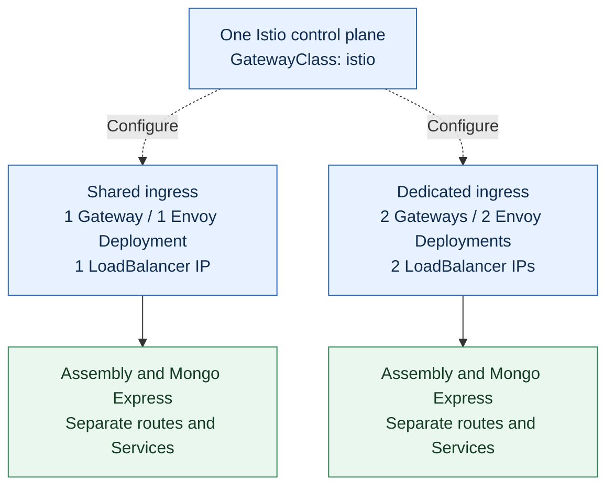
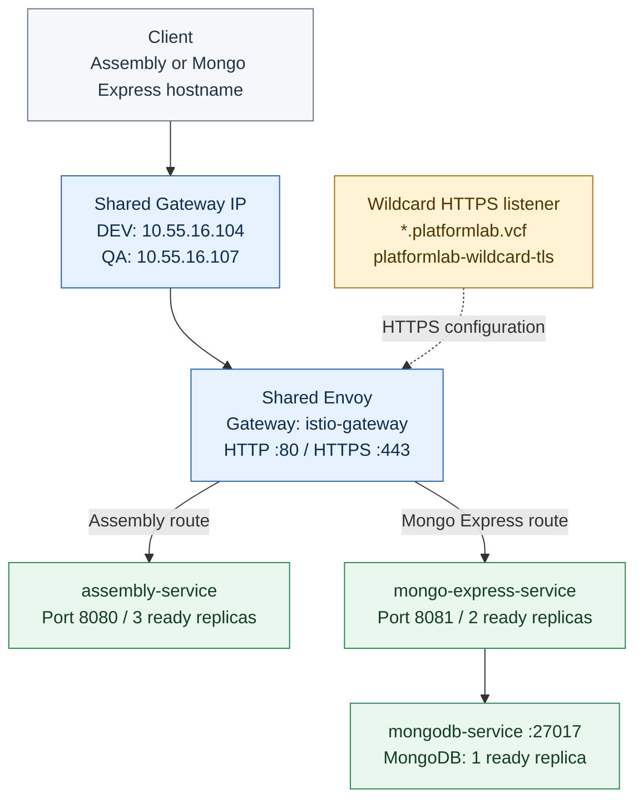
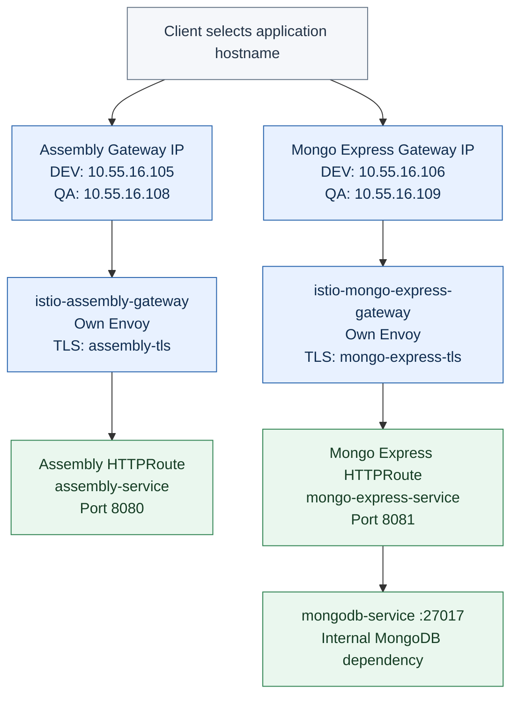
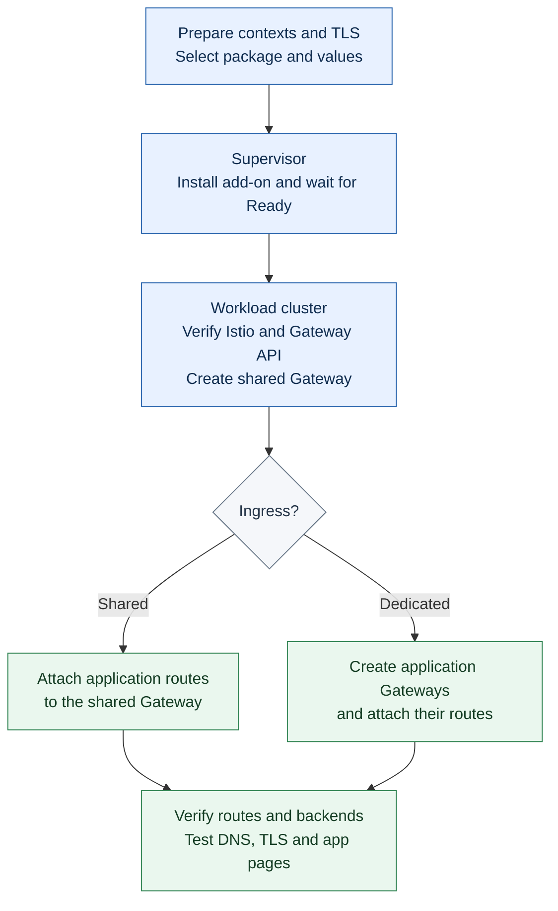
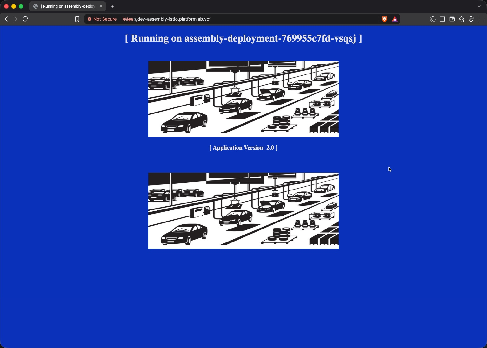
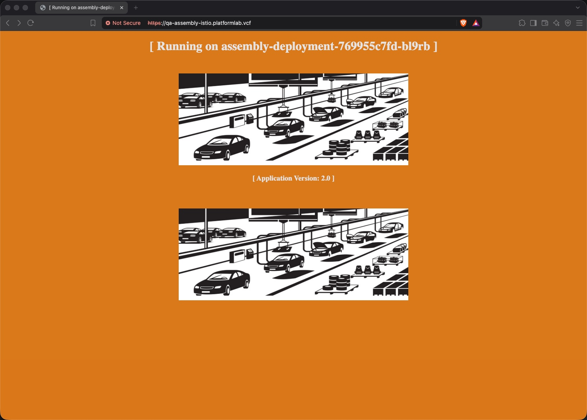
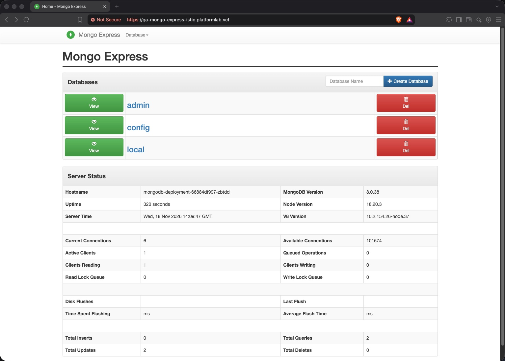

<!--
authors: "Julius M. Nicolescu, Qwen3-Coder-30B-A3B-Instruct-4bit, Qwen3.8-27B-8bit"
date: 2026-11-18
description: Install the VKS Istio add-on and use Kubernetes Gateway API to publish applications through shared or dedicated Gateways.
keywords: VCF, VKS, Istio, Envoy, Gateway API, HTTPRoute, Assembly, Mongo Express
lang: en
-->

# Install the Istio add-on on VKS

Install **Istio** on existing VKS clusters in VMware Cloud Foundation **9.1.1**, then publish applications through **Kubernetes Gateway API**. Istio manages the routing configuration; Envoy proxies receive HTTP/HTTPS traffic and forward it to application Services. Follow the manual procedure or use the supplied Bash examples.

**Documentation scope:** DEV is the worked example for procedures and terminal captures. QA follows the same steps with its own contexts, namespaces, hostnames, IPs and certificates. Environment tables, application screenshots and the [Output](#output) index cover both clusters.

Choose how applications use their Gateways:

| Option | Gateway resources | When to use it |
| --- | --- | --- |
| **Shared Gateway** | Both applications attach HTTPRoutes to `istio-gateway/istio-gateway`. | Share one LoadBalancer IP, HTTP/HTTPS listeners and wildcard certificate. |
| **Dedicated Gateways** | Assembly uses `istio-assembly-gateway`; Mongo Express uses `istio-mongo-express-gateway`, both in `istio-gateway`. | Give each application its own Envoy Deployment, LoadBalancer IP and certificate. |

Choose one option per application. Scripts `02` and `03` deploy alternative routes for the same application, rather than two independent copies. Assembly WebApp tests HTTP/HTTPS routing. MongoDB + Mongo Express also tests persistent storage and application-to-database access.

| Target | VKS cluster | Supervisor namespace | Workload Kubernetes context |
| --- | --- | --- | --- |
| DEV | `dev-cluster-01` | `dev-namespace` | `dev-cluster-01:dev-cluster-01` |
| QA | `qa-cluster-02` | `qa-namespace` | `qa-cluster-02:qa-cluster-02` |

Add-on installation resources live on the **Supervisor**. Istio controllers, Envoy gateways and application resources run inside the **VKS workload cluster**. The Supervisor namespace `dev-namespace` is different from the application's workload namespace `dev-assembly-istio`.

## Contents

- [Reference Environment](#reference-environment)
- [Check Supported VKr Versions in VKS Add-ons v3.8.0+20261021](#check-supported-vkr-versions-in-vks-add-ons-v38020261021)
- [Prerequisites](#prerequisites)
- [Shared versus dedicated Istio Gateways](#shared-versus-dedicated-istio-gateways)
- [Prepare the DEV configuration](#prepare-the-dev-configuration)
- [Install Istio on DEV](#install-istio-on-dev)
- [Deploy the DEV applications](#deploy-the-dev-applications)
- [Application screenshots](#application-screenshots)
- [Project files](#project-files)
- [Optional cleanup](#optional-cleanup)
- [Troubleshooting](#troubleshooting)
- [Output](#output)
- [References](#references)

## Reference Environment

The procedures and configurations in this document were validated against the following platform versions, as recorded in the supplied lab reference environment:

| Component | Version |
| --- | --- |
| VMware Cloud Foundation | `9.1.1.0-545627-2026-09` |
| Supervisor Release | `v1.34.9+vmware.1-vsc9.1.1.0-25712839` |
| vSphere Kubernetes Service | `3.7.0-embedded+v1.36` |
| VKS Release | `v1.35.6---vmware.2-vkr.3` |
| VKS Add-ons Release | `v3.8.0+20261021` |
| cert-manager Version | `1.20.3+vmware.1-vks.1` |
| Contour Version | `1.33.5+vmware.1-vks.1` |

This table preserves the supplied environment record; the documentation update does not perform a new live validation. cert-manager and Contour are included as environment inventory, not as installation steps for this Istio workflow. The Istio installation capture and current scripts separately pin `1.30.0+vmware.1-vks.1`; check that package's compatibility before deployment.

### VKS Add-Ons

VKS Add-Ons are a collection of validated software components that extend the core functionality of vSphere Kubernetes Service (VKS) clusters. An add-on repository provides package releases that can be discovered and installed through the Supervisor.

Use the [VKS Add-ons Release Notes][ref-release] to check package changes, supported VKr versions and upgrade paths. Use `vcf addon available list istio` in the target Supervisor context to discover the Istio releases actually available to that environment.

For an optional service-mesh introduction, see the [Istio crash course](https://www.youtube.com/watch?v=yxTR__Y0DnU). It is supplementary training, not the VKS installation procedure.

## Check Supported VKr Versions in VKS Add-ons v3.8.0+20261021

The supplied compatibility record lists the following Istio packages for VKS Add-ons **v3.8.0+20261021**. Blank cells preserve the original record and do not indicate support.

| Package | Support Tier | Package Version | v1.37 | v1.36 | v1.35 | v1.34 | v1.33 |
| --- | --- | --- | --- | --- | --- | --- | --- |
| Istio | Product | `1.31.0+vmware.1-vks.1` | Yes | Yes | Yes | Yes | |
| Istio | Product | `1.30.4+vmware.1-vks.1` | | Yes | Yes | Yes | Yes |
| Istio | Product | `1.28.10+vmware.1-vks.1` | | | Yes | Yes | Yes |

This table covers those three package releases. It does not validate the older `1.30.0` release used in the captured installation commands. Confirm the target VKr, repository and exact AddonRelease against the [release notes][ref-release] before choosing or upgrading a package.

## Prerequisites

| Requirement | Details |
| --- | --- |
| Platform | Existing VCF 9.1.1 Supervisor and DEV VKS cluster; see the [Reference Environment](#reference-environment) for the supplied versions. |
| Release selection | Confirm the pinned Istio release is available and supported for your VKr. The record also includes a v3.8.0+20261021 compatibility table for newer `1.31.0`, `1.30.4` and `1.28.10` packages; it is separate from the `1.30.0` installation capture. |
| Runtime | Bash on macOS or Linux. On Windows, use a suitably configured Linux environment. |
| Tools | VCF CLI 9.1.1, compatible kubectl, standard shell utilities; jq, curl and nslookup for application scripts and diagnostics. Context/certificate helpers use OpenSSL; certificate utilities specify OpenSSL 3.3 or later. |
| Authentication | Refreshable Supervisor and workload contexts. See the sibling [context guide](../42-create-vks-context/Readme.md) and [CLI installation guide](../41-install-vcf-cli-kubectl/Readme.md). |
| Permissions | Manage Supervisor add-on resources and workload namespaces, Secrets, Deployments, Services, Gateways and HTTPRoutes; inspect cluster-scoped GatewayClasses and CRDs. |
| Connectivity | Access both Kubernetes APIs, package registries and application images. Provide LoadBalancer capacity and routing to application clients. |
| Gateway API | Compatible GatewayClass, Gateway and HTTPRoute CRDs already installed in the workload cluster. |
| TLS and DNS | Import the wildcard certificate for the shared Gateway and matching hostname certificates for dedicated Gateways; configure DNS and client CA trust. |
| Storage | MongoDB needs a working `STORAGE_CLASS`, capacity and persistence policy. The scripts use `vsan-default-storage-policy`. |
| Local access | Write kubeconfig/VCF CLI configuration, `deployment-files/`, certificates and dated reports. |

The reference environment and supplied captures describe a lab. The README rewrite has not performed a new installation or compatibility test.

## Shared versus dedicated Istio Gateways

Here, **shared** and **dedicated** describe the application ingress Gateways. Both designs use **one Istio add-on installation, one shared control plane and GatewayClass `istio` per workload cluster**. A dedicated Gateway gives an application its own ingress proxy and IP; it does not require a separate Istio installation.

### Architecture comparison

The [technical guide](./Readme-istio-gateway-api-technical-guide.md) contains reference manifests and the saved DEV/QA results. The comparison below describes the reference designs; the script-specific differences follow.

| Decision factor | Design A — shared Gateway | Design B — dedicated Gateways |
| --- | --- | --- |
| Istio control plane | One per cluster. | The same control plane serves both Gateways. |
| Active ingress resources | One Gateway, Envoy Deployment and LoadBalancer IP. | One Gateway, Envoy Deployment and IP per application. |
| DNS | Both application hostnames use the shared IP. | Each application hostname uses its dedicated IP. |
| Reference TLS layout | Individual certificates on two exact-hostname HTTPS listeners. | One hostname certificate per application Gateway. |
| Reference ownership | Gateway and TLS Secrets in `istio-gateway`; app-owned routes and Services. | Gateway, Secret, routes and Services in each application namespace. |
| Reference route admission | Approved namespace labels with `from: Selector`. | Same-namespace routes with `from: Same`. |
| Operations | Shared capacity and proxy lifecycle; centrally coordinated changes. | Independent proxy capacity and lifecycle; more ingress resources. |

For these two applications, both choices share one Istio control plane. Dashed arrows show configuration; solid arrows lead to application backends. Counts below describe the selected active ingress resources; the installer can also retain an unused shared Gateway in dedicated mode.



Separate application certificates work with either design. A shared Gateway selects the appropriate certificate through its hostname-specific HTTPS listener; a dedicated IP is not required merely because applications have different certificates. See [Gateway API TLS configuration][ref-gateway-tls].

### How the current scripts implement these options

The project uses the same shared-versus-dedicated proxy model, with these concrete differences from the reference design:

| Area | Architecture reference | Current project scripts |
| --- | --- | --- |
| Shared Gateway TLS | Individual exact-hostname certificates; separate `https-assembly` and `https-mongo` listeners. | One wildcard `*.platformlab.vcf` listener named `https`, using `platformlab-wildcard-tls`. |
| Dedicated Gateway location | Gateways and TLS Secrets live in each application's namespace. | `istio-assembly-gateway`, `istio-mongo-express-gateway` and their TLS Secrets all live in the central `istio-gateway` namespace. |
| Route admission | Namespace selector for shared ingress; same-namespace attachment for dedicated ingress. | Both shared and dedicated Gateway listeners use `from: All`; application HTTPRoutes reference Gateways across namespaces. |
| Application names | Some example namespace, hostname and Gateway names differ from this checkout. | Use the actual names in this README's DNS table and supplied scripts. |
| Resources retained by the installer | Each reference design shows the resources selected for that design. | The add-on installer creates a shared Gateway first. Deploying both dedicated application Gateways can leave three Envoy Deployments/LoadBalancer Services: the shared one plus the two dedicated ones. |

Keep the wildcard procedure in this guide when running the current shared scripts. Adopting the reference design's individual shared certificates requires centrally configuring both TLS Secrets and HTTPS listeners, updating each route's `sectionName`, and reviewing route admission together. The reference architecture has not been substituted into the existing scripts.

### Choose a design

Use the **shared scripts** for one ingress IP and common proxy capacity. Use the **dedicated scripts** for separate application IPs, certificates and proxy lifecycles. Both use the central `istio-gateway` namespace in this project.

The reference design also demonstrates individual certificates on a shared Gateway. Adopting it requires coordinated listener, Secret and route changes; use the [technical guide](./Readme-istio-gateway-api-technical-guide.md) for that alternative.

For a transition, test the destination with `curl --resolve`, update DNS, verify application access, then remove obsolete routes and Gateways. Preserve MongoDB PVC data.

### Current script traffic flows

These diagrams show the scripts' lab layout and IPs. Choose DEV or QA independently. Blue identifies ingress resources, gold TLS configuration and green application backends. Solid arrows carry requests or application-to-database traffic; dashed arrows supply configuration.

#### Shared Gateway



HTTPS terminates at Envoy using `platformlab-wildcard-tls`. Each HTTPRoute names the shared Gateway namespace and listener (`https` or `http`). The HTTP route redirects clients to HTTPS; the HTTPS route forwards to the application's ClusterIP Service.

#### Dedicated Gateways



Both dedicated Gateways use class `istio` and namespace `istio-gateway`. Each has its own Envoy proxy and IP; Services and HTTPRoutes stay in the application namespace. The dedicated reports also retain the shared Gateway with zero attached routes: three Envoy Deployments and LoadBalancer Services in total.

## Prepare the DEV configuration

### Cluster, namespace and package settings

| Setting | Purpose |
| --- | --- |
| `CONTEXT_NAME` | Supervisor context base name, `supervisor`. |
| `CLUSTER_NAMESPACE` | DEV Supervisor namespace: `dev-namespace`. |
| `CLUSTER_NAME` | DEV VKS target: `dev-cluster-01`. |
| `ISTIO_RELEASE` | Exact AddonRelease name, currently `istio.kubernetes.vmware.com.1.30.0-vmware.1-vks.1`. |
| `READY_TIMEOUT` | Add-on/Gateway wait timeout, currently `10m`. |
| `GATEWAY_NAMESPACE` | Workload namespace for shared and dedicated ingress gateways, `istio-gateway`. |
| `ENVOY_LB_IP` | Requested Gateway LoadBalancer IP. Verify the actual address after provisioning. |
| `APP_FQDN` | Hostname matched by the application route and, for dedicated Gateways, the HTTPS listener. |

| Workload namespace | Components |
| --- | --- |
| `istio-system` | `istiod`, CNI and add-on support components. |
| `istio-gateway` | Gateways, generated Envoy Deployments/Services and TLS Secrets. |
| `dev-assembly-istio` | Assembly Deployment, Service and HTTPRoutes. |
| `dev-mongodb-istio` | MongoDB, Mongo Express, credentials, PVC, Services and HTTPRoutes. |

### Istio package values — Gateway API and Gateway Provisioning

For this deployment, the VKS Istio add-on acts primarily as a **Kubernetes Gateway API controller**. It configures managed Envoy gateways to provide HTTP/HTTPS ingress and Layer 7 routing for Assembly WebApp and Mongo Express.

The following package settings are defined under the top-level `istio:` section of the add-on values file:

| Setting | Lab value | Effect on Gateway provisioning |
| --- | --- | --- |
| `gateways.ingress.enabled` | `false` | Disable the preconfigured Istio ingress gateway. Kubernetes Gateway API resources provision their own managed Envoy gateways. |
| `gateways.egress.enabled` | `false` | Disable the preconfigured egress gateway, which is not required for this application-ingress POC. |
| `enableGatewayAPIInference` | `false` | Disable the AI inference extension. Standard Gateway and HTTPRoute functionality remains available. |

**Disabling the preconfigured ingress gateway does not disable Kubernetes Gateway API provisioning.** When a Kubernetes `Gateway` references `gatewayClassName: istio`, the Istio controller automatically creates its Envoy Deployment and Kubernetes LoadBalancer Service by default. A separately installed legacy ingress gateway is not required.

The components have different responsibilities:

| Component | Responsibility |
| --- | --- |
| Istio add-on | Install and manage the Istio control plane and supporting platform components. |
| GatewayClass `istio` | Select the Istio Gateway API controller. |
| Gateway | Define the entry point, HTTP/HTTPS listeners, ports, TLS certificate references and optional requested address. |
| Envoy Deployment | Run the gateway proxies that terminate HTTPS and route incoming application requests. |
| LoadBalancer Service | Expose the gateway proxies through an externally reachable IP supplied by the VKS networking integration. |
| HTTPRoute | Match application hostnames and paths, attach to a permitted Gateway listener and select backend Services. |

Provision the resources in this order:

1. Install the Istio add-on and confirm that GatewayClass `istio` is accepted.
2. Create the Gateway namespace and TLS Secret, then apply the Gateway manifest.
3. Wait for Istio to provision Envoy and its LoadBalancer Service, and for the Gateway to report `Programmed=True`.
4. Deploy application backends and HTTPRoutes, then configure DNS using the allocated Gateway address.

The same package configuration supports both deployment models:

- **Shared Gateway:** both applications use one Gateway, Envoy Deployment and LoadBalancer IP; application HTTPRoutes select their backends.
- **Dedicated Gateways:** each application has its own Gateway, Envoy Deployment, LoadBalancer Service and TLS configuration.

Both models use the **same Istio control plane and GatewayClass**. Gateways, TLS Secrets and HTTPRoutes are created separately from the package values file. See [Shared versus dedicated Istio Gateways](#shared-versus-dedicated-istio-gateways) for the architecture and the current scripts' certificate and namespace layout.

The configured VKS networking integration, such as NSX or Avi, allocates the LoadBalancer IP; `istiod` does not allocate the address itself. A Gateway `spec.addresses` entry requests a particular IP, subject to provider support and availability. Verify the actual Gateway and Service addresses before creating DNS records. See [Istio Gateway API provisioning][ref-gateway] for the managed deployment model.

### Application DNS records

The table lists the editable lab IPs and application hostnames for **both DEV and QA**. Within each environment, the shared and dedicated options use the same application hostnames; point DNS at the Gateway option actually deployed. QA follows the DEV procedure, using the QA values shown here.

| Gateway | DEV | QA |
| --- | --- | --- |
| Shared Istio | `10.55.16.104`<br>`dev-assembly-istio.platformlab.vcf`<br>`dev-mongo-express-istio.platformlab.vcf` | `10.55.16.107`<br>`qa-assembly-istio.platformlab.vcf`<br>`qa-mongo-express-istio.platformlab.vcf` |
| Dedicated Assembly | `10.55.16.105`<br>`dev-assembly-istio.platformlab.vcf` | `10.55.16.108`<br>`qa-assembly-istio.platformlab.vcf` |
| Dedicated Mongo Express | `10.55.16.106`<br>`dev-mongo-express-istio.platformlab.vcf` | `10.55.16.109`<br>`qa-mongo-express-istio.platformlab.vcf` |

For **shared Gateways**, these example forward-zone records belong in the `platformlab.vcf` DNS zone. The records below show both environments because their DNS names and IP addresses differ.

```dns
dev-istio-gateway        IN A      10.55.16.104
dev-assembly-istio       IN CNAME  dev-istio-gateway.platformlab.vcf.
dev-mongo-express-istio  IN CNAME  dev-istio-gateway.platformlab.vcf.

qa-istio-gateway         IN A      10.55.16.107
qa-assembly-istio        IN CNAME  qa-istio-gateway.platformlab.vcf.
qa-mongo-express-istio   IN CNAME  qa-istio-gateway.platformlab.vcf.
```

Optional matching records in the `16.55.10.in-addr.arpa` reverse zone:

```dns
104 IN PTR dev-istio-gateway.platformlab.vcf.
107 IN PTR qa-istio-gateway.platformlab.vcf.
```

For **dedicated Gateways**, replace each application's CNAME with an A record pointing at its dedicated address. Do not retain a CNAME and an A record for the same application name.

### Application certificates

The [utilities directory](utilities/) provides these local certificate helpers:

| Script | Purpose |
| --- | --- |
| [01-create-custom-ca-cert.sh](utilities/01-create-custom-ca-cert.sh) | Create the lab CA once. |
| [02-create-wildcard.platformlab.vcf.sh](utilities/02-create-wildcard.platformlab.vcf.sh) | Create the shared Gateway certificate covering `*.platformlab.vcf`. |
| [03-create-dev-assembly-istio.platformlab.vcf.sh](utilities/03-create-dev-assembly-istio.platformlab.vcf.sh) | Create the DEV Assembly hostname certificate. |
| [04-create-dev-mongo-express-istio.platformlab.vcf.sh](utilities/04-create-dev-mongo-express-istio.platformlab.vcf.sh) | Create the DEV Mongo Express hostname certificate. |
| [05-create-qa-assembly-istio.platformlab.vcf.sh](utilities/05-create-qa-assembly-istio.platformlab.vcf.sh) | Create the QA Assembly hostname certificate. |
| [06-create-qa-mongo-express-istio.platformlab.vcf.sh](utilities/06-create-qa-mongo-express-istio.platformlab.vcf.sh) | Create the QA Mongo Express hostname certificate. |

Run the CA helper once, then only the certificate helpers needed for the selected option. They save files in `utilities/certificates/` and refuse to overwrite existing key/certificate files. From the README directory, for example:

```bash
# Create the lab CA if it has not already been created.
bash utilities/01-create-custom-ca-cert.sh

# Create the wildcard server certificate for shared Gateways.
bash utilities/02-create-wildcard.platformlab.vcf.sh
```

Copy the required `.key` and `.cer.plusCA` files to these destinations before installation:

| Option | Destination beside the DEV scripts | TLS Secret in `istio-gateway` |
| --- | --- | --- |
| Shared Gateway | `dev-cluster-01/certificates/wildcard.platformlab.vcf.key` and `.cer.plusCA` | `platformlab-wildcard-tls` |
| Dedicated Assembly | `dev-cluster-01/deploy-assembly-webapp/certificates/<APP_FQDN>.key` and `.cer.plusCA` | `assembly-tls` |
| Dedicated Mongo Express | `dev-cluster-01/deploy-mongo-express/certificates/<APP_FQDN>.key` and `.cer.plusCA` | `mongo-express-tls` |

QA uses the same certificate directory layout under `qa-cluster-02/`, with the matching QA hostname certificate files. The wildcard certificate covers both environments' application hostnames.

Trust the CA on clients. These workflows import existing certificates and do not configure cert-manager renewal. The application scripts use privileged Pod Security namespace labels; review those lab settings before reuse.

## Install Istio on DEV

Choose **one** installation path: the manual commands or the supplied scripts. Both install the same pinned Istio add-on and create the shared HTTP/HTTPS Gateway. Complete [Prerequisites](#prerequisites) and [Prepare the DEV configuration](#prepare-the-dev-configuration) first. Run Bash examples on macOS or Linux.



### Option 1: manual installation

Run the following steps in one Bash session, starting beside this README, with authenticated Supervisor and workload contexts already available. This path creates the values file, installs the add-on and configures the Gateway directly.

**Captured lab output:** the text blocks below preserve recorded command results supplied with this guide. Recorded versions, resource ages, pod names and addresses are examples, not a current health check. The older Gateway capture has HTTP only; the procedure below adds HTTPS.

#### 1. Select DEV

Start in the README directory and configure the DEV target:

```bash
CONTEXT_NAME=supervisor
CLUSTER_NAMESPACE=dev-namespace
CLUSTER_NAME=dev-cluster-01
ENVOY_LB_IP=10.55.16.104

# Enter the DEV add-on directory.
cd dev-cluster-01
```

Continue in the DEV directory:

```bash
ISTIO_RELEASE=istio.kubernetes.vmware.com.1.30.0-vmware.1-vks.1
READY_TIMEOUT=10m
GATEWAY_NAME=istio-gateway
GATEWAY_NAMESPACE=istio-gateway

# Resolve the DEV cluster directory for generated files.
SCRIPT_DIR=$(pwd)

DEPLOYMENT_FILES=${SCRIPT_DIR}/deployment-files
CERTIFICATES_DIR=${SCRIPT_DIR}/certificates

# Create the local deployment directory.
mkdir -p ${DEPLOYMENT_FILES}

# Refresh Supervisor authentication.
vcf context refresh ${CONTEXT_NAME}

# Activate the Supervisor context in the target cluster's namespace.
vcf context use ${CONTEXT_NAME}:${CLUSTER_NAMESPACE}

# Select the same Supervisor context for Kubernetes commands.
kubectl config use-context ${CONTEXT_NAME}:${CLUSTER_NAMESPACE}
```

#### 2. Discover the Istio release

```bash
# List add-ons already installed on the selected cluster.
vcf addon install list --cluster-name ${CLUSTER_NAME}
```

Recorded output before Istio installation:

```text
  ADDONNAME        NAMESPACE      ADDONRELEASENAME                                                     PAUSED  READY  DELETE/UPGRADE
  helm-controller  dev-namespace  helm-controller.kubernetes.vmware.com.1.5.4-v4.01.04-vmware.1-vks.1  false   True   NotAllowed
```

```bash
# List add-ons available from the configured repositories.
vcf addon available list
```

Recorded repository inventory:

```text
  NAMESPACE                 ADDONNAME                    DESCRIPTION
  vmware-system-vks-public  ako                          Integrates VMware NSX Advanced Load Balancer with Kubernetes for L4-L7 services.
  vmware-system-vks-public  cert-manager                 Certificate management
  vmware-system-vks-public  contour                      An ingress controller
  vmware-system-vks-public  external-dns                 This package provides DNS synchronization functionality.
  vmware-system-vks-public  fluent-bit                   Fluent Bit is a fast Log Processor and Forwarder
  vmware-system-vks-public  gatekeeper                   Policy enforcement for Kubernetes via OPA Gatekeeper
  vmware-system-vks-public  harbor                       OCI Registry
  vmware-system-vks-public  headlamp                     Web UI for Kubernetes (Headlamp).
  vmware-system-vks-public  helm-controller              declarative Helm chart lifecycle management
  vmware-system-vks-public  istio                        networking service mesh solution for containers
  vmware-system-vks-public  multus-cni                   This package provides the ability for enabling attaching multiple network
                                                         interfaces to pods in Kubernetes
  vmware-system-vks-public  nfs-client                   A CSI for NFS.
  vmware-system-vks-public  prometheus                   A time series database for your metrics
  vmware-system-vks-public  sriov-network-device-plugin  The SR-IOV Network Device Plugin is Kubernetes device plugin for discovering and
                                                         advertising SR-IOV virtual functions (VFs) available on a Kubernetes host
  vmware-system-vks-public  telegraf                     collect and report metrics
  vmware-system-vks-public  vault-injector               Vault Agent Injector for Secret Store Service
  vmware-system-vks-public  velero                       Velero is an open source tool to safely backup and restore, perform disaster
                                                         recovery, and migrate Kubernetes cluster resources and persistent volumes.
  vmware-system-vks-public  vsphere-pv-csi-webhook       vSphere paravirtual CSI provider webhook
  vmware-system-vks-public  whereabouts                  A CNI IPAM plugin that assigns IP addresses cluster-wide
  vmware-system-vks-public  windows-gmsa-webhook         Windows Group Managed Service Accounts (GMSA) Kubernetes Webhook
```

```bash
# List the available Istio releases.
vcf addon available list istio
```

Recorded Istio release inventory:

```text
  NAMESPACE                 ADDONNAME  VERSION                ADDON-RELEASE-NAME                                 PACKAGE
  vmware-system-vks-public  istio      1.28.7+vmware.1-vks.1  istio.kubernetes.vmware.com.1.28.7-vmware.1-vks.1  istio.kubernetes.vmware.com/1.28.7+vmware.1-vks.1
  vmware-system-vks-public  istio      1.30.0+vmware.1-vks.1  istio.kubernetes.vmware.com.1.30.0-vmware.1-vks.1  istio.kubernetes.vmware.com/1.30.0+vmware.1-vks.1
```

The scripts and installation capture use **`1.30.0+vmware.1-vks.1`**. Use the exact release name returned by your Supervisor. A newer repository compatibility table does not establish compatibility for this older pinned package; confirm the VKS/VKr and package pairing before changing `ISTIO_RELEASE`. See [VKS add-on release notes][ref-release].

```bash
# Export defaults for the exact release selected above.
vcf addon available-releases get ${ISTIO_RELEASE} \
    --values-config-file-output ${DEPLOYMENT_FILES}/istio-default-data-values.yaml
```

#### 3. Write the Gateway API values

These settings retain Istio CNI and two `istiod` replicas, enable access logging and metrics merging, and disable Ambient Mesh, strict mesh-wide mTLS, tracing and preconfigured legacy gateways. They do not inject sidecars into application pods. Enable mesh security or Ambient Mesh only as a separately reviewed configuration change.

Use the same filename for creation and installation:

```bash
# Write the reviewed Istio package values for this lab.
cat << 'EOF' > ${DEPLOYMENT_FILES}/istio-gateway-api-data-values.yaml
istio:
  # 1. Standard sidecar model; no Ambient Mesh / ztunnel for this PoC.
  ambientMode:
    enabled: false
    ztunnel:
      resources:
        requests:
          cpu: 200m
          memory: 512Mi

  # 2. Standard Gateway API needs no AI inference extension.
  enableGatewayAPIInference: false

  # 3. Do not impose mesh-wide STRICT mTLS on non-mesh PoC backends.
  enableStrictMTLS: false

  # 4. No preconfigured legacy Istio gateways: Gateway API provisions its own proxy.
  gateways:
    egress:
      autoscaling:
        enabled: false
        maxReplicas: 5
        minReplicas: 1
      enabled: false
      namespace: istio-egress
      namespaceLimitRange:
        defaultRequests:
          cpu: 100m
          memory: 128Mi
      priorityClassName: ""
      replicas: 1
      resources:
        limits:
          cpu: 2000m
          memory: 1024Mi
        requests:
          cpu: 100m
          memory: 128Mi

    ingress:
      autoscaling:
        enabled: false
        maxReplicas: 5
        minReplicas: 1
      enabled: false
      namespace: istio-ingress
      namespaceLimitRange:
        defaultRequests:
          cpu: 100m
          memory: 128Mi
      priorityClassName: ""
      replicas: 1
      resources:
        limits:
          cpu: 2000m
          memory: 1024Mi
        requests:
          cpu: 100m
          memory: 128Mi

  # 5. Retain vendor default Istio CNI support (available for later sidecar testing).
  istioCNI:
    enabled: true
    resources:
      requests:
        cpu: 100m
        memory: 100Mi

  # 6. Mesh observability and networking defaults suitable for PoC.
  meshConfig:
    accessLogFile: /dev/stdout
    connectTimeout: 10s
    enableDNSProxy: false
    enablePrometheusMerge: true
    # Without a tracing collector, turning on tracing adds little value to the PoC.
    enableTracing: false
    externalIstiod: false
    # This governs traditional Istio/Kubernetes Ingress handling, not Gateway API enablement.
    ingressControllerMode: STRICT
    ingressSelector: ingressgateway
    meshID: ""
    meshMTLS:
      minProtocolVersion: TLSV1_2
    network: ""
    proxy:
      resources:
        limits:
          cpu: 2000m
          memory: 1024Mi
        requests:
          cpu: 100m
          memory: 128Mi
    trustDomain: cluster.local
    trustDomainAliases: []
    waypoint:
      resources:
        limits:
          cpu: "2"
          memory: 1Gi
        requests:
          cpu: 100m
          memory: 128Mi

  # 7. Dedicated control-plane namespace.
  namespace: istio-system

  # 8. Default container requests within the Istio control-plane namespace.
  namespaceLimitRange:
    defaultRequests:
      cpu: 100m
      memory: 64Mi

  # 9. Redundant istiod control plane, no autoscaler needed for small PoC.
  pilot:
    autoscaling:
      enabled: false
      maxReplicas: 5
      minReplicas: 2
    priorityClassName: ""
    replicas: 2
    resources:
      requests:
        cpu: 500m
        memory: 2048Mi

  # 10. Add-on supporting resources.
  support:
    priorityClassName: ""
    resources:
      requests:
        cpu: 100m
        memory: 64Mi

# Leave blank unless the add-on documentation requires a specific VKS cluster version override.
vks_cluster_version: ""
EOF
```

#### 4. Install Istio and wait for readiness

```bash
# Install the pinned Istio release with the saved values.
vcf addon install create istio \
    --cluster-name ${CLUSTER_NAME} \
    --namespace ${CLUSTER_NAMESPACE} \
    --addon-release-name ${ISTIO_RELEASE} \
    --values-config-file ${DEPLOYMENT_FILES}/istio-gateway-api-data-values.yaml \
    --yes

# Wait for the Supervisor ClusterAddon to be created.
kubectl wait clusteraddon/${CLUSTER_NAME}-istio \
    -n ${CLUSTER_NAMESPACE} --for=create --timeout=${READY_TIMEOUT}

# Wait for Istio add-on readiness.
kubectl wait clusteraddon/${CLUSTER_NAME}-istio \
    -n ${CLUSTER_NAMESPACE} --for=condition=Ready --timeout=${READY_TIMEOUT}

# Display installed add-ons after the readiness wait.
vcf addon install list --cluster-name ${CLUSTER_NAME} -n ${CLUSTER_NAMESPACE}
```

Recorded output after installation:

```text
  ADDONNAME        NAMESPACE      ADDONRELEASENAME                                                     PAUSED  READY  DELETE/UPGRADE
  helm-controller  dev-namespace  helm-controller.kubernetes.vmware.com.1.5.4-v4.01.04-vmware.1-vks.1  false   True   NotAllowed
  istio            dev-namespace  istio.kubernetes.vmware.com.1.30.0-vmware.1-vks.1                    false   True   Allowed

```

Continue only after Istio reports `READY=True` and the readiness wait succeeds.

#### 5. Verify the control plane and Gateway API

```bash
# Refresh workload cluster authentication and retain error messages.
vcf context refresh ${CLUSTER_NAME} >/dev/null 2>&1

# Select the workload cluster context.
kubectl config use-context ${CLUSTER_NAME}:${CLUSTER_NAME}

# Inspect the Gateway API Gateway CRD.
kubectl get crd gateways.gateway.networking.k8s.io
```

Recorded Gateway CRD output:

```text
NAME                                 CREATED AT
gateways.gateway.networking.k8s.io   2026-11-15T22:24:16Z
```

```bash
# Check the GatewayClass and HTTPRoute CRDs as well.
kubectl get crd gatewayclasses.gateway.networking.k8s.io httproutes.gateway.networking.k8s.io

# List Istio's automatically created GatewayClasses.
kubectl get gatewayclass
```

Recorded GatewayClass output:

```text
NAME           CONTROLLER                    ACCEPTED   AGE
istio          istio.io/gateway-controller   True       15m
istio-remote   istio.io/unmanaged-gateway    True       15m
```

Use class **`istio`** for automatic proxy provisioning. `istio-remote` uses the unmanaged gateway controller. If CRDs are missing, use the CRD bundle supported by the target VKS and Istio package before continuing; do not install the latest experimental bundle solely because an upstream example uses it.

```bash
# Inspect Istio control-plane, CNI and support pods.
kubectl get pods -n istio-system
```

Recorded control-plane output:

```text
NAME                             READY   STATUS    RESTARTS   AGE
istio-cni-node-4cptv             1/1     Running   0          16m
istio-cni-node-9rjfn             1/1     Running   0          16m
istio-cni-node-c2ltb             1/1     Running   0          16m
istio-cni-node-l49jm             1/1     Running   0          16m
istio-cni-node-pr7l7             1/1     Running   0          16m
istio-cni-node-s7zvl             1/1     Running   0          16m
istio-support-54d6c5466f-sdlbz   1/1     Running   0          16m
istiod-6686b58697-5f9rp          1/1     Running   0          16m
istiod-6686b58697-m2rpq          1/1     Running   0          16m
```

The capture contains two ready `istiod` pods, six CNI pods and one support pod. The number of CNI pods depends on the cluster's nodes.

#### 6. Create the shared HTTP/HTTPS Gateway

Prepare `wildcard.platformlab.vcf.key` and `wildcard.platformlab.vcf.cer.plusCA` in the DEV cluster's `certificates/` directory. The certificate must cover `*.platformlab.vcf`; the filename alone does not establish certificate coverage. See [Application certificates](#application-certificates).

```bash
# Create the shared Gateway namespace if needed.
kubectl create namespace ${GATEWAY_NAMESPACE} --dry-run=client -o yaml | kubectl apply -f -

# Import the wildcard certificate and private key beside the Gateway.
kubectl create secret tls platformlab-wildcard-tls \
    --cert=${CERTIFICATES_DIR}/wildcard.platformlab.vcf.cer.plusCA \
    --key=${CERTIFICATES_DIR}/wildcard.platformlab.vcf.key \
    --namespace=${GATEWAY_NAMESPACE} --dry-run=client -o yaml | kubectl apply -f -

# Write the shared Istio Gateway with HTTP and wildcard HTTPS listeners.
cat << EOF > ${DEPLOYMENT_FILES}/istio-gateway-resource.yaml
apiVersion: gateway.networking.k8s.io/v1
kind: Gateway
metadata:
  name: ${GATEWAY_NAME}
  namespace: ${GATEWAY_NAMESPACE}
spec:
  gatewayClassName: istio
  addresses:
    - type: IPAddress
      value: ${ENVOY_LB_IP}
  listeners:
    - name: http
      protocol: HTTP
      port: 80
      allowedRoutes:
        namespaces:
          from: All
    - name: https
      hostname: "*.platformlab.vcf"
      protocol: HTTPS
      port: 443
      tls:
        mode: Terminate
        certificateRefs:
          - kind: Secret
            name: platformlab-wildcard-tls
      allowedRoutes:
        namespaces:
          from: All
EOF

# Apply the shared Gateway resource.
kubectl apply -f ${DEPLOYMENT_FILES}/istio-gateway-resource.yaml

# Wait for the Gateway to be programmed.
kubectl wait gateways.gateway.networking.k8s.io/${GATEWAY_NAME} \
    -n ${GATEWAY_NAMESPACE} --for=condition=Programmed --timeout=${READY_TIMEOUT}

# Inspect the shared Gateway's assigned address.
kubectl get gateway -n istio-gateway
```

Recorded output from the earlier HTTP-only Gateway:

```text
NAME            CLASS   ADDRESS        PROGRAMMED   AGE
istio-gateway   istio   10.55.16.104   True         18s
```

```bash
# Inspect the Envoy Deployment created by Istio.
kubectl get deployments -n istio-gateway
```

```text
NAME                  READY   UP-TO-DATE   AVAILABLE   AGE
istio-gateway-istio   1/1     1            1           2m46s
```

```bash
# Inspect the gateway proxy pods.
kubectl get pods -n istio-gateway
```

```text
NAME                                   READY   STATUS    RESTARTS   AGE
istio-gateway-istio-79f78bfd85-rgqm2   1/1     Running   0          3m9s
```

```bash
# Inspect the LoadBalancer address and exposed ports.
kubectl get svc -n istio-gateway
```

```text
NAME                  TYPE           CLUSTER-IP     EXTERNAL-IP    PORT(S)                        AGE
istio-gateway-istio   LoadBalancer   10.102.75.93   10.55.16.104   15021:30413/TCP,80:32413/TCP   51s
```

The recorded Service exposes port 80 and the health-check port 15021. After applying the HTTP/HTTPS Gateway above, also check for **443** and valid HTTPS listener conditions. `spec.addresses` requests an IP; the LoadBalancer provider decides whether it can allocate it. Configure DNS from the address actually reported in status.

### Option 2: use the installation scripts

Use this path instead of the manual installation. Review the script inputs and prepare the wildcard certificate files first. Starting in the README directory, recreate the configured Supervisor and DEV workload contexts:

```bash
# Enter the DEV directory.
cd dev-cluster-01

# Recreate and activate the Supervisor context.
bash ./01-create-supervisor-context.sh

# Recreate and activate the DEV workload context.
bash ./02-create-vks-cluster-context.sh
```

Choose **one** installer from the DEV directory:

| Installer | What it does | Command |
| --- | --- | --- |
| [10-install-istio-addon-vcf-cli.sh](dev-cluster-01/10-install-istio-addon-vcf-cli.sh) | Install through VCF CLI, wait for readiness, import wildcard TLS and create the shared Gateway. | `bash ./10-install-istio-addon-vcf-cli.sh` |
| [20-install-istio-addon-kubectl.sh](dev-cluster-01/20-install-istio-addon-kubectl.sh) | Apply Supervisor AddonConfig/AddonInstall resources, wait for readiness and configure the same Gateway. | `bash ./20-install-istio-addon-kubectl.sh` |

Script `20` still uses VCF CLI to refresh authentication. Both installers create the shared Gateway even when applications will later use dedicated Gateways. Neither installer deploys the application examples.

The current add-on lifecycle scripts (`10`, `11`, `20` and `21`) have `set -e` commented out and can continue after a command or readiness wait fails. Inspect resource conditions before proceeding.

### Installation success conditions

| Check | What it establishes |
| --- | --- |
| Supervisor ClusterAddon has `Ready=True` | The Istio add-on reconciled successfully. |
| `istiod`, CNI and support pods are ready | The package's control plane and supporting components are running. |
| GatewayClass `istio` has `Accepted=True` | The intended controller accepts the class. |
| Gateway has `Programmed=True` and an address | Istio provisioned/configured the gateway proxy. |
| HTTPS listener has `ResolvedRefs=True` | Its certificate reference resolves. |

When these conditions are satisfied, continue with [Deploy the DEV applications](#deploy-the-dev-applications). A programmed Gateway establishes ingress readiness; application access also depends on routes, backends, DNS and TLS.

## Deploy the DEV applications

Complete either installation path once, then continue in `dev-cluster-01/`. Prepare the matching DNS records and certificates for the selected Gateway option.

The application deployment scripts stop on command or pipeline failure. Shared scripts attach application HTTPRoutes to the existing wildcard Gateway; dedicated scripts create their own Gateway and import the application's hostname certificate.

Choose **one** routing option per application. Both examples deploy Assembly first, then MongoDB and Mongo Express.

### Option 1: shared Gateway

```bash
# Deploy Assembly routes on the existing shared Gateway.
bash ./deploy-assembly-webapp/03-deploy-assembly-webapp-shared-gateway.sh

# Deploy MongoDB and Mongo Express routes on the same Gateway.
bash ./deploy-mongo-express/03-deploy-mongo-express-shared-gateway.sh
```

### Option 2: dedicated Gateways

```bash
# Deploy Assembly with its own Gateway and hostname certificate.
bash ./deploy-assembly-webapp/02-deploy-assembly-webapp-dedicated-gateway.sh

# Deploy MongoDB and Mongo Express with a separate Gateway and certificate.
bash ./deploy-mongo-express/02-deploy-mongo-express-dedicated-gateway.sh
```

Set DNS to the selected IPs, trust the issuing CA, and verify both applications. Switching options reapplies routes to the new parent; remove any unused dedicated Gateway explicitly after verifying the change.

### Application success conditions

| Check | What it establishes |
| --- | --- |
| HTTPRoute parent has `Accepted=True` and `ResolvedRefs=True` | The intended listener accepts the route and its backend references resolve. |
| Application Deployments and endpoints are ready | The route has available application backends. |
| MongoDB PVC is Bound and database pod is ready | Storage provisioning and the database workload are available. |
| DNS lookup and trusted HTTPS request succeed | The tested hostname, certificate and request path work together. |

Use the Gateway address actually allocated to the selected option. Healthy pods and a programmed Gateway alone do not prove that the application hostname works. The saved [Output](#output) reports are historical observations.

### Capture namespace reports

From the same cluster directory:

```bash
# Save an Assembly namespace and routing report.
bash ./deploy-assembly-webapp/91-document-application-namespace.sh

# Save a MongoDB and Mongo Express namespace report.
bash ./deploy-mongo-express/91-document-application-namespace.sh
```

The scripts save `<namespace>-report.txt` directly in each application's `output-YYYY-MM-DD/` directory. Rename the saved report to retain separate shared and dedicated observations before another run overwrites it.

### Application screenshots

The supplied captures show Assembly WebApp version **2.0** and Mongo Express with its database list and server status. Open a preview for the full-size image; all eight file copies are linked in [Output](#output).

| Application | DEV | QA |
| --- | --- | --- |
| **Assembly WebApp** | [](./dev-cluster-01/deploy-assembly-webapp/output-2026-11-18/dev-assembly-istio.platformlab.vcf.jpg) | [](./qa-cluster-02/deploy-assembly-webapp/output-2026-11-18/qa-assembly-istio.platformlab.vcf.jpg) |
| **Mongo Express** | [](./dev-cluster-01/deploy-assembly-webapp/output-2026-11-18/dev-mongo-express-istio.platformlab.vcf.jpg) | [](./qa-cluster-02/deploy-assembly-webapp/output-2026-11-18/qa-mongo-express-istio.platformlab.vcf.jpg) |

The browser captures show a **Not Secure** indicator at HTTPS URLs. They record the rendered pages; validate client CA trust separately. The filenames do not identify the Gateway mode.

## Project files

### Repository layout

Both cluster directories exist. The QA branch lists all add-on and application scripts. Certificate helpers include both environments:

```text
.
├── Readme.md
├── dev-cluster-01/
│   ├── 01-create-supervisor-context.sh
│   ├── 02-create-vks-cluster-context.sh
│   ├── 10-install-istio-addon-vcf-cli.sh
│   ├── 11-delete-istio-addon-vcf-cli.sh
│   ├── 20-install-istio-addon-kubectl.sh
│   ├── 21-delete-istio-addon-kubectl.sh
│   ├── certificates/
│   ├── deployment-files/
│   ├── deploy-assembly-webapp/
│   └── deploy-mongo-express/
├── qa-cluster-02/
│   ├── 01-create-supervisor-context.sh
│   ├── 02-create-vks-cluster-context.sh
│   ├── 10-install-istio-addon-vcf-cli.sh
│   ├── 11-delete-istio-addon-vcf-cli.sh
│   ├── 20-install-istio-addon-kubectl.sh
│   ├── 21-delete-istio-addon-kubectl.sh
│   ├── certificates/
│   ├── deployment-files/
│   ├── deploy-assembly-webapp/
│   │   ├── 01-create-vks-cluster-context.sh
│   │   ├── 02-deploy-assembly-webapp-dedicated-gateway.sh
│   │   ├── 03-deploy-assembly-webapp-shared-gateway.sh
│   │   ├── 04-delete-assembly-webapp-gateway.sh
│   │   ├── 91-document-application-namespace.sh
│   │   ├── certificates/
│   │   └── deployment-files/
│   └── deploy-mongo-express/
│       ├── 01-create-vks-cluster-context.sh
│       ├── 02-deploy-mongo-express-dedicated-gateway.sh
│       ├── 03-deploy-mongo-express-shared-gateway.sh
│       ├── 04-delete-mongo-express-gateway.sh
│       ├── 91-document-application-namespace.sh
│       ├── certificates/
│       └── deployment-files/
└── utilities/
    ├── 01-create-custom-ca-cert.sh
    ├── 02-create-wildcard.platformlab.vcf.sh
    ├── 03-create-dev-assembly-istio.platformlab.vcf.sh
    ├── 04-create-dev-mongo-express-istio.platformlab.vcf.sh
    ├── 05-create-qa-assembly-istio.platformlab.vcf.sh
    └── 06-create-qa-mongo-express-istio.platformlab.vcf.sh
```

Each application directory contains context (`01`), dedicated deployment (`02`), shared deployment (`03`), deletion (`04`) and report (`91`) scripts, plus local certificate and deployment-file directories. Reports are saved directly in `output-YYYY-MM-DD/`.

### Generated deployment files

Generated manifests belong in `deployment-files/` beside the script that produces them. Installers overwrite their generated files; edit inputs in the selected script for persistent changes.

| File | Producer | Purpose |
| --- | --- | --- |
| `istio-default-data-values.yaml` | Manual release export | Defaults from the exact selected AddonRelease. |
| `istio-gateway-api-data-values.yaml` | Manual procedure and installers | Reviewed Istio package values. |
| `istio-addon-config.yaml` | Script `20` | Supervisor AddonConfig containing the values. |
| `istio-addon-install.yaml` | Script `20` | Supervisor AddonInstall selecting the target cluster and release. |
| `istio-gateway-namespace.yaml` | Installers | Gateway namespace and lab Pod Security labels. |
| `istio-gateway-resource.yaml` | Manual procedure and installers | Shared HTTP/HTTPS Gateway and IP request. |
| `10-istio-gateway-gateway-tls.yaml` | Dedicated application scripts | Application-specific Gateway and certificate reference. |
| `11-<namespace>-namespace.yaml` | Application scripts | Application namespace and labels. |
| `12-<namespace>-deployment.yaml`, `13-<namespace>-httproute.yaml` | Assembly scripts | Workloads, Service, HTTPS route and HTTP redirect. |
| `12-<namespace>-secret.yaml` through `16-<namespace>-httproute.yaml` | Mongo Express scripts | Credentials, PVC, database, web UI, Services and routes. |

Values files are package input, not standalone Kubernetes resources. Apply only the manifest named in the procedure; do not apply an entire directory that may contain package values or artifacts from another Gateway option.

## Optional cleanup

Remove application examples before deleting shared routing or Istio. From the DEV cluster directory:

```bash
# Delete Assembly application resources and its dedicated Gateway if present.
bash ./deploy-assembly-webapp/04-delete-assembly-webapp-gateway.sh

# Delete MongoDB/Mongo Express resources, namespace and dedicated Gateway if present.
bash ./deploy-mongo-express/04-delete-mongo-express-gateway.sh
```

Both scripts retain the shared Gateway and its wildcard TLS Secret. Deleting the MongoDB namespace deletes its PVC; the PV reclaim policy determines the backing data's lifetime.

Choose one add-on removal method, starting in the README directory:

| Target | VCF CLI cleanup | kubectl cleanup |
| --- | --- | --- |
| DEV | `bash dev-cluster-01/11-delete-istio-addon-vcf-cli.sh` | `bash dev-cluster-01/21-delete-istio-addon-kubectl.sh` |

These scripts remove Istio and delete the entire `istio-gateway` namespace, including all dedicated/shared Gateways and TLS Secrets there. They retain the VKS cluster, application namespaces, local manifests/certificates/reports and cert-manager if separately installed. Script `11` currently passes `istio,istio-remote` as one GatewayClass name; inspect remaining classes after cleanup. Script `21` names the classes separately but does not explicitly delete AddonConfig. These are existing script behaviors, not corrected by this documentation update.

Retain Gateway API CRDs used by other controllers. Manage the VKS Istio add-on through its Supervisor installation.

## Troubleshooting

| Symptom | Check or action |
| --- | --- |
| VCF CLI cannot find the cluster or package | Select `supervisor:<namespace>`; check the target namespace, cluster name and available Istio release. |
| Istio add-on remains unready | Describe the Supervisor ClusterAddon; inspect events, image access, capacity and release/VKr support. |
| Gateway API resource type is unknown | Confirm the selected context is the workload cluster and compatible CRDs are installed. |
| GatewayClass is missing | Check add-on readiness and `istiod`; do not substitute class `istio-remote` for managed provisioning. |
| Gateway has no address or `Programmed=False` | Inspect Gateway conditions/events, proxy Service and LoadBalancer provider capacity; the requested static IP may not be available. |
| HTTPS listener has unresolved references | Check the TLS Secret name, namespace, certificate chain/private key and hostname coverage. |
| HTTPRoute is rejected | Check `parentRefs`, namespace, listener `sectionName`, hostname intersection and `allowedRoutes`. |
| HTTPS reaches Envoy but returns 404 | Inspect route hostname/path matching and confirm the route attaches to the Gateway receiving traffic. |
| Envoy returns 503 | Inspect Service ports, EndpointSlices, application readiness, connectivity and any mesh policies. |
| `--resolve` works but normal URL fails | Check forward DNS records, caches and whether DNS points at the shared or dedicated option actually deployed. |
| Certificate validation fails | Trust the issuing CA, confirm SAN coverage and use the application hostname rather than a bare IP. |
| MongoDB PVC stays Pending | Inspect StorageClass, quota, capacity and PVC events in the application namespace. |
| A script prints later steps after an error | The add-on lifecycle scripts currently have `set -e` disabled; verify each wait and resource condition. |

Check gateway proxy logs after selecting the workload context:

```bash
# Inspect recent logs from the shared Envoy proxy.
kubectl logs deployment/istio-gateway-istio -n istio-gateway --tail=100
```

## Output

Application reports and screenshots are saved in `output-2026-11-18`. The reports include application readiness, Gateway/listener conditions, HTTPRoute attachments, certificates and Envoy resources. Their `Captured:` fields are blank; the folder supplies the date.

The shared captures show one Gateway with two routes per listener. Dedicated captures show one route per application listener, plus a retained shared Gateway with no attached routes. Assembly is **3/3**, Mongo Express **2/2** and MongoDB **1/1** ready in both environments and modes.

| Cluster | Output | Description |
| --- | --- | --- |
| `dev-cluster-01` | **Assembly reports**<br>[Dedicated](./dev-cluster-01/deploy-assembly-webapp/output-2026-11-18/dev-assembly-istio-report-dedicated-gateway.txt) · [Shared](./dev-cluster-01/deploy-assembly-webapp/output-2026-11-18/dev-assembly-istio-report-shared-gateway.txt) | Assembly: **3/3** ready replicas. |
| `dev-cluster-01` | **Mongo Express reports**<br>[Dedicated](./dev-cluster-01/deploy-mongo-express/output-2026-11-18/dev-mongodb-istio-report-dedicated-gateway.txt) · [Shared](./dev-cluster-01/deploy-mongo-express/output-2026-11-18/dev-mongodb-istio-report-shared-gateway.txt) | Mongo Express: **2/2**; MongoDB: **1/1** ready replicas. |
| `dev-cluster-01` | **Screenshots** — `deploy-assembly-webapp`<br>[Assembly WebApp](./dev-cluster-01/deploy-assembly-webapp/output-2026-11-18/dev-assembly-istio.platformlab.vcf.jpg) · [Mongo Express](./dev-cluster-01/deploy-assembly-webapp/output-2026-11-18/dev-mongo-express-istio.platformlab.vcf.jpg) | Application pages, Assembly pod/version and MongoDB status. |
| `dev-cluster-01` | **Screenshots** — `deploy-mongo-express`<br>[Assembly WebApp](./dev-cluster-01/deploy-mongo-express/output-2026-11-18/dev-assembly-istio.platformlab.vcf.jpg) · [Mongo Express](./dev-cluster-01/deploy-mongo-express/output-2026-11-18/dev-mongo-express-istio.platformlab.vcf.jpg) | Application pages, Assembly pod/version and MongoDB status. |
| `qa-cluster-02` | **Assembly reports**<br>[Dedicated](./qa-cluster-02/deploy-assembly-webapp/output-2026-11-18/qa-assembly-istio-report-dedicated-gateway.txt) · [Shared](./qa-cluster-02/deploy-assembly-webapp/output-2026-11-18/qa-assembly-istio-report-shared-gaeway.txt) | Assembly: **3/3** ready replicas. |
| `qa-cluster-02` | **Mongo Express reports**<br>[Dedicated](./qa-cluster-02/deploy-mongo-express/output-2026-11-18/qa-mongodb-istio-report-dedicated-gateway.txt) · [Shared](./qa-cluster-02/deploy-mongo-express/output-2026-11-18/qa-mongodb-istio-report-shared-gateway.txt) | Mongo Express: **2/2**; MongoDB: **1/1** ready replicas. |
| `qa-cluster-02` | **Screenshots** — `deploy-assembly-webapp`<br>[Assembly WebApp](./qa-cluster-02/deploy-assembly-webapp/output-2026-11-18/qa-assembly-istio.platformlab.vcf.jpg) · [Mongo Express](./qa-cluster-02/deploy-assembly-webapp/output-2026-11-18/qa-mongo-express-istio.platformlab.vcf.jpg) | Application pages, Assembly pod/version and MongoDB status. |
| `qa-cluster-02` | **Screenshots** — `deploy-mongo-express`<br>[Assembly WebApp](./qa-cluster-02/deploy-mongo-express/output-2026-11-18/qa-assembly-istio.platformlab.vcf.jpg) · [Mongo Express](./qa-cluster-02/deploy-mongo-express/output-2026-11-18/qa-mongo-express-istio.platformlab.vcf.jpg) | Application pages, Assembly pod/version and MongoDB status. |

The QA Assembly shared report keeps its original `shared-gaeway.txt` filename. Installation command captures remain beside their procedures; application previews appear in [Application screenshots](#application-screenshots).

## References

Links were opened and their destination content reviewed on **2026-11-17**. Broadcom's Istio overview still uses the **9.0** documentation path; its child installation page shows older `vcf package install` commands. Use those pages for package background, and verify the actual `vcf addon` release inventory and target compatibility for this VCF 9.1.1 workflow. Istio **1.30** links match the scripts' base version; `latest` links are broader background and can describe newer releases.

| Reference | What it covers |
| --- | --- |
| [VKS Add-ons release notes — VCF 9.1][ref-release] | Repository releases, supported VKr/package combinations and upgrade requirements. |
| [Installing and using Istio on VKS][ref-vks-istio] | Broadcom's Istio package overview and links to package installation and usage; 9.0 documentation path. |
| [Using Istio on VKS][ref-vks-using] | Vendor package configuration, sidecar/ambient modes, tracing and CA integration. |
| [Istio documentation](https://istio.io/latest/docs/) | Upstream concepts and task index; follows the latest documentation release. |
| [Kubernetes Gateway API — Istio 1.30][ref-gateway] | Managed Gateway provisioning, listeners, routes and generated Deployment/Service behavior. |
| [Gateway API TLS configuration][ref-gateway-tls] | Hostname-specific HTTPS listeners, separate certificates and certificate-reference namespaces. |
| [Gateway API GEP-1762](https://gateway-api.sigs.k8s.io/geps/gep-1762/) | Design for in-cluster Gateway deployments, address requests and generated-resource attachment; a design document, not a VKS support matrix. |

[ref-release]: https://techdocs.broadcom.com/us/en/vmware-cis/vcf/vcf-service-administration-and-development/9-1/release-notes/vks-addons-release-notes.html
[ref-vks-istio]: https://techdocs.broadcom.com/us/en/vmware-cis/vcf/vcf-service-administration-and-development/9-0/managing-vsphere-kuberenetes-service-clusters-and-workloads/installing-standard-packages-on-tkg-service-clusters/installing-standard-packages-on-tkg-cluster-using-tkr-for-vsphere-8-x/installaing-and-using-istio.html
[ref-vks-using]: https://techdocs.broadcom.com/us/en/vmware-cis/vcf/vcf-service-administration-and-development/9-0/managing-vsphere-kuberenetes-service-clusters-and-workloads/installing-standard-packages-on-tkg-service-clusters/installing-standard-packages-on-tkg-cluster-using-tkr-for-vsphere-8-x/installaing-and-using-istio/using-istio.html
[ref-gateway]: https://istio.io/v1.30/docs/tasks/traffic-management/ingress/gateway-api/

[ref-gateway-tls]: https://gateway-api.sigs.k8s.io/guides/user-guides/tls/
